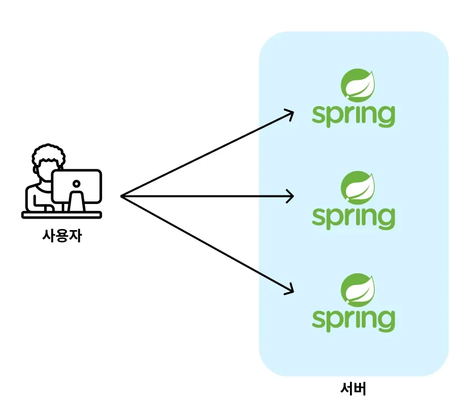
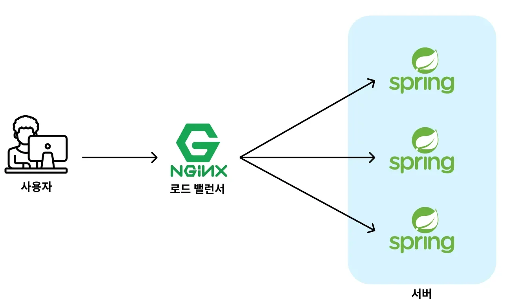
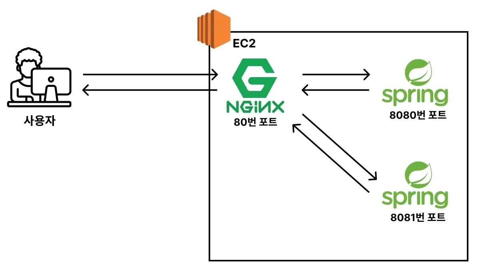
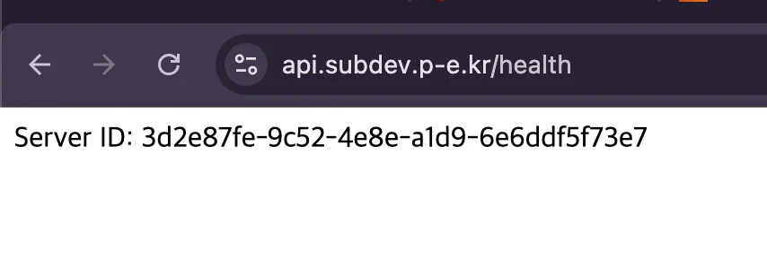
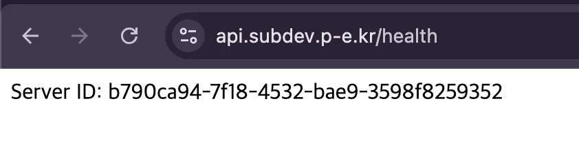

<a id="207eda9b0fe18000bc3fcc4b742e9df1"></a>

##  Nginx를 로드벨런서(Load Balancer)로 사용

---

<a id="207eda9b0fe18018a1c4e67ec6312a71"></a>

### <code>로드벨런서</code>란?

> ✏️ 
> 
> <a id="207eda9b0fe18044bcd3f2d7bcd0c6be"></a>
> 
> <strong><u>로드 밸런서(Load Balancer)</u></strong>란 <strong><u>트래픽을 적절하게 분배해주는 장치</u></strong>이다&#46;



<a id="207eda9b0fe18010a19ef3b09d3362f1"></a>

애플리케이션이 계속 발전하다 보면 사용자가 증가되고 그에 따른 트래픽도 증가한다&#46; 

<a id="207eda9b0fe180c19b9ff882bb815004"></a>

따라서 증가되는 트래픽을 처리하기 위해서 한 대의 서버로는 사양이 부족한 경우가 발생된다&#46; 이를 해결하기 위해 보통 스케일 아웃을 통해 서버의 개수를 늘린다&#46; 

<a id="207eda9b0fe1800eaf36f096d9f714c7"></a>

여기서  들어오는 트래픽 적절하게 서버로 분산시켜야 효율적으로 많은 트래픽을 처리할 수 있다&#46; 

- 서버를 증설해도 여전히 하나의 서버에서만 처리한다면, 분산 서버 환경의 이점을 얻기 어렵다&#46; <br>비용은 비용대로 나가고, 느린 요청 처리만 계속 된다&#46; 따라서 서버가 다운되거나 유저가 이탈하여 서비스가 망하거나 할수 밖에 없다&#46;



<a id="207eda9b0fe1806aa4c7f2e95063b338"></a>

이를 <code>로드 밸런서(Load Balancer)</code>를 도입함으로써 해결할 수 있다&#46; 

- 로드밸런서는 들어오는 사용자의 요청(트래픽)을 적절하게 서버들에게 분배한다&#46; 

<a id="207eda9b0fe18058b727fa61ee475daa"></a>

로드벨런서를 지원하는 여러 서비스들이 있지만, 이 중 <code>nginx</code>도 로드벨런서의 기능을 할 수 있다&#46; 

<a id="207eda9b0fe1801aaa29e4e9ee732c84"></a>

### 실습) 하나의 EC2에서 백엔드 서버 2개를 로드 밸런싱시키기



1. <strong>EC2에 백엔드 서버(Spring Boot) 2개 띄우기</strong>
    <a id="207eda9b0fe180b6bb1ac53bc565f23b"></a>

    ```bash
    # jar 파일 경로로 이동
    cd ~/nginx-backend-springboot/build/libs

    # 또다른 서버 구동 ( 실행 서버: 2개 )
    nohup java -jar nginx-backend-springboot-0.0.1-SNAPSHOT.jar --server.port=8081 &
    ```

    - 이전 학습을 통해 8080 포트에서 Spring Boot 서버가 실행되고 있다&#46;  ( 만약 아니라면 8080 포트로 서버를 띄우자 )

1. <strong>2개의 서버가 잘 실행되는지 확인</strong>
    <a id="207eda9b0fe1805aaf93cdbf83b3ffe1"></a>

    ```bash
    # 해당하는 포트로 실행되는 프로세스 확인
    lsof -i:8080
    lsof -i:8081
    ```

1. Nginx 설정 변경
    <a id="207eda9b0fe18032bb7df6c5ca6d6f98"></a>

    <strong><code>/etc/nginx/conf&#46;d/websites/api&#46;subdev&#46;p&#45;e&#46;kr&#46;conf</code></strong>

    <a id="207eda9b0fe18040855dc22c43d05a50"></a>

    ```bash
    limit_req_zone $binary_remote_addr zone=mylimit:10m rate=3r/s;

    # 로드 벨런싱 대상 서버들을 upstream이라는 그룹으로 묶음
    # upstream 그룹의 이름은 backend라고 지정
    upstream backend {
            server localhost:8080;
            server localhost:8081;
    }

    server {
            limit_req zone=mylimit;
            limit_req_status 429;
            server_name api.subdev.p-e.kr;
    				
    				# upstream 그룹에서 지정한 서버들로 요청이 분산됨
            location / {
                    proxy_pass http://backend;
            }

        listen 443 ssl; # managed by Certbot
        ssl_certificate /etc/letsencrypt/live/api.subdev.p-e.kr/fullchain.pem; # managed by Certbot
        ssl_certificate_key /etc/letsencrypt/live/api.subdev.p-e.kr/privkey.pem; # managed by Certbot
        include /etc/letsencrypt/options-ssl-nginx.conf; # managed by Certbot
        ssl_dhparam /etc/letsencrypt/ssl-dhparams.pem; # managed by Certbot
    }

    server {
        if ($host = api.subdev.p-e.kr) {
            return 301 https://$host$request_uri;
        } # managed by Certbot


            listen 80;
            server_name api.subdev.p-e.kr;
        return 404; # managed by Certbot
    }
    ```

1. 변경된 Nginx 설정 적용
    <a id="207eda9b0fe1807ca6b9cfb1f53e68bc"></a>

    ```bash
    # Nginx 설정 파일들 중 문법 오류가 발생 됐는지 확인
    sudo nginx -t

    # Nginx 재로딩 - 변경된 설정 파일 적용
    sudo nginx -s reload
    ```

1. 로드벨런싱 적용 확인
    

    

    - 2개의 서버가 요청마다 번갈아가면서 처리하는 것을 확인할 수 있다&#46;
