- 이전 정리 내용&#58; <a href="#/post/1e4eda9b-0fe1-805a-9397-cd18590fb649">페이지</a> 

### Route 53

---

> 📖 
> 
> 
> 
> AWS에서 제공하는 DNS(Domain Name System) 서비스이다&#46; 
> 
> - DNS&#58; 도메인을 발급하고 관리하는 서비스

<strong>DNS ( Domain Name System )</strong>

> ✏️ 
> 
> 
> 
> <code>도메인</code>은 <u>www&#46;naver&#46;com</u>, <u>daum&#46;net</u>, <u>youtube&#46;com</u>  과 같이 문자로 표현된 인터넷 주소를 의미한다&#46; 

도메인(Domain)이 없던 시절, 특정 컴퓨터와 통신하기 위해서는 IP 주소( ex, <code>12&#46;235&#46;123&#46;13</code>)를 사용했다&#46; 

- <code>IP 주소</code>는 인터넷에서 특정 컴퓨터는 식별하는 역할을 한다&#46; 

하지만 IP 주소는 4개의 8bit로 이루어진 값(<code>IPv4</code> 기준)이기 때문에 사람이 기억하기에는 어려움이 있었다&#46; 이를 해결하기 위해 나온 기술이 DNS이다&#46;

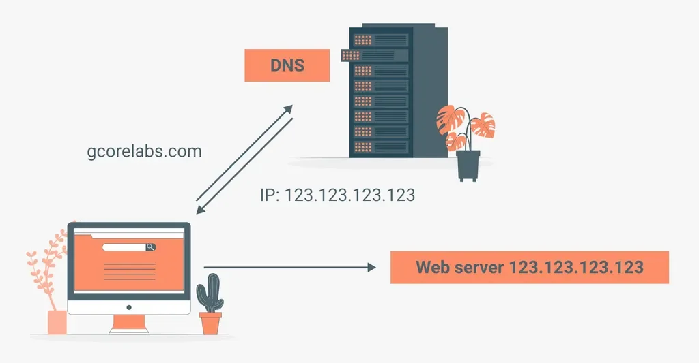

사용자는 <code>Domain</code>이라는 사람이 기억하기 쉬운 <strong><u>문자</u></strong><strong>로 요청을 보낸다&#46; </strong>그리고 DNS 서버를 통해 실제 서버로 요청을 날릴 수 있도록 IP주소 변환한다&#46;  

- 해당하는 도메인(문자)으로 요청 시,<code>DNS</code>(Domain Name System) 서버에서 매핑된 IP 주소 변환하여 다시 클라이언트에게 전송한다&#46;

-  클라이언트는 DNS에서 받아온 IP주소를 통해 실제 웹 서버로 요청을 날린다&#46; 

현업에서의 Route53 활용 여부

프론트 웹 페이지든 백엔드 서버든 일반적으로 IP를 기반으로 통신하지 않고 도메인을 기반으로 통신하다&#46; 

여러 이유가 있지만, 그중 핵심 원인은 HTTPS 적용 때문이다&#46;  도메인 주소가 있어야 HTTPS 적용이 가능하다&#46;

- IP주소에는 HTTPS 적용할 수 없다&#46; 

HTTPS는 통신에 있어서 최소한의 보안 조치이다&#46; 따라서 외부에 노출되는 모든 서비스에서는 HTTPS가 필수적으로 적용되어야 한다&#46;

따라서 서비스 운영 시, 도메인은 필수적이다&#46; 

DNS 역할을 제공하는 서비는 AWS Route 53 뿐만 아니라 다양하게 존재한다&#46; 

- 가비아(gabia), 후이즈(whois) 등

따라서 현업에서는 무조건적으로 AWS Route 53을 고집하지 않는다&#46;  왜냐면 각 서비스마다 구매할 수 있는 도메인의 종류가 다르기 때문이다&#46; 

예를 들어, 가비아(gabia)에는 내가 원하는 도메인이 있는데, AWS Route 53 없을 수 있다&#46; 따라서 원하는 도메인이 존재하는 DNS 서비스르 활용한다&#46;

실습) Route 53에서 도메인 구매

1. 
    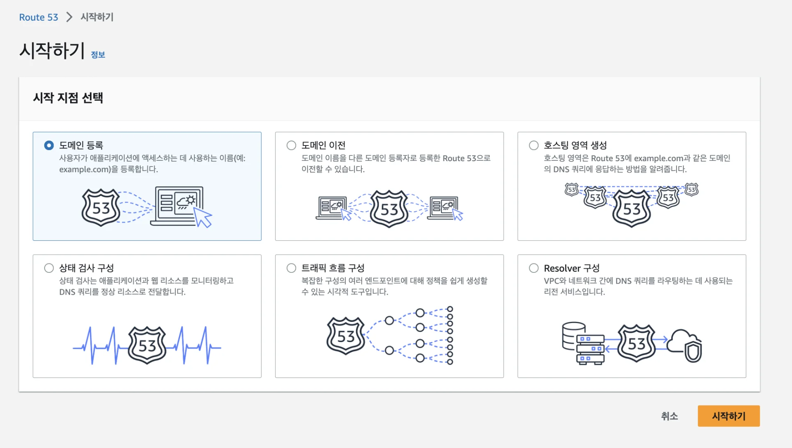

1. 
    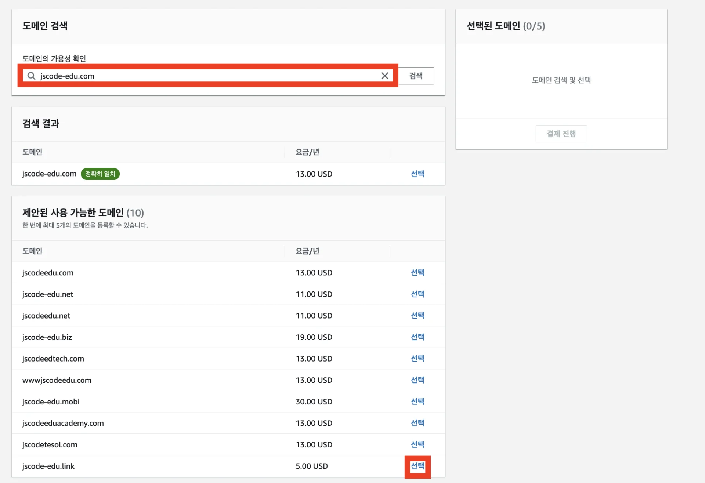

1. 
    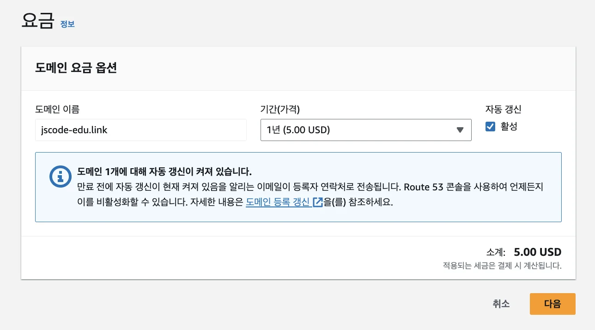

1. 
    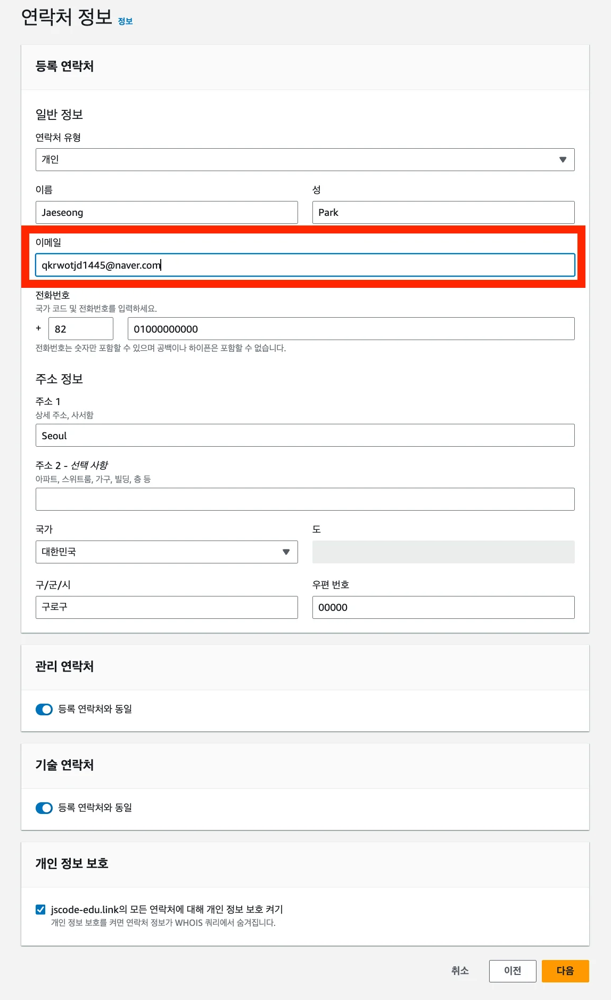

    

    <strong>주의) </strong>다른 건 몰라도 이메일은 정확히 입력해야 한다&#46; 10&#126;20분 있다가 등록한 이메일로 메일이 날라온다&#46; 이 메일을 확인해야만 정상적으로 도메인이 등록된다&#46; 

    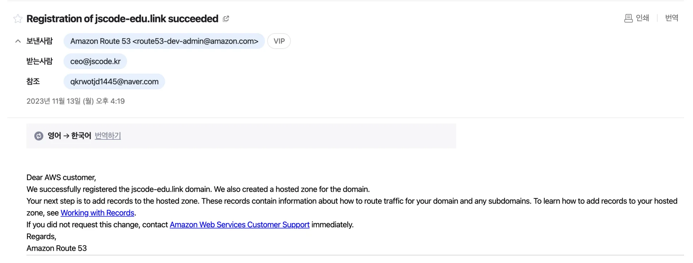

1. 
    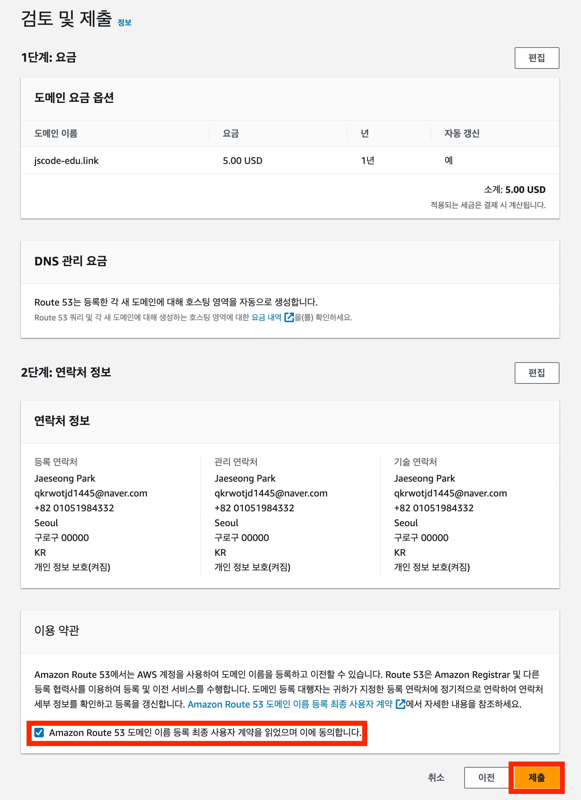

### ✅ 도메인 구매 잘 됐는 지 확인하기

<strong>&#91;호스팅 영역&#93;</strong>

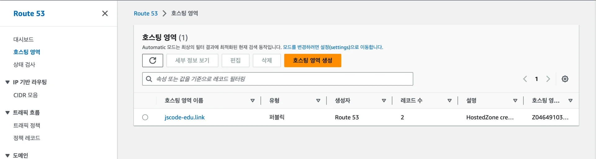

<strong>&#91;등록된 도메인&#93;</strong>

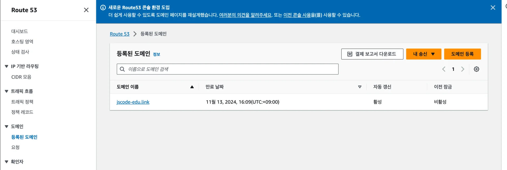

위와 같이 <strong><u>등록된 도메인</u></strong>은 도메인을 구매한 시점으로부터 10&#126;20분 뒤에 등록된다&#46; 

실습)  Route53의 도메인, EC2에 연결

1. <strong>Route 53의 </strong><strong><code>호스팅 영역</code></strong><strong> 메뉴에 들어가서 </strong><strong><code>레코드 생성</code></strong><strong> 버튼 누르기</strong>
    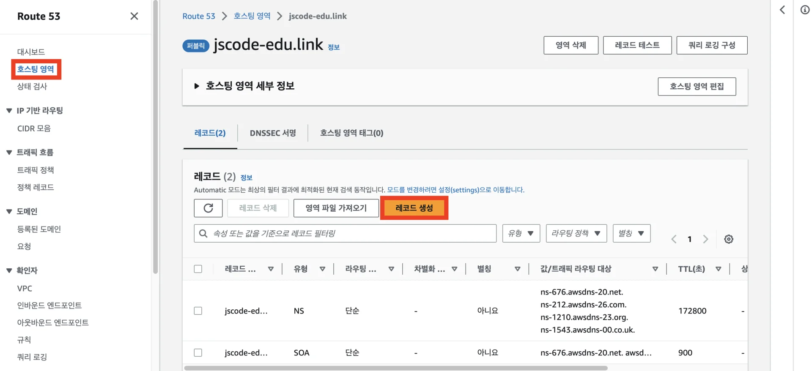

    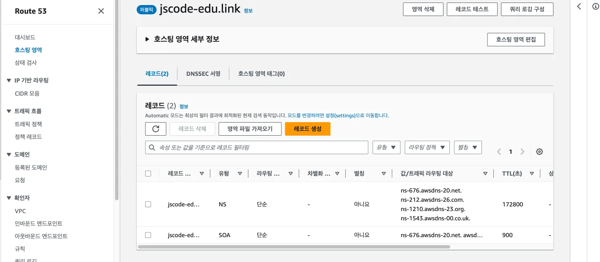

1. <strong>레코드 생성하기</strong>
    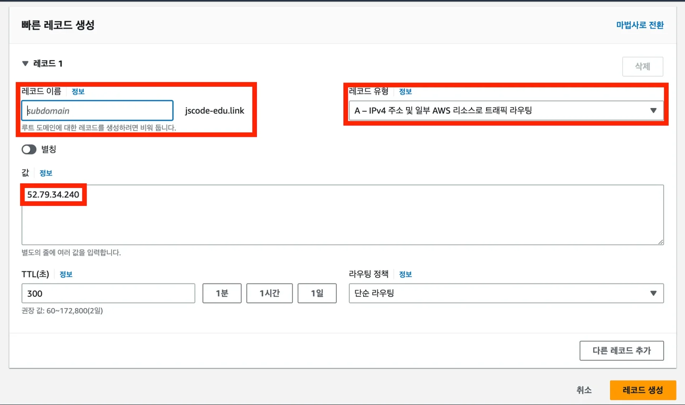

    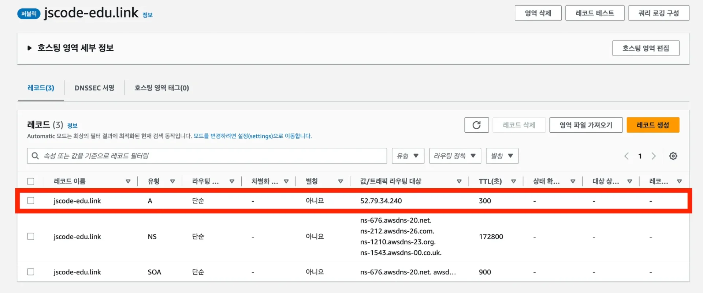

    -  <code>jscode&#45;edu&#46;link</code>의 도메인으로 접속 시, <code>52&#46;79&#46;34&#46;240</code>의 IP 주소로 연결시킨다&#46; 

    > ✏️ 
    > 
    > 
    > 
    > 하나의 도메인만 구매하더라도 여러 개의 서브 도메인을 사용할 수 있다&#46; 
    > 
    > - 주 도메인&#58; <code>jscode&#45;edu&#46;link</code>
    > 
    > - 서브 도메인&#58; <code>&#95;&#95;&#95;&#46;jscode&#45;edu&#46;link</code> 

1. <strong>잘 접속되는 지 확인하기</strong>
    > 💬 
    > 
    > 
    > 
    > A 레코드로 추가하고나서 도메인이 적용되는데 5&#126;10분 정도 걸린다&#46;

    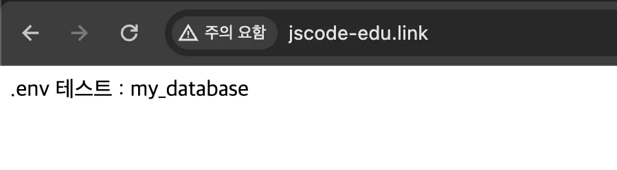

레코드 유형

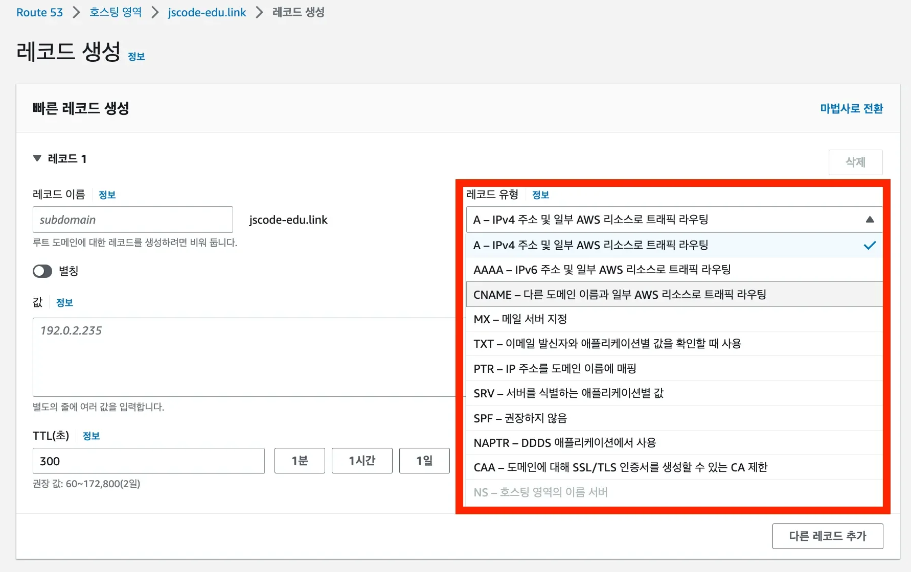

> ✏️ 
> 
> 
> 
> DNS에 공통적으로 있는 설정 중 하나가 <strong><u>레코드 유형</u></strong>이다&#46;  많은 레코드 유형이 있지만 <strong><u>2가지(A 레코드, CNAME 레코드)</u></strong>만 확실히 알고 있으면 충분하다

- <strong><code>A 레코드</code></strong>
    - 도메인을 <strong><u>특정 IPv4 주소에 연결</u></strong>시키고 싶을 때 사용하는 레코드 유형 

- <code>CNAME 레코드</code>
    - 도메인을 <strong><u>특정 도메인 주소에 연결</u></strong>시키고 싶을 때  사용하는 레코드 유형

    - ex)
        - CNAME의 레코드 값으로 <code>www&#46;naver&#46;com</code>을 설정했다면, 해당 도메인으로 접속 시 <code>www&#46;naver&#46;com</code>으로 연결된다&#46; 

실습용 무료 도메인 사용

> ☝🏻 
> 
> 
> 
> 무료 도메인은 불안정하다&#46; 
> 
> 
> 
> 따라서 실제 운영 서비스에서는 도메인을 구입해 사용하는 것을 권장한다&#46; 
> 
> - 중간에 도메인 접속이 끊기기도 한다&#46; 즉, 서비스가 중단된다&#46; 

✅ 참고 자료

[내도메인&#46;한국 &#45; 한글 무료 도메인 등록센터]()

[무료 도메인 서비스 내도메인&#46;한국 사용 방법]()

