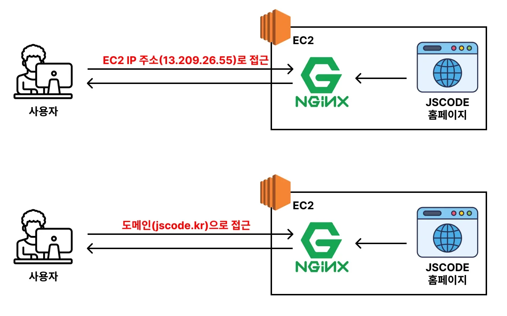
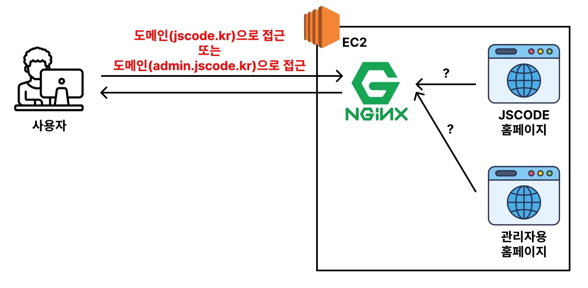
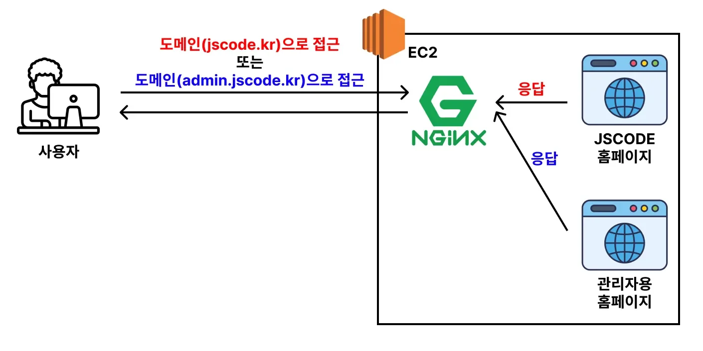
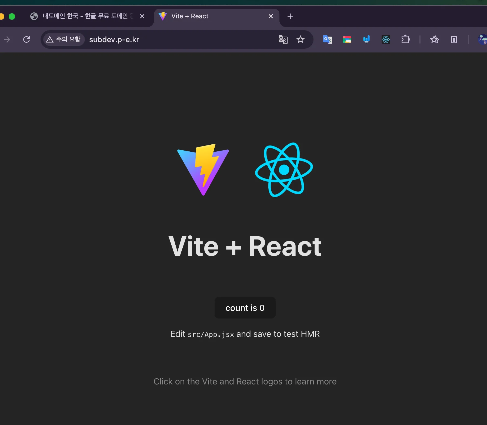
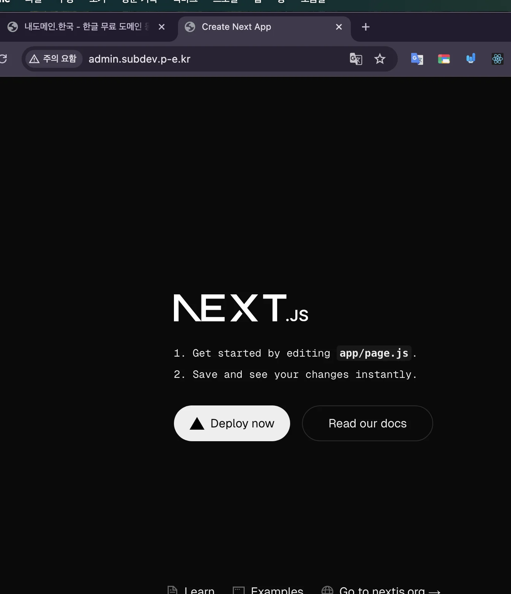

<a id="206eda9b0fe18081bda3c87da70d3fc1"></a>

## 하나의 서버에 여러 웹사이트 베포하기(멀티 도메인)

<details>
<summary>이론</summary>

<a id="206eda9b0fe180e58cbefd2df25fe9f1"></a>

일반적으로 배포된 웹 사이트를 보면 <strong><u>IP 주소</u></strong>로 접근하지 않고 <strong><u>도메인 주소</u></strong>로 접근을 한다&#46; 

- 자세한 내용은 이전 챕터 참고&#58; <a href="#/post/203eda9b-0fe1-80b4-a452-d78186e11df2">페이지</a> 



<a id="206eda9b0fe180abbe0df5b1a7d48a9e"></a>

도메인을 연결시킬 때 <strong><u>도메인 주소</u></strong>와 <strong><u>EC2 IP 주소</u></strong>를 연결시킨다&#46; 

<a id="206eda9b0fe18091bde4c47a65540a98"></a>

그러면 도메인 주소로 접근했을 때 DNS를 통해 IP 주소로 변환되어 실제 웹 서버로 요청을 전송한다&#46; 

- 주소창에 <strong><code>jscode&#46;kr</code></strong>로 입력하는 순간, <strong><code>13&#46;209&#46;26&#46;55</code></strong>로 변환해서 요청을 보낸다&#46;

- 그럼 <code>Nginx</code>가 웹 사이트에 필요한 파일(HTML, CSS, JS, 이미지 파일 등)로 응답한다&#46;

> 🧐 그렇다면 여기서 하나의 서버에 두 종류의 웹사이트를 베포하고 싶다면 어떻게 해야할까?



<a id="206eda9b0fe1809f80dcce32be3a2ae6"></a>

두 종류의 웹 사이트를 배포한다고 하더라도, 각각의 웹 사이트마다 도메인을 가지고 있는 경우가 일반적이다&#46; 

- ex) 
    - JSCODE 홈페이지&#58; <code>jscode&#46;kr</code> 도메인 주소로 접근

    - 관리자용 홈페이지&#58; <code>admin&#46;jscode&#46;kr</code> 도메인 주소로 접근



<a id="206eda9b0fe180709a99f518d19a5add"></a>

그런데 <strong><u>도메인 주소는 IP 주소와 매핑</u></strong>되어 웹 서버에 요청을 보낸다&#46; 

<a id="206eda9b0fe180e9bba8e3c98125eedc"></a>

따라서 여러 도메인 주소가 동일한 EC2 IP 주소에 매핑된다&#46; 

- <code>jscode&#46;kr</code>의 도메인, EC2의 IP 주소(ex&#46; <code>13&#46;209&#46;26&#46;55</code>)에 연결

- <code>admin&#46;jscode&#46;kr</code>의 도메인도 <strong><u>동일한 EC2의 IP 주소</u></strong>(ex&#46; <code>13&#46;209&#46;26&#46;55</code>)에 연결

<a id="206eda9b0fe180b194e6f91f13b8d62a"></a>

따라서 <code>Nginx</code>는 어떤 도메인 주소로 요청이 들어오는가에 따라, 이를 구분하고 그에 맞는 웹 사이트로 응답할 수 있어야 한다&#46; 

<a id="206eda9b0fe180379470f08bf986393f"></a>

그리고 이에 대한 기능을 지원한다&#46; 

</details>

<details>
<summary>무료 도메인 생성 및 서브 도메인 연결</summary>

[내도메인&#46;한국 &#45; 한글 무료 도메인 등록센터]()

<a id="206eda9b0fe180a99184f75530629aee"></a>

<a href="https://beautiful-college-c84.notion.site/16811062ff0780afaf36f8ec7e158af9">페이지</a> 

- 주 도메인&#58; <code>subdev&#46;p&#45;e&#46;kr</code>

- 서브 도메인&#58; <code>admin&#46;subdev&#46;p&#45;e&#46;kr</code>

</details>

<details>
<summary>nginx 멀티도메인 연결</summary>

1. 기존 Nginx 설정 파일 삭제
    <a id="206eda9b0fe18032b5b8f1e61a385742"></a>

    ```bash
    cd /etc/nginx/conf.d
    sudo rm default.conf
    ```

1. Nginx 설정 파일 작성
    <a id="206eda9b0fe18019b6c3f43e1aa4f817"></a>

    ```bash
    sudo vi default.conf
    ```

    <a id="206eda9b0fe1809ba3cac392ebf72320"></a>

    <code>/etc/nginx/conf&#46;d/default&#46;conf</code>

    <a id="206eda9b0fe1807aac03c218e900ffa0"></a>

    ```bash
    server {
            listen 80;
            server_name subdev.p-e.kr;

            location / {
                     root /usr/share/nginx/nginx-frontend-react/dist;
                     index index.html;
            }
    }

    server {
            listen 80;
            server_name admin.subdev.p-e.kr;

            location / {
                     root /usr/share/nginx/nginx-frontend-next/out;
                     index index.html;
            }
    }
    ```

    - <code>server&#95;name</code>&#58; 도메인 주소 명시

    - <code>root</code>&#58; 정적 파일 경로 명시

1. Nginx 설정 파일 반영
    <a id="206eda9b0fe180e69161c610507c8081"></a>

    ```bash
    # 설정 파일들 중 문법 오류 확인
    sudo nginx -t

    # Nginx 재로딩
    sudo nginx -s reload
    ```

1. <strong>도메인 적용 확인</strong>
    

    - <a href="http://subdev.p-e.kr/">http&#58;//subdev&#46;p&#45;e&#46;kr/</a>&#58; React

    

    - <a href="http://admin.subdev.p-e.kr/">http&#58;//admin&#46;subdev&#46;p&#45;e&#46;kr/</a>&#58; Next&#46;js

</details>
