<details>
<summary>실행 결과</summary>

1. 도메인 소유 확인 (HTTP&#45;01 방식)
    - Nginx 루트 경로에 <code>/&#46;well&#45;known/acme&#45;challenge/</code> 폴더를 만들어 접근 테스트

1. 인증서 발급
    - /etc/letsencrypt/live/subdev&#46;p&#45;e&#46;kr/에 인증서와 키 저장

1. Nginx 설정 자동 변경
    - 기존 80포트 설정에 대해 443 포트 HTTPS 블록 추가

1. Nginx 자동 reload

</details>

<a id="206eda9b0fe180fc8116dfa768c0dbdc"></a>

## Nginx를 활용한 HTTPS 적용

> 📖 
> 
> <a id="206eda9b0fe180a18db2ea03b99db871"></a>
> 
> Nginx를 활용하여 <code>HTTPS</code> 적용시킬 수 있다&#46;        
> 
> 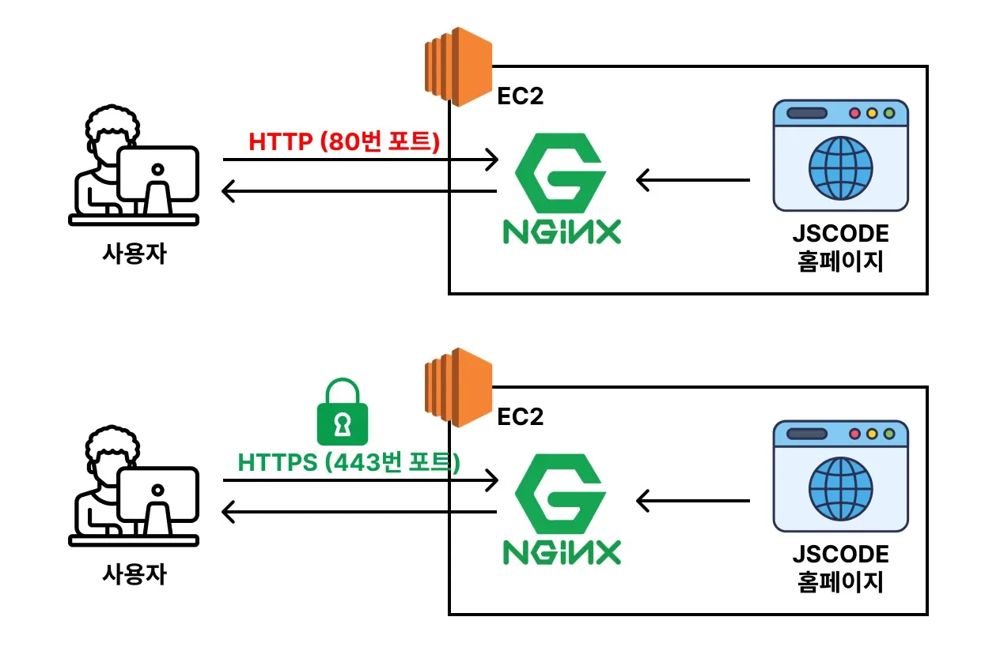
> 
> - Nginx가 사용자(클라이언트) 와 통신할 때, HTTPS를 활용해 암호화된 정보를 주고 받는다&#46;

<details>
<summary>HTTPS 를 적용해야 하는 이유</summary>

> 이전 정리 내용&#58; <a href="#/post/175eda9b-0fe1-8080-9dbf-e67e9f4d0908">페이지</a> 

1. 보안
    <a id="206eda9b0fe180e18b37d7643d206980"></a>

    클라이언트와 서버 간의 데이터를 주고 받을 때, 암호화하여 통신하지 않으면 누군가 중간에 데이터를 가로채면 해당 데이터가 바로 악용될 수 있다&#46; 이 때문에 데이터가 탈취 당해도 악용될 수 없도록 최소한의 보안 장치가 HTTP 통신 프로토콜에 데이터 암호화를 더하는 HTTPS 통신이다&#46; 

1. 사용자 이탈
    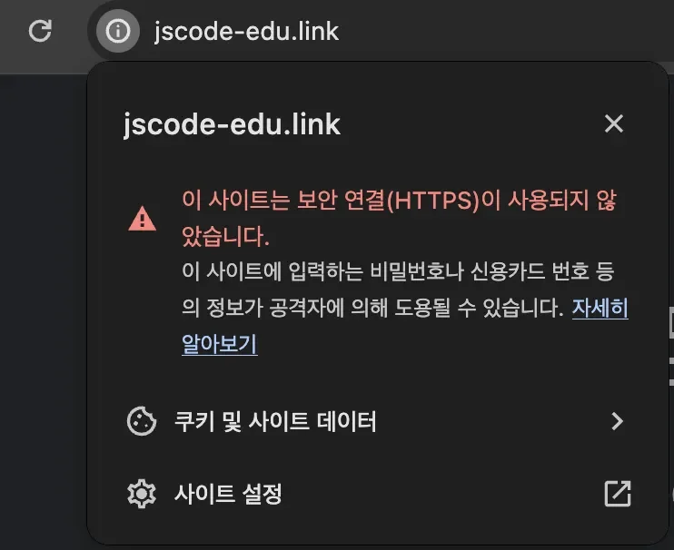

    <a id="206eda9b0fe180248fbde1f8ee0d30e2"></a>

    위에서 설명했듯이 <code>HTTPS</code>는 최소한의 보안 조치이다&#46; 

    <a id="206eda9b0fe18096935ddf19bc105795"></a>

    따라서 웹 사이트에 <code>HTTPS</code>가 적용되어 있지 않다면, 사용자에게 신뢰성을 주지 못한다&#46; 

    - 사용자의 데이터가 탈취 당하면 바로 악용 가능

1. 협업(실무)
    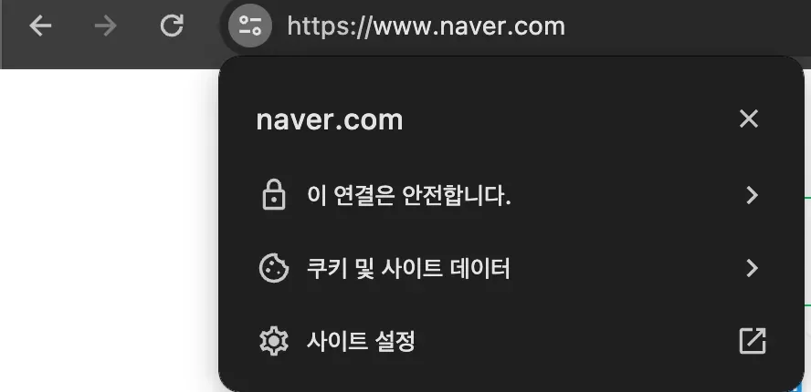

    <a id="206eda9b0fe180969c86d963512c3ebe"></a>

    따라서 실무에서는 대부분의 웹 사이트에서 HTTPS를 적용시킨다&#46;

</details>

<details>
<summary><strong>&#91;실습&#93;</strong> Nginx, Certbot을 활용한 <code>HTTPS</code> 적용</summary>

<details>
<summary>reference</summary>

[Certbot Instructions]()

</details>

1. <strong>Certbot</strong> 설치
    > ✏️ 
    > 
    > <a id="206eda9b0fe180748fdad4ed84f66423"></a>
    > 
    > <code>Certbot</code>은 <u>Let’s Encrypt</u>에서 제공하는 무료 <strong><u>SSL/TLS 인증서</u></strong><u>를 쉽게 발급받고 갱신</u>할 수 있도록 도와주는 <strong>자동화 도구이다&#46;</strong>
    > 
    > <details>
    > <summary>Certbot의 핵심 기능</summary>
    > 
    > |  |  |
    > | --- | --- |
    > | <strong>기능</strong> | <strong>설명</strong> |
    > | 인증서 발급 | Let’s Encrypt에서 무료 SSL 인증서를 발급받음 |
    > | 인증서 갱신 | 기본적으로 90일 유효, 자동 갱신 스크립트 제공 (cron, systemd) |
    > | 웹 서버 연동 | nginx, apache 설정을 자동 수정하여 HTTPS 활성화 가능 |
    > | 도메인 검증 | HTTP&#45;01(웹서버에 파일 업로드) 방식, DNS&#45;01(도메인 TXT 레코드) 방식 |
    > 
    > </details>

    <a id="206eda9b0fe180a8a337dcd581cbf060"></a>

    ```bash
    # certbot 설치
    sudo snap install --classic certbot

    # 리눅스에서 certbot 명령어를 어디서든 실행할 수 있도록 심볼릭 링크(바로가기) 생성
    sudo ln -s /snap/bin/certbot /usr/bin/certbot
    ```

1. HTTPS 인증서 발급받기
    > ⚠️ 
    > 
    > - <strong><u> 반드시 도메인을 먼저 연결</u></strong>한 뒤에 <strong><u>인증서를 발급</u></strong>해야 정상 작동한다&#46;
    > 
    > <details>
    > <summary>도메인 이름에 <code>/</code>가 포함되면 안된다&#46; </summary>
    > 
    > <a id="206eda9b0fe180959e9ee906dca5b4d0"></a>
    > 
    > ```bash
    > sudo certbot --nginx -d subdev.p-e.kr/
    > ```
    > 
    > 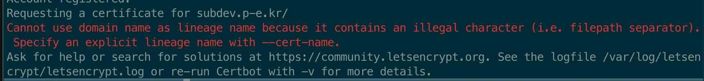
    > 
    > - 포함 시, 위와 같이 <code>illegal character</code> 오류가 발생된다&#46; 
    > 
    > </details>

    <a id="206eda9b0fe18085aeedfc21ba067d94"></a>

    ```bash
    sudo certbot --nginx -d <도메인 주소>

    # ex)
    sudo certbot --nginx -d subdev.p-e.kr
    sudo certbot --nginx -d admin.subdev.p-e.kr
    ```

    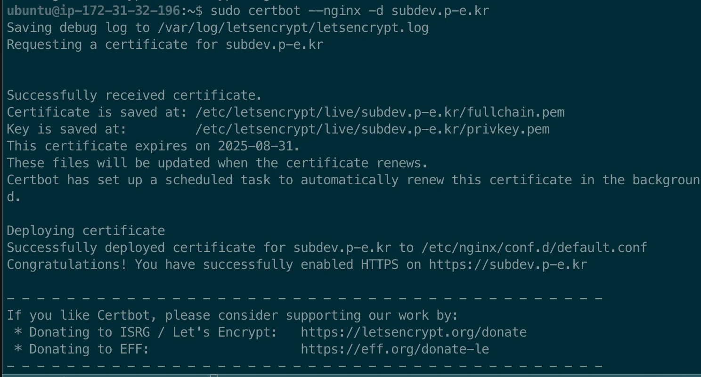

    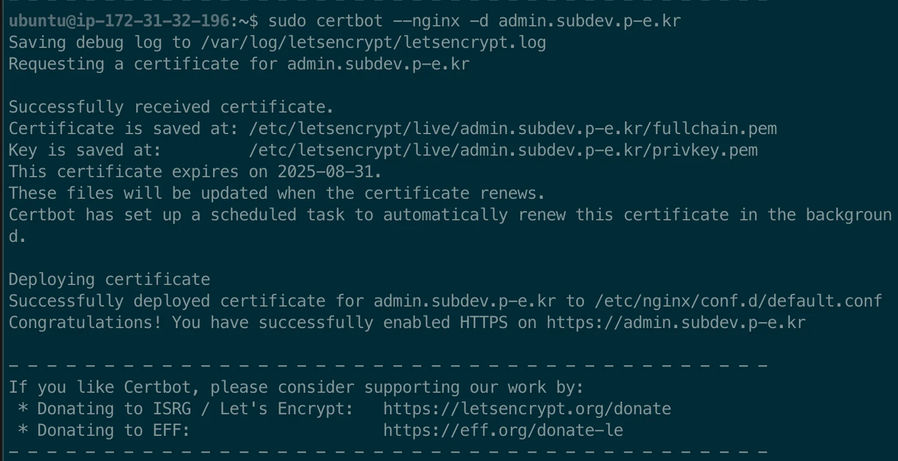

    <details>
    <summary><strong> 명령어 해석</strong></summary>

    | <strong>구성 요소</strong> | <strong>의미</strong> |
    | --- | --- |
    | <code>sudo</code> | 관리자 권한으로 실행 (인증서 발급 및 Nginx 설정을 변경하기 위해 필요) |
    | <code>certbot</code> | Let’s Encrypt에서 SSL 인증서를 발급받는 도구 |
    | <code>&#45;&#45;nginx</code> | Certbot이 <strong>Nginx 웹 서버의 설정을 자동으로 감지하고 수정</strong>하도록 지정 |
    | <code>&#45;d subdev&#46;p&#45;e&#46;kr</code> | 인증서를 발급받을 <strong>도메인 이름(domain)</strong> 지정 |

    </details>

1. HTTPS 적용 확인
    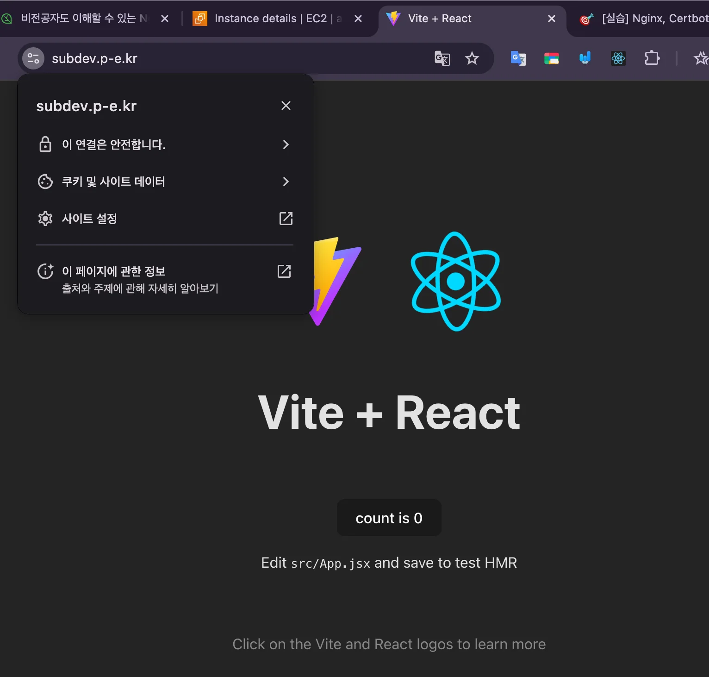

    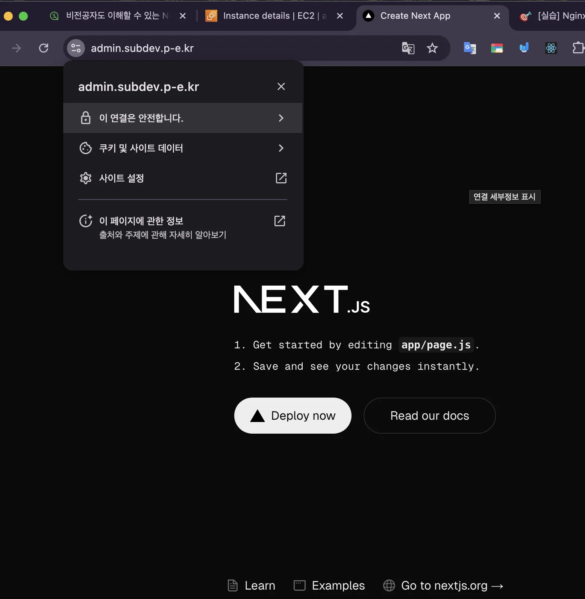

</details>

<details>
<summary>Nginx, Certbot에서 자동으로 작성된 HTTPS 관련 코드 해석</summary>

> 🗣 
> 
> <a id="206eda9b0fe1805499add73d591d6df1"></a>
> 
> Certbot이 작성한 아래 코드는 직접 작성할 수 있을 필요까지는 없다&#46; 다만, 대략적으로 어떤 의미를 가지고 있는 지 해석할 수는 있어야 한다&#46; 

<a id="206eda9b0fe18081b0a4ed6bfb27614a"></a>

<strong><code>/etc/nginx/conf&#46;d/default&#46;conf</code></strong>

<a id="206eda9b0fe180b3852cd583f2398db0"></a>

```bash
# server 블록에서는 일반적으로 listen, server_name을 가장 먼저 처리한다.
server {
				# subdev.p-e.kr 주소로 들어온 요청이면서
		    # 443번 포트(https)로 들어오는 요청일 때 
		    # 이 server 블럭에서 처리하도록 설정
        server_name subdev.p-e.kr;

        location / {
                root /usr/share/nginx/nginx-frontend-react/dist;
                index index.html;
        }

    listen 443 ssl; # managed by Certbot
    
    # (HTTPS 처리 과정에 필요한 로직 -> 자세히는 몰라도 됨)
    ssl_certificate /etc/letsencrypt/live/subdev.p-e.kr/fullchain.pem; # managed by Certbot
    ssl_certificate_key /etc/letsencrypt/live/subdev.p-e.kr/privkey.pem; # managed by Certbot
    include /etc/letsencrypt/options-ssl-nginx.conf; # managed by Certbot
    ssl_dhparam /etc/letsencrypt/ssl-dhparams.pem; # managed by Certbot
}

server {
		    # admin.jscode.p-e.kr 주소로 들어온 요청이면서
		    # 443번 포트(https)로 들어오는 요청일 때 
		    # 이 server 블럭에서 처리하도록 설정
        server_name admin.subdev.p-e.kr;

				location / {
					 root /usr/share/nginx/nginx-frontend-next/out;
					 index index.html;
				}

    listen 443 ssl; # managed by Certbot
    
    # (HTTPS 처리 과정에 필요한 로직 -> 자세히는 몰라도 됨)
    ssl_certificate /etc/letsencrypt/live/admin.subdev.p-e.kr/fullchain.pem; # managed by Certbot
    ssl_certificate_key /etc/letsencrypt/live/admin.subdev.p-e.kr/privkey.pem; # managed by Certbot
    include /etc/letsencrypt/options-ssl-nginx.conf; # managed by Certbot
    ssl_dhparam /etc/letsencrypt/ssl-dhparams.pem; # managed by Certbot
}


server {

		# 2. 들어온 요청의 주소의 Host가 subdev.p-e.kr일 경우 (ex. http://subdev.p-e.kr/about)
		#    https://subdev.p-e.kr/...(ex. https://subdev.p-e.kr/about)로 리다이렉트(301) 처리
    if ($host = subdev.p-e.kr) {
        return 301 https://$host$request_uri;
    } # managed by Certbot

    # 1. subdev.p-e.kr 주소로 들어온 요청이면서
    #    80번 포트(http)로 들어오는 요청일 때
    #    이 server 블럭에서 처리하도록 설정
        listen 80;
        server_name subdev.p-e.kr;
        
    # 3. 그 이외의 경우에는 404(Not Found)로 응답
    return 404; # managed by Certbot


}

server {
		# 2. 들어온 요청의 주소의 Host가 admin.subdev.p-e.kr일 경우 (ex. http://admin.subdev.p-e.kr/about)
		#    https://admin.subdev.p-e.kr/...(ex. https://admin.subdev.p-e.kr/about)로 리다이렉트(301) 처리
    if ($host = subdev.p-e.kr) {
        return 301 https://$host$request_uri;
    } # managed by Certbot


    # 1. admin.subdev.p-e.kr 주소로 들어온 요청이면서
    #    80번 포트(http)로 들어오는 요청일 때
    #    이 server 블럭에서 처리하도록 설정
        listen 80;
        server_name admin.subdev.p-e.kr;
        
    # 3. 그 이외의 경우에는 404(Not Found)로 응답
    return 404; # managed by Certbot
}
```

<details>
<summary>이미지</summary>

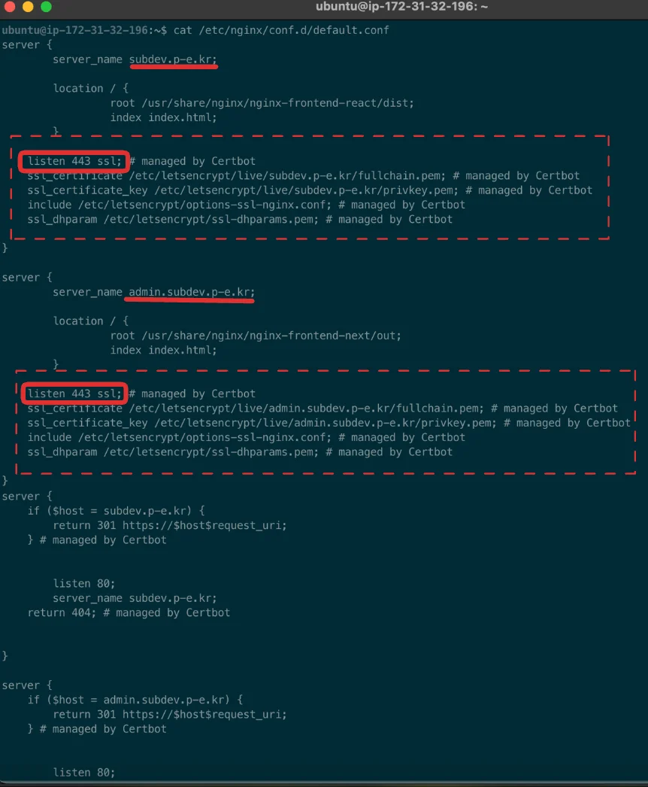

</details>

</details>

<details>
<summary><code>HTTP</code>로 요청, <code>HTTPS</code>로 요청</summary>

> ✏️ 
> 
> <a id="206eda9b0fe1807290b0c6a111f11801"></a>
> 
> <code>프로토콜 명시X</code>, <code>http</code>, <code>https</code>로 명시하면 nginx에서 자동으로 <code>https</code>(<code>443 포트</code>)로 리다이렉트 처리한다&#46; 

<details>
<summary>1&#46; HTTP로 요청</summary>

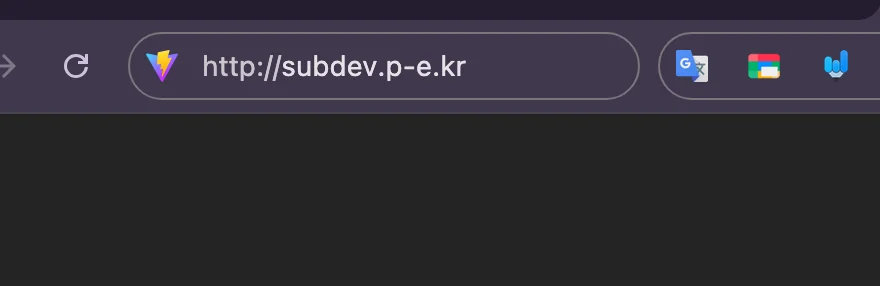

- <code>http&#58;//</code>를 명시하여 요청을 보내면 브라우저가 자동으로 80번 포트로 요청을 보낸다&#46; 

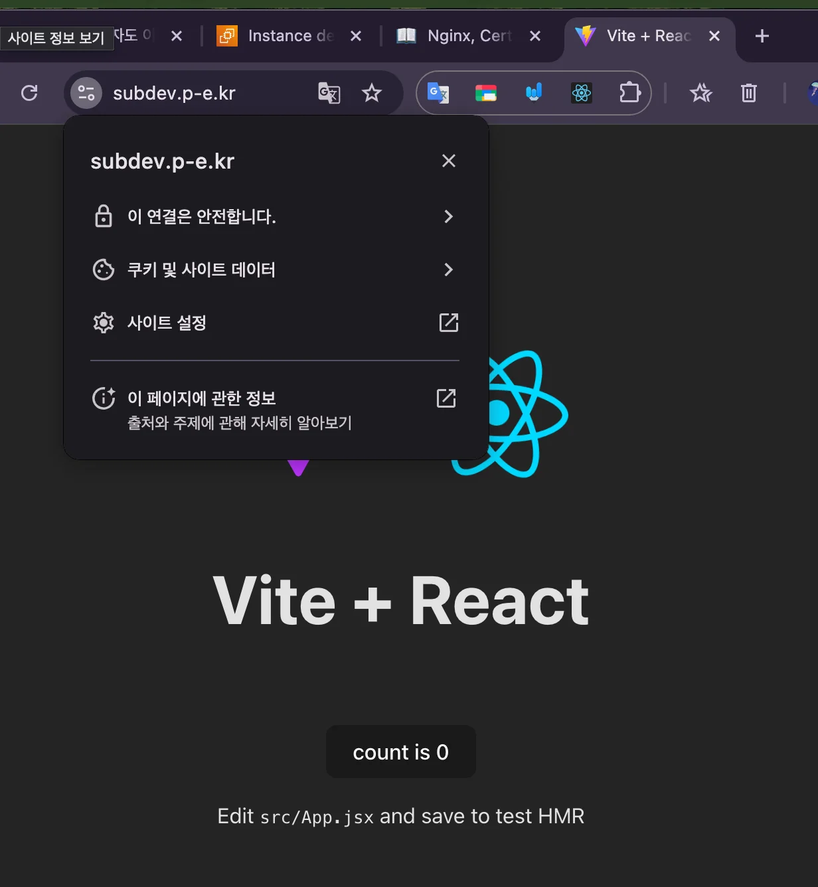

- <code>http&#58;//</code>요청을 보내면 Nginx 내부에서 <code>https&#58;//</code> 즉, <code>443 포트</code>로 리다이렉트하여 응답한다&#46; 

</details>

<details>
<summary>2&#46; HTTPS로 요청</summary>

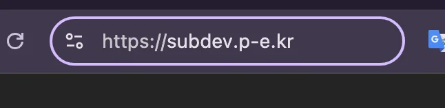

- <code>https&#58;//</code>를 명시하여 요청을 보내면 브라우저가 자동으로 443 포트로 요청을 보낸다&#46;

</details>

<details>
<summary>3&#46; HTTP, HTTPS를 명시적으로 작성하지 않고 요청</summary>


- 프로토콜을 명시하지 않고 도메인 명만을 입력
    - <code>http&#58;//</code> 또는 <code>https&#58;//</code>를 명시하지 않고 요청을 보내면, 브라우저는 자동으로 HTTP(80번 포트)로 요청을 보낸다

    - 하지만 Nginx의 설정에 따라 HTTP(80번 포트)로 요청을 보내면 HTTPS로 리다이렉트 되어 <code>https&#58;//</code>로 변경되어 접속이 된다&#46; 

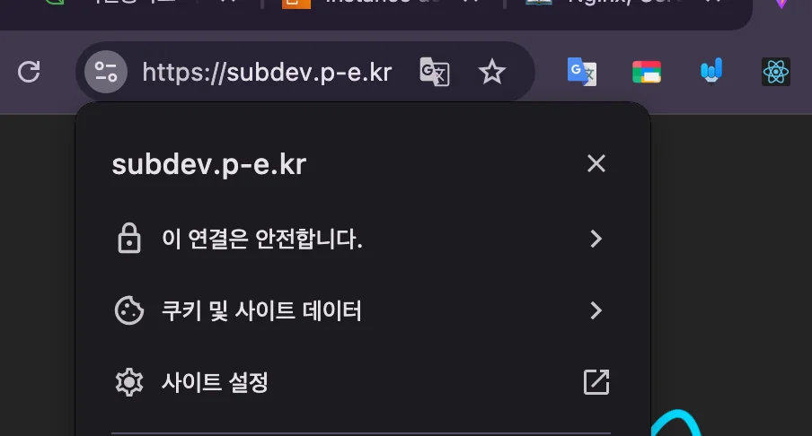

- nginx 내부에서 https(443 포트)로 리다이렉트 처리

</details>

</details>

<details>
<summary>설정 파일 분리해서 관리</summary>

> 📌 
> 
> <a id="206eda9b0fe18047a970e3a9d920bac9"></a>
> 
> <code>default&#46;conf</code> 파일 내 내용을 도메인 별로 분리하고 <code>include</code> 키워드를 통해 분리된 설정 파일을 <code>default&#46;conf</code>로 불러온다&#46; 

<details>
<summary>🧐 왜 설정 파일을 분리해야 하는가?</summary>

<a id="206eda9b0fe1806c8e60db522f965c21"></a>

지금까지 <code>default&#46;conf</code>에 <u>라우팅 설정, 멀티 도메인 설정, https 설정 등</u>이 추가되었다&#46; 

<details>
<summary><strong>&#91;파일&#93; </strong><strong><code>default&#46;conf</code></strong></summary>

<a id="206eda9b0fe180debcc4ec65cfe66d83"></a>

```bash
# server 블록에서는 일반적으로 listen, server_name을 가장 먼저 처리한다.
server {
				# subdev.p-e.kr 주소로 들어온 요청이면서
		    # 443번 포트(https)로 들어오는 요청일 때 
		    # 이 server 블럭에서 처리하도록 설정
        server_name subdev.p-e.kr;

        location / {
                root /usr/share/nginx/nginx-frontend-react/dist;
                index index.html;
        }

    listen 443 ssl; # managed by Certbot
    
    # (HTTPS 처리 과정에 필요한 로직 -> 자세히는 몰라도 됨)
    ssl_certificate /etc/letsencrypt/live/subdev.p-e.kr/fullchain.pem; # managed by Certbot
    ssl_certificate_key /etc/letsencrypt/live/subdev.p-e.kr/privkey.pem; # managed by Certbot
    include /etc/letsencrypt/options-ssl-nginx.conf; # managed by Certbot
    ssl_dhparam /etc/letsencrypt/ssl-dhparams.pem; # managed by Certbot
}

server {
		    # admin.jscode.p-e.kr 주소로 들어온 요청이면서
		    # 443번 포트(https)로 들어오는 요청일 때 
		    # 이 server 블럭에서 처리하도록 설정
        server_name admin.subdev.p-e.kr;

				location / {
					 root /usr/share/nginx/nginx-frontend-next/out;
					 index index.html;
				}

    listen 443 ssl; # managed by Certbot
    
    # (HTTPS 처리 과정에 필요한 로직 -> 자세히는 몰라도 됨)
    ssl_certificate /etc/letsencrypt/live/admin.subdev.p-e.kr/fullchain.pem; # managed by Certbot
    ssl_certificate_key /etc/letsencrypt/live/admin.subdev.p-e.kr/privkey.pem; # managed by Certbot
    include /etc/letsencrypt/options-ssl-nginx.conf; # managed by Certbot
    ssl_dhparam /etc/letsencrypt/ssl-dhparams.pem; # managed by Certbot
}


server {

		# 2. 들어온 요청의 주소의 Host가 subdev.p-e.kr일 경우 (ex. http://subdev.p-e.kr/about)
		#    https://subdev.p-e.kr/...(ex. https://subdev.p-e.kr/about)로 리다이렉트(301) 처리
    if ($host = subdev.p-e.kr) {
        return 301 https://$host$request_uri;
    } # managed by Certbot

    # 1. subdev.p-e.kr 주소로 들어온 요청이면서
    #    80번 포트(http)로 들어오는 요청일 때
    #    이 server 블럭에서 처리하도록 설정
        listen 80;
        server_name subdev.p-e.kr;
        
    # 3. 그 이외의 경우에는 404(Not Found)로 응답
    return 404; # managed by Certbot


}

server {
		# 2. 들어온 요청의 주소의 Host가 admin.subdev.p-e.kr일 경우 (ex. http://admin.subdev.p-e.kr/about)
		#    https://admin.subdev.p-e.kr/...(ex. https://admin.subdev.p-e.kr/about)로 리다이렉트(301) 처리
    if ($host = subdev.p-e.kr) {
        return 301 https://$host$request_uri;
    } # managed by Certbot


    # 1. admin.subdev.p-e.kr 주소로 들어온 요청이면서
    #    80번 포트(http)로 들어오는 요청일 때
    #    이 server 블럭에서 처리하도록 설정
        listen 80;
        server_name admin.subdev.p-e.kr;
        
    # 3. 그 이외의 경우에는 404(Not Found)로 응답
    return 404; # managed by Certbot
}
```

</details>

<a id="206eda9b0fe180d89f7de5bd530fa782"></a>

처음보다 설정 파일 내 많은 내용들이 추가되었다&#46; 실제 서비스를 운영하는 상황에서는 더 많은 내용들이 담길 것이고, 서비스가 커지면 커질수록 해당 설정 파일은 더욱 거대해 질 것이다&#46; 

<a id="206eda9b0fe1804f87e9eccd60df4e34"></a>

이렇게 한 파일에 너무 많은 정보를 담아 관리한다면 가독성이 떨어지고 유지보수하기 어렵다&#46;

<a id="206eda9b0fe1802cb0dbf606b7acb9e9"></a>

이걸 해결하기 위해서 <strong><u>여러 파일로 분리해서 설정 파일을 관리</u></strong>하는 것이 일반적이다&#46; 

</details>

1. 설정 파일 분리
    > ✏️ 
    > 
    > <a id="206eda9b0fe1808db4d4d845e5f13f6f"></a>
    > 
    > <code>/etc/nginx/conf&#46;d/default&#46;conf</code> 파일에 있는 코드 내용을 각 파일에 분리해서 넣는다&#46; 
    > 
    > - 도메인 별로 분리

    <a id="206eda9b0fe1807a9ef7f89053dcfbff"></a>

    ```bash
    # 폴더 생성
    cd /etc/nginx/conf.d
    sudo mkdir websites
    cd websites

    # 설정 파일 분리하여 생성
    sudo vi subdev.p-e.kr.conf
    sudo vi admin.subdev.p-e.kr.conf
    ```

    <details>
    <summary><strong>/etc/nginx/conf&#46;d/websites/</strong><strong><u>subdev&#46;p&#45;e&#46;kr&#46;conf</u></strong></summary>

    <a id="206eda9b0fe1804e802fee107aadba12"></a>

    ```bash
    server {
            server_name subdev.p-e.kr;

            location / {
                    root /usr/share/nginx/nginx-frontend-react/dist;
                    index index.html;
            }

        listen 443 ssl; # managed by Certbot
        
        ssl_certificate /etc/letsencrypt/live/subdev.p-e.kr/fullchain.pem; # managed by Certbot
        ssl_certificate_key /etc/letsencrypt/live/subdev.p-e.kr/privkey.pem; # managed by Certbot
        include /etc/letsencrypt/options-ssl-nginx.conf; # managed by Certbot
        ssl_dhparam /etc/letsencrypt/ssl-dhparams.pem; # managed by Certbot
    }

    server {	
        if ($host = subdev.p-e.kr) {
            return 301 https://$host$request_uri;
        } # managed by Certbot
        
            listen 80;
            server_name subdev.p-e.kr;
            
        return 404; # managed by Certbot
    }

    ```

    </details>

    <details>
    <summary><strong>/etc/nginx/conf&#46;d/websites/</strong><strong><u>admin&#46;subdev&#46;p&#45;e&#46;kr&#46;conf</u></strong></summary>

    <a id="206eda9b0fe1806a821fe2f7e2bd7e4e"></a>

    ```bash
    server {
            server_name admin.subdev.p-e.kr;

            location / {
                    root /usr/share/nginx/nginx-frontend-react/dist;
                    index index.html;
            }

        listen 443 ssl; # managed by Certbot
        
        ssl_certificate /etc/letsencrypt/live/subdev.p-e.kr/fullchain.pem; # managed by Certbot
        ssl_certificate_key /etc/letsencrypt/live/subdev.p-e.kr/privkey.pem; # managed by Certbot
        include /etc/letsencrypt/options-ssl-nginx.conf; # managed by Certbot
        ssl_dhparam /etc/letsencrypt/ssl-dhparams.pem; # managed by Certbot
    }

    server {	
        if ($host = admin.subdev.p-e.kr) {
            return 301 https://$host$request_uri;
        } # managed by Certbot
        
            listen 80;
            server_name admin.subdev.p-e.kr;
        return 404; # managed by Certbot
    }

    ```

    </details>

1. <strong><code>default&#46;conf</code></strong><strong> 파일에서 분리한 설정 파일 불러오기</strong>
    <a id="206eda9b0fe18061a846fa5014aab9a1"></a>

    <strong><u>/etc/nginx</u></strong><strong>/conf&#46;d/default&#46;conf</strong>

    <a id="206eda9b0fe180cea151c825b609a6c0"></a>

    ```bash
    include conf.d/websites/subdev.p-e.kr.conf;
    include conf.d/websites/admin.subdev.p-e.kr.conf;
    ```

    - 기준 경로가 <code>/etc/nginx</code>이기 때문에 위와 같이 경로 설정을 했다&#46;

1. 변경된 Nginx 설정 파일 반영
    <a id="206eda9b0fe180b18292fe3a370716dc"></a>

    ```bash
    # 설정 파일들 문법 checking
    sudo nginx -t

    # nginx 재로딩, 변경된 설정 파일 반영
    sudo nginx -s reload
    ```

1. 정상 동작 확인
    

    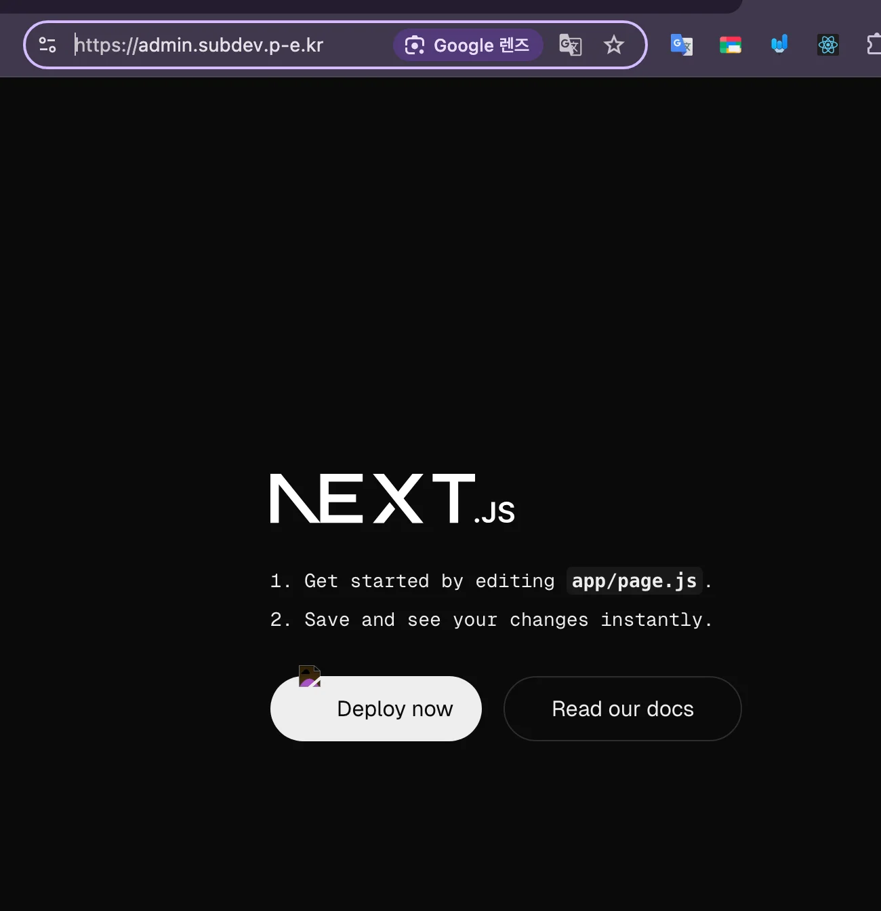

1. include 한 줄 삭제
    <a id="206eda9b0fe180ada927d2176785bbe3"></a>

    /etc/nginx/conf&#46;d/default&#46;conf

    <a id="206eda9b0fe1803a97eec9b18babcfc0"></a>

    ```bash
    include conf.d/websites/jscode.p-e.kr.conf;
    include conf.d/websites/admin.jscode.p-e.kr.conf;
    ```

    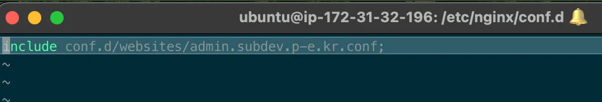

    <a id="206eda9b0fe18029b2f5c14ae719ddb3"></a>

    ```bash
    # 설정 파일들 문법 checking
    sudo nginx -t

    # nginx 재로딩, 변경된 설정 파일 반영
    sudo nginx -s reload
    ```

    

    - <code>subdev&#46;p&#45;e&#46;kr&#46;conf</code> 접속 시 강의랑 다르게 설정한 <code>admin&#46;subdev&#46;p&#45;e&#46;kr&#46;conf</code>로 접속이 된다&#46; 
        - 내부적으로 오류페이지 보다는 설정된 다른 페이지를 redirect 처리하는 것이 더 효율적이라 판단? 하여 이렇게 동작하는 것 같다&#46; 

        - 자세한 내용 추가 조사 필요

1. <strong>와일드카드(&#42;)를 활용해 설정 간결하게 추가</strong>
    <a id="206eda9b0fe180ecabd6f05944e875b8"></a>

    <strong>/etc/nginx/conf&#46;d/default&#46;conf</strong>

    <a id="206eda9b0fe180c2afa4e54d035cc455"></a>

    ```bash
    include conf.d/websites/*.conf;
    ```

    <a id="206eda9b0fe180448838e6bea7bbb559"></a>

    ```bash
    # 설정 파일들 문법 checking
    sudo nginx -t

    # nginx 재로딩, 변경된 설정 파일 반영
    sudo nginx -s reload
    ```

    <details>
    <summary>정상 동작 확인</summary>

    

    

    </details>

</details>
