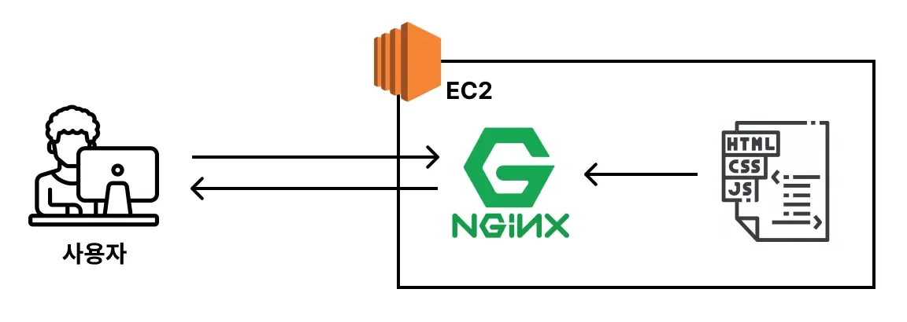
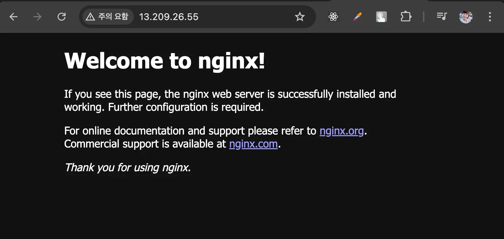
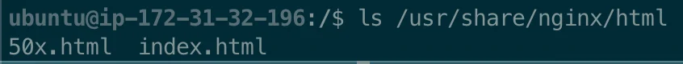
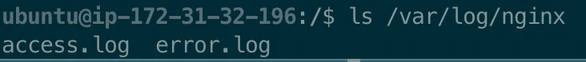
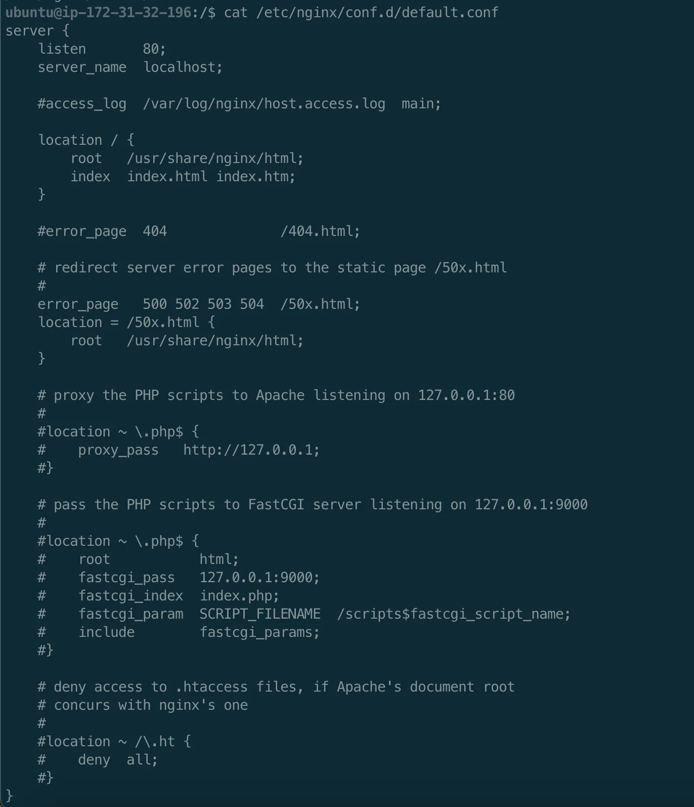
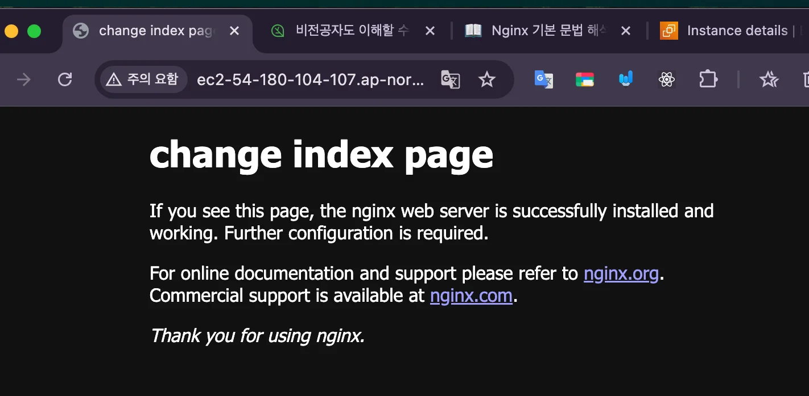
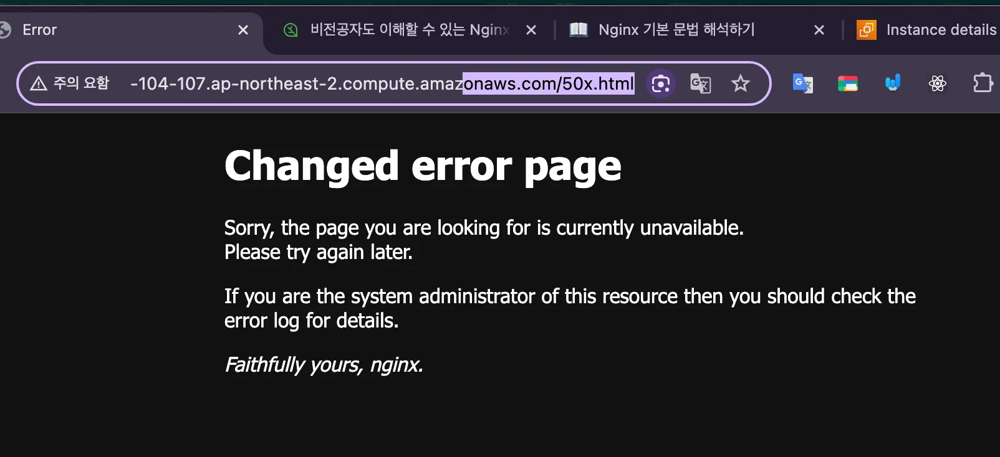
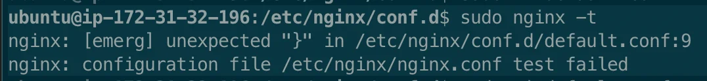
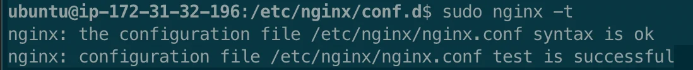
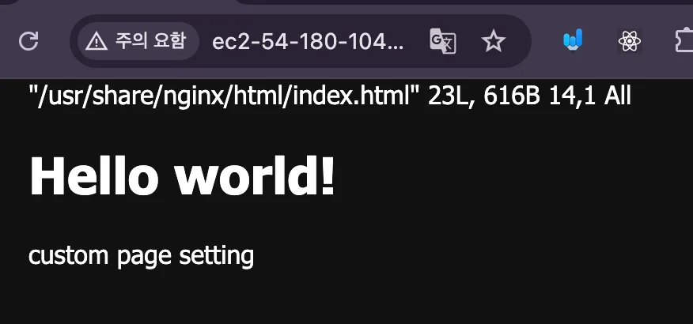

> ✏️ 
> 
> <a id="205eda9b0fe180e6b99ce88da3daeb0b"></a>
> 
> <strong><u>웹 서버(Web Server)</u></strong>는 <strong><u>사용자의 요청(www&#46;naver&#46;com으로 접속하는 행위)이 들</u></strong><strong>어올 때마다 </strong><strong><u>HTML, CSS, JS, 이미지와 같은 파일들을 제공하는 컴퓨터</u></strong>를 의미한다&#46; 

<a id="205eda9b0fe180a49156c184f15fc38f"></a>

## Nginx의 웹 서버(Web Server) 기능

---

> 📖 
> 
> 
> 
> <a id="205eda9b0fe180dd8502fc96c9fe37cf"></a>
> 
> Nginx는 웹 서버(Web Server) 역할 <br>즉, 정적 파일을 클라이언트로 서빙하는 역할이 가능하다&#46;
> 
> <a id="205eda9b0fe18044920fcebbafe1a79c"></a>
> 
> 따라서 Nginx를 사용하여 웹사이트 베포가 가능하며 실무에서도 자주 사용된다&#46; 
> 
> <details>
> <summary>ex) </summary>
> 
> 
> 
> <a id="205eda9b0fe180d7ac4aded4b9951ec3"></a>
> 
> Nginx를 설치하자마자 별도의 세팅을 하지 않더라도 위와 같은 웹 사이트가 뜬다&#46; 
> 
> <a id="205eda9b0fe180ddba0acb8790f9a402"></a>
> 
> 그 이유는 Nginx에서 해당 페이지의 HTML, CSS, JS 파일을 클라이언트로 제공하기 때문이다&#46;<br>즉, Nginx가 이미 웹 서버(Web Server) 역할을 하고 있다&#46; 
> 
> </details>

<details>
<summary>Nginx의 기본 개념</summary>

> ⚙ 
> 
> <a id="205eda9b0fe18050a7ccd94e0f38edce"></a>
> 
> <strong>Nginx의 설정 파일 위치</strong>
> 
> <details>
> <summary>1&#46; <code>/etc/nginx/nginx&#46;conf</code></summary>
> 
> - Nginx의 루트 설정 파일
> 
> - 전역적으로 설정되어야 하는 내용(워커 프로세스 개수, 로그 저장 위치 등)을 설정한다&#46;
> 
> - 초보자 기준으로 해당 설정 파일을 커스텀할 일은 없다&#46;
> 
> </details>
> 
> <details>
> <summary>2&#46;<code>/etc/nginx/config&#46;d/default&#46;conf</code></summary>
> 
> - 기본 웹 서버(Web Server) 설정 파일
> 
> </details>
> 
> <a id="205eda9b0fe1808a8043dad574531a9e"></a>
> 
> 크게 위 2개의 설정 파일이 존재한다&#46; 

- 정적 파일 경로&#58; <code>/usr/share/nginx/html/…</code>
    

- 로그 경로&#58; <code>/var/log/nginx/&#46;&#46;&#46;</code>
    

-  라우팅&#58; <code>/etc/nginx/conf&#46;d/default&#46;conf</code> 
    <details>
    <summary>파일 확인&#58; <code>cat /etc/nginx/conf&#46;d/default&#46;conf</code></summary>

    

    </details>

    <a id="205eda9b0fe180518e3ac18898db4261"></a>

    ```bash
    server {
        listen       80;
        server_name  localhost;

        #access_log  /var/log/nginx/host.access.log  main;

        location / {
            root   /usr/share/nginx/html;
            index  index.html index.htm;
        }

        #error_page  404              /404.html;

        # redirect server error pages to the static page /50x.html
        
        error_page   500 502 503 504  /50x.html;
        location = /50x.html {
            root   /usr/share/nginx/html;
        }
    }
    ```

    - <code>/</code>&#58; 모든 경로

    - <code>=</code>&#58; 완전히 일치하는 경로 

</details>

<a id="205eda9b0fe1800fafb1cef33265e43c"></a>

### 실습) 렌더링 파일 및  config 수정

<details>
<summary>실습) 정적 파일 수정 </summary>

<details>
<summary>기본(<code>index&#46;html</code>) 페이지 수정</summary>

1. vim 에디터로 해당 html 파일 접근
    <a id="205eda9b0fe1800c9bd9c81a69abdec5"></a>

    ```bash
    sudo vi /usr/share/nginx/html/index.html
    ```

    - 관리자 권한(<code>sudo</code>)으로 실행해야 <strong><u>파일 쓰기 권한</u></strong>이 있음 <br>( 기본&#58; readOnly)

1. 접근한 파일(<code>index&#46;html</code>) 수정
    <a id="205eda9b0fe18044b964f6bd473d5892"></a>

    ```html
    <!DOCTYPE html>
    <html>
    <head>
      <title>change index page</title>
    <style>
    html { color-scheme: light dark; }
    body { width: 35em; margin: 0 auto;
    font-family: Tahoma, Verdana, Arial, sans-serif; }
    </style>
    </head>
    <body>
    <h1>change index page</h1>
    <p>If you see this page, the nginx web server is successfully installed and
    working. Further configuration is required.</p>

    <p>For online documentation and support please refer to
    <a href="http://nginx.org/">nginx.org</a>.<br/>
    Commercial support is available at
    <a href="http://nginx.com/">nginx.com</a>.</p>

    <p><em>Thank you for using nginx.</em></p>
    </body>
    </html>
    ```

    - vim 에디터로 해당 html 파일 수정 후 저장

1. EC2 접속 확인
    > URl&#58; <code>{EC2 엔드포인트}/</code>

    

    - 새로고침하면 저장된 내용이 바로 반영된 것을 확인할 수 있다&#46;

</details>

<details>
<summary>오류(<code>50x&#46;html</code>) 페이지 수정</summary>

1. vim 에디터로 해당 html 파일 접근
    <a id="205eda9b0fe180dfafd1c2c698daf0f4"></a>

    ```bash
    sudo vi /usr/share/nginx/html/50x.html
    ```

    - 관리자 권한(<code>sudo</code>)으로 실행해야 <strong><u>파일 쓰기 권한</u></strong>이 있음 <br>( 기본&#58; readOnly)

1. 접근한 파일(<code>index&#46;html</code>) 수정
    <a id="205eda9b0fe180c88da9ec41fe570fff"></a>

    ```html
    <!DOCTYPE html>
    <html>
    <head>
    <title>Error</title>
    <style>
    html { color-scheme: light dark; }
    body { width: 35em; margin: 0 auto;
    font-family: Tahoma, Verdana, Arial, sans-serif; }
    </style>
    </head>
    <body>
    <h1>Changed error page</h1>
    <p>Sorry, the page you are looking for is currently unavailable.<br/>
    Please try again later.</p>
    <p>If you are the system administrator of this resource then you should check
    the error log for details.</p>
    <p><em>Faithfully yours, nginx.</em></p>
    </body>
    </html>
    ```

    - vim 에디터로 해당 html 파일 수정 후 저장

1. EC2 접속 확인
    > URl&#58; <code>{EC2 엔드포인트}/50x&#46;html</code>

    

    - 새로고침하면 저장된 내용이 바로 반영된 것을 확인할 수 있다&#46;

</details>

</details>

<details>
<summary>실습2) config 수정</summary>

- 기본 페이지를 직접 생성한 페이지(hello&#46;html)로 변경
    <a id="205eda9b0fe18027a215c9b720738f5c"></a>

    ```bash
    # 1. 정적 파일 생성,  config에서 경로 설정을 변경하면 다른 곳에 생성해도 됨
    cd /usr/share/nginx/html
    vi hello.html

    # 2. 라우팅 config 수정
    cd /etc/nginx/conf.d # '/': 절대 경로
    sudo vi default.conf
    ```

    <details>
    <summary>hello&#46;html</summary>

    <a id="205eda9b0fe180c79549f9562528b17c"></a>

    ```html
    <!DOCTYPE html>
    <html>
    <head>
    <title>hello world</title>
    <style>
    html { color-scheme: light dark; }
    body { width: 35em; margin: 0 auto;
    font-family: Tahoma, Verdana, Arial, sans-serif; }
    </style>
    </head>
    <body>
    <h1>Hello world!</h1>
    <p>custom page setting<p>
    </body>
    </html>
    ```

    </details>

    <details>
    <summary>default&#46;conf</summary>

    <a id="205eda9b0fe1806596edd924f99a5e3e"></a>

    ```bash
    server {
        listen       80;
        server_name  localhost;

        #access_log  /var/log/nginx/host.access.log  main;

        location / {
            root   /usr/share/nginx/html;
            index  basic.html; # 페이지 지정
        }

        #error_page  404              /404.html;

        # redirect server error pages to the static page /50x.html
        #
        error_page   500 502 503 504  /50x.html;
        location = /50x.html {
            root   /usr/share/nginx/html;
        }

        # proxy the PHP scripts to Apache listening on 127.0.0.1:80
        #
        #location ~ \.php$ {
        #    proxy_pass   http://127.0.0.1;
        #}

        # pass the PHP scripts to FastCGI server listening on 127.0.0.1:9000
        #
        #location ~ \.php$ {
        #    root           html;
        #    fastcgi_pass   127.0.0.1:9000;
        #    fastcgi_index  index.php;
        #    fastcgi_param  SCRIPT_FILENAME  /scripts$fastcgi_script_name;
        #    include        fastcgi_params;
        #}

        # deny access to .htaccess files, if Apache's document root
        # concurs with nginx's one
        #
        #location ~ /\.ht {
        #    deny  all;
        #}
    }
    ```

    </details>

- nginx에 수정된 설정값 반영
    > ✏️ 
    > 
    > <a id="205eda9b0fe18022b2a6ed3259a74b8a"></a>
    > 
    > nginx의 설정 값 수정 시, 변경된 설정 값을 반영하기 위해 아래와 같은 추가 과정이 필요하다&#46; 

    <a id="205eda9b0fe18095ad41c01c420afe5d"></a>

    ```bash
    # 3. nginx 설정 파일들 중, 문법 오류가 있는지 확인
    sudo nginx -t 

    # 4. nging 재로딩 - 변경된 설정 파일 반영
    sudo nginx -s reload
    ```

    <details>
    <summary>문법 확인&#58; <code>nginx &#45;t</code> </summary>

    - test fail
        

        - 문법 오류가 발생된 파일, 위치, 테스트 실패 여부를 알려준다&#46;

    - test success
        

    </details>

    <details>
    <summary>nginx 재부팅&#58; <code>nginx &#45;s reload</code></summary>

    

    - 설정한 내용이 정상적으로 반영된 것을 확인할 수 있다&#46;

    </details>

</details>
