<a id="206eda9b0fe180648447eec475991815"></a>

## 리버스 프록시(Reverse Proxy)

---

> 📖 
> 
> <a id="206eda9b0fe18056a2d3dcaae4a6a31d"></a>
> 
> <strong>프록시(Proxy)</strong>란 ‘중계, 대리자’ 라는 의미를 가진다&#46; 
> 
> <a id="206eda9b0fe180c9bd12e81b6b3d7c62"></a>
> 
> 따라서 <u>프록시 서버</u>(Proxy Server)란 <strong><u>중간 역할에서 트래픽을 중계 해주는 서버</u></strong>다&#46;
> 
> 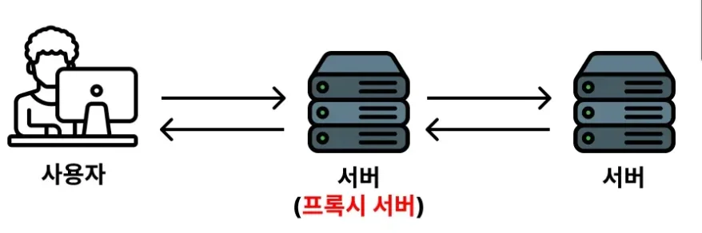
> 
> - 클라이언트(사용자)와 서버가 직접 통신하지 않고 중간에 <strong><u>프록시 서버(Proxy Server)</u></strong>를 거쳐 통신을 한다&#46;

<a id="206eda9b0fe1806e89a6ee63ba064afd"></a>

### 포워드 프록시, 리버스 프록시 

> ☝🏻 
> 
> <a id="206eda9b0fe180dd9d92de63c2e9c732"></a>
> 
> 리버스 프록시 서버와 많이 혼동한다&#46; 따라서 주의해서 학습하자&#46;

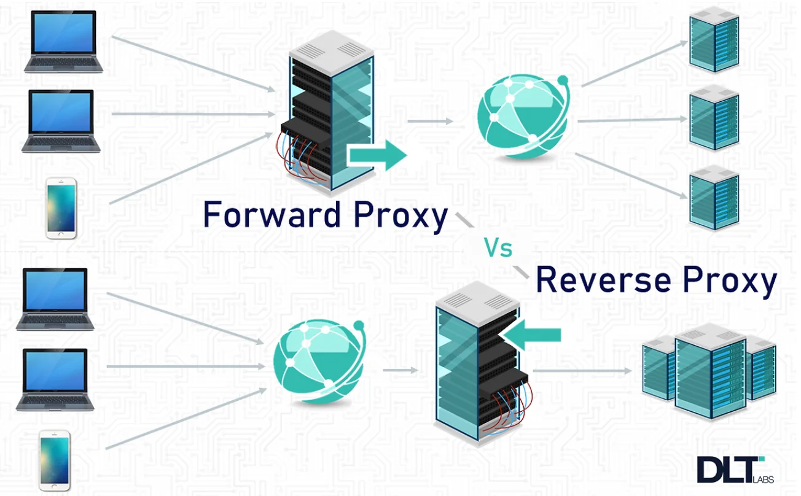

<details>
<summary><strong>포워드 프록시 (Forward Proxy)</strong></summary>

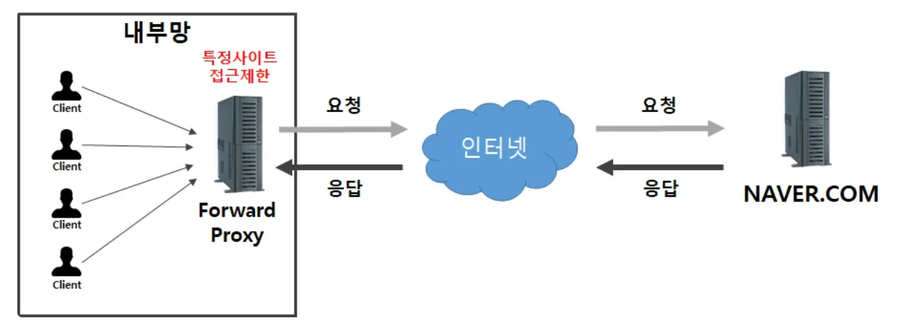

<a id="206eda9b0fe18067b4edc57b072781c8"></a>

<strong><u>보내려고 하는 요청</u></strong>을 <strong><u>관리</u></strong>, 또는 <strong><u>보안 처리</u></strong>를 위한 용도로 사용하는 서버를 <strong><u>포워드 프록시(Forward Proxy) 서버</u></strong>라고 얘기한다&#46;

- 포워드 프록시 서버의 대표적인 예시로 회사 방화벽이 있다&#46; 

- 포워드 프록시 서버가 <u>보내려고 하는 요청을 감시</u>하면서 <strong>위험하다고 판단되는 사이트에 </strong><strong><u>접속하지 못하게 차단</u></strong>한다&#46;

</details>

<details>
<summary>리버스 프록시 ( Reverse Proxy )</summary>

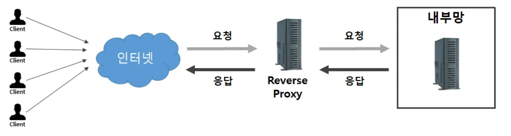

<a id="206eda9b0fe180ab9820c4066cfc85dd"></a>

<strong><u>들어는 요청</u></strong>을 <strong><u>관리</u></strong> 또는 <strong><u>보안 처리</u></strong> 하기 위한 용도로 사용하는 서버를 <strong><u>리버스 프록시(Reverse Proxy) 서버</u></strong>라고 얘기한다&#46; 

<a id="207eda9b0fe1807d86acc805bac456f9"></a>

리버스 프록시 서버의 대표적인 예시가 Nginx이다&#46; 

- HTTPS 처리, 요청 수 제한, 로드벨런싱을 하는 용도로 사용한다&#46;

> 리버스 프록시의 주요 기능

- 들어오는 요청의 보안을 위해, HTTPS 처리

- 들어오는 요청을 감시하며, 일정 수 이상 요청이 보면 차단

- 들어오는 요청을 여러 대의 서버로 분배해주는 로드밸런싱 기능

</details>

<details>
<summary>Nginx의 리버스 프록시(Reverse Proxy) 구성</summary>

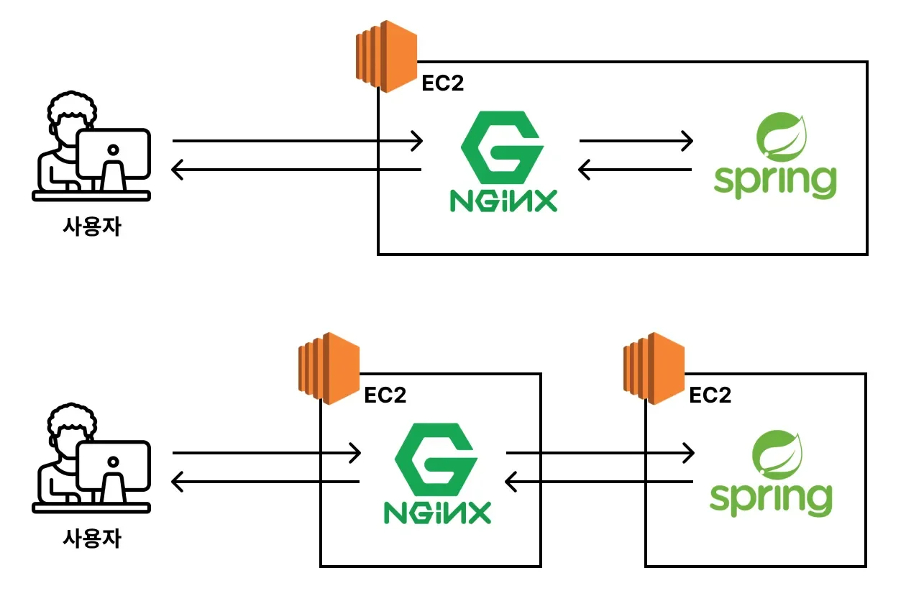

<a id="206eda9b0fe180deb535db8534c41fb0"></a>

프록시 서버(Proxy Server)는 위와 같이 동일한 서버에서 구성할 수 있고, 분리된 서버 형태로 구성 가능하다&#46; 

- 2의 경우, 대규모 트래픽을 처리하는 스케일 아웃 상황에 적절하다&#46; 

- 프록시 서버로 사용하는 소프트웨어는 <code>Nginx</code> 이외에도 다양하다&#46;

</details>

> 🗒️ 
> 
> <a id="207eda9b0fe180bcb832edebb5fef366"></a>
> 
> <strong>정리) </strong>🧐<strong> 왜 리버스 프록시를 사용하는가?</strong>
> 
> <a id="207eda9b0fe1807abf8ed2e52bbe14d2"></a>
> 
> 리버스 프록시는 들어오는 요청을 관리 및 보안 처리를  하기위해 구성한다&#46; 
> 
> <a id="207eda9b0fe180788e8eeca807cf71f8"></a>
> 
> 만약 리버스 프록시 서버를 구성하지 않고 백엔드 서버에서 요청을 바로 받아 처리하면 보안적으로 문제되는 경우가 많다&#46; 
> 
> - 누군가 악의적으로 수많은 요청을 갑자기 보내는 경우 ( <code>DDOS</code> ), 실제 백엔드 서버 해당 요청들을 처리하려고 과부하가 발생되고 결국 서버에 장애(다운)가 발생된다&#46;

<a id="207eda9b0fe180d3bae6cc87b914dc86"></a>

### 실습) 리버스 프록시를 활용한 Spring Boot 서버 배포

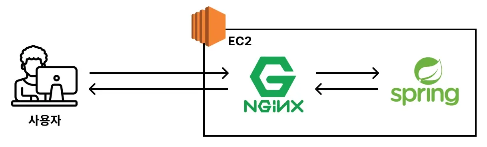

> 📌 
> 
> 1. EC2에 Spring Boot 프로젝트 클론
> 
> 1. Nginx 설정 추가
> 
> 1. 도메인 연결 &#45; 스프링 부트와 통신할 레코드 추가
> 
> 1. HTTPS 적용

<details>
<summary>1&#46; Spring Boot 서버 EC2 클론 및 Nginx 설정</summary>

> 📌 
> 
> - [x] EC2에 Spring Boot 프로젝트 클론
> 
> - [x] Nginx 설정 추가
> 
> - [ ] 도메인 연결 &#45; 스프링 부트와 통신할 레코드 추가
> 
> - [ ] HTTPS 적용

1. <strong>JDK 17 설치</strong>
    <a id="207eda9b0fe180e295abe462556a30d1"></a>

    ```bash
    sudo apt update && /
    sudo apt install openjdk-17-jdk -y

    # 설치 확인
    java -version
    ```

1. <strong>Spring Boot 프로젝트 클론</strong>
    <details>
    <summary>예시 프로젝트</summary>

    [nginx-backend-springboot](https://github.com/JSCODE-COURSE/nginx-backend-springboot)

    </details>

    <a id="207eda9b0fe1805d9699e2d3ce0e0813"></a>

    ```bash
    git clone https://github.com/JSCODE-COURSE/nginx-backend-springboot.git
    cd ~ # /home/ubuntu 
    cd nginx-backend-springboot
    ```

1. <strong>Spring Boot 서버 실행</strong>
    <a id="207eda9b0fe1800d99e0cd2d75197d5b"></a>

    ```bash
    ./gradlew clean build -x test
    cd build/libs

    # nohup: 백그라운드로 서버 실행
    nohup java -jar nginx-backend-springboot-0.0.1-SNAPSHOT.jar &
    ```

    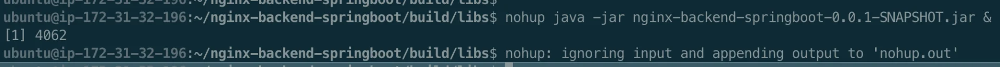

1. <strong>Spring Boot 서버 정상 동작 확인</strong>
    <a id="207eda9b0fe180a8a464e41f18757961"></a>

    ```bash
    # 8080 포트에서 실행되고 있는 프로세스 조회
    lsof -i:8080
    ```

    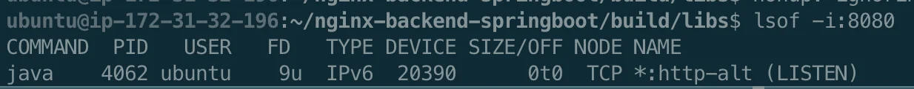

1. <strong>Nginx 설정 파일 작성</strong>
    <a id="207eda9b0fe180ac870fc4b21e745eeb"></a>

    ```bash
    cd /etc/nginx/conf.d/websites
    sudo vi api.subdev.p-e.kr.conf
    ```

    <a id="207eda9b0fe18009b59fffb5c6e12d66"></a>

    <strong><code>/etc/nginx/conf&#46;d/websites/api&#46;subdev&#46;p&#45;e&#46;kr&#46;conf</code></strong>

    <a id="207eda9b0fe1805f9d4ed8119256b43d"></a>

    ```bash
    server {
    				# api.jscode.p-e.kr:80로 들어온 요청을 이 server 블록이 처리
            listen 80;
            server_name api.subdev.p-e.kr;
            
            # / 으로 시작하는 모든 경로를 처리
            location / {
    				        # 들어온 요청을 전부 http://localhost:8080(Spring Boot 서버)로 전달
                    proxy_pass http://localhost:8080;
            }       
    }
    ```

    <details>
    <summary>작성한 파일을 <code>default&#46;conf</code>에 등록해야 한다&#46; </summary>

    <a id="207eda9b0fe180bc8036e1ab8ad1539b"></a>

    <strong>/etc/nginx/conf&#46;d/default&#46;conf</strong>

    <a id="207eda9b0fe18074bd6ddcdfde772720"></a>

    ```bash
    include conf.d/websites/*.conf;
    ```

    - 와일드 카드(<code>&#42;</code>)를 통해 <code>/websites</code> 경로 내 <code>&#46;conf</code> 파일을 모두 등록하도록 했다&#46; 

    - 따라서 따로 등록할 필요는 없다&#46;

    </details>

1. 변경된 Nginx 설정 적용
    <a id="207eda9b0fe180929e8adf3fdb961c94"></a>

    ```bash
    # Nginx 설정 파일들 문법 checking
    sudo nginx -t

    # Nginx 재로딩: 변경된 설정 파일 적용
    sudo nginx -s reload
    ```

</details>

<details>
<summary>2&#46; 도메인 연결</summary>

> 📌 
> 
> - [x] EC2에 Spring Boot 프로젝트 클론
> 
> - [x] Nginx 설정 추가
> 
> - [x] 도메인 연결 &#45; 스프링 부트와 통신할 레코드 추가
> 
> - [ ] HTTPS 적용

[내도메인&#46;한국 &#45; 한글 무료 도메인 등록센터]()


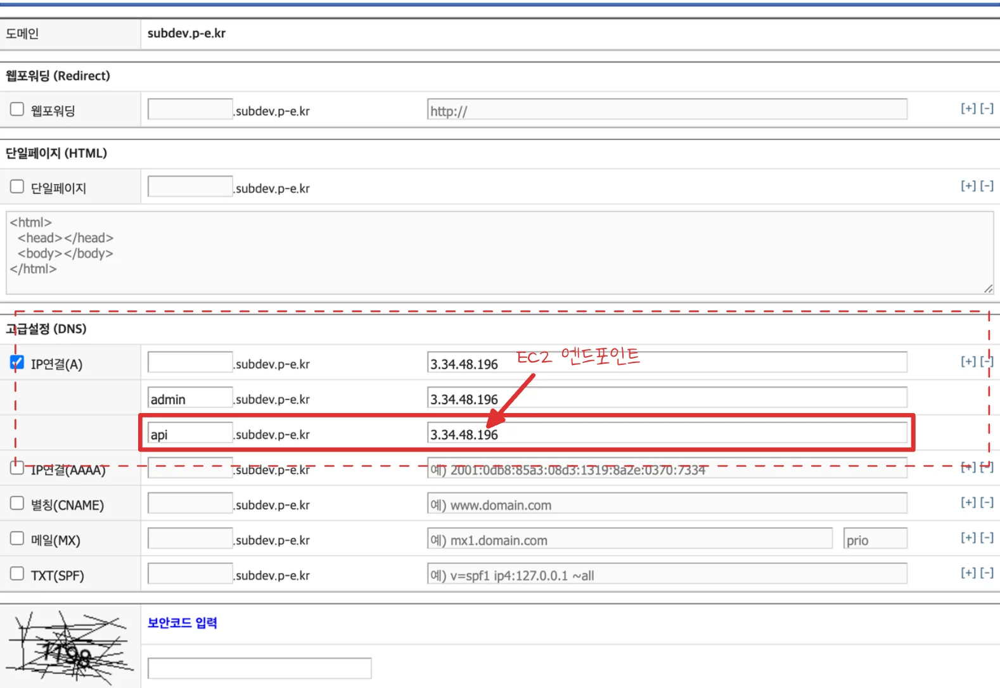

- 백엔드 서버와 통신하는 서브 도메인(레코드) 추가
    - <code>api&#46;subdev&#46;p&#45;e&#46;kr</code>

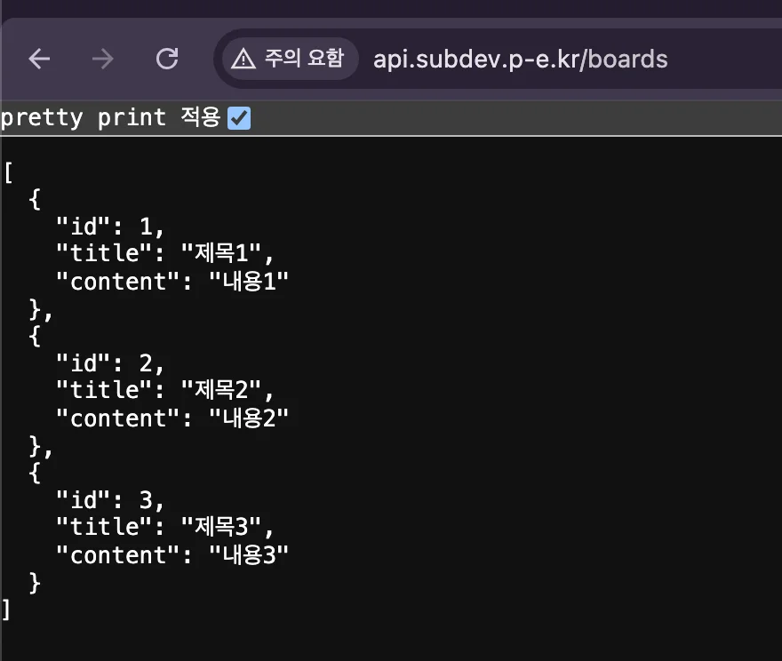

- 연결 확인
    - <a href="http://api.subdev.p-e.kr/boards"><code>api&#46;subdev&#46;p&#45;e&#46;kr/boards</code></a> 호출

    <details>
    <summary>예제 프로젝트 &#45; controller</summary>

    [BoardController.java](https://github.com/JSCODE-COURSE/nginx-backend-springboot/blob/main/src/main/java/com/example/nginxbackendspringboot/BoardController.java)

    </details>

</details>

<details>
<summary>3&#46; HTTPS 적용</summary>

> 📌 
> 
> - [x] EC2에 Spring Boot 프로젝트 클론
> 
> - [x] Nginx 설정 추가
> 
> - [x] 도메인 연결 &#45; 스프링 부트와 통신할 레코드 추가
> 
> - [x] HTTPS 적용

> ✏️ 
> 
> <a id="207eda9b0fe180bf99dae2cc867a94bf"></a>
> 
> <code>certbot</code>을 사용하면 명령어 1줄로 <code>https</code> 적용이 가능하다&#46; 
> 
> - <del>이건 진짜 대박인 듯…</del>

- certbot을 사용한 https 적용
    <a id="207eda9b0fe1807fb22dfa61675511ec"></a>

    ```bash
    sudo certbot --nginx -d <도메인주소>

    # ex) 여러 도메인 한번에 가능
    sudo certbot --nginx -d subdev.p-e.kr -d admin.subdev.p-e.kr -d api.subdev.p-e.kr
    ```

    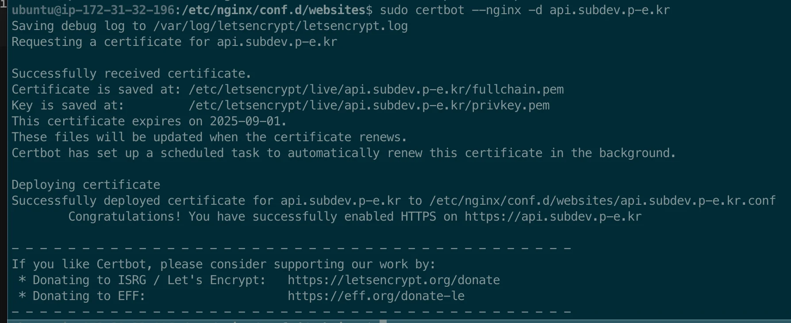

- https 적용 확인
    > <a href="https://api.subdev.p-e.kr">https&#58;//api&#46;subdev&#46;p&#45;e&#46;kr</a> 

    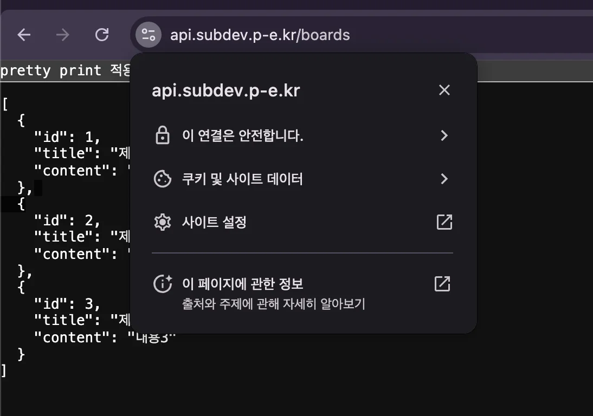

- <strong>Nginx 설정 파일 확인</strong>
    <a id="207eda9b0fe180618b5dfbf0d5ebab7d"></a>

    <strong><code>/etc/nginx/conf&#46;d/websites/api&#46;subdev&#46;p&#45;e&#46;kr&#46;conf</code></strong>

    <a id="207eda9b0fe1800faa67fb74aa42db2d"></a>

    ```bash
    server {
            server_name api.jscode.p-e.kr;

            location / {
                    proxy_pass http://localhost:8080;
            }
    		
    		# 추가된 부분 1 - SSL 인증서 설정
        listen 443 ssl; # managed by Certbot
        ssl_certificate /etc/letsencrypt/live/api.jscode.p-e.kr/fullchain.pem # managed by Certbot
        ssl_certificate_key /etc/letsencrypt/live/api.jscode.p-e.kr/privkey.pm; # managed by Certbot
        include /etc/letsencrypt/options-ssl-nginx.conf; # managed by Certbot
        ssl_dhparam /etc/letsencrypt/ssl-dhparams.pem; # managed by Certbot

    }

    # 추가된 부분 2 - https(443)으로 redirect(301) 설정
    server {
        if ($host = api.jscode.p-e.kr) {
            return 301 https://$host$request_uri;
        } # managed by Certbot


            listen 80;
            server_name api.jscode.p-e.kr;
        return 404; # managed by Certbot
        
    }
    ```

</details>

<a id="207eda9b0fe180b2b6ddc17ffc631d34"></a>

### 실습 2) IP당 요청 수 제한하기

> ✏️ 
> 
> <a id="207eda9b0fe18037a021c6562089b1c2"></a>
> 
> <strong><code>리버스 프록시(Reverse Proxy) 서버</code></strong>의 역할은 <strong>들어오는 요청</strong>을 <strong>관리</strong>하고 <strong>보안 처리</strong>하는 것이다&#46;
> 
> <a id="207eda9b0fe180099b23db0de087ae57"></a>
> 
> 이에 해당하는 대표적인 사용 예시가 <strong><u>요청 수를 제한</u></strong>하는 것이다&#46; 
> 
> - 요청 수를 제한함으로 악의적인 반복 요청으로부터 서버를 보호할 수 있다&#46; 

1. Nginx 설정 파일 수정
    <a id="207eda9b0fe1809b84b0f1c3c286df4f"></a>

    <strong><code>/etc/nginx/conf&#46;d/website/api&#46;subdev&#46;p&#45;e&#46;kr</code></strong>

    <a id="207eda9b0fe180c6b53fd993abf8d98d"></a>

    ```bash
    # limit_req_zone : 요청 수를 제한기 위한 메모리 공간(zone)과 요청 속도(rate)를 정의
    # $binary_remote_addr : 요청 수를 제한하는 기준을 클라이언트 IP로 설정
    # zone=mylimit:10m : 메모리 공간(zone)의 이름을 mylimit이라 지정,
    #			               메모리 공간이ㅡ 크기를 10MB 제한 (약 16만개의 IP 주소를 관리할 수 있음)
    # rate=3r/s : 1초에 최대 3개의 요청만 허용
    limit_req_zone $binary_remote_addr zone=mylimit:10m rate=3r/s;

    server {
    				# limit_req_zone에서 정의한 mylimit이라는 조건을 해당 server 블럭에 적용
            limit_req zone=mylimit;
            # 요청이 제한됐을 때 429(Too Many Requests) 상태 코드 반환
            limit_req_status 429;
            server_name api.subdev.p-e.kr;

            location / {
                    proxy_pass http://localhost:8080;
            }

        listen 443 ssl; # managed by Certbot
        ssl_certificate /etc/letsencrypt/live/api.subdev.p-e.kr/fullchain.pem; # managed by Certbot
        ssl_certificate_key /etc/letsencrypt/live/api.subdev.p-e.kr/privkey.pem; # managed by Certbot
        include /etc/letsencrypt/options-ssl-nginx.conf; # managed by Certbot
        ssl_dhparam /etc/letsencrypt/ssl-dhparams.pem; # managed by Certbot

    }
    server {
        if ($host = api.subdev.p-e.kr) {
            return 301 https://$host$request_uri;
        } # managed by Certbot


            listen 80;
            server_name api.subdev.p-e.kr;
        return 404; # managed by Certbot
    }
    ```

1. 변경된 Nginx 설정 내용 적용
    <a id="207eda9b0fe1802b9803e46cf3c9d4c7"></a>

    ```bash
    # Nginx 설정 파일들 문법 확인
    sudo nginx -t

    # Nginx 재로딩 - 변경된 설정 파일 반영
    sudo nginx -s reload
    ```

1. 요청 수 제한이 적용 됐는지 확인
    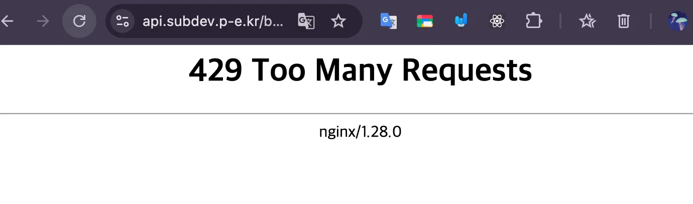

    - 1초에 3번 이상 클릭 시, 429로 응답하는 것을 확인 가능함
