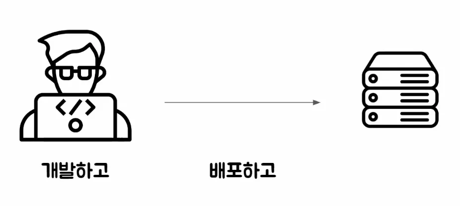
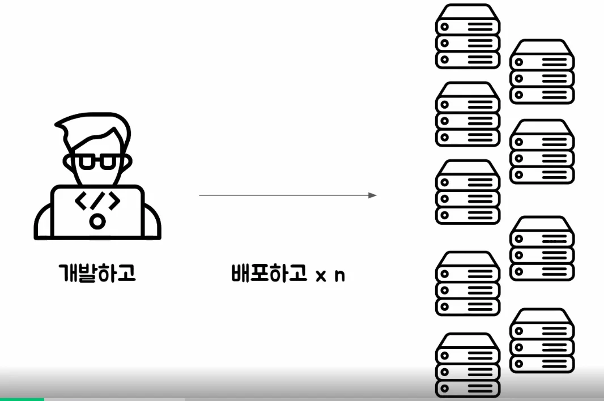
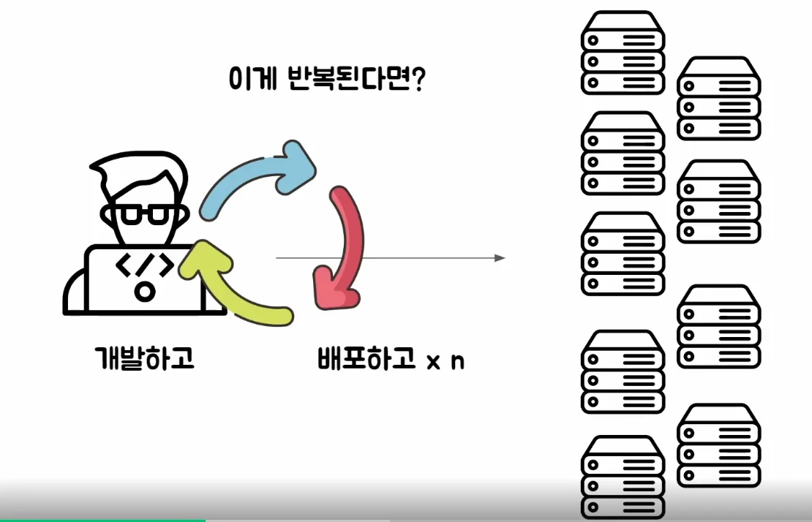
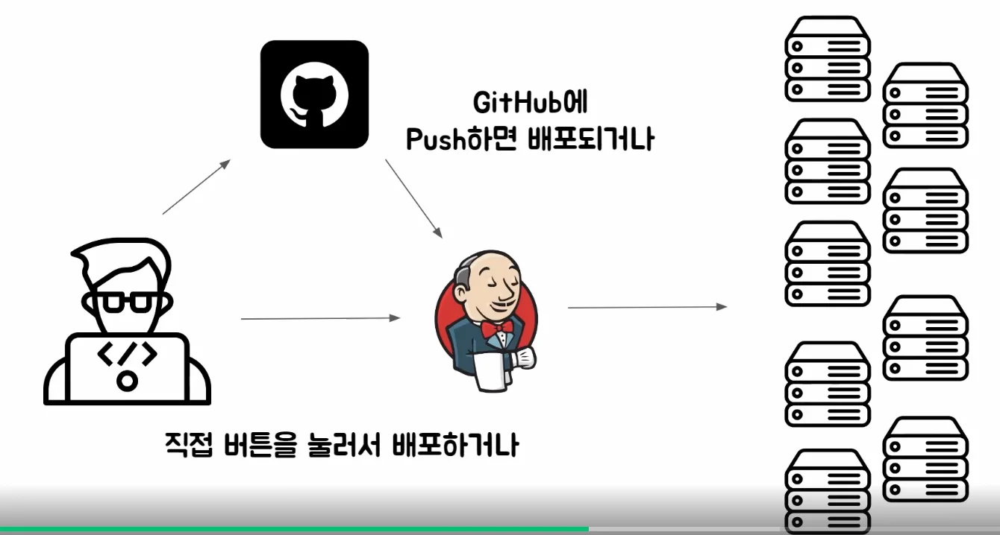
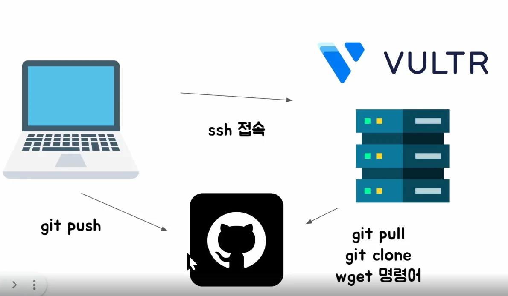
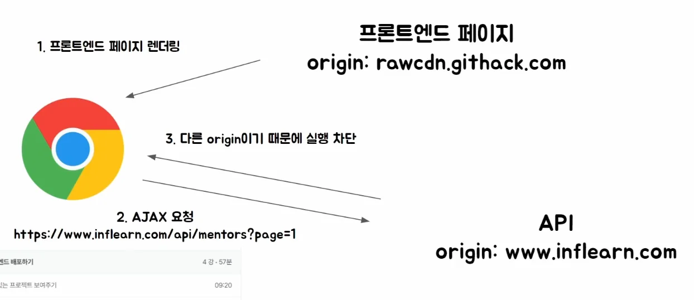
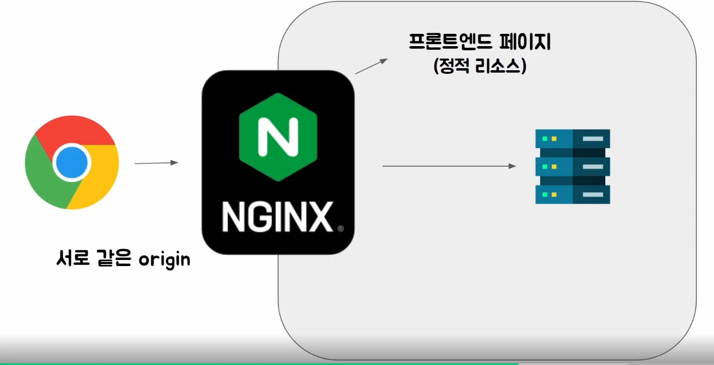

### 베포를 왜 자동화해야 하는가?

---

서비스를 서버에 베포하는 과정은 아래와 같다&#46; 

- 개발자가 본인의 컴퓨터에서 애플리케이션을 개발하고, 서버 접속해 서비스를 실행시킨다&#46; 

> 그러나 앱을 베포해야 하는 서버가 여러 대 이면 어떨까?

실제로 실무에서 운영하는 대부분의 서비스는 여러 대의 서버에서 실행되고 있다&#46; 따라서 일일이 서버에 접속하고 서버를 실행하는 명령어를 n개 만큼 반복해야한다&#46; 

또한 기능 개발이나, 버그 패치 등 자주 수정된 코드를 다시 베포 해야한다&#46;

- 회사, 팀, 서비스 마다 다르겠지만 개발이 활발히 진행되는 서비스라면 하루에도 수십 번 베포하곤 한다&#46; 

이러한 과정을 일일이 매번 사람이 한다면 굉장한 리소스가 매번 들어간다&#46; 

그리고 만약 새로 개발된 코드에 버그가 존재한다면? 그리고 그게 그대로 서버에 베포하면? 바로 서비스에 중대한 문제가 발생된다&#46; 

혹은 내 로컬 컴퓨터에서 정상 동작했던 코드들이 실제 베포 서버에서는 정상적으로 동작하지 않을 수 있다&#46;

따라서 일일이 베포할 때마다  테스트를 돌려가며 정상적으로 동작되는지 확인해야 한다&#46; 

바로 위와 같이 지속적으로 리소스가 발생되는 반복적인 작업을 자동화하는 것이 CI/CD 이다&#46;

- 코드 develop(or main) 브랜치로 코드 commit 시, 이러한 반복적인 패턴(서버 베포, 테스트 검증)을 트리거로 실행 시킬 수 있다&#46; 

### 수동 베포 간단 요약

- <code>VULTR</code>를 통해 ssh로 접속하여 수동 베포를 진행

### CORS ( Cross Origin Resource Sharing ) 문제

### 해결 1 &#45; nginx 사용하여 CORS 해결

