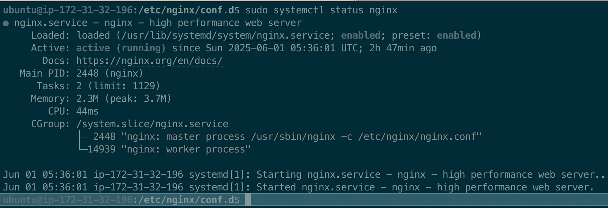
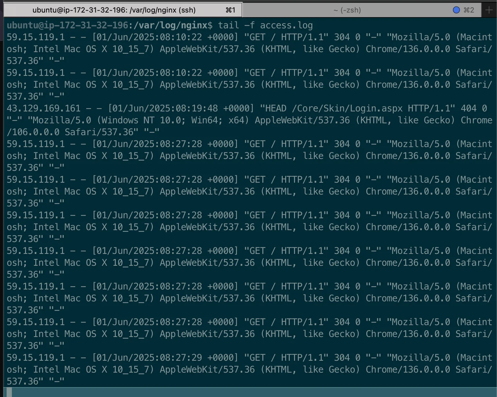
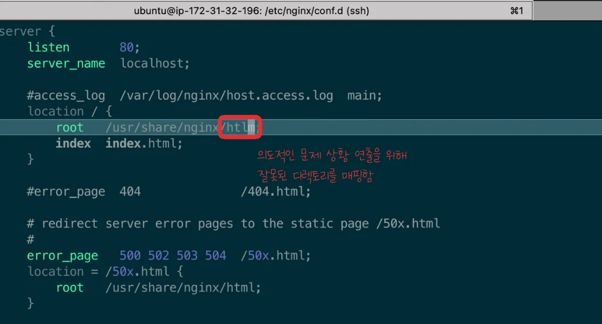
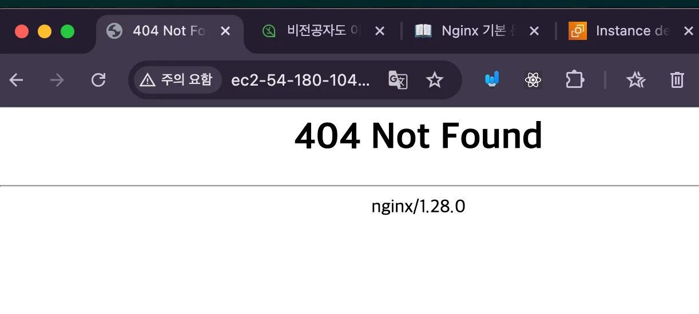
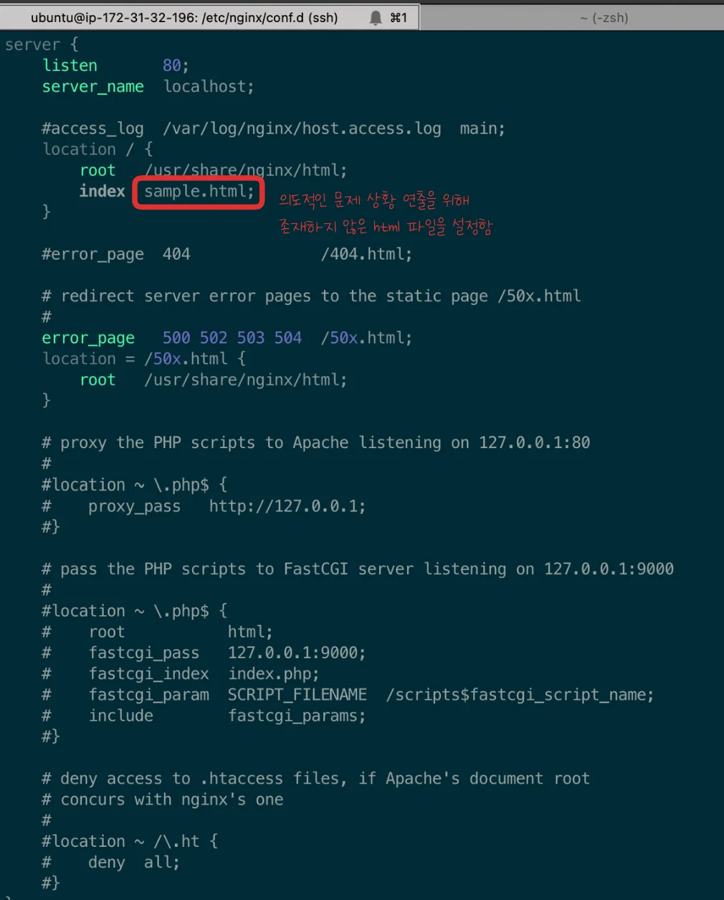
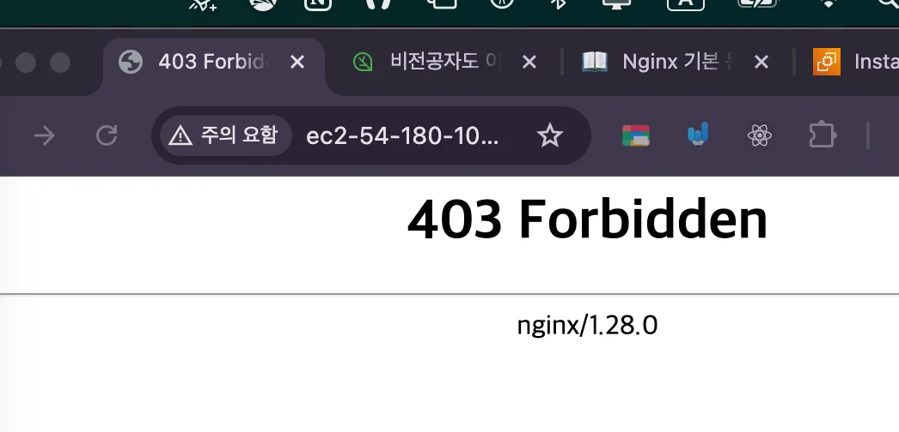
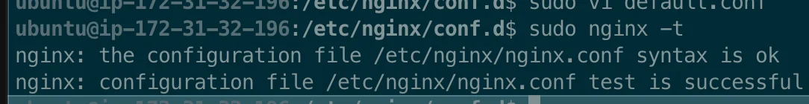
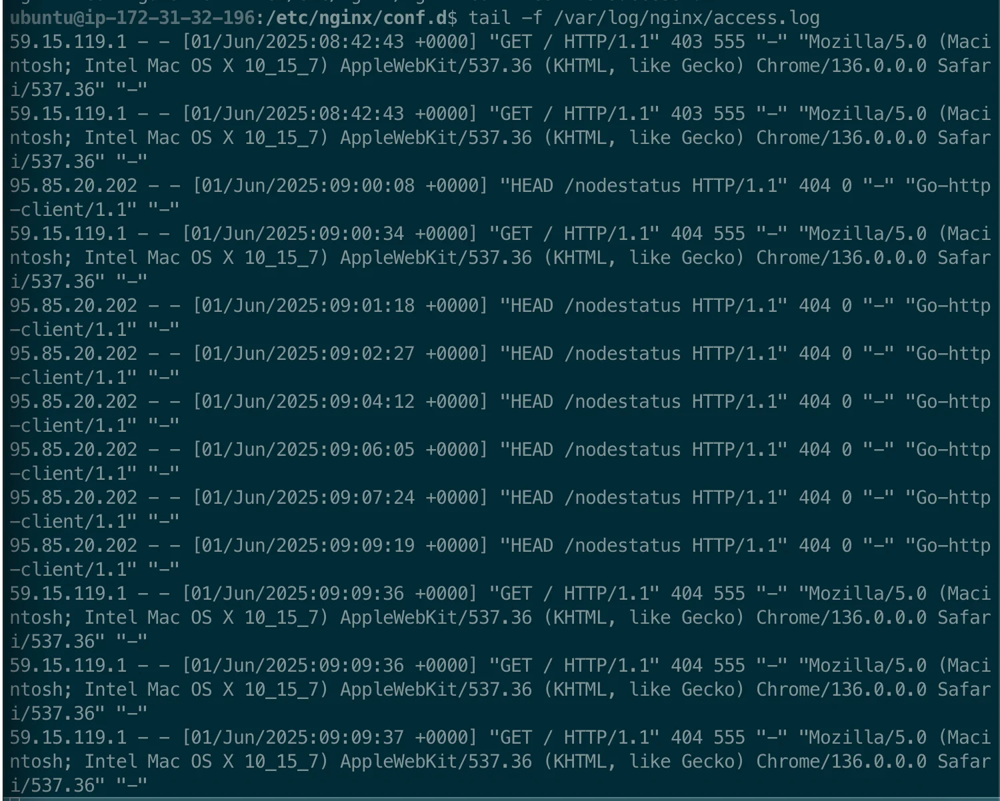
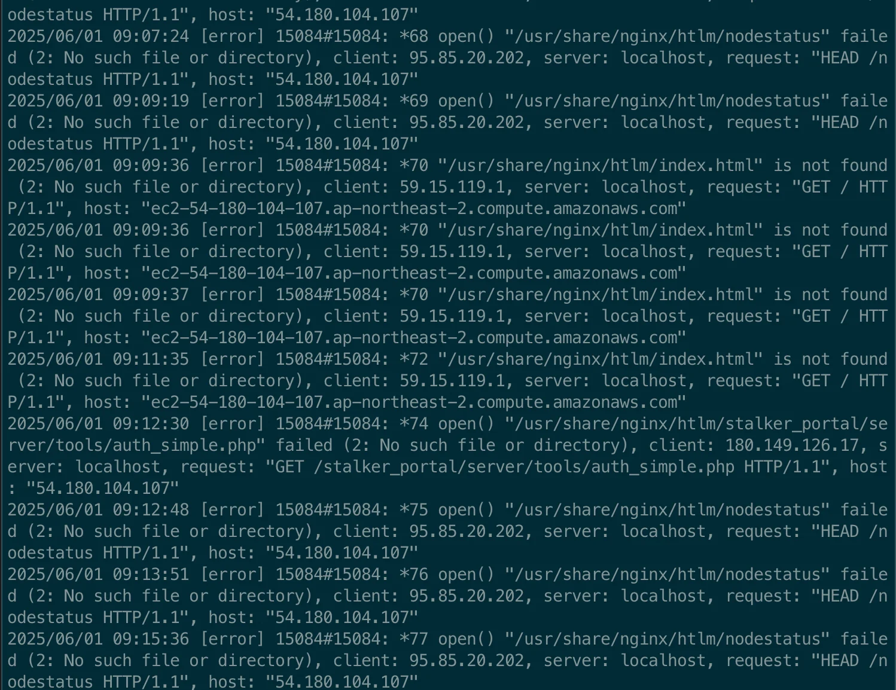
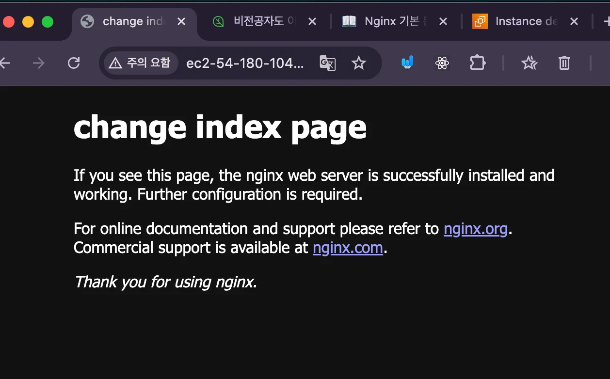

<a id="205eda9b0fe1805f9a11f40cb832a87c"></a>

### Nginx 디버깅

> ✏️ 
> 
> <a id="206eda9b0fe1808e80aef67e8eb0c86d"></a>
> 
> <code>디버깅</code>은 오류 지점을 찾기위해 단계적으로 찾아들어가 해결하는 과정을 말한다&#46; 
> 
> <details>
> <summary>reference</summary>
> 
> <a id="206eda9b0fe180f0aa93efece0c9ff69"></a>
> 
> ‣
> 
> <a id="206eda9b0fe1801eb447e63c91e50763"></a>
> 
> ‣
> 
> </details>

<details>
<summary>방법1) nginx 문법 확인</summary>

<a id="205eda9b0fe180b3bee1f7e56cf6046a"></a>

```bash
sudo nginx -t 
```

- config 에서 발생된 문법적 오류를 확인하고 알려준다&#46;

</details>

<details>
<summary>방법2) nginx 정상 동작 확인</summary>

<a id="205eda9b0fe18059b7c0c5241ac8f8c2"></a>

```bash
sudo systemctl status nginx 
```



</details>

<details>
<summary>방법3) nginx 로그 확인</summary>

<details>
<summary>1&#46; access&#46;log 확인</summary>

<a id="205eda9b0fe18070b025d7dd369e1683"></a>

```bash
# access.log 실시간 확인 
tail -f /var/log/nginx/access.log
```



- 실시간으로 nginx로 접근하는 트래픽을 확인할 수 있다&#46; 

- 요청마다 GET 로그가 발생된다면, nginx로 들어오는 트래픽에는 문제가 없는 것이기 때문에, 내부 동작 과정에서의 오류나, out bound 트래픽을 살펴봐야 한다&#46; 

</details>

<details>
<summary>2&#46; error&#46;log 확인</summary>

<a id="205eda9b0fe1803a902cddccbcbb603f"></a>

```bash
# error.log 실시간 확인 
tail -f /var/log/nginx/error.log
```


</details>

</details>

<details>
<summary>실습) 올바르지 않은 html 파일이 명시된 경우, 디버깅하여 해결</summary>

<a id="205eda9b0fe180c0948fcba01ba792ee"></a>

### 문제 상황



- config에서 잘못된 폴더 경로를 입력
    - <code>htlm</code> ( 정상 명칭 <code>html</code> )



- EC2 엔드포인트 접속 → <code>404 Not Found</code> 발생

<details>
<summary>🧐 404를 기대했으나 403이 발생됨</summary>

<a id="205eda9b0fe18024a185eab77833a38c"></a>

### 문제





<details>
<summary>default&#46;config </summary>

<a id="205eda9b0fe1802e8cefc94afe5d34bb"></a>

```bash
server {
    listen 80;
    server_name localhost;

    root /usr/share/nginx/html;
    index index.html;
    
    . . .
}

```

</details>

<details>
<summary>디렉토리 구조</summary>

<a id="205eda9b0fe1807fae30fadcf3d632ab"></a>

```bash
/usr/share/nginx/html/   ← ✅ 디렉토리 존재
└── ❌ sample.html 없음
```

</details>

<a id="205eda9b0fe180998dc7edf0126e8dd0"></a>

위 상황에서 GET  <code>/</code> 요청, nginx는 아래와 같이 처리한다&#46;

- <code>/usr/share/nginx/html/</code>디렉토리로 매핑

-  <code>sample&#46;html</code>을 찾음 → <strong>없음</strong>

- <code>autoindex on</code>도 없음 → 디렉토리 내용을 보여줄 수도 없음

<a id="205eda9b0fe180cdb885d5279d694484"></a>

 

<a id="205eda9b0fe180bcac1ae391aa7b152f"></a>

<strong>결론&#58;</strong><strong><code>403 Forbidden</code></strong>

<a id="205eda9b0fe180b884cbf621b7d81d8c"></a>

<strong>요청이 ‘파일’이 아니라 </strong><strong><u>‘디렉토리’를 대상</u></strong><strong>으로 하기 때문에 404가 아니라 403이 된다&#46;</strong>

<a id="205eda9b0fe1802484f1e25c98784b18"></a>

### 해결

<a id="205eda9b0fe1808495d3f0ae78cdbd26"></a>

따라서 아래와 같이 <u>폴더명에서 오류</u>를 발생시킴

<a id="205eda9b0fe1807c9f1bdc24e9873357"></a>

```bash
server {
    listen       80;
    server_name  localhost;

    #access_log  /var/log/nginx/host.access.log  main;
    location / {
        root   /usr/share/nginx/htlm;
        index  index.html;
    }

    #error_page  404              /404.html;

    # redirect server error pages to the static page /50x.html
    #
    error_page   500 502 503 504  /50x.html;
    location = /50x.html {
        root   /usr/share/nginx/html;
    }
    
     . . .
}
```


<a id="205eda9b0fe180029ae9c0dd0e6d57c7"></a>

기대값과 동일하게 404 Not Found가 발생되되는 것을 확인

</details>

<a id="205eda9b0fe180c29e06f1eacd297745"></a>

### 해결&#58; 디버깅

<details>
<summary>0&#46; nginx 정상 동작 확인</summary>

<a id="205eda9b0fe180e5b408db9b850fc9b8"></a>

```bash
sudo systemctl status nginx
```


- nginx 프로그램이 정상적으로 실행되고 있는지 확인

</details>

<details>
<summary>1&#46; 문법 오류 확인</summary>

<a id="205eda9b0fe180019893ce1963591546"></a>

```bash
sudo nginx -t 
```



- 디렉토리 이름 오류이기 때문에 문법 오류에서는 확인할 수 없음

</details>

<details>
<summary>2&#46; access&#46;log 확인</summary>

<a id="205eda9b0fe18079b32df5bf49fdf67c"></a>

```bash
tail -f /var/log/nginx/access.log
```



- access&#46;log를 실시간으로 확인
    - nginx에서 GET 요청을 정상적으로 받아오는 것을 확인

</details>

<details>
<summary>3&#46; error&#46;log 확인</summary>

<a id="205eda9b0fe180babfb8f7703379783b"></a>

```bash
tail -f /var/log/nginx/error.log
```



<a id="205eda9b0fe180698845d8976d0092dd"></a>

오류 로그

<a id="205eda9b0fe1808aa66bfddac24f7184"></a>

```bash
2025/06/01 09:11:35 
[error] 15084#15084: *72 
"/usr/share/nginx/htlm/index.html" is not found 
(2: No such file or directory), 
client: 59.15.119.1, 
server: localhost, 
request: "GET / HTTP/1.1", 
host: "ec2-54-180-104-107.ap-northeast-2.compute.amazonaws.com"
```

- error 확인 시, 경로에 맞는 리소스를 찾을 수 없다는 것을 확인 가능
    - 요청 리소스 경로인 <code>&#34;/usr/share/nginx/htlm/index&#46;html&#34;</code>에서 오타가 발생된 것을 확인 가능함

</details>

<details>
<summary>4&#46; 알맞는 경로로 config 수정</summary>

<a id="205eda9b0fe180d0a36beff210f3fb8d"></a>

```bash
# 1. config 경로 오타 수정
cd /etc/nginx/conf.d
sudo vi default.conf

# 2. nginx 재로딩
sudo nginx -t   # 설정 파일을 변경한 경우, 습관적으로 문법 확인을 하는 것이 좋다.
sudo nginx -s reload
```

<a id="205eda9b0fe18072b506c7fe79aaf219"></a>

```bash
server {
    listen       80;
    server_name  localhost;

    #access_log  /var/log/nginx/host.access.log  main;
    location / {
        root   /usr/share/nginx/html; # 폴더명 오타 수정
        index  index.html;
    }

    #error_page  404              /404.html;

    # redirect server error pages to the static page /50x.html
    error_page   500 502 503 504  /50x.html;
    location = /50x.html {
        root   /usr/share/nginx/html;
    }
    
		 . . .
}
```

- config 오타 수정



- 오류가 수정되어 index&#46;html이 정상 로딩되는 것을 확인할 수 있다&#46;

</details>

</details>
