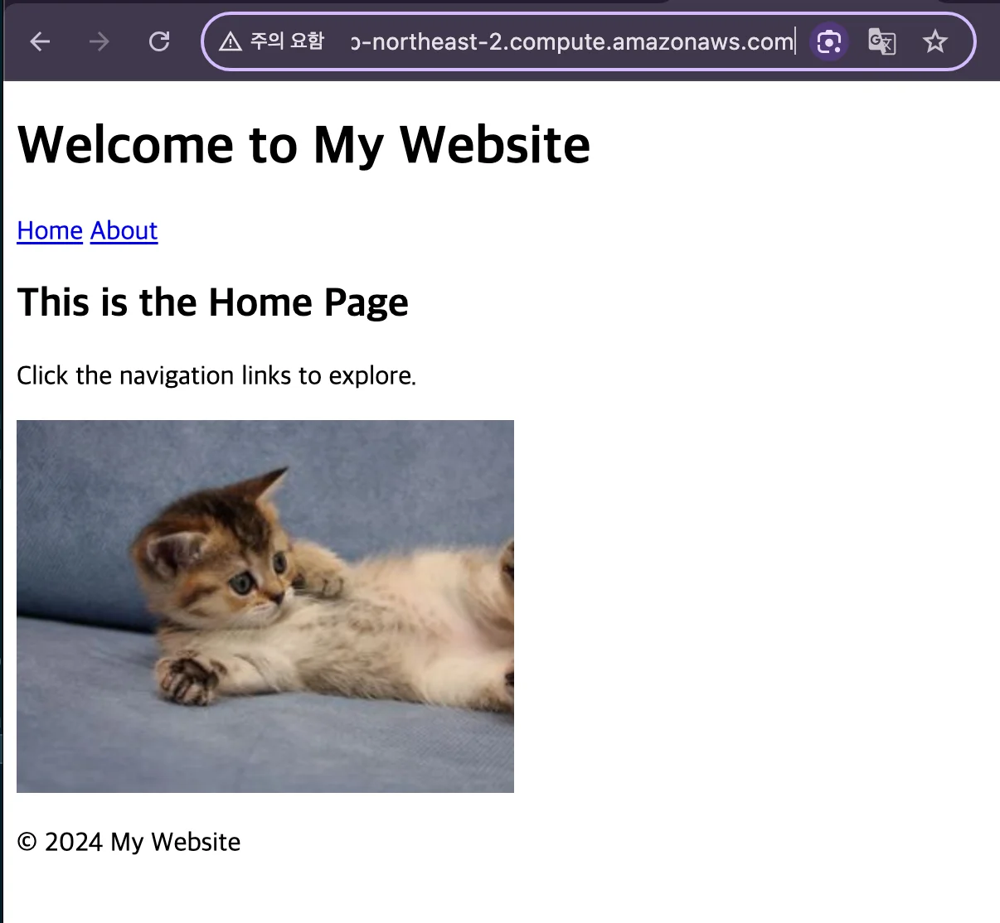
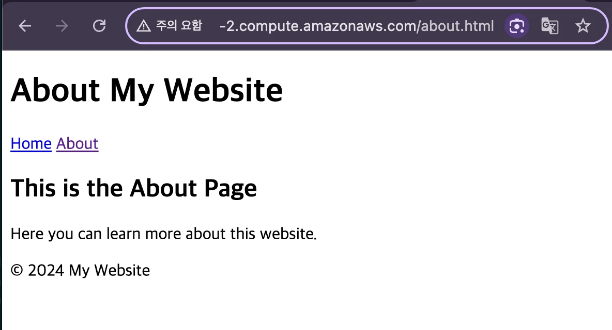
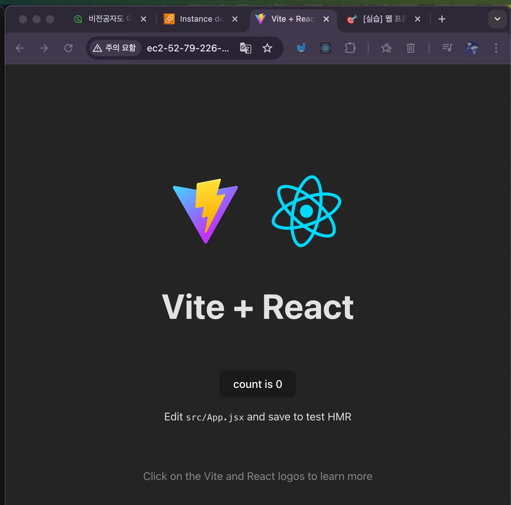
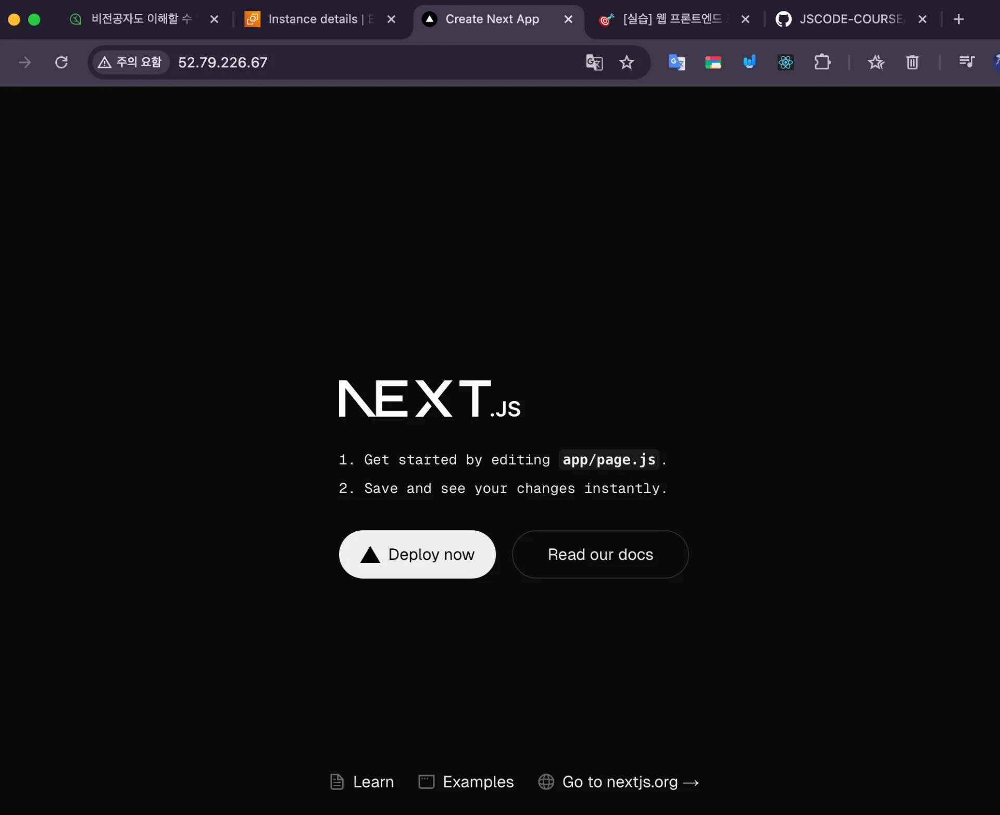

> /icons/checklist_gray.svg 
> 
> - [Nginx를 사용한 웹사이트 베포](#206eda9b0fe180bd959bc7281f1f0a34)
> - [프론트엔드 베포1 - HTML, CSS, JS](#206eda9b0fe180d3a092c4a3e3334905)
> - [프론트엔드 베포2 - React, Vite](#206eda9b0fe18082a413f1532d023330)
> - [프론트엔드 베포3 - Next.js](#206eda9b0fe18076b6a4e3bb8835dcb9)

<a id="206eda9b0fe180bd959bc7281f1f0a34"></a>

## Nginx를 사용한 웹사이트 베포

---

<a id="206eda9b0fe180d3a092c4a3e3334905"></a>

### 프론트엔드 베포1 &#45; <code>HTML</code>, <code>CSS</code>, <code>JS</code>

1. 웹 프로젝트(<code>HTML</code>, <code>CSS</code>, <code>JS</code>) EC2로 가져오기
    <a id="206eda9b0fe180b39687dca3dfdde9d1"></a>

    ```bash
    cd /usr/share/nginx
    sudo git clone https://github.com/JSCODE-COURSE/nginx-frontend-html.git
    ```

1. Nginx 설정 파일 수정
    <a id="206eda9b0fe180bda520f671042ce056"></a>

    ```bash
    cd /etc/nginx/conf.d
    sudo vi default.conf
    ```

    <a id="206eda9b0fe18078982dcb142ee2daa2"></a>

    <code>/etc/nginx/conf&#46;d/default&#46;conf</code>

    <a id="206eda9b0fe1805992e0cc76abb5a266"></a>

    ```bash
    server {
    		listen        80;
    		server_name   location;
    		
    		location / {
    				root   /usr/share/nginx/nginx-frontend-html;
    				index  index.html;
    		}
    		
    		error_page  500 502 503 504  /50x.html;
    		
    		location = /50x.html {
    				root   /usr/share/nginx/html;
    		}
    }
    ```

1. Nginx 설정 파일 반영
    <a id="206eda9b0fe180b59cb8c419fb3be9c4"></a>

    ```bash
    # Nginx 설정 파일 중 문법 에러가 있는 지 체크
    $ sudo nginx -t

    # Nginx의 설정 파일이 바뀐 경우 아래 명령어를 입력해줘야 설정 파일이 반영된다.
    $ sudo nginx -s reload
    ```

1. 웹 페이지(<code>http&#58;//{EC2 IP 주소}</code>) 접속
    

    

<a id="206eda9b0fe18082a413f1532d023330"></a>

### 프론트엔드 베포2 &#45; <code>React</code>, <code>Vite</code>

<details>
<summary>예제 React 프로젝트</summary>

[nginx-frontend-react](https://github.com/JSCODE-COURSE/nginx-frontend-react)

</details>

1. React 프로젝트 EC2로 clone
    <a id="206eda9b0fe180239eb3fd5759656a49"></a>

    ```bash
    # 정적 리소스 저장 폴더로 이동
    cd /usr/share/nginx

    # react 프로젝트 clone
    sudo git clone https://github.com/JSCODE-COURSE/nginx-frontend-react.git
    ```

1. <strong>React 프로젝트 빌드를 위한 Node&#46;js 설치</strong>
    <a id="206eda9b0fe180bc9f50c9ba8db21720"></a>

    ```bash
    sudo apt-get update && \
    sudo apt-get install -y ca-certificates curl gnupg && \
    sudo mkdir -p /etc/apt/keyrings && \
    curl -fsSL https://deb.nodesource.com/gpgkey/nodesource-repo.gpg.key | sudo gpg --dearmor -o /etc/apt/keyrings/nodesource.gpg && \
    NODE_MAJOR=20 && \
    echo "deb [signed-by=/etc/apt/keyrings/nodesource.gpg] https://deb.nodesource.com/node_$NODE_MAJOR.x nodistro main" | sudo tee /etc/apt/sources.list.d/nodesource.list && \
    sudo apt-get update && \
    sudo apt-get install nodejs -y

    # Node.js 설치 확인
    node -v
    ```

1. <strong>React 프로젝트 빌드</strong>
    <a id="206eda9b0fe180afa186db90d2428a4f"></a>

    ```bash
    cd nginx-frontend-react
    sudo npm i
    sudo npm run build
    ```

1. <strong>Nginx 설정 파일 수정</strong>
    <a id="206eda9b0fe1806db88af9476ad7831d"></a>

    ```bash
    cd /etc/nginx/conf.d
    sudo vi default.conf
    ```

    <a id="206eda9b0fe1802b9c35ef3ec51ab3c7"></a>

    <code>/etc/nginx/conf&#46;d/default&#46;conf</code>

    <a id="206eda9b0fe180eda072ec92860c0c3a"></a>

    ```bash
    server {
    		listen        80;
    		server_name   location;
    		
    		location / {
    				root   /usr/share/nginx/nginx-frontend-react/dist;
    				index  index.html;
    		}
    		
    		error_page  500 502 503 504  /50x.html;
    		
    		location = /50x.html {
    				root   /usr/share/nginx/html;
    		}
    }
    ```

1. <strong>Nginx 설정 파일 반영</strong>
    <a id="206eda9b0fe1807abdd0ece9b205ef91"></a>

    ```bash
    # Nginx 설정 파일 중 문법 오류가 있는지 확인
    sudo nginx -t

    # Nginx 재로딩 - 설정 파일이 변경된 경우, 해당 cmd를 통해 nginx를 재시작해야 반영된다. 
    sudo nginx -s reload
    ```

1. 웹 페이지(<code>http&#58;//{EC2 IP 주소}</code>) 접속
    

<a id="206eda9b0fe18076b6a4e3bb8835dcb9"></a>

### 프론트엔드 베포3 &#45; <code>Next&#46;js</code>

<details>
<summary>예제 React 프로젝트</summary>

[nginx-frontend-next](https://github.com/JSCODE-COURSE/nginx-frontend-next)

</details>

1. <strong>Next&#46;js</strong> 프로젝트 EC2로 clone
    <a id="206eda9b0fe181c2adc7cb66814bf687"></a>

    ```bash
    # 정적 리소스 저장 폴더로 이동
    cd /usr/share/nginx

    # next 프로젝트 clone
    sudo git clone https://github.com/JSCODE-COURSE/nginx-frontend-next.git
    ```

1. <strong>Next&#46;js 프로젝트 빌드를 위한 Node&#46;js 설치</strong>
    <a id="206eda9b0fe181d4989cc7ca897d3acc"></a>

    ```bash
    sudo apt-get update && \
    sudo apt-get install -y ca-certificates curl gnupg && \
    sudo mkdir -p /etc/apt/keyrings && \
    curl -fsSL https://deb.nodesource.com/gpgkey/nodesource-repo.gpg.key | sudo gpg --dearmor -o /etc/apt/keyrings/nodesource.gpg && \
    NODE_MAJOR=20 && \
    echo "deb [signed-by=/etc/apt/keyrings/nodesource.gpg] https://deb.nodesource.com/node_$NODE_MAJOR.x nodistro main" | sudo tee /etc/apt/sources.list.d/nodesource.list && \
    sudo apt-get update && \
    sudo apt-get install nodejs -y

    # Node.js 설치 확인
    node -v
    ```

1. <strong>Next&#46;js 프로젝트 빌드</strong>
    <a id="206eda9b0fe18115b42ae2a8d64f327a"></a>

    ```bash
    cd nginx-frontend-next
    sudo npm i
    sudo npm run build
    ```

1. <strong>Nginx 설정 파일 수정</strong>
    <a id="206eda9b0fe18133bdfecb9ceedc8ae5"></a>

    ```bash
    cd /etc/nginx/conf.d
    sudo vi default.conf
    ```

    <a id="206eda9b0fe181e0bc0de53b1f3d835e"></a>

    <code>/etc/nginx/conf&#46;d/default&#46;conf</code>

    <a id="206eda9b0fe181a081bee29d7474ba86"></a>

    ```bash
    server {
    		listen        80;
    		server_name   location;
    		
    		location / {
    				root   /usr/share/nginx/nginx-frontend-next/out;
    				index  index.html;
    		}
    		
    		error_page  500 502 503 504  /50x.html;
    		
    		location = /50x.html {
    				root   /usr/share/nginx/html;
    		}
    }
    ```

1. <strong>Nginx 설정 파일 반영</strong>
    <a id="206eda9b0fe1816baa07c997ad88f96a"></a>

    ```bash
    # Nginx 설정 파일 중 문법 오류가 있는지 확인
    sudo nginx -t

    # Nginx 재로딩 - 설정 파일이 변경된 경우, 해당 cmd를 통해 nginx를 재시작해야 반영된다. 
    sudo nginx -s reload
    ```

1. 웹 페이지(<code>http&#58;//{EC2 IP 주소}</code>) 접속
    
