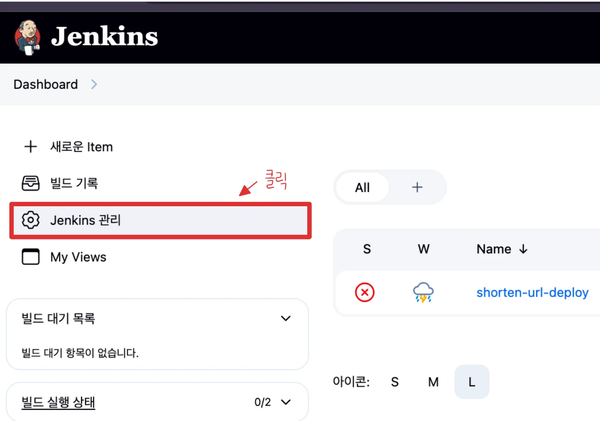
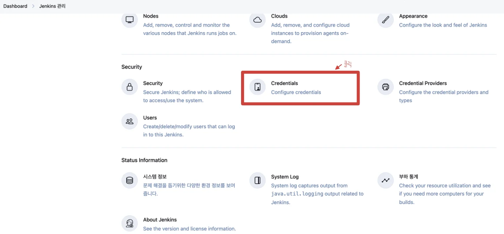
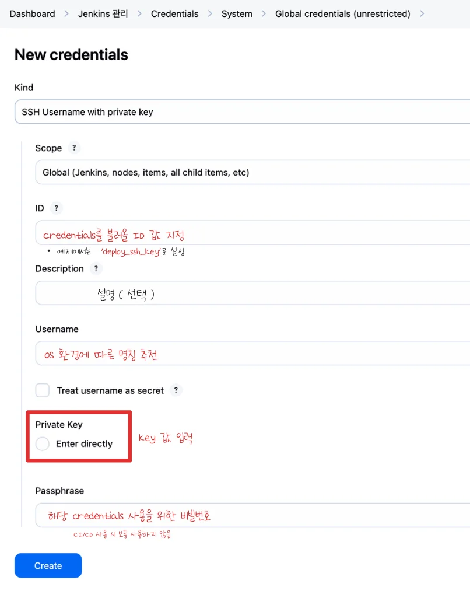

<a id="208eda9b0fe18052a645e0fa8221107e"></a>

### EC2 개인 키 <code>Jenkins Credential</code>로 등록

---

<a id="207eda9b0fe1803a874ad7cff3e49831"></a>

‣

- Jenkins → Manage Jenkins → Credentials 
    

    

- Domains, (global) &#45; Add Credentials
    

    

- credentials 값 입력
    

    - kind&#58; SSH Username with private key

    - scope&#58; Global

    - ID&#58; 실제 사용 시, 식별하는 키

    - Description&#58; credentials 에 대한 설명 ( 선택 )

    - Username&#58; OS에서 사용하는 유저명 사용

    - Private Key&#58; SSH 개인키의 value 값 입력
        <a id="208eda9b0fe180baa48bedf263e6b831"></a>

        ```bash
        cat jenkins_prac.pem | pbcopy
        ```

        - 그냥 복사 시, 공백 때문에 문제가 생길 수 있음

    - Passphrase&#58; credentials에 비밀번호 ( 선택 )
        - CI/CD 구축에 사용 시, 일반적으로 설정 안함
