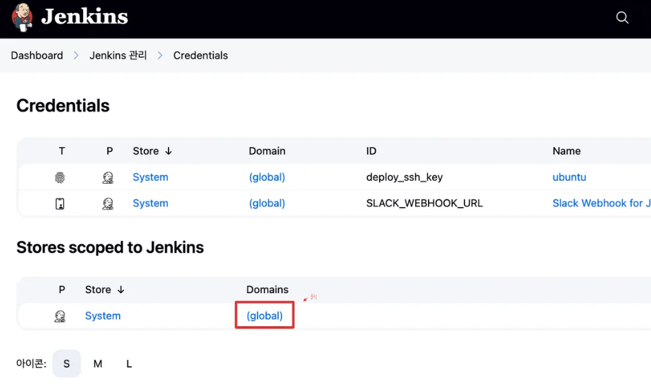
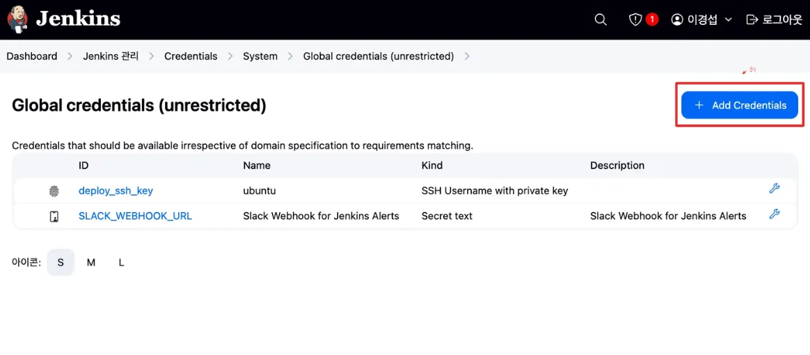
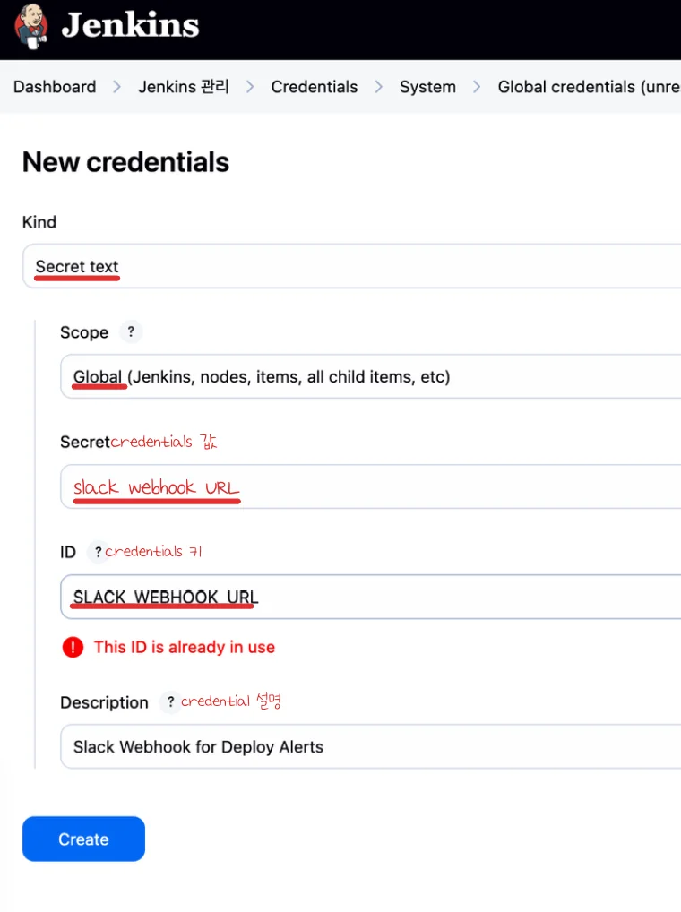

<a id="208eda9b0fe180629dc1d716f4ab2259"></a>

### Slack Webhook URL, <code>Jenkins Credential</code>로 등록

---

1. Slack App 설정 → <strong>Incoming Webhooks</strong> 활성화
    - Slack App 설정 → <strong>Incoming Webhooks</strong> 활성화

    - Webhook URL 생성

    - ex) <code>https&#58;//hooks&#46;slack&#46;com/services/T00000000/B00000000/XXXXXXXXXXXXXXXXXXXXXXXX</code>

1. Jenkins Credentials 등록 
    - Jenkins → Manage Jenkins → Credentials 
        

        

    - Domains, (global) &#45; Add Credentials
        

        

    - Credential 입력
        

1. 사용
    <a id="208eda9b0fe1809db274e0ee6c618bec"></a>

    ```groovy
     . . . 
     
    	post {
            success {
                script {
                    def logContent = readFile('deploy-check.log')
                    if (logContent.contains("APPLICATION FAILED TO START")) {
                        error("🚨 Spring Boot 애플리케이션이 포트 충돌 등으로 인해 시작 실패했습니다.")
                    }
                }
                withCredentials([string(credentialsId: 'SLACK_WEBHOOK_URL', variable: 'SLACK_URL')]) {
                    sh """
                    curl -X POST -H 'Content-type: application/json' \\
                    --data '{"text":"✅ *배포 성공* : ${JOB_NAME} #${BUILD_NUMBER}"}' \\
                    \$SLACK_URL
                    """
                }
            }
            failure {
                withCredentials([string(credentialsId: 'SLACK_WEBHOOK_URL', variable: 'SLACK_URL')]) {
                    sh """
                    curl -X POST -H 'Content-type: application/json' \\
                    --data '{"text":"❌ *배포 실패* : ${JOB_NAME} #${BUILD_NUMBER}"}' \\
                    \$SLACK_URL
                    """
                }
            }
        }
    }
    ```

    - <code>withCredentials(&#91;string(credentialsId&#58; &#39;SLACK&#95;WEBHOOK&#95;URL&#39;, variable&#58; &#39;SLACK&#95;URL&#39;)&#93;)</code>
        - 등록한 Slack Webhook을 credentialsId로 가져와 변수로 등록해 사용한다&#46;
