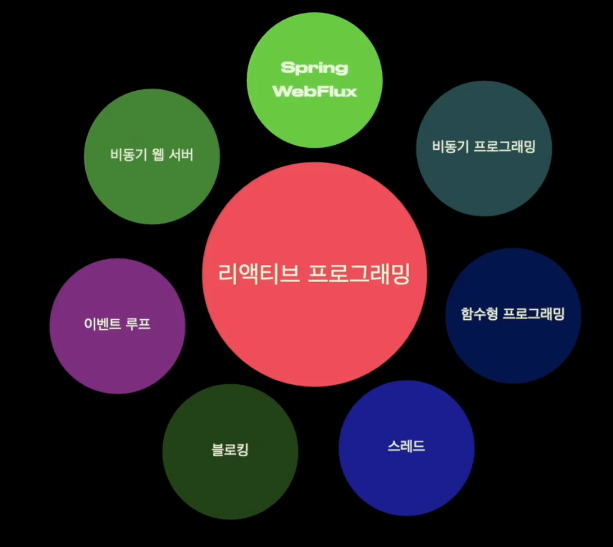

> /icons/push-pin_green.svg 
> 
> 
> 
> &#91;인프런&#93; <strong>RabbitMQ를 이용한 비동기 아키텍처 한방에 해결하기 &#45; 정리본</strong>
> 
> - 기간&#58; 보류
> 
> - 강의&#58; ‣
> 
> - reference
>     - ‣
> 
>     - ‣

> 
> 
> 
> 
> 목차
> 
> - [Chapter 1: WebFlux 개념](#210eda9b0fe181d6b6d8f21996602860)
> - [Chapter 2: WebFlux 구현](#212eda9b0fe1808cbe6ad48b7ef81946)
> - [Chapter 3: WebFlux + LLM ( GPT )](#212eda9b0fe180eb9f8df7fa41359fdc)

> 💬 
> 
> 
> 
> 각 개념들 간의 연결고리를 찾고 각 개념들이 Spring WebFlux에서 어떤 역할을 하는지를 학습한다면 WebFlux를 구현할 때 어떻게 해야하는지 자연스럽게 이해 가능하다&#46; 
> 
> 

## Chapter 1&#58; WebFlux 개념

[1. WebFLux](#/post/210eda9b-0fe1-8006-a929-face3a590697)

[1.2 SSE ( Server-Sent Events )](#/post/212eda9b-0fe1-800e-910d-cc2100e77faa)

[2. 리액티브 프로그래밍](#/post/210eda9b-0fe1-80cf-9985-f1cd37cb8664)

[3. 스레드 - Netty, Tomcat 비교](#/post/212eda9b-0fe1-80fa-8a40-cf46a578dfc3)

[4. 블로킹, 논블로킹 - 비동기 프로그래밍](#/post/212eda9b-0fe1-8096-8b74-e506e4c363c8)

[5. Reactive Streams, 함수형 프로그래밍](#/post/212eda9b-0fe1-80a1-8caa-ef0a361980c2)

[6. WebFlux - Pub/Sub 패턴](#/post/217eda9b-0fe1-80d7-9f80-dbe392a6e47d)

[7. Netty 와 이벤트 루프 패턴](#/post/212eda9b-0fe1-80a5-b220-c8664b98fe0e)

[[ 추가 ]  Netty 와 이벤트 루프 동작 원리](#/post/21ceda9b-0fe1-80fc-81eb-fec44dbfee1d)

[8. WebFlux, Netty 통합  ( 부제: 이벤트 루프 패턴들 )](#/post/212eda9b-0fe1-80a2-9875-f2a498c5f5db)

[9. WebFlux 블로킹 처리](#/post/212eda9b-0fe1-8050-8056-df0834044f08)

## Chapter 2&#58; WebFlux 구현

[1. WebFlux 기본 사용법 -  Flux, Mono](#/post/212eda9b-0fe1-816d-af62-ded0b8b7d476)

[2. Operator 1 - Mono](#/post/212eda9b-0fe1-8100-8547-ee3a3815f26e)

[3. Operator 2 - Flux](#/post/212eda9b-0fe1-802c-97eb-c53413752f6f)

[4. Operator 3 - FluxMap](#/post/212eda9b-0fe1-80da-8151-fd262d340adb)

[5. 시그널, 예외처리](#/post/212eda9b-0fe1-8089-aecc-e21a57363777)

[6. Scheduler](#/post/212eda9b-0fe1-80de-ad28-dfa642e57d21)

## Chapter 3&#58; WebFlux &#43; LLM ( GPT )

[1. LLM 서비스 설계, WebClient 1](#/post/212eda9b-0fe1-816f-917c-d2adb3fe81d9)

[1.2 LLM 서비스 설계, WebClient 2](#/post/212eda9b-0fe1-80c3-bdfb-ea7a9fc31539)

[2. 웹 뷰를 위한 간단한 React 프로젝트 설정](#/post/212eda9b-0fe1-813e-afb5-c5df6c8e1700)

[3. Facade API 구현, CORS 설정](#/post/212eda9b-0fe1-8093-a167-e6627008bd47)

[4. Http stream 통신](#/post/212eda9b-0fe1-80dc-ab94-fe7e974e9dd7)

[5. 실전 예외처리](#/post/212eda9b-0fe1-80f5-a8e9-c6ba5e72bdc8)

[6. Chain of Thought 1](#/post/212eda9b-0fe1-80c1-8ae1-c19615095659)

[7. Chain of Thought 2](#/post/212eda9b-0fe1-8011-bd01-e5dee53a8767)

[제목 없음](#/post/236eda9b-0fe1-8007-a2dd-d618f53e8c97)

[제목 없음](#/post/236eda9b-0fe1-80be-9fd8-c3a35234a47c)
