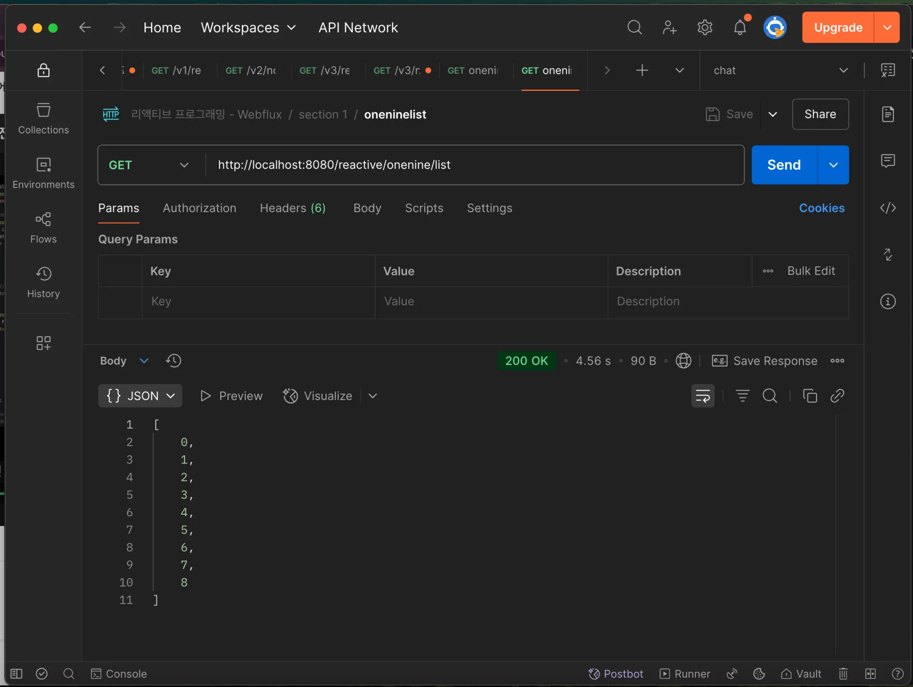
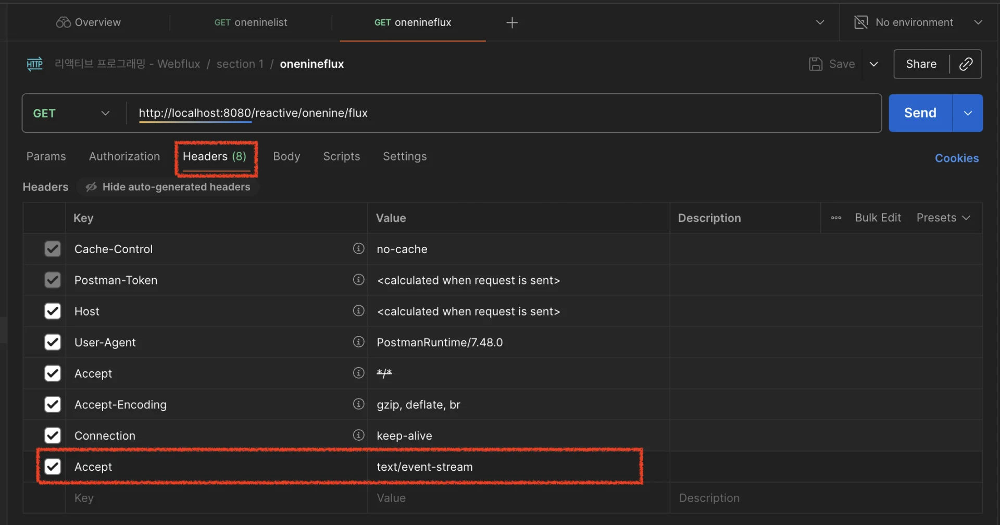
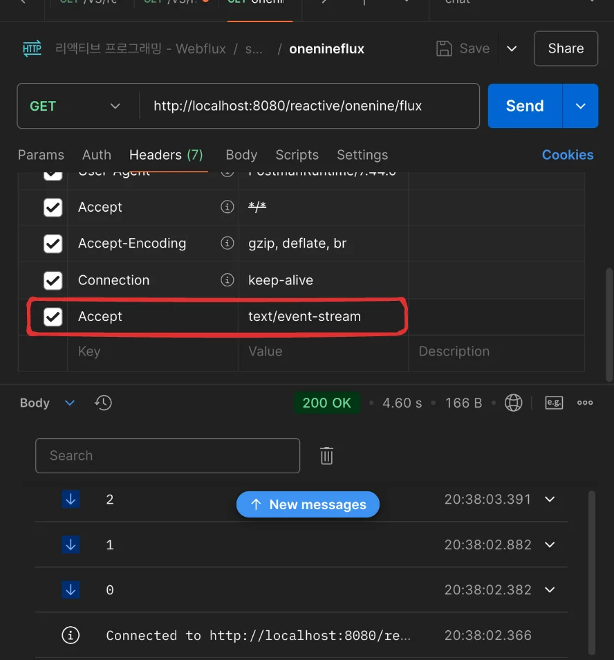
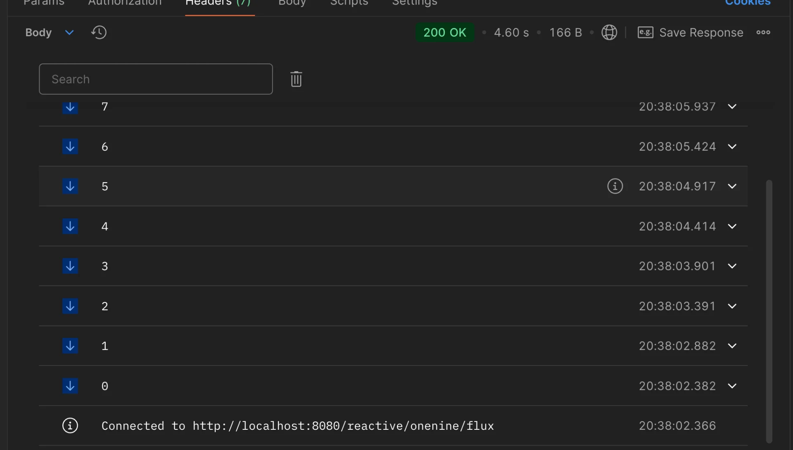

<a id="210eda9b0fe1800eaaadd2b3ccffaf64"></a>

## 리액티브 프로그래밍

---

> ✏️ 
> 
> <a id="212eda9b0fe1809cbff6ccfe174463f2"></a>
> 
> <strong>리액티브(Reactive)</strong>
> 
> <a id="212eda9b0fe1804d850ccde8224607b8"></a>
> 
> 리액티브는  <strong><u>데이터가 오거나, 에러가 나거나, 완료가 되거나 등 </u></strong><strong><u>이벤트가 발생</u></strong>하면<strong><u> </u></strong><strong><u>자동으로 반응</u></strong>하여  처리되는 것을 의미한다&#46;

<details>
<summary><strong>리액티브 4가지 핵심 특성 ( Reactive Manifesto )</strong></summary>

> ‣

> 📌 
> 
> <a id="212eda9b0fe180759a1ec62eeb36d157"></a>
> 
> Spring WebFlux는 리액티브 매니페스토의 4가지 특성을 따른다&#46;

| <strong>특성</strong> | <strong>설명</strong> |
| --- | --- |
| <strong><code>Responsive</code></strong><strong> (응답성)</strong> | 사용자 요청에 빠르게 응답해야 한다 |
| <strong><code>Resilient</code></strong><strong> (탄력성)</strong> | 장애가 발생해도 전체 시스템은 멀쩡하게 동작해야 한다 |
| <strong><code>Elastic</code></strong><strong> (탄력적 확장성)</strong> | 부하에 따라 유연하게 확장/축소 가능해야 한다 |
| <strong><code>Message Driven</code></strong><strong> (메시지 기반)</strong> | 비동기 메시지 전달로 시스템 컴포넌트 간 느슨한 결합을 유지해야 한다 |

</details>

<details>
<summary><strong>리액티브 프로그래밍</strong></summary>

> 📌 
> 
> <a id="212eda9b0fe1808990cdd9cd6b15e5fe"></a>
> 
> Reactive Programming은 <strong><u>“데이터 스트림(Stream)”</u></strong>을 중심으로 구성된 비동기 처리 방식이다

<a id="212eda9b0fe180a9b0a4c2a14e3fb85e"></a>

<strong>ex)</strong>

<a id="212eda9b0fe180e4a041fae0773bfdef"></a>

```java
Mono<String> nameMono = Mono.just("LEE");
nameMono.map(name -> "Hello " + name)
        .subscribe(System.out::println); // 데이터가 들어오면 출력 
```

- <code>Mono</code>는 <strong>1개의 데이터를 담을 수 있는 </strong><strong><code>Publisher</code></strong>이다&#46;

- <code>subscribe</code>는 <strong>데이터가 실제 도착했을 때 반응적으로 처리하겠다</strong>는 의미이다&#46;

- 즉, <code>nameMono</code>가 내부에서 “언제 데이터가 도착할지”를 결정하고, 개발자는 그에 대한 처리만 미리 정의해두는 방식이다&#46;

</details>

<details>
<summary>🧐 <code>기존 MVC</code> vs <code>리액티브 WebFlux</code> 차이</summary>

| 항목 | <strong><code>Spring MVC</code></strong> | <strong><code>Spring WebFlux</code></strong> |
| --- | --- | --- |
| 처리 모델 | 동기, 블로킹  | 비동기, 논블로킹 |
| 스레드당 요청 | 1&#58;1 | 1&#58;N |
| 성능 | 적은 동시 요청에 강함 | 많은 동시 요청에 유리 |
| API | &#64;RestController, RestTemplate | &#64;RestController,<br>WebClient, <br>Mono, Flux |

</details>

> 📌 
> 
> <a id="211eda9b0fe180f2b652d8ca7f0f9602"></a>
> 
> <strong>리액티브 프로그래밍 필수 요소</strong>
> 
> ---
> 
> 1. 데이터가 준비될 때마다 <u>바로바로 리액티브하게 처리</u>
>     - <strong><u>리액티브 스트림 구현체</u></strong> <code>Flux</code>, <code>Mono</code> 사용
> 
> 1. 로직 구현 시 반드시 <strong><u>논 블로킹</u></strong>하게 구현 해야한다&#46; 
>     - <strong><u>비동기 프로그래밍</u></strong> 필요

<a id="211eda9b0fe180fda292f523f65bc1a2"></a>

### 예제 코드

<details>
<summary>&#91; 코드 &#93; PracController</summary>

<a id="211eda9b0fe180bfb952ee387aabf670"></a>

```java
package webflux.prac.controller;

import org.springframework.web.bind.annotation.GetMapping;
import org.springframework.web.bind.annotation.RequestMapping;
import org.springframework.web.bind.annotation.RestController;
import reactor.core.publisher.Flux;

import java.util.ArrayList;
import java.util.List;

@RestController
@RequestMapping("/reactive")
public class PracController {

    @GetMapping("/onenine/list")
    public List<Integer> produceOneToNine() {
        List<Integer> sink = new ArrayList<>();
        for (int i = 0; i < 9; i++) {
            try {
                Thread.sleep(500);
            } catch (InterruptedException e) {
                throw new RuntimeException(e);
            }
            sink.add(i);
        }
        return sink;
    }

    @GetMapping("/onenine/flux")
    public Flux<Integer> produceOneToNineFlux() {
        return Flux.create(sink -> {
            for (int i = 0; i < 9; i++) {
                try {
                    Thread.sleep(500);
                } catch (InterruptedException e) {
                    throw new RuntimeException(e);
                }
                sink.next(i);
            }
            sink.complete();
        });
    }
}
```

<a id="211eda9b0fe180babe94e276262f6e04"></a>

<br>

</details>

<a id="211eda9b0fe18085b78df109b89910df"></a>

### Notes

> <strong>Postman 호출</strong>

<details>
<summary>일반(<strong>블로킹/동기) 프로그래밍&#58; </strong><strong><code>List</code></strong></summary>

> URL&#58; <code>/reactive/onenine/list</code>

<a id="211eda9b0fe1803d8ee9dbc7dabd8337"></a>

```java
@GetMapping("/onenine/list")
public List<Integer> produceOneToNine() {
    List<Integer> sink = new ArrayList<>();
    for (int i = 0; i < 9; i++) {
        try {
		        // 각 요청마다 데이터 처리 시간을 약 .5초 가정하여 블로킹 처리를 함
            Thread.sleep(500);
        } catch (InterruptedException e) {
            throw new RuntimeException(e);
        }
        sink.add(i);
    }
    return sink;
}
```



- 약 4&#46;5초가 걸림 ( 0&#46;5 &#42; 9 )

</details>

<details>
<summary><strong>리액티브 프로그래밍&#58; </strong><strong><code>Flux</code></strong></summary>

> ✏️ 
> 
> <a id="28beda9b0fe18078993cd0d780f086d3"></a>
> 
> Flux 사용 시, Header 추가 필요
> 
> -  Accept&#58; <code>text/event&#45;stream</code>
>     

> URL&#58; <code>flux/reactive/onenine/flux</code>

<a id="211eda9b0fe18094a528ce3fd0baa6ed"></a>

```java
@GetMapping("/onenine/flux")
public Flux<Integer> produceOneToNineFlux() {
    return Flux.create(sink -> {
        for (int i = 0; i < 9; i++) {
            try {
                Thread.sleep(500);
            } catch (InterruptedException e) {
                throw new RuntimeException(e);
            }
            sink.next(i);
        }
        sink.complete();
    });
}
```





<a id="28beda9b0fe180fcb5bcf9566c42ebd4"></a>

동일하게 블로킹이 발생되어 약 4&#46;5 초 정도가 걸림 ( 0&#46;5 &#42; 9 )

<a id="28beda9b0fe180279030c8f6022737dc"></a>

블로킹이 발생 시, 동기 방식과 동일한 성능을 보이는 것을 확인할 수 있다&#46;

<a id="28beda9b0fe180d1b0d7f7a55076ec01"></a>

따라서 논블로킹하게 코드를 작성하는 것이 중요하다&#46;

</details>

<details>
<summary><strong>🧐 </strong><strong><code>text/event&#45;stream</code></strong></summary>

> ✏️ 
> 
> <a id="212eda9b0fe180daadbcca2bad0b20e5"></a>
> 
> ```java
> Content-Type: text/event-stream
> ```
> 
> <a id="212eda9b0fe180a4b7c2f2926f2a37e2"></a>
> 
> <code>text/event&#45;stream</code>은 <code>Server&#45;Sent Event(SSE)</code>에서 사용하는 HTTP 응답의 <code>Content&#45;Type</code>으로 <strong><u>서버가 클라이언트로 이벤트를 지속적으로 전</u></strong><u>송</u>하는 방식으로 동작한다&#46;&#46; 
> 
> - <code>Flux</code>를 통해 스트리밍 응답을 만들 때 주로 사용된다&#46;
> 
> - HTTP 연결은 한 번만 열고, 그 후 서버가 여러 개의 메세지를 계속 전송한다&#46;
> 
> - 클라이언트는 메세지를 받자마자 처리할 수 있다&#46; <br>( <code>실시간성</code> )

| <strong>항목</strong> | <strong>설명</strong> |
| --- | --- |
| 형식 | Content&#45;Type&#58; <code>text/event&#45;stream</code> |
| 프로토콜 | HTTP 기반의 <strong>단방향 스트리밍</strong> |
| 연결 유지 | 지속적인 연결 유지 (keep&#45;alive) |
| 사용 기술 | React, Vue, JS에서 EventSource 사용 |
| 대안 기술 | WebSocket (양방향), <br>Polling (단방향 비효율적),<br> gRPC 등 |

<a id="212eda9b0fe1801a8249e87503e5308e"></a>

### ex)

<a id="212eda9b0fe18028b50ac3434890bc60"></a>

<strong>Spring WebFlux 사용</strong>

<a id="212eda9b0fe180e6afafe3b37aa02295"></a>

```java
@GetMapping(value = "/stream", produces = MediaType.TEXT_EVENT_STREAM_VALUE)
public Flux<String> streamData() {
    return Flux.interval(Duration.ofSeconds(1))
               .map(i -> "data: " + i);
}
```

- <code>Flux&#46;interval()</code>은 1초마다 값을 생성한다&#46; 

- <code>TEXT&#95;EVENT&#95;STREAM&#95;VALUE</code>를 지정하면 <strong>SSE 프로토콜 형식</strong>으로 응답한다&#46;

- 클라이언트는 서버로부터 실시간 데이터를 스트리밍 방식으로 수신한다&#46;

<a id="212eda9b0fe18042abdcdd249d523b78"></a>

<strong>클라이언트에서 수신 (JavaScript)</strong>

<a id="212eda9b0fe180f5936fc5517b971f40"></a>

```java
<script>
    const eventSource = new EventSource('/stream');

    eventSource.onmessage = function(event) {
        console.log('수신된 메시지:', event.data);
    };

    eventSource.onerror = function(err) {
        console.error('연결 오류:', err);
    };
</script>
```

- <code>EventSource</code>는 브라우저에서 <code>SSE</code>를 사용하는 표준 API이다&#46;

- 서버가 전송하는 메세지를 실시간 수신 가능하다&#46; 

</details>
