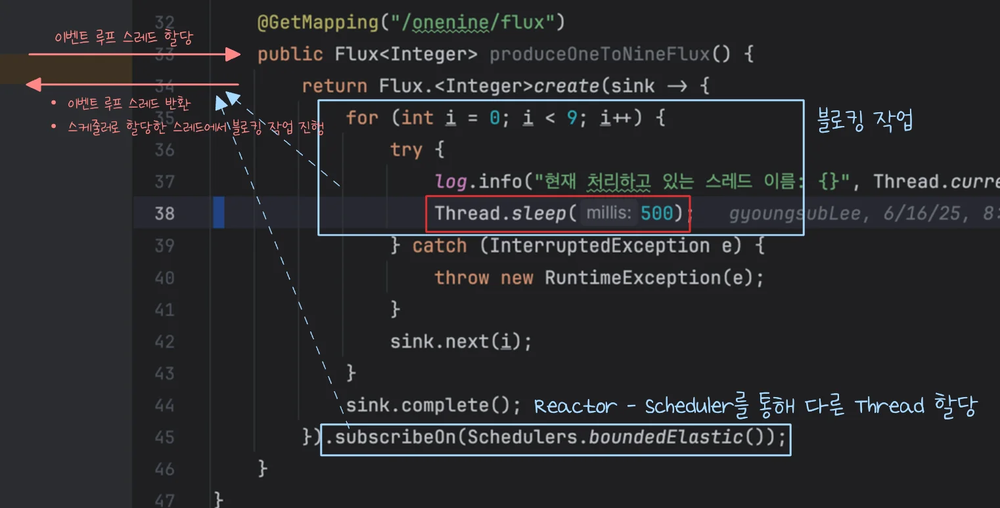
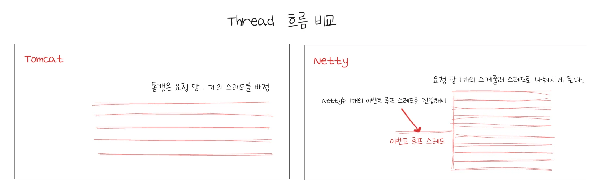
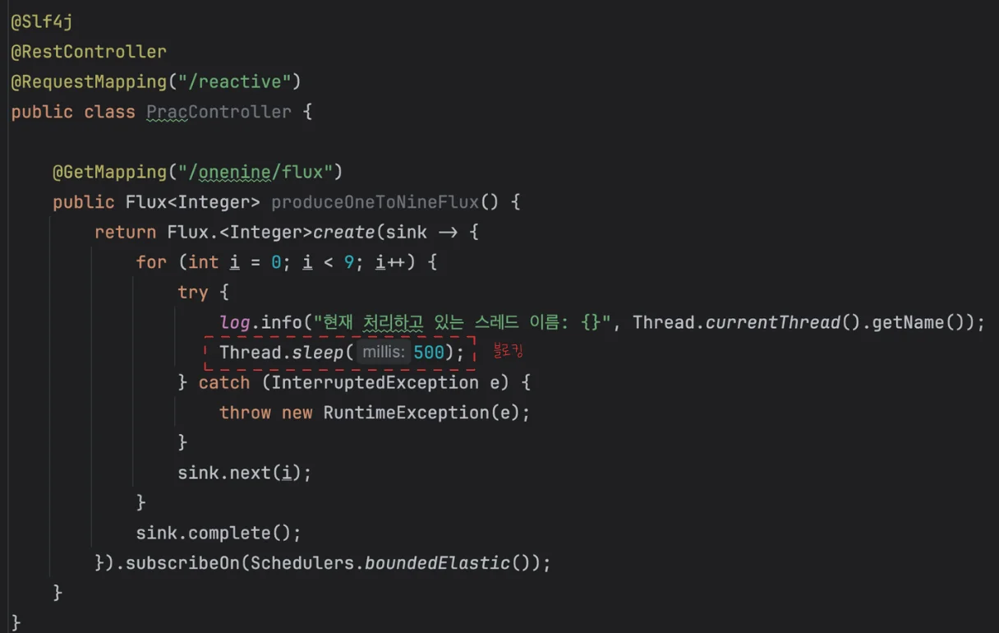
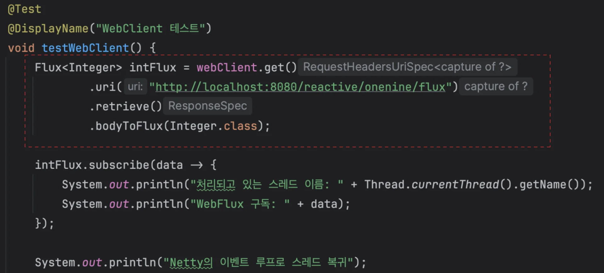
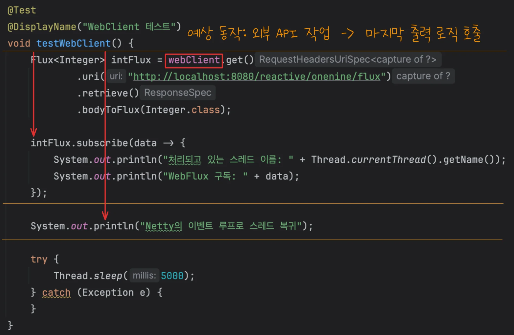
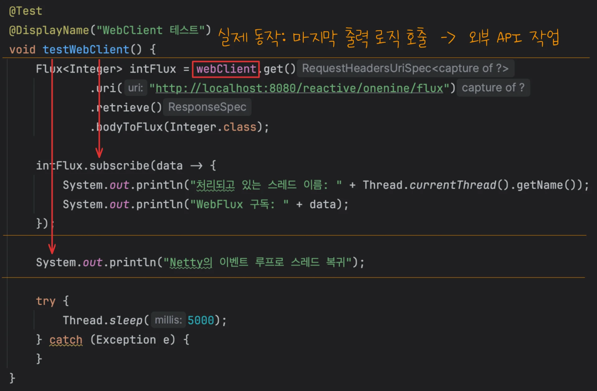
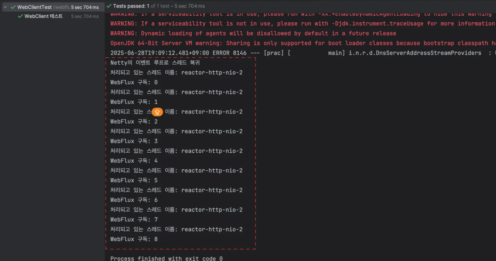

<a id="21deda9b0fe18038a249f4f0c9ed7512"></a>

## WebFlux, Netty 통합

---

<a id="21deda9b0fe1800da906e1063725cc61"></a>

### 1&#46; Reactor &#45; Schedulers를 통한 블로킹 회피 



<details>
<summary>&#91; 코드 &#93; <code>PracController&#46;produceOneToNineFlux()</code></summary>

<a id="21deda9b0fe1806ea999c5e54e8580e2"></a>

```java
import reactor.core.scheduler.Schedulers;

@Slf4j
@RestController
@RequestMapping("/reactive")
public class PracController {

		@GetMapping("/onenine/flux")
    public Flux<Integer> produceOneToNineFlux() {
        return Flux.<Integer>create(sink -> {
            for (int i = 0; i < 9; i++) {
                try {
                    log.info("현재 처리하고 있는 스레드 이름: {}", Thread.currentThread().getName());
                    Thread.sleep(500);
                } catch (InterruptedException e) {
                    throw new RuntimeException(e);
                }
                sink.next(i);
            }
            sink.complete();
        }).subscribeOn(Schedulers.boundedElastic());
    }
}
```

</details>

<a id="21deda9b0fe180a792a7e5e3689f4618"></a>

이전 챕터에서 블로킹 로직(<code>Thread&#46;sleep</code>)을 Reactor 라이브러리에서 제공하는 Schedulers를 통해 다른 스레드를 할당하여 회피했다&#46; 

<a id="21deda9b0fe18035b413fc237b23d202"></a>

그러나 해당 방식은 <strong>결국 스레드 하나가 블로킹</strong>이 되기 때문에 <strong><u>완전한 </u></strong><strong><u>논블로킹</u></strong><u>이라 보기는 </u><strong><u>다소 애매</u></strong>하다&#46; 물론 이벤트 루프 스레드는 다시 반환 되었기 때문에 Netty 자체에 문제가 발생 되지는 않는다&#46; 

- <strong><u>논블로킹</u></strong><strong>이 </strong><strong><u>필수</u></strong>적인 스레드는 <strong><u>이벤트 루프 스레드</u></strong>이다&#46; 

<a id="21deda9b0fe180f4a89bf9ecd90eefe2"></a>

### 2&#46; 논블로킹을 위한 외부 라이브러리  &#45; <code>WebClient</code> …

> 🧐 
> 
> <a id="21deda9b0fe180a5aa37f86a50eab196"></a>
> 
> <strong><code>비동기 웹서버</code></strong><strong>(Netty) 와 </strong><strong><code>WebFlux</code></strong><strong>의 사용 목적</strong>
> 
> ---
> 
> <a id="21deda9b0fe180e0bac3fb4472a3fe80"></a>
> 
> <strong><code>비동기 웹서버(Netty) 와 WebFlux의 사용 목적</code></strong>은 <strong><u>스레드 변경으로 인한 컨텍스트 스위칭 비용</u></strong>과 <strong><u>스레드의 블로킹을 최소화</u></strong>하여 <strong>성능을 최대한으로 끌어 올린 리액티브한 동작을 하기 위함이다&#46;</strong>

<a id="21deda9b0fe180e7ab70c638058ca2de"></a>

<strong><code>Reactor &#45; Schedulers을 통한 블로킹 회피 방식</code></strong>은 매번 블로킹 작업(ex&#46; 외부 API 호출 등) 마다 스케줄러의 스레드를 따로 할당해서 작업을  한다&#46;

<a id="220eda9b0fe180839fbde171aa9c4747"></a>

이는 <strong><u>기존의 Tomcat</u></strong>과<strong> </strong><strong><u>거의 비슷하거나 떨어지는 성능</u></strong><strong>을 가진다&#46; </strong>



- 지금 구조에서는 만약 유저의 요청이 100개가 들어온다면 스케줄러의 스레드가 100개가 할당되어야 한다&#46;  

- 톰캣에서 유저 요청 100개를 동시에 처리하기 위해 스레드 100개를 할당하는 것과 거의 비슷하거나 더 많은 리소스를 소모한다&#46;

<a id="21deda9b0fe180cca838cd1f3fe1821e"></a>

따라서 이를 해결하기 위해서는 직접 OS에 대기를 위임하고 작업이 끝나면 이벤트를 조회해서 콜백 함수를 처리하는 로직을 구현해야 하는데, 해당 작업은 번거로우며 비용이 많이 든다 &#46;<br><br>그렇다면 어떻게 해결해야 하는가? 이러한 니즈를 이미 다른 개발자들이 인식하고 해결했다&#46; 

<a id="21deda9b0fe180ed9b97daaf332d716f"></a>

즉, 해당 문제를 해결하기 위한 <strong><u>이미 검증이 완료된 라이브러리들이 존재</u></strong><strong>한다&#46;  </strong>

<a id="220eda9b0fe18040978fdf553283ac61"></a>

따라서 상황에 맞게 가져와 사용하면 된다&#46; 

> ✏️ 
> 
> - 외부 API 호출  &#45; <code>WebClient</code>
> 
> - DB 조회 &#45; <code>R2DBC</code>
> 
> - Redis 캐싱 &#45; <code>Reactive Redis</code>

<a id="21deda9b0fe1807a8aaec4bcffded01d"></a>

### 3&#46; &#91; 실습 &#93; <code>WebClient</code>

> ✏️ 
> 
> <a id="21deda9b0fe18073b619ff7933fbe635"></a>
> 
> <strong><u>외부 API 호출</u></strong> 시 <code>WebClient</code>를 사용하면 <strong>스케줄러 스레드의 지원 없</strong><strong>이도 완벽하게 </strong><strong><u>비동기로 블로킹 회피</u></strong><strong>가 가능</strong>하다&#46; 

<a id="21deda9b0fe18039a4adc5ba6156028f"></a>

### 코드

<details>
<summary>&#91; 코드 &#93; <code>testWebClient()</code></summary>

<a id="21deda9b0fe1801d85b8df5f71a2a9e8"></a>

```java
@Test
@DisplayName("WebClient 테스트")
void testWebClient() {
    Flux<Integer> intFlux = webClient.get()
            .uri("http://localhost:8080/reactive/onenine/flux")
            .retrieve()
            .bodyToFlux(Integer.class);

    intFlux.subscribe(data -> {
        System.out.println("처리되고 있는 스레드 이름: " + Thread.currentThread().getName());
        System.out.println("WebFlux 구독: " + data);
    });
    LocalDateTime endTime = LocalDateTime.now();

    try {
        Thread.sleep(5000);
    } catch (Exception e) {
    }
}
```

</details>

<details>
<summary>&#91; 코드 &#93; <code>testWebClient&#95;Signal()</code> &#45; 추가</summary>

<a id="21deda9b0fe180a7b4b6edf3499210c8"></a>

```java
@Test
@DisplayName("WebClient Flux 테스트 2 - WebCline 내에서 Signal로 분기")
void testWebClient_Signal() {
    LocalDateTime startTime = LocalDateTime.now();

    CountDownLatch latch = new CountDownLatch(1);

    Flux<Integer> intFlux = webClient.get()
            .uri("http://localhost:8080/reactive/onenine/flux")
            .retrieve()
            .bodyToFlux(Integer.class)
            .doOnNext(data -> {
                System.out.println("처리 스레드: " + Thread.currentThread().getName());
                System.out.println("받은 데이터: " + data);
            })
            .doOnComplete(() -> {
                LocalDateTime endTime = LocalDateTime.now();
                Duration duration = Duration.between(startTime, endTime);
                System.out.println("총 처리 시간(ms): " + duration.toMillis());
                latch.countDown(); // 완료 신호
            })
            .doOnError(error -> {
                System.err.println("에러 발생: " + error.getMessage());
                latch.countDown();
            });

    intFlux.subscribe();

    try {
        latch.await(); // 비동기 작업이 완료될 때까지 대기
    } catch (InterruptedException e) {
        e.printStackTrace();
    }
}
```

</details>

<details>
<summary>&#91; 전체 코드 &#93; WebClientTest</summary>

<a id="21deda9b0fe18083b52bf12f719fb610"></a>

```java
package webflux.prac.chapter1;

import org.junit.jupiter.api.DisplayName;
import org.junit.jupiter.api.Test;
import org.springframework.boot.test.context.SpringBootTest;
import org.springframework.web.reactive.function.client.WebClient;
import reactor.core.publisher.Flux;

import java.time.Duration;
import java.time.LocalDateTime;
import java.util.concurrent.CountDownLatch;

@SpringBootTest
public class WebClientTest {

    private WebClient webClient = WebClient.builder().build();

    @Test
    @DisplayName("WebClient 테스트")
    void testWebClient() {
        Flux<Integer> intFlux = webClient.get()
                .uri("http://localhost:8080/reactive/onenine/flux")
                .retrieve()
                .bodyToFlux(Integer.class);

        intFlux.subscribe(data -> {
            System.out.println("처리되고 있는 스레드 이름: " + Thread.currentThread().getName());
            System.out.println("WebFlux 구독: " + data);
        });
        LocalDateTime endTime = LocalDateTime.now();

        try {
            Thread.sleep(5000);
        } catch (Exception e) {
        }
    }

    @Test
    @DisplayName("WebClient Flux 테스트 2 - WebCline 내에서 Signal로 분기")
    void testWebClient_Signal() {
        LocalDateTime startTime = LocalDateTime.now();

        CountDownLatch latch = new CountDownLatch(1);

        Flux<Integer> intFlux = webClient.get()
                .uri("http://localhost:8080/reactive/onenine/flux")
                .retrieve()
                .bodyToFlux(Integer.class)
                .doOnNext(data -> {
                    System.out.println("처리 스레드: " + Thread.currentThread().getName());
                    System.out.println("받은 데이터: " + data);
                })
                .doOnComplete(() -> {
                    LocalDateTime endTime = LocalDateTime.now();
                    Duration duration = Duration.between(startTime, endTime);
                    System.out.println("총 처리 시간(ms): " + duration.toMillis());
                    latch.countDown(); // 완료 신호
                })
                .doOnError(error -> {
                    System.err.println("에러 발생: " + error.getMessage());
                    latch.countDown();
                });

        intFlux.subscribe();

        try {
            latch.await(); // 비동기 작업이 완료될 때까지 대기
        } catch (InterruptedException e) {
            e.printStackTrace();
        }
    }
}

```

</details>

<a id="220eda9b0fe180568b3fe2cc97b32674"></a>

### NOTES

> ✏️ 
> 
> <a id="220eda9b0fe1800d9629f2f0569110bb"></a>
> 
> <code>WebClient</code>를 사용하면 <strong><u>스케줄러 스레드의 지원 없</u></strong>이도 <strong><u>완벽하게 비동기로 블로킹 회피가 가능</u></strong>하다&#46;
> 
> - 해당 방법을 통해 스케줄러를 따로 할당해야 하는 문제 해결된다&#46; 

<details>
<summary><code>WebClient</code>를 사용 시 <strong><u>외부 API 호출을 비동기로 처리</u></strong>한다&#46; </summary>





<a id="220eda9b0fe1807fa149f1300ed1e935"></a>

실습 예제에서 <code>WebClient</code>를 통해<strong><u> Controller에 정의한 API를 호출</u></strong>했다&#46; 

- 해당 API에는 블로킹이 발생되기 때문에 이전 학습헹서 Reator 라이브러리의 <code>Schedulers</code>를 통해 블로킹 작업을 다른 스레드로 위임하여 해결했다&#46; 

> 예상 동작&#58; <code>외부 API 호출</code> → <code>마지막 출력 호출</code>



<a id="220eda9b0fe18093b3b2cdb647d33790"></a>

테스트코드에서 Schedulers와 같이 다른 쓰레드를 통해 블로킹 작업을 위임하는 정의되지 않았기 때문에, <strong><u>메인 쓰레드가 외부 API를 호출하고 그 다음 마지막 출력값을  출력</u></strong>할 것으로 예상되지만,

<details>
<summary>예상 출력값</summary>

<a id="220eda9b0fe180c8b2cff917d521c0f1"></a>

```java
▲   처리되고 있는 스레드 이름: reactor-http-nio-2
|   WebFlux 구독: 0
| 
|     . . .
| 
|   처리되고 있는 스레드 이름: reactor-http-nio-2
|   WebFlux 구독: 8
| 
====================외부 API 호출 작업======================
▲   
|   Netty의 이벤트 루프로 스레드 복귀
|   
=================비동시 동작 확인을 위한 출력값=================
```

예상하는 출력값

</details>

> 실제 동작&#58; <code>마지막 출력 호출</code> → <code>외부 API 호출</code>



<a id="220eda9b0fe180ee9d1ac5cd3d7eb757"></a>

실제 호출은 마지막 출력값이 먼저 실행 후, 그 다음 외부 API 호출 로직이 실행된다&#46; 

<a id="220eda9b0fe180b08d41e3ad4e3cbb57"></a>

즉, 이전과 동일하게 외부 API 호출이 <strong><u>비동기로 동작</u></strong>한다&#46; 

- 자세한 내부 동작은 <a href="#/post/212eda9b-0fe1-80a2-9875-f2a498c5f5db">페이지</a> &#45; <code>Case2</code> 참조

<details>
<summary>실제 출력값</summary>



</details>

</details>

<details>
<summary>🧐 <code>WebClient</code>는 어떻게 외부 API 호출을 비동기로 동작 있도록 하는가?</summary>

<a id="220eda9b0fe180e2937bf52a931ea616"></a>

WebClient가 반환하는 Flux는 내부적으로 <code>FluxReceive</code> 클래스를 사용한다&#46; 

<a id="220eda9b0fe18021ad7beeef176051c4"></a>

FluxReceive와 웹 클라언트의 내부 코드 동작을 통해 요청을 받아오는 Retrieve 라는 블로킹 동작을 할 때 블로킹 대기는 OS한테 위임을 하게 된다&#46; 

- Retrieve 블로킹 이벤트를 Netty의 이벤트로 등록하여 비동기로 처리한다&#46; 

<a id="220eda9b0fe180378e2eced208baefb2"></a>

그리고 Retrieve 블로킹 이벤트가 완료되면 subscribe 뒤에 붙은 callback 함수를 Netty가 Event Loop Thread를 할당해서 처리한다&#46; 

</details>

> 💬 
> 
> <a id="220eda9b0fe1803d8da1e5296051129f"></a>
> 
> 강사님 팁 &#45; DB 논블로킹 작업 
> 
> <a id="220eda9b0fe180f5ae8ad8df3f967723"></a>
> 
> <strong>바운디드 엘라스틱으로 스레드를 분리하여 JPA로 처리</strong> 
> 
> -  회원가입, 로그인을 통해 발생되는 조회 및 인서트는 바운디드 엘라스틱 스레드로 분리해서 JPA를 채용해 사용
> 
> - R2DBC는 오래된 라이브러리로써 이미 충분한 검증이 이뤄졌지만, 숙련도 부족으로 그냥 쓰레드를 분리하여 JPA로 비동기 처리를 한다

> 🗒️ 
> 
> <a id="220eda9b0fe1802e83a6fd7894e81532"></a>
> 
> <strong>WebFlux의 블로킹 처리 원칙</strong>
> 
> ---
> 
> 1. R2DBC, WebClient 등을 이용해 IO 블로킹을 가능한 최소화해야 한다&#46;
> 
> 1. 아래와 같은 경우, <strong>Scheduler</strong>를 이용해 스레드를 분리하여 비동기 처리를 한다&#46; 
>     - 어쩔 수 없이 발생되는 블로킹 로직
> 
>     - 병렬 처리
> 
>     - 오래 걸리는 작업
> 
>     - 마땅한 라이브러리가 없는 I/O 작업
> 
>     - 이벤트 루프 스레드가 할 일이 너무 많은 경우
> 
> 1. 리액티브 프로그래밍의 기본 원칙은 스레드 변경 최소화다&#46; 
>     <a id="220eda9b0fe1801ea5dee74b9bc7b65c"></a>
> 
>     따라서 불필요한 스레드 분리는 삼가 해야한다&#46;
