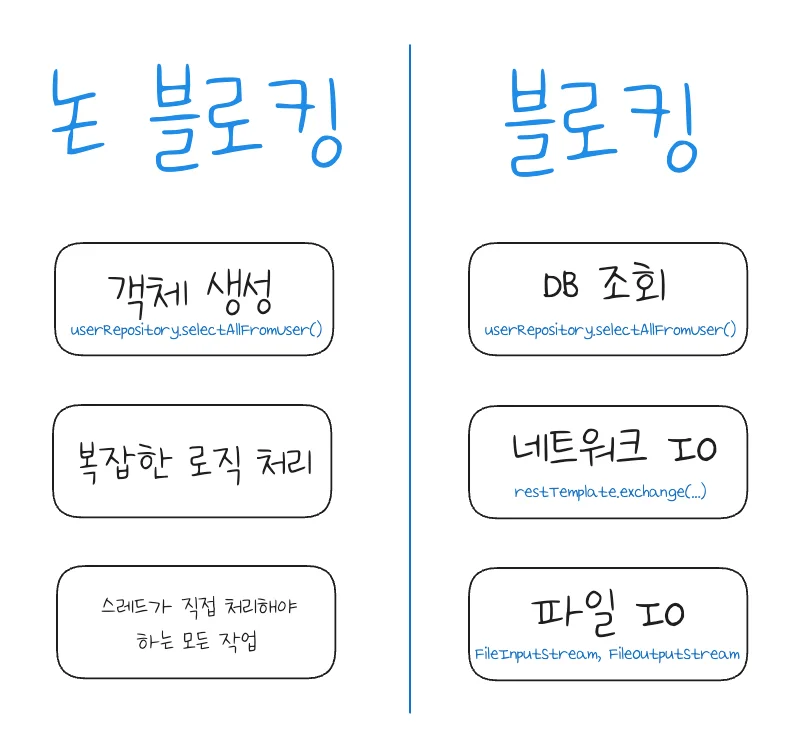
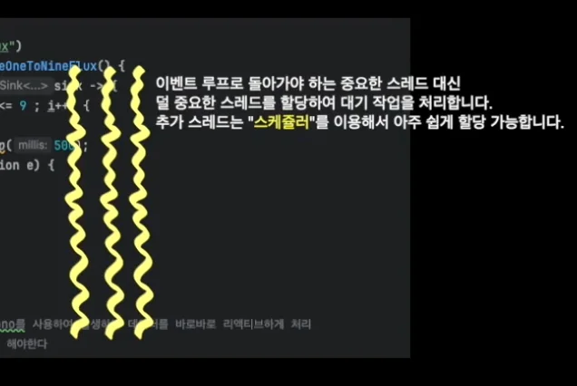

<a id="214eda9b0fe180b5a67ac16a0c06771e"></a>

## 

---

> 📖 
> 
> <a id="214eda9b0fe1806fb91adab8263af073"></a>
> 
> <code>I/O 블로킹(Blockin)</code>이란 작업을 처리하는 스레드가 외부 리소스의 처리를 기다려야 해서 작업이 중지된 채로 기다리고 있는 상태를 말한다&#46; 

- 스레드 블로킹이란 무엇인가?
    

> ✏️ 
> 
> <a id="214eda9b0fe180fe9152c32ef8ab7710"></a>
> 
> <strong><code>비동기 프로그래밍</code></strong>
> 
> <a id="214eda9b0fe180f2a89bc3e98aab59a6"></a>
> 
> 순서대로 <strong>동기적으로 작업하면서 블로킹이 완료될 때까지 </strong><strong>기다리지 않</strong>고 <strong><u>다른 스레드나 OS 등에 맡</u></strong>겨버리고 바로 <strong><u>다음 작업을 실행</u></strong>시킨다&#46;




- <strong>&#91;비동기&#93;</strong> <strong> </strong><strong><u>블로킹 → 논 블로킹</u></strong> 처리  예시
    - 자바스크립트의 <code>setTimeout()</code> 
        - 브라우저 백그라운드 스레드가 대기

    - 자바의 CompletableFuture 
        - 지정한 스레드가 대기

    - Netty의 이벤트 루프 패턴
        - OS의 I/O 다중화 메커니즘이 대기

    - Subscriber / Publisher 패턴 구현체인 Flux, Mono
        - 스케쥴러 스레드가 대기

<details>
<summary>&#91; 코드 &#93;</summary>

<a id="214eda9b0fe18014a088ff37313c8972"></a>

```java

```

</details>
