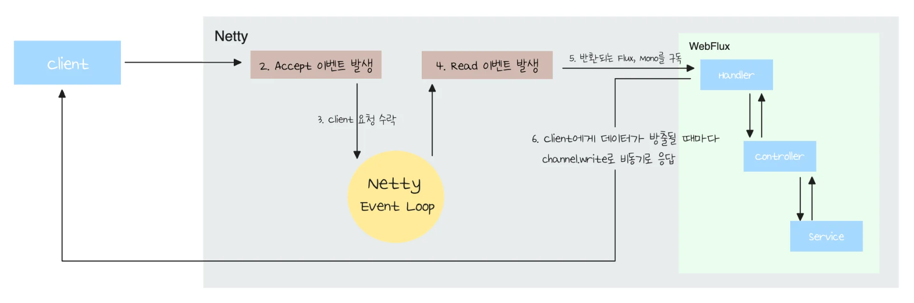
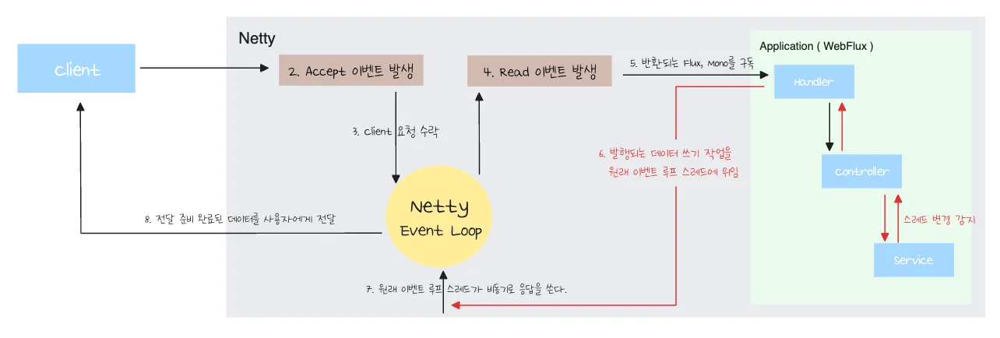
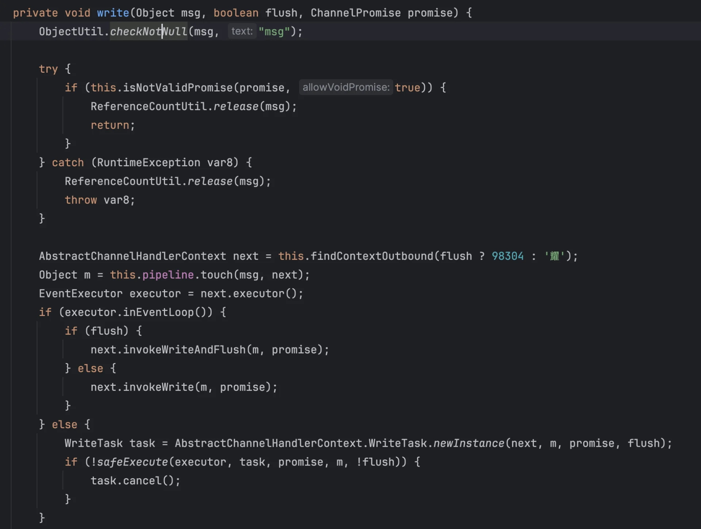
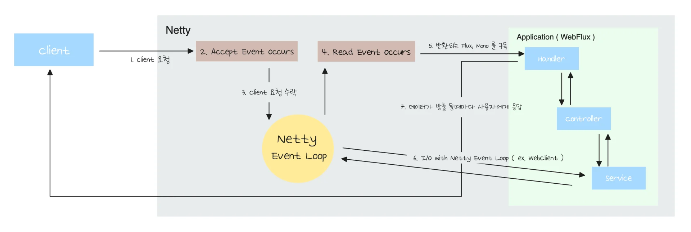

<a id="220eda9b0fe1803681edf360bbd7dc4d"></a>

## WebFlux에서의 Netty 통합

---

<a id="21ceda9b0fe180f4a9c0f98c21f6d447"></a>

### <strong>Case 1&#46;  일반적인 경우 &#45; </strong>Flux, Mono만 반환 



> 📌 
> 
> <a id="21ceda9b0fe180d3906cc6d74672a0c2"></a>
> 
> 로직 처리 시, 스레드가 변경되지 않는다면 Read 이벤트를 처리하던 이벤트 루프 스레드가 새로운 이벤트를 발생 시키지 않고 응답까지 처리한다&#46; 

> 진행 과정

1. 유저 요청이 수락되고 유저 요청 읽기가 완료 되면 WebFlux의 각종 핸들러가 프론트 컨트롤러 역할을 하여 URL에 따라 적절한 컨트롤러 메서드를 호출한다&#46; 

1. 그 결과로 컨트롤러에서 <code>Flux</code>나 <code>Mono</code>가 반환되면 이걸 Netty의 응답으로 쓰기 위해 내부적으로 <code>ChannelSendOperator</code>라는 클래스를 이용해 <code>subscribe</code>를 하게 된다&#46; 

1. 그리고 해당 구독(<code>subscribe</code>)한 시점에 비로소 작성한 로직들이 실행되기 시작하고 데이터들이 방출되면서 사용자에게 응답이 전달된다&#46; 

<a id="21ceda9b0fe180faae92d8a5f0788142"></a>

### Case 2&#46; Scheduler로 데이터를 방출하는 스레드를 교체하는 경우



> 📌 
> 
> <a id="21ceda9b0fe18023b27defced39177f3"></a>
> 
> 로직 처리 시에 <strong>스레드가 변경</strong>된다면 <strong><u>이벤트 루프로 복귀</u></strong>하여 <strong>원래 할당 받았던 이벤트 루프 스레드로 응답</strong>해야 한다&#46; 
> 
> - 이는 <strong><u>여러 동시성 문제를 회피</u></strong>하기 위함과 ( ByteBuffer 동시 접근 방지 등 ) <strong><u>효율성</u></strong>을 위해서이다&#46; 

<a id="21ceda9b0fe180c2a0adcb61fdac6b45"></a>

해당 케이스는 이전 챕터에서 학습했던 <strong><u>스케줄러를 통해 블로킹 회피 ( 데이터 방출 스레드를 교체 )</u></strong>하는 경우이다&#46;

<a id="21ceda9b0fe180caa420f758de1d26c3"></a>

Netty는 사용자한테 응답을 쓸 때 바이트 버퍼를 사용하며, 바이트 버퍼에 응답이 다 써지면 해당 데이터를 응답으로 사용자에게 전달한다&#46; 

<a id="21ceda9b0fe1803497bec9b783a7ec5d"></a>

그러나 Netty가 사용하는 <strong><u>바이트버퍼</u></strong>는 <strong><u>Thread Safe 하지 않</u></strong>기 때문에 <strong>여러 쓰레드가 접근</strong>한다면 <strong>동시성 문제</strong><strong>가 발생</strong>된다&#46; 

- 만약 스케줄러로 <u>무작위 할당된 스레드들이 하나의 바이트 버퍼에 접근하여 쓰기 작업을 진행</u>한다면 <u>무조건 </u><strong><u>동시성 문제</u></strong>가 발생된다&#46; 

<a id="21ceda9b0fe180df9ab1c6c3e696af0e"></a>

따라서 이를 해결하기 위해 <strong>이벤트 루프 스레드가 아닌, </strong><strong>스케줄러를 통해 추가로 할당한 스레드가 </strong><strong><u>응답을 방출</u></strong><strong> </strong>했다면 <strong>해당 응답은 바로 쓰지 않고 </strong><strong>이벤트 루프 스레드가 할 일로 등록</strong>한다&#46; 

<a id="21ceda9b0fe180bfacebd31f5fd99ecb"></a>

그러면 이벤트 루프 스레드가 바이트 버퍼에 직접 응답을 쓰게 된다&#46;<br>이를 통해<strong><u> 동시성 문제를 예방</u></strong>하고 <strong><u>효율성 있게 작업을 처리</u></strong>한다&#46;

- <strong><u>바이트 버퍼를 접근하여 유저에게 응답을 쓸 수 있는 스레드</u></strong>는 <strong>이벤트 루프 스레드가 유일</strong>하다&#46; 

<details>
<summary>&#91; 코드 &#93; <code>AbstractChannelHandlerContext&#46;write()</code></summary>

<a id="21ceda9b0fe1806ca5c0cfd56541af1c"></a>

```java
private void write(Object msg, boolean flush, ChannelPromise promise) {
		ObjectUtil.checkNotNull(msg, "msg");
		
		try {
		    if (this.isNotValidPromise(promise, true)) {
		        ReferenceCountUtil.release(msg);
		        return;
		    }
		} catch (RuntimeException var8) {
		    ReferenceCountUtil.release(msg);
		    throw var8;
		}
		
		AbstractChannelHandlerContext next = this.findContextOutbound(flush ? 98304 : '耀');
		Object m = this.pipeline.touch(msg, next);
		EventExecutor executor = next.executor();
		
		/**
			in event loop가 false 이면 
			즉, event loop 스레드 말고 다른 스레드가 write 하려고 하면
			event loop 스레드가 할일로 대신 등록한다. 
		*/
		if (executor.inEventLoop()) {
		    if (flush) {
		        next.invokeWriteAndFlush(m, promise);
		    } else {
		        next.invokeWrite(m, promise);
		    }
		} else {
		    WriteTask task = AbstractChannelHandlerContext.WriteTask.newInstance(next, m, promise, flush);
		    if (!safeExecute(executor, task, promise, m, !flush)) {
		        task.cancel();
		    }
		}
}
```

io&#46;netty&#46;channel&#46;<code>AbstractChannelHandlerContext&#46;write()</code>

<details>
<summary>이미지</summary>



</details>

</details>

<a id="21ceda9b0fe180e3883de2b014a48488"></a>

### Case 3&#46;  I/O 네트워크 처리에 Netty Event Loop를 사용하는 경우



> 📌 
> 
> <a id="21ceda9b0fe1807da00ad2b2e8f7cc95"></a>
> 
> <code>Case 1</code>에서 <strong><u>Netty Event Loop를 사용한</u></strong><u> </u><strong><u>I/O가 추가</u></strong>된 케이스이다&#46;
> 
> - <code>WebClient</code>와 같은 <strong><u>io 지원 라이브러리</u></strong>를 사용한다&#46;
> 
> - <u>I</u><strong><u>/O 처리를 이벤트 기반으로 처리</u></strong>하여 <strong>이벤트 루프 스레드에 대기가 발생하지 않</strong>는다&#46; 

<a id="21ceda9b0fe1802597fde9f149026a93"></a>

<code>WebClient</code>를 사용해<strong> </strong><strong><u>외부에서 API를 호출</u></strong>하면 <strong><u>이벤트 루프 스레드 대신 </u></strong><strong><u>OS가 대신 블로킹 작업(네트워크 I/O) 대기</u></strong>한다&#46;  

<a id="220eda9b0fe18016acdbde72859ca1f7"></a>

그리고 이벤트 루프 스레드는 다른 이벤트들을 처리하고 있다가 <strong><u>해당 외부 API 요청이 완료</u></strong>되면 <strong>subscribe에 등록한 콜백 함수</strong>를 <strong><u>비동기</u></strong><strong>로 실행</strong>하여 <strong>블로킹 없이 동작</strong>된다&#46;

> ✏️ 
> 
> <a id="21ceda9b0fe180129613fa9e7a4dafda"></a>
> 
> <code>Spring WebFlux</code>의 <strong><u>큰 장점 중 하나</u></strong>는 <strong>외부 AP 호출을 </strong><strong><u>논블로킹</u></strong><strong>하게 처리</strong>할 수 있다는 점이다
> 
> <a id="21ceda9b0fe180b69a71e396b6e2c7c1"></a>
> 
> 이를 <code>WebClient</code>를 사용하여 가능하게 한다

<a id="21ceda9b0fe1806cbc2ed9ab5a890b7e"></a>

따라서 <strong><u>이벤트 루프 스레드가 블로킹되지 않</u></strong>고 아주 <strong>효율적으로 </strong><strong><u>외부 API를 호출</u></strong>할 수 있다&#46; 

<a id="21ceda9b0fe18077ae6cc946e0201732"></a>

### <code>WebClient</code> vs <code>Schedulers &#43; RestTemplate</code>

> 🧐 
> 
> <a id="21ceda9b0fe180febdfddac80eed1b44"></a>
> 
> 이전에 배웠던 <code>Schedulers</code>를 통해  스레드 분리 후, <code>RestTemplate</code>을 호출하면 <code>WebClient</code>와 동일하게 <strong><u>외부 API 호출을 논블로킹하게 호출</u></strong>할 수 있는 것 아닌가?

<a id="21ceda9b0fe18039ae65f71be6eae522"></a>

블로킹 처리를 <code>Schedulers</code>를 이용해 별도의 스레드에서 처리하면 비효율이 발생된다&#46;

<a id="21ceda9b0fe1801aa670eba5ddf79ed7"></a>

이에 대한 자세한 내용은 다음 챕터에서 학습한다&#46;
