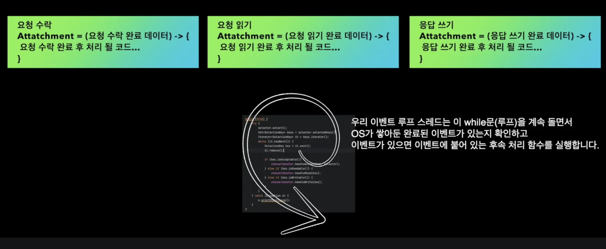
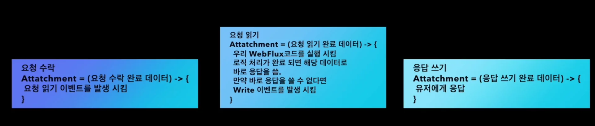

<a id="21ceda9b0fe180f09eb4fd69c7f0e057"></a>

## Netty 와 이벤트 루프 패턴

---

> 📖 
> 
> <a id="220eda9b0fe18010afa7fde723ba0922"></a>
> 
> <strong>Netty와 이벤트 루프 패턴</strong>
> 
> ---
> 
> > 이벤트 루프 패턴들에 대해서는 다음 장에서 자세히 다룬다&#46; 
> > 
> > - <a href="#/post/212eda9b-0fe1-80a2-9875-f2a498c5f5db">페이지</a> 
> 
> <a id="220eda9b0fe18096a858f42efc411fb9"></a>
> 
> 이벤트 루프를 패턴이라 하는 이유는 비동기 웹서버들이 전부 해당 이벤트 루프를 사용해 동작하기 때문이다&#46; 
> 
> - 대부분의 비동기 웹 서버들은 이벤트 루프를 사용하여 비동기적으로 동작한다&#46; 
> 
> - ex) NIO Tomcat, Netty …

<a id="220eda9b0fe180cb9dd4d9c814cc2b48"></a>

### 이벤트 루프

> 📌 
> 
> <a id="220eda9b0fe180bcb9afe624d78d939d"></a>
> 
> <code>이벤트 루프</code>란 <strong><u>스레드가 루프를 돌</u></strong>면서 <strong><u>이벤트</u></strong><strong><u>를 처리</u></strong>하는 방식을 말한다&#46;
> 
> <a id="220eda9b0fe180619108e3043c84c6ec"></a>
> 
> <strong>해당 루프를 도는 스레드</strong>를 <code>이벤트 루프 스레드</code>라고 한다&#46;

- 간단한 이벤트 루프 구현 코드
    > ✏️ 
    > 
    > <a id="220eda9b0fe180da86e8ee5927a85390"></a>
    > 
    > selector로 OS가 가지고 있는 이벤트가 있는지 확인 후, 이벤트가 있다면 while 루프를 돌면서 계속해서 이벤트를 처리한다&#46; 

    <a id="220eda9b0fe1801b80ace4ac8db6d51f"></a>

    ```java
    while (true) {
    		try {
    				selector.select();
    				Set<SelectionKey> keys = selector.selectedKey();
    				Iterator<SelectionKey> it = keys.iterator();
    				
    				while (it.hasNext()) {
    						SelectionKey key = it.next();
    						it.remove();
    						
    						if (key.isAcceptable()) {
    								chanceHandler.handleAccept(key, selector);
    						} else if (key.isReadable()) {
    								channelHandler.handleRead(key);
    						} else if (key.isWriteable()) {
    								channelHandler.handleWrite(key);
    						}
    				}
    		} catch (Exception e) {
    				e.printStackTrace();
    		}
    }
    ```

<a id="220eda9b0fe1809aa1c9d7ef0953a39d"></a>

### 이벤트 처리 순서

<a id="220eda9b0fe180f0b3e3c4b367e1179c"></a>

대표적인 이벤트로는 <code>요청 수락</code>, <code>요청 읽기</code>, <code>응답 쓰기</code> 등이 있다&#46; 

- 웹 클라이언트나 R2DBC 같은 라이브러리를 이용해 기본적인 요청 처리 말고도 다른 I/O 네티를 통해서 이벤트로 관리할 수 있다&#46;



<a id="220eda9b0fe180eda12fe5b9170e2ade"></a>

이러한 모든 이벤트들에는 <code>Attatchment</code>라는 걸로 이벤트가 완료됐을 때 처리해야 하는 함수 객체들이 붙어 있다&#46; 

- Flux에서 함수를 매개변수로 전달했던 것 처럼 이벤트에 함수 객체가 달려있다&#46; 

<a id="220eda9b0fe180289085d71fb3f782bf"></a>

이벤트루프 스레드들은 해당 이벤트 루프를 계속 돌면서 이벤트가 있느지 확인하고 만약 처리해야 될 이벤트가 있다면 이벤트에 달려있는 후속처리 함수를 실행한다&#46; 

<a id="220eda9b0fe180a2aecdd00ea1f99ce2"></a>

따라서 이벤트를 처리한다는 말은 이벤트에 붙은 후속처리 함수를 실행한다는 의미이다&#46; 

- 이렇게 이벤트를 완료한 뒤, 이후 호출을하는 함수를 콜백 함수라고 부르기도 한다&#46; 



<a id="220eda9b0fe180e28a22ddc105e02828"></a>

그렇다면 <code>요청 수락</code>, <code>요청 읽기</code>, <code>응답 쓰기</code>와 같은 이러한 이벤트들에는 <strong><u>어떤 함수가 달</u></strong>려있는가?

> <strong><code>요청 수락</code></strong><strong>  —&#62;  </strong><strong><code>요청 읽기</code></strong><strong>  —&#62;  </strong><strong><code>응답 쓰기</code></strong>

- 요청 수락 이벤트에는 요청 수락이 완료 이후, 읽기 이벤트를 발생시키는 함수가 들어 있다&#46; 

- 요청 읽기 이벤트에는 다음 애플리케이션 코드를 실행시키고 로직 처리를 한 다음에 <strong><u>응답 쓰기 이벤트를 발생</u></strong>시키는 함수가 들어있다&#46; 

- 응답 쓰기 이벤트에는 사용자에게 응답을 하는 함수들이 있다&#46; 

> 🗒️ 
> 
> <a id="220eda9b0fe180589525e0ace62e57ba"></a>
> 
> <strong>Netty 와 이벤트 루프 동작 원리</strong>
> 
> ---
> 
> <a id="220eda9b0fe180c588b0e5d01acd9d3e"></a>
> 
> 이벤트 루프 스레드는 1&#126;2를 계속 반복한다&#46; 
> 
> 1. 이벤트 루프에서 selector로 OS가 쌓아둔 이벤트가 있는지 조회한다&#46; 
> 
> 1. 이벤트가 있다면 이벤트에 등록 되어있는 함수를 실행한다&#46; 
> 
> > <a href="#/post/21ceda9b-0fe1-80fc-81eb-fec44dbfee1d">페이지</a>
