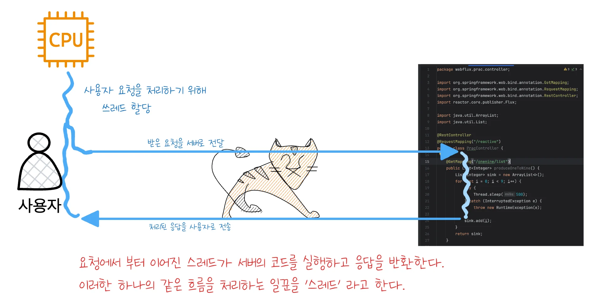
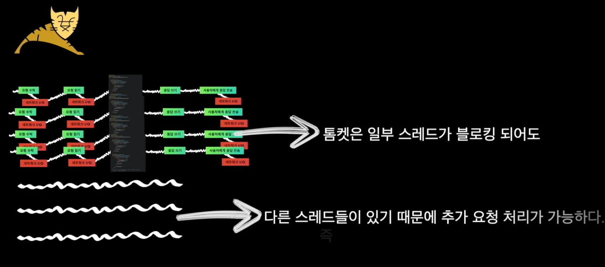
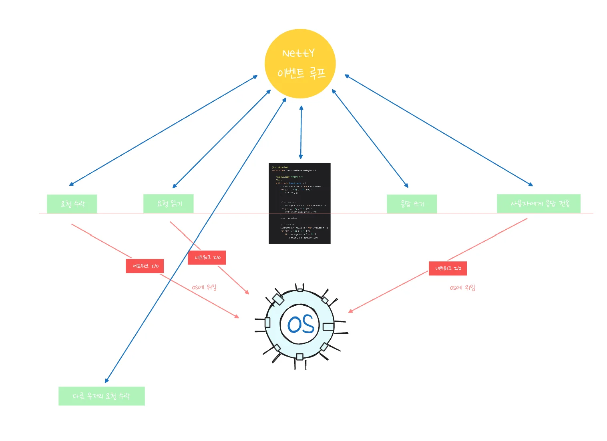
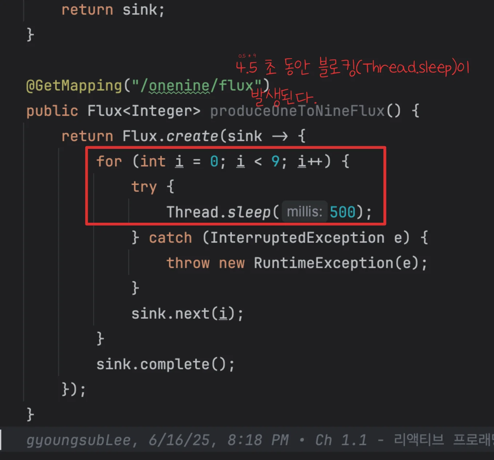
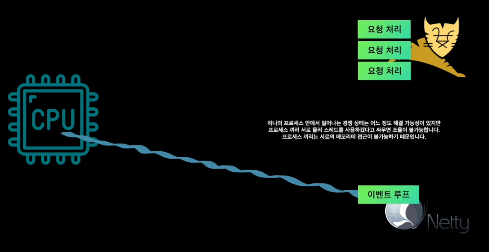
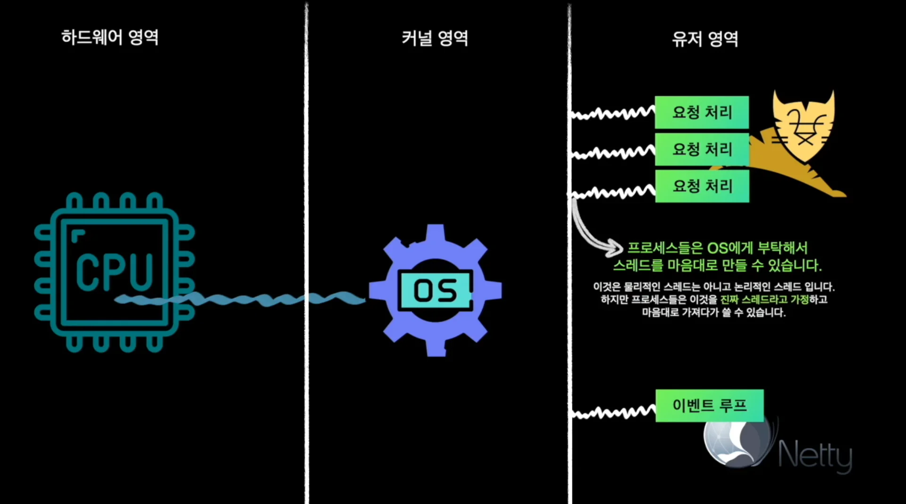
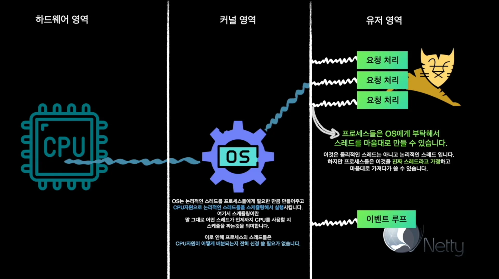
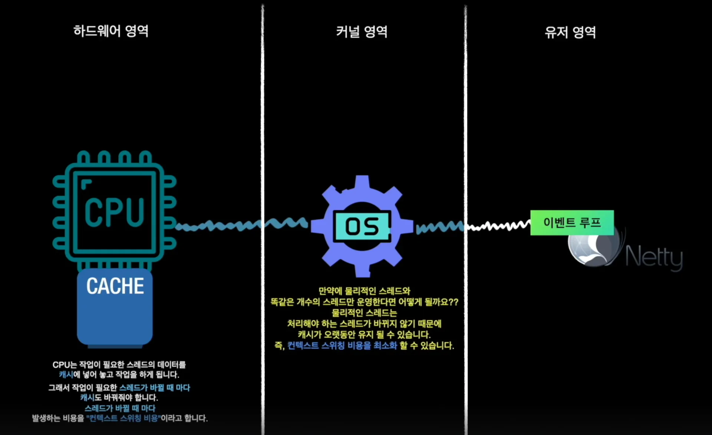

Reference

[EventLoop selector poorly balances cpu usage on cpu cores](https://github.com/netty/netty/issues/6905)

‣

> 
> 
> 
> 
> 목차
> 
> - [스레드](#210eda9b0fe1803cb64de0ae699e381d)
> - [Tomcat, Netty 비교](#211eda9b0fe180d0abbbeaa06617b444)
> - [ Tomcat](#211eda9b0fe1800ab636e11d1dac0bc6)
> - [ Netty](#211eda9b0fe1800d8f69dc623ff3b6c1)
> - [ Netty 가 블로킹에 취약한 이유 ](#21aeda9b0fe18092bc0ccf25522540f9)
> - [물리 스레드, 논리 스레드](#21aeda9b0fe1809fb8d0f345b0ff4907)
> - [ Netty가 적은 스레드로 이벤트를 처리하는 이유](#21aeda9b0fe18043b74efc02d8b79c4c)

## 스레드

---

> 📖 
> 
> 
> 
> <strong><u>하나의 작업 흐름을 실행</u></strong>시켜 주는 걸 <code>Thread</code>라고 말한다&#46; 
> 
> - <code>Thead</code>는 <code>실</code>이라는 뜻을 가지는데, 아래와 같이 <strong><u>하나로 이어져 있는 작업 흐름</u></strong> 하나의 실과 같다고 하여 <code>Thread</code>라고 한다&#46; 

사용자가 요청을 보내 스레드가 할일이 생기면 스레드는 CPU 자원을 할당 받는다&#46; 

그리고 웹서버에서 필요한 작업을 해주고 서버 즉, 코드에 도달하여 해당되는 작업을 실행 후, 응답 값을 사용자에게 다시 전달하는 하나의 작업 흐름을 갖는다&#46;

각 애플리케이션이 실행될 때 즉, 해당 프로세스(톰캣)가 실행될 때 스레드도 같이 만들어진다&#46; 그리고 애플리케이션이 처리해야 되는 모든 작업은 이 스레드릍 통해 이뤄진다&#46; 

## <strong>Tomcat, Netty 비교</strong>

---

> ✏️ 
> 
> 
> 
> <strong>Tomcat, Netty 비교</strong>
> 
> ---
> 
> > <code>블로킹</code>&#58; 파일 I/O, DB 호출, 외부 API 호출 등에서 스레드가 응답을 기다리며 멈추는 작업
> 
> - <strong>Tomcat</strong>
>     - 스레드&#45;퍼&#45;리퀘스트 모델
> 
>     - (기본적으로) 요청 하나당 스레드 하나를 할당하여 처리
> 
>     - 스레드가 블로킹되더라도, <strong>스레드 풀에서 다른 스레드가 새 요청을 처리 가능</strong>
> 
>     - 다만, 요청 수가 스레드 수를 넘기면 마찬가지로 병목 발생
> 
> - Netty
>     - 이벤트 루프 기반의 <strong>논블로킹 네트워크 프레임워크</strong>&#46; 소수의 스레드로 수천&#126;수만 연결을 처리 가능
> 
>     - Netty는 <strong>이벤트 루프 스레드 수가 적고 고정</strong>되어 있기 때문에, <u>블로킹 작업이 하나라도 발</u>생하면 <strong><u>해당 이벤트 루프는 그 작업이 끝날 때까지 다른 이벤트를 처리하지 못</u></strong><strong>함</strong>
>         
> 
>         → <strong><u>성능 급감</u></strong>

### <strong> Tomcat</strong>

톰켓의 스레드는 IO(블로킹) 작업을 <strong>직접 대기</strong>하며 <strong><u>하나하나 차례대로 실행</u></strong>한다&#46; 

- 톰켓은 <strong><u>하나의 요청</u></strong>을 <strong><u>하나의 스레드</u></strong>가 처리한다&#46; 

- 만약 100개의 작업 흐름을 실행하다면 100개의 스레드가 필요하다&#46;

스레드 풀에 수백개의 스레드를 보관하고 사용하기 때문에 일부 스레드가 블로킹 되어도 문제없이 동작한다&#46; 

따라서 <strong><u>DB 조회, 외부 API 호출</u></strong> 등 <code>네트워크 I/O</code>로 인한 블로킹 작업이 일부 발생되어도 나머지 <strong><u>스레드들을 추가 요청에 대한 처리</u></strong>하기 때문에 <strong>어느 정도의 블로킹 상황을 감당할</strong> 수 있다&#46; 

### <strong> Netty</strong>

> 📖 
> 
> 
> 
> <strong><u><code>Tomcat Thread는</code></u></strong>요청 수락, 읽기, 코드 처리, 응답 쓰기, 사용자에게 응답 전송 등을 <strong><u>하나의 작업 흐름으로 처리</u></strong>하지만 이와 달리 <strong><code>Netty Thread</code></strong>는 <strong><u>각 과정을 </u></strong><strong><u>이벤트로 분리</u></strong>하여 <strong><u>네트워크 I/O와 같은 </u></strong><strong><u>블로킹 작업 대기를 OS에 위임</u></strong>하여 이벤트들을 아주 짧은 시간에 처리 가능토록 한다&#46;

<code>Netty의 스레드</code>는 한개의 요청을 처리하고 작업을 끝내는 게 아닌, <strong><u>이벤트 루프에서 이벤트를 끝없이 처리</u></strong>한다&#46; 

### <strong> Netty </strong>가 블로킹에 취약한 이유 

Netty는 <strong><u>이벤트 루프 기반의 비동기 모델</u></strong>로 동작하며, 적은 수의 스레드(이벤트 루프)만으로 많은 연결을 처리할 수 있다&#46;

하지만 <strong><u>이벤트 루프 내에서 블로킹 작업이 발생</u></strong><strong>하면 </strong><strong><u>해당 스레드는 다른 이벤트를 처리할 수 없</u></strong><strong>기 때문에</strong><strong> 전체 성능에 심각한 영향</strong><strong>을 줄 수 있다&#46;</strong>

- 블로킹 작업이 발생되는 경우, Tomcat 과 달리 Netty는 다른 작업을 처리할 스레드가 없다&#46; 따라서 스레드는 해당 블로킹 작업을 기다린다&#46; 

해당 경우와 같이 <strong><u>블로킹이 발생되도록 코드를 작성</u></strong>하는 경우,

다른 동작들이 아무리 비동기 작업으로 잘 설계되어 있고, 하드웨어 스펙이 아무리 좋더라도 하나의 블로킹 대기를 매번 기다려야 한다&#46;

따라서 <strong><u>블로킹이 발생되지 않</u></strong>도록 코드를 작성하거나, <strong><u>해당 블로킹을 회피</u></strong>할 수 있도록 처리하는 것이 Netty를 사용하는데 중요하다&#46;

## 물리 스레드, 논리 스레드

---

###  Netty가 적은 스레드로 이벤트를 처리하는 이유

- 컨텍스트 스위칭 비용을 최소화하기 위해서

