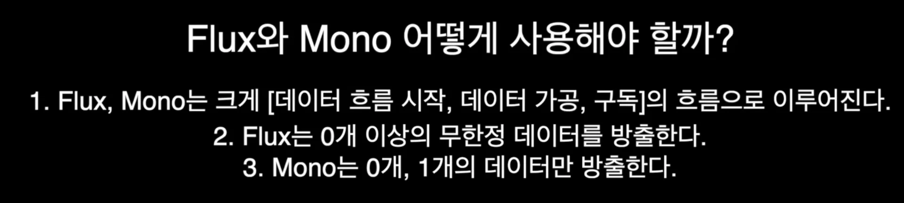

<a id="220eda9b0fe18042b876e5f85d74d0c5"></a>

## 1&#46; WebFlux 기본 사용법 &#45;  Flux, Mono

---

> ✏️ 
> 
> <a id="221eda9b0fe1800bb27ec30548912f31"></a>
> 
> <strong>Flux, Mono의 기본 구조</strong>
> 
> 1. just를 통해 데이터 시작
> 
> 1.  map, filter를 통해 데이터 가공
> 
> 1. subscribe를 통해 데이터 방출

> ✏️ 
> 
> - <code>Flux</code>&#58; 0개 이상의 데 이터를 방출할 수 있는 객체 
>     - List, Stream 같이 0개 이상의 데이터 방출
> 
> - <code>Mono</code>&#58; 0&#126;1개의 데이터만 방출할 수 있는 객체 
>     - Optional 정도
> 
>     - <strong><u>1 개의 데이터를 사용</u></strong>하는 경우 <code>Mono</code>가 <code>Flux</code>보다 가독성이 좋고 유지보수도 수월하다&#46;

<a id="220eda9b0fe18065968bc9ae87666efc"></a>

### 코드

<details>
<summary>&#91; 코드 &#93; Flux, Mono 기본 사용</summary>

<a id="221eda9b0fe180b083e7dd3829b34988"></a>

```java
@Test
void testBasicFlux() {
     Flux.<Integer>just(1, 2, 3, 4, 5)  // 1. 빈 함수, 2. 데이터로부터 시작 가능하다.
             .map(data -> data * 2)
             .filter(data -> data % 4 == 0)
             .subscribe(data -> System.out.println("Flux가 구독한 data: " + data  ));

}

@Test
void testBasicMono() {
    Mono.<Integer>just(1)  // 1. 빈 함수, 2. 데이터로부터 시작 가능하다.
            .map(data -> data * 2)
            .filter(data -> data % 4 == 0)
            .subscribe(data -> System.out.println("Mono가 구독한 data: " + data  ));
}
```

</details>

<details>
<summary>&#91; 코드 &#93; block ( 사용 ❌ )</summary>

<a id="221eda9b0fe180fbb653e4f673b2f18a"></a>

```java
@Test
void testBlock() {
    Mono<String> justString = Mono.just("string");
    String s = justString.block();
    System.out.println("s = " + s);
}
```

</details>

<details>
<summary>&#91; 전체 코드 &#93;</summary>

<a id="221eda9b0fe180bbb085eeeeea21b0cf"></a>

```java
package webflux.prac.chapter2;

import org.junit.jupiter.api.Test;
import org.springframework.boot.test.context.SpringBootTest;
import reactor.core.publisher.Flux;
import reactor.core.publisher.Mono;

@SpringBootTest
public class BasicFluxMonoTest {

    @Test
    void testBasicFlux() {
         Flux.<Integer>just(1, 2, 3, 4, 5)  // 1. 빈 함수, 2. 데이터로부터 시작 가능하다.
                 .map(data -> data * 2)
                 .filter(data -> data % 4 == 0)
                 .subscribe(data -> System.out.println("Flux가 구독한 data: " + data  ));

    }

    @Test
    void testBasicMono() {
        Mono.<Integer>just(1)  // 1. 빈 함수, 2. 데이터로부터 시작 가능하다.
                .map(data -> data * 2)
                .filter(data -> data % 4 == 0)
                .subscribe(data -> System.out.println("Mono가 구독한 data: " + data  ));
    }

    @Test
    void testBlock() {
        Mono<String> justString = Mono.just("string");
        String s = justString.block();
        System.out.println("s = " + s);
    }
}
```

</details>

<details>
<summary>원래 코드 </summary>

<a id="220eda9b0fe1804898aaf394beaf2e4a"></a>

```java
@GetMapping("/onenine/list")
public List<Integer> produceOneToNine() {
    List<Integer> sink = new ArrayList<>();
    for (int i = 0; i < 9; i++) {
        try {
            Thread.sleep(500);
        } catch (InterruptedException e) {
            throw new RuntimeException(e);
        }
        sink.add(i);
    }
    return sink;
}
```

</details>

<details>
<summary>내부 동작</summary>

<a id="221eda9b0fe180809344ff24ab83c8d9"></a>

```java
@GetMapping("/onenine/list")
public Mono<List<Integer>> produceOneToNine() {
    List<Integer> sink = new ArrayList<>();
    for (int i = 0; i < 9; i++) {
        try {
            Thread.sleep(500);
        } catch (InterruptedException e) {
            throw new RuntimeException(e);
        }
        sink.add(i);
    }
    return Mono.just(sink);
}
```

</details>

<a id="220eda9b0fe180339ae7c757d2dad706"></a>

모노나 플럭스가 아닌 동기적인 객체를 반환하게 되면 스프링 내부에서 자동으로 Mono&#46;just로 감싸 처리한다&#46; 

<a id="220eda9b0fe18055a576f6785a2708b5"></a>

Mono 껍데기만 씌워버려 WebFlux는 해당 리스트를 감싸고 있는 Mono를 구독할 수 있게 된다&#46; 

- 실제 구현할 때는 API 유지보수를 위해서라도 직접 Mono로 감싸주는 걸 권장한다&#46;

> 💬 
> 
> <a id="220eda9b0fe1806db5d6fb9e6e8e36cc"></a>
> 
> Spring WebFlux에서 모든 흐름은 Mono나 Flux로부터 시작하는 것을 권장한다&#46; 



<a id="220eda9b0fe180529379cd5a73b2c221"></a>

<code>Mono&#60;String&#62;</code>은 구독을 하고 그 안에 있는 데이터가 완성이 돼서 방출이 되어야지만 String으로 생성된다&#46; 

<a id="220eda9b0fe180c68001e73c82725bd9"></a>

즉, 해당하는 <code>Mono</code>는 언제 방출될지 비동기 객체라는 의미이다&#46; 

<a id="220eda9b0fe180019297d74d30742ced"></a>

그렇다면 이런 <code>Mono&#60;String&#62;</code>을 그냥 String으로 변환하려면 어떻게 해야 하는가?

<a id="220eda9b0fe1806cb36cefeea90efed5"></a>

가장 간단한 방법은 여기 스레드를 블로킹하고 얘가 방출되고 데이터가 완성될때까지 기다리면 된다&#46; 

<a id="220eda9b0fe18061ad51f67912fbaa83"></a>

그리고 해당 작업을 <code>block()</code>을 통해 가능하다&#46; 

<a id="220eda9b0fe1805fab44f8b11dc1a16b"></a>

ㅇ

<a id="220eda9b0fe180d190bedbb0c6fe5476"></a>

만약 해당  모노 안에서 다른 스레드가 메인 스레드 대신 시간이 오래 걸리는 블로킹 작업을 처리한다고 한다면, 원래 같으면 메인 스레드는 해당되는 모노의 작업을 기다리지 않고 비동기적으로 동작하지만, block으로 인해 동기적으로 동작되어 이벤트 루프 스레드가 블로킹되는 심각한 오류 상황이 발생된다&#46; 

<a id="220eda9b0fe1801baf64d55c25656b4a"></a>

따라서 <code>block()</code> 웬만해서는 사용하지 않는 것을 권장한다&#46;
