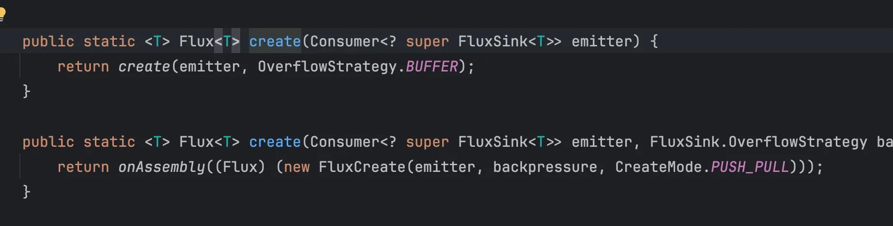
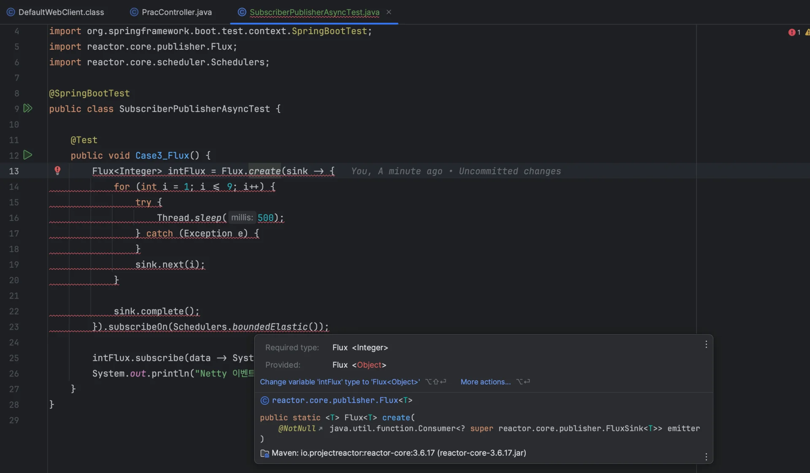
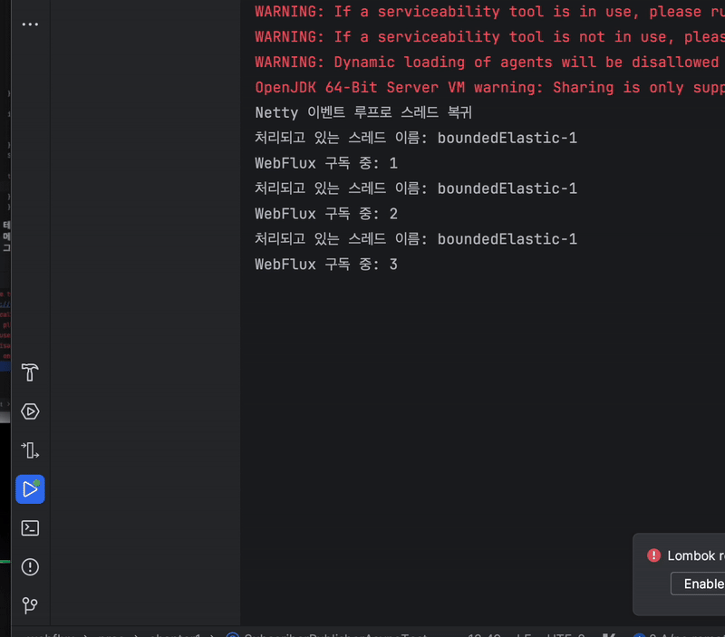

> 🗒️ 
> 
> <a id="21beda9b0fe180b88c10e87c89cccd4c"></a>
> 
> <strong>정리</strong>
> 
> ---
> 
> 1. Flux는 함수 코드 덩어리만 들어있다가 <strong>구독</strong>을 해서 함수를 실행시키는 순간부터 데이터를 발행한다&#46; 
> 
> 1. 스레드가 1개라면 Flux만으로는 절대로 블로킹을 회피할 수 없다&#46; 따라서  스케줄러로 추가 스레드를 할당하여 대신 작업시켜야 한다&#46; 

<a id="217eda9b0fe180c6b7d4d2050204e8f9"></a>

## WebFlux &#45; <code>Subscriber</code> / <code>Publisher</code> ( 구독/발행) 패턴

---

> 📖 
> 
> <a id="21beda9b0fe1800298a8f0cece29d196"></a>
> 
> 구독 / 발행 패턴은 비동기 스트림 방식에서 많이 사용하는 패턴이다&#46;  
> 
> - <code>Flux</code>는 <code>Reactor</code>라는 라이브러리 내부 존재하며 <code>Spring WebFlux</code>도 해당 라이브러리를 사용한다&#46;
> 
> - <code>Flux</code>를 구독해야지만 해당 코드가 실행 되면서 발행이 시작된다&#46; 그리고 그 안에 데이터가 하나씩 방출되는 걸 <strong><u>Publish</u></strong> 즉, <strong><u>발행</u></strong>이라고 한다&#46; 

<a id="21beda9b0fe180d4a049f10cf67e3c56"></a>

### 예제 &#45; Controller

<a id="21beda9b0fe180258f45d90b1a5da309"></a>

```java
@Slf4j
@RestController
@RequestMapping("/reactive")
public class PracController {

		@GetMapping("/onenine/flux")
    public Flux<Integer> produceOneToNineFlux() {
        return Flux.create(sink -> {
            for (int i = 0; i < 9; i++) {
                try {
		                log.info("현재 처리하고 있는 스레드 이름: {}", Thread.currentThread().getName());
                    Thread.sleep(500);
                } catch (InterruptedException e) {
                    throw new RuntimeException(e);
                }
                sink.next(i);
            }
            sink.complete();
        });
    }
}
```

<a id="21beda9b0fe180488c30e463d785edcd"></a>

```java
webflux.prac.controller.PracController   : 현재 처리하고 있는 스레드 이름: reactor-http-nio-3
webflux.prac.controller.PracController   : 현재 처리하고 있는 스레드 이름: reactor-http-nio-3
webflux.prac.controller.PracController   : 현재 처리하고 있는 스레드 이름: reactor-http-nio-3
webflux.prac.controller.PracController   : 현재 처리하고 있는 스레드 이름: reactor-http-nio-3
webflux.prac.controller.PracController   : 현재 처리하고 있는 스레드 이름: reactor-http-nio-3
webflux.prac.controller.PracController   : 현재 처리하고 있는 스레드 이름: reactor-http-nio-3
webflux.prac.controller.PracController   : 현재 처리하고 있는 스레드 이름: reactor-http-nio-3
webflux.prac.controller.PracController   : 현재 처리하고 있는 스레드 이름: reactor-http-nio-3
webflux.prac.controller.PracController   : 현재 처리하고 있는 스레드 이름: reactor-http-nio-3
```

<a id="21beda9b0fe180849bbad9a28929dbc7"></a>

<code>reactor&#45;http&#45;nio</code>가  이벤트 루프 스레드이다&#46; 

<a id="21beda9b0fe18005ba58cbad56c24e5a"></a>

이벤트 루프 스레드는 블로킹 되어선 안된다&#46; 

<a id="21beda9b0fe18081971ccdf7f9156da8"></a>

## Flux 블로킹 회피 방법 &#45; <code>Scheduler</code>

---

> 📖 
> 
> <a id="21beda9b0fe180ed855edc7cf0d97ce9"></a>
> 
> <code>Flux</code>와 <code>Mono</code>의 라이브러리인 <code>Reactor</code>에서는 <code>Scheduler</code>를 제공한다&#46;
> 
> <a id="21beda9b0fe1809c91a0c7691074b3df"></a>
> 
> 이를 통해 <strong><u>스레드를 추가 할</u></strong><strong><u>당</u></strong>하여 블로킹 로직을 회피할 수 있다&#46;
> 
> <a id="21beda9b0fe180818dc1ced4f234b68a"></a>
> 
> ```java
> Flux.<>create(…).subscribeOn(Schedulers.boundedElastic());
> ```
> 
> - <code>스케줄러</code>를 사용하면 즉석으로 스레드를 만들어줘서 원하는 위치에 이용할 수 있게 해준다&#46; 
> 
> - 해당 스레드는 이벤트 루프 일에는 일절 관여하지 않고, 직접 코드를 할당해주는 일만 수행 가능하다&#46; 
> 
> - 따라서 Tomcat과 같이 어느 정도 블로킹이 발생 되어도 감당할 수 있다&#46; 

<a id="21beda9b0fe180a1b612c4d4ffbf1a4a"></a>

### 예제 

> ✏️ 
> 
> <a id="21beda9b0fe18097a926fdb2f122da1e"></a>
> 
> <code>스케줄러</code>를 통해서 <strong><u>이벤트루프 스레드의 블로킹을 회피</u></strong>하거나 <strong><u>병렬 처리</u></strong> 등 <strong><u>다용도 스레드</u></strong>로 사용한다&#46;
> 
> <a id="21beda9b0fe18074a9b2d870378ed718"></a>
> 
> 이러한 다용도 스레드는 <strong><u>2가지 구간에 할당</u></strong>할 수 있다&#46; 
> 
> 1. 구독 시작
> 
> 1. 구독 끝날 때 (  이후 챕터에서 학습 )

<a id="21beda9b0fe18087a68eda85db0cb9e9"></a>

<strong>ex) 구독 시작&#58;  </strong><strong><code>subscribeOn</code></strong><strong>, </strong><strong><code>Schedulers&#46;boundedElastic()</code></strong>

<a id="21beda9b0fe180db9e03d2e3064dbf5f"></a>

```java
@Test
public void Subscribe() {
		Flux<Integer> intFlux = Flux.<Integer>create(sink -> {
		    for (int i = 1; i <= 9; i++) {
		        try {
		            Thread.sleep(500);
		        } catch (Exception e) {
		        }
		        sink.next(i);
		    }
		
		    sink.complete();
		}).subscribeOn(Schedulers.boundedElastic());
		
		intFlux.subscribe(data -> {
		    System.out.println("처리되고 있는 스레드 이름: " + Thread.currentThread().getName());
		    System.out.println("WebFlux 구독 중: " + data);
		}
}
```

- Flux 객체에 <code>Subscribeon</code>으로 적용

<details>
<summary>스케줄러 할당&#58; <code>BoundedElastic</code></summary>

> ❗ 
> 
> <a id="21beda9b0fe180d39bc2eb2f3f76158b"></a>
> 
> Flux에 고정되어 있지 않은 객체가 계속 반환된다면 나중에 유지보수를 하는 건 불가능하다&#46; 
> 
> <a id="21beda9b0fe180b39917f806e41efa2b"></a>
> 
> 따라서 Flux 사용 시, Generic의 반환형을 지정하는 것이 좋다&#46; 
> 
> - 제네릭 타입을 지정하지 않으면 이미 컴파일 오류가 발생된다&#46; 

- 스케줄러를 할당하면 다른 스레드에서 어떤 자료형이 반환될 지 확신하기 못하기 때문에, 반환 타입에 대한 명시가 필요하다&#46; 

</details>

<details>
<summary>제네릭 메서드&#58; <code>Flux&#46;create()</code> </summary>



- <code>Flux&#46;create()</code>는 Generic Method로 제네릭 타입에 대한 할당이 필요하다&#46;



- 제네릭 타입을 명시하지 않으면 위와 같이 오류가 발생한다&#46; 

</details>

<a id="21beda9b0fe180a999dad44d01c2c73f"></a>

## <code>Scheduler</code>로 스레드 할당하여 <strong> 실행</strong>

---

<a id="21beda9b0fe18067910eeddc5a06b413"></a>

### <strong>주의점</strong>

> ❗ 
> 
> <a id="21beda9b0fe18012890bc24afcb1b418"></a>
> 
> 테스트 환경에서는 메인 스레드는 자기 할 일을 다하면 테스트를 종료한다&#46; 

<a id="21beda9b0fe1806cac85f0af5f85c75e"></a>

```java
@Test
public void Case1_() {
    Flux<Integer> intFlux = Flux.<Integer>create(sink -> {
        for (int i = 1; i <= 9; i++) {
            try {
                Thread.sleep(500);
            } catch (Exception e) {
            }
            sink.next(i);
        }

        sink.complete();
    }).subscribeOn(Schedulers.boundedElastic());

		// 출력 안됨
    intFlux.subscribe(data -> {
        System.out.println("처리되고 있는 스레드 이름: " + Thread.currentThread().getName());
        System.out.println("WebFlux 구독 중: " + data);
    });
    
    // 해당 내용만 출력됨: 메인 스레드만 실행되고 테스트 종료함
    System.out.println("Netty 이벤트 루프로 스레드 복귀");
}
```

- 현재 예시는 블로킹 작업을 다른 스레드로 넘겨 실행되는 지를 확인한다&#46;

- 그러나 위 예제는 메인 스레드가 먼저 종료되어 확인이 불가능하다&#46;

<a id="21beda9b0fe180e89613cc34401ca02f"></a>

```java
@Test
public void Case1_() {
    Flux<Integer> intFlux = Flux.<Integer>create(sink -> {
        for (int i = 1; i <= 9; i++) {
            try {
                Thread.sleep(500);
            } catch (Exception e) {
            }
            sink.next(i);
        }

        sink.complete();
    }).subscribeOn(Schedulers.boundedElastic());

    intFlux.subscribe(data -> {
        System.out.println("처리되고 있는 스레드 이름: " + Thread.currentThread().getName());
        System.out.println("WebFlux 구독 중: " + data);
    });
    System.out.println("Netty 이벤트 루프로 스레드 복귀");
		
		// 메인 스레드 sleep으로 boundedElastic 스레드 실행 시간 확보
    try {
        Thread.sleep(5000);
    } catch (Exception e) {
    }
}
```

- 따라서 위와 같이 메인 스레드를 잠시 잡아둬 블로킹 로직이 실행될 수 있도록 한다&#46;

<a id="21beda9b0fe1802b8e19f4daaab8bfc2"></a>

### 테스트 실행 및 결과 분석



<details>
<summary>출력 값</summary>

<a id="21beda9b0fe1803ba682e2dfd790be43"></a>

```java
Netty 이벤트 루프로 스레드 복귀
처리되고 있는 스레드 이름: boundedElastic-1
WebFlux 구독 중: 1
처리되고 있는 스레드 이름: boundedElastic-1
WebFlux 구독 중: 2
처리되고 있는 스레드 이름: boundedElastic-1
WebFlux 구독 중: 3
처리되고 있는 스레드 이름: boundedElastic-1
WebFlux 구독 중: 4
처리되고 있는 스레드 이름: boundedElastic-1
WebFlux 구독 중: 5
처리되고 있는 스레드 이름: boundedElastic-1
WebFlux 구독 중: 6
처리되고 있는 스레드 이름: boundedElastic-1
WebFlux 구독 중: 7
처리되고 있는 스레드 이름: boundedElastic-1
WebFlux 구독 중: 8
처리되고 있는 스레드 이름: boundedElastic-1
WebFlux 구독 중: 9
```

</details>

<a id="21beda9b0fe18052bd72c298b04ae167"></a>

출력 값을 보면은 <code>intFlux&#46;subscribe()</code> 내 데이터 출력 로직이 차례대로 나중에 실행되는 것을 확인할 수있다&#46; 

<a id="21beda9b0fe18024ab3bc6ac39cc43a2"></a>

```java
intFlux.subscribe(data -> {
    System.out.println("처리되고 있는 스레드 이름: " + Thread.currentThread().getName());
    System.out.println("WebFlux 구독 중: " + data);
});
System.out.println("Netty 이벤트 루프로 스레드 복귀");
```

<a id="21beda9b0fe180e89746db26a87489a3"></a>

이를 통해서 블로킹이 발생된 로직을 <code>subscribeOn</code> 과 <code>Schedulers&#46;boundedElastic()</code>을 통해 다른 스레드(<code>boundedElastic</code>)로 넘겨 블로킹을 회피하는 것을 확인할 수 있다&#46; 

<a id="21beda9b0fe18043b194cd720bdc6301"></a>

### Controller 적용

<a id="21beda9b0fe1805d853cc2223d009714"></a>

```java
package webflux.prac.controller;

import lombok.extern.slf4j.Slf4j;
import org.springframework.web.bind.annotation.GetMapping;
import org.springframework.web.bind.annotation.RequestMapping;
import org.springframework.web.bind.annotation.RestController;
import reactor.core.publisher.Flux;
import reactor.core.scheduler.Schedulers;

import java.util.ArrayList;
import java.util.List;

@Slf4j
@RestController
@RequestMapping("/reactive")
public class PracController {

    @GetMapping("/onenine/flux")
    public Flux<Integer> produceOneToNineFlux() {
        return Flux.<Integer>create(sink -> {
            for (int i = 0; i < 9; i++) {
                try {
                    log.info("현재 처리하고 있는 스레드 이름: {}", Thread.currentThread().getName());
                    Thread.sleep(500);
                } catch (InterruptedException e) {
                    throw new RuntimeException(e);
                }
                sink.next(i);
            }
            sink.complete();
        }).subscribeOn(Schedulers.boundedElastic());
    }
}
```

> 💬 
> 
> <a id="21beda9b0fe1801c8de5d5ad3c03d7af"></a>
> 
> <strong>참고) 핫 시퀀스</strong>
> 
> > 해당 강의에서는 다루지 않음
> 
> - 구독을 바로 하지않고 데이터를 발행할 수 있다&#46; 
> 
> - 구독자가 있든 말든 계속 발행을 하며 아무나 중간에 구독하여 데이터를 가져가거나 아니면 그냥 소모되거나 한다&#46; 
> 
> - 이런 경우, 구독자가 데이터를 전부 소화할 수 없는 경우가 있기 때문에 <code>백프레셔</code> 등으로 방출 속도를 조절해야 한다&#46; 
> 
> - ex) 인터넷 방송 동시 송출
