> 📌 
> 
> 
> 
> <strong>목차</strong>
> 
> - [1. 서버 리스](#21eeda9b0fe180f5a94ff3a70f7bba88)
> - [서버리스 란?](#21eeda9b0fe180799097faa170a6dded)
> - [패러다임의 전환 ( Paradigm shift )](#21eeda9b0fe1808b8cbef4648609fb39)
> - [장점](#21eeda9b0fe180679acfcc4bf8556e33)
> - [AWS 서버리스 서비스 ](#21eeda9b0fe1801fa033ed11a80dd167)
> - [3 - Tier 서버리스 아키텍처 구성](#21eeda9b0fe18015a7a4f28f3b0fbcec)
> - [2. AWS Lambda](#21eeda9b0fe1805bbf7bc104a0e24031)
> - [특성](#21eeda9b0fe1808b895cd06f76f56f09)
> - [아키텍처](#21eeda9b0fe180f08abdfa312a221c63)
> - [사례](#21eeda9b0fe180fc926fe6872220ef89)
> - [3. Amazon API Gateway](#21eeda9b0fe180eca848db80f4041c09)
> - [API 기반 아키텍처의 관문 ](#21eeda9b0fe180dabdc2e74919d10519)
> - [다양한 API 유형 지원](#21eeda9b0fe1805780d6e3a6cc309ba2)
> - [4. Amazon DynamoDB](#21eeda9b0fe1807fa850ec8566354037)
> - [특성](#21eeda9b0fe180fba15bc4a22ae77666)
> - [데이터베이스 확장](#21eeda9b0fe1803481f9e306cd1640ba)
> - [Core Concepts - Tables, Items, Attributes, Indexes](#21eeda9b0fe180339b4ed03a0a65967d)
> - [5. Amazon S3](#21eeda9b0fe180b3a424e32f1d2f2062)
> - [특성](#21eeda9b0fe180a08e0fe75a42d5ec2d)
> - [정적 웹사이트 호스팅](#21eeda9b0fe180e096cdddc72f95382f)
> - [퍼블릭 액세스 정책](#21eeda9b0fe180fa9661d48dd5911076)
> - [S3 버킷 정책](#21eeda9b0fe180ff972cdd3029bfc32b)
> - [6. 실습](#21eeda9b0fe180408dd4f066890a8938)

## 1&#46; 서버 리스

### 서버리스 란?

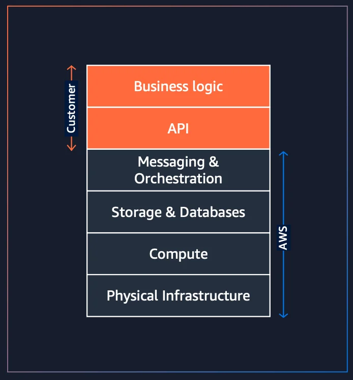

서버리스란 서버가 없다는 뜻이 아닌 서버를 관리할 필요가 없다는 뜻이다&#46;

- 사용하는 사용자가 관리할 서버가 없다는 뜻

- AWS에서 물리적 인프라 확보 및 컴퓨팅, 스토리징 등 리소스에 대한 자원 관리를 대신한다&#46; 

- 클라우드의 관리와 확장성을 단순화 시킨 모델이라고 보면 된다&#46;

서버리스 서비스는 차별화되지 않은 운영 작업을 클라우드 공급자에게 이전함으로써<strong><u> 클라우드 애플리케이션의 관리 및 확장을 </u></strong><strong><u>단순화</u></strong>하여 <strong><u>개발 팀</u></strong>이 <strong>비즈니스 문제를 해결하는 코드 작성에 집중</strong>할 수 있게 한다&#46; 

### 패러다임의 전환 ( Paradigm shift )

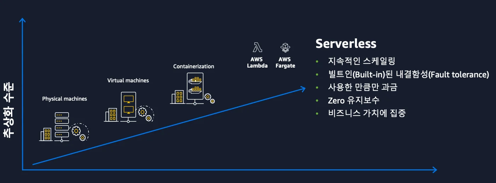

기존에는 서버를 만들기 위해서 물리 장비를 직접 구매하고 구축해서 사용했다&#46; 

그러다가 <strong>물리 장비에 대한 리소스 효율을 높</strong>이기 위해 <strong><u>가상 머신 기술</u></strong>이 발전하였다&#46; 

- 가상 머신 사용 시, 한대의 서버를 여러 대의 서버로 사용하여 리소스 효율성을 올릴 수 있다&#46; 

- 대표적으로 AWS EC2가 이러한 클라우드 환경에 최적화된 가상 머신이다&#46; 

하지만 이러한 <strong><u>가상 머신</u></strong>에서도 <strong>한계</strong>가 있었다&#46; 

바로 <strong>호스트 OS 위에 </strong><strong><u>게스트 OS를 올리는 방식</u></strong><strong>이다 보니 무겁고 베포 속도가 오래 걸</strong>렸다&#46; 

이를 해결하기 위해 별도의 게스트 OS를 올리지 않는 컨테이너 기술이 발전하게 되었다&#46; 

이 컨테이너 기술은 기존 가상 머신 방식에 비해 가볍고 베포 속도가 빠른 장점이 있다&#46; 

이렇게 인프라를 관리하는 기술은 많은 발전을 해왔지만 결국에는 인프라를 관리하는 부분이 존재하게 된다&#46; 

이렇게 인프라를 관리하는 영역을 제거하고 비지니스 가치에 집중하기 위해서 <code>서버리스</code>라는 개념이 생기게 되었다&#46;

### 장점

> 📌 
> 
> 
> 
> 아래와 같은 장점들이 서버리스가 빠르게 시장 점유율을 높이는 이유이다&#46; 
> 
> 
> 
> 이러한 서버리스 전략을 통해 고객의 비지니스에 더욱 집중할 수 있다&#46; 

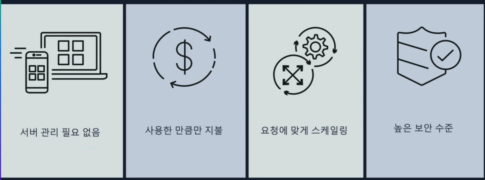

- 서버 관리가 필요 없다&#46; 
    - 운영 우수성을 높일 수 있다&#46; 

- 사용한 만큼만 지불한다&#46; 
    - 기존 방식은 실제 사용자의 요청이 없는 유휴 시간에도 구동되며 비용이 발생된다&#46;

    - 트래픽이 특정 시간 대에서만 많이 발생된다면 서비리스를 통한 비용 최적화가 적절하다&#46; 

- 요청에 맞게 스케일링 가능하다&#46; 
    - 트래픽에 따른 스케일 아웃, 인 과정을 자동으로 지원한다&#46; 

- 높은 보안 수준 유지가 가능하다&#46; 
    - 서버리스 서비스를 사용하면 더이상 서버를 관리하기 위해 직접 서버에 접근할 필요가 없다&#46; 

    - 공격자들도 서버의 운영체제에 직접 접근하지 못한다&#46; 

    - 따라서 높은 보안 수준을 유지할 수 있다&#46; 

### AWS 서버리스 서비스 

> 📌 
> 
> 
> 
> AWS에는 다양한 서버리스 서비스들이 존재하여 지속적으로 서버리스 서비스들을 확대하고 있다&#46; 
> 
> 
> 
> 그 중 대표적인 서비스들은 아래와 같다&#46; 

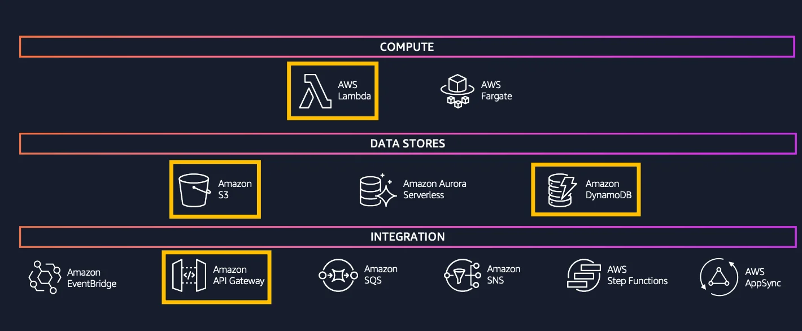

- 컴퓨팅 영역
    - AWS Lamda 
        - Function as Service

        - <code>EDA ( 이벤트 드리븐 아키텍처 )</code>에서 많이 사용된다&#46; 

    - AWS Fargate
        - 컨테이너 노드를 위한 서비리스 서비스이다&#46; 

- 데이터 영역
    - S3
        - Object Storage 서비스

    - Aurora Serverless
        - 관계형 데이터베이스(RDB) 서비스

    - DynamoDB
        - 비관계형 데이터베이스(NoSQL) 서비스

- 서비스 통합
    > 이러한 서비리스 서비스들을 이용하여  아키텍처를 구성하려고 할 때 서비스 간에 통합을 위해 아래와 같은 서비스을 이용할 수 있다&#46; 

    - EventBridge
        - 이벤트 버스를 통해 이벤트를 전달

    - API Gateway
        - API 엔드포인트 구성

    - SQS, SNS
        - 메세징 처리

    - Step Functions
        - 워크플로우 제공

    - AppSync
        - GraphQL 지원

### 3 &#45; Tier 서버리스 아키텍처 구성

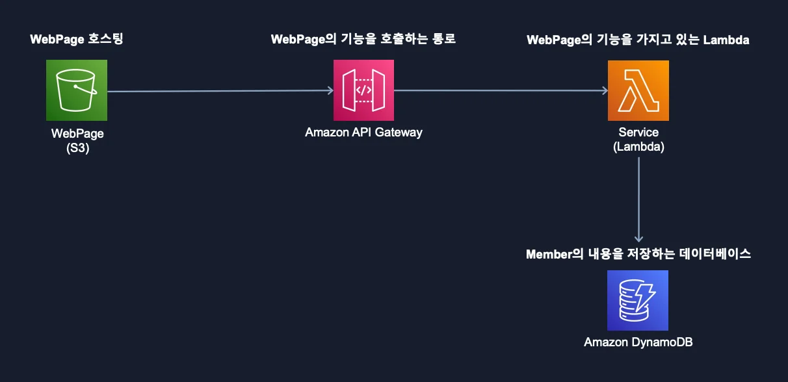

1. 사용자가 접속하는 웹페이지 호스팅 &#45; <code>S3</code>

- 웹페이지를 통해 발생되는 사용자의 요청을 받아올 엔드포인트 &#45; <code>API Gateway</code>

- 사용자의 요청에 따른 비지니스 로직 &#45; <code>AWS Lambda</code>

- 비지니스 처리하는 과정에서 데이터 처리(DB의 역할)&#45; <code>DynamoDB</code>

## 2&#46; AWS Lambda

### 특성

> 📌 
> 
> - AWS의 대표적인 서버리스 서비스 중 하나이다&#46; 
> 
> - <strong>불필요한 서버 관리없</strong>이 <strong>코드를 실행</strong>하주는 컴퓨팅 서비스이다&#46; 
> 
> - 서버 이중화와 같은 고가용성, 보안 패치와 같은 것들을 기본적으로 제공한다&#46; 
>     

>     
ex) <a href="https://namu.wiki/w/Log4j%20%EB%B3%B4%EC%95%88%20%EC%B7%A8%EC%95%BD%EC%A0%90%20%EC%82%AC%ED%83%9C">2022&#46;12 &#45; log4j 보안 취약점</a>

> 
>     
> 
>     AWS Lamda를 사용하는 경우, 관리형으로 제공되는 자바 런타임의 보안 패치가 자동으로 적용되어 고객은 직접 변경없이 자동으로 보안 취약점에 대한 대처가 가능했다&#46; 
> 
>     - 안정적으로 자바 런타임 환경에서의 워크로드 지속 가능
> 
>     

> 
> - 자동으로 스케일 아웃/인을 제공하기 때문에 사용한 만큼만 비용을 지불한다&#46; 

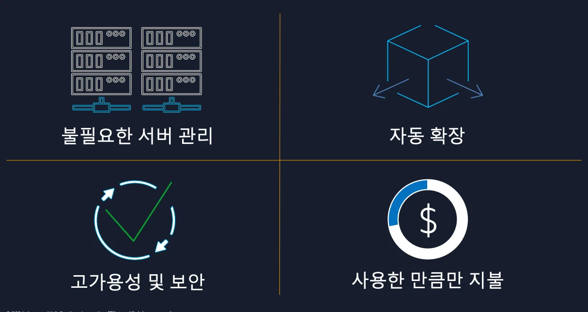

### 아키텍처

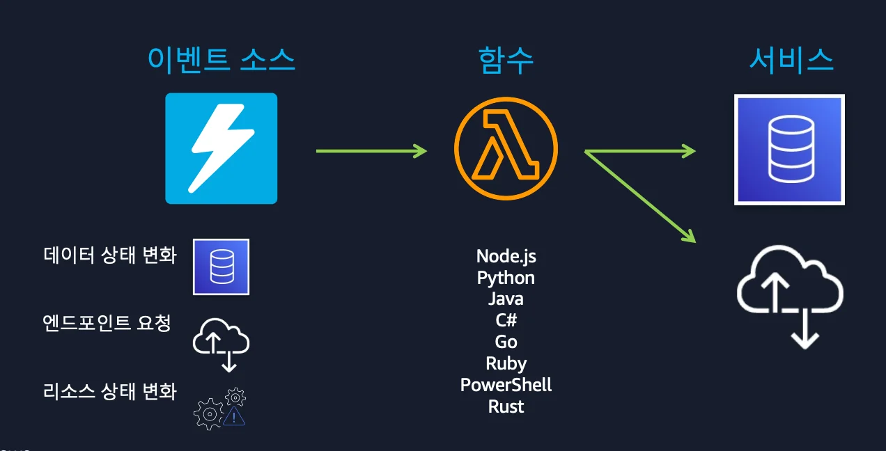

- 람다에 작성하는 비지니스 로직은 다양한 언어 사용이 가능하다&#46; 
    - Node&#46;js, Python, Java, Rust …

- DB를 통해 데이터 관리가 필요하는 경우, 데이터 CRUD에 대한 로직 작성이 가능하다&#46;

- 비지니스 로직 작성 후 적용하기 위해서는 람다를 실행시켜야 한다&#46; 

- 여기서 람다를 실행시키는 방법은 여러가지가 있다&#46;
    1. AWS의 다른 서비스를 통해 람다 실행 가능

    1. API Gateway를 통해 엔드포인트로 람다 실행 가능

    1. 필요 시 CLI를 통해 람다 실행 가능

### 사례

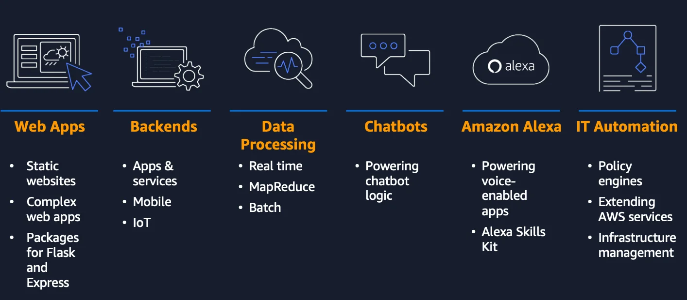

웹 애플리케이션 및 백엔드 서버, 데이터 처리, chat bot 등

IT 운영 자동화를 위한 여러 기법들에서 람다를 사용한다&#46; 

- 매월 100만명 이상의 고객이 람다를 사용하며, 매월 10조건 이상의 데이터를 처리한다&#46; 

## 3&#46; Amazon API Gateway

### API 기반 아키텍처의 관문 

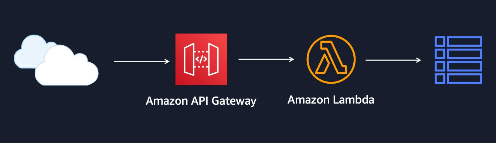

API 기반 아키텍처에서 API Gateway는 API의 관문 역할을 한다&#46; 

사용자에게 엔드포인트를 제공하여 요청을 받고 백엔드로 전달한다&#46; 

- 로드벨런서(ALB) 와 Elastic Beanstalk 과 같은 다양한 서비스에 요청을 전달할 수 있다&#46; 

### 다양한 API 유형 지원

> 📌 
> 
> 
> 
> 크게 <code>RESTful 통신</code>과 <code>WebSocket 통신</code>을 위한 프로토콜을 지원한다&#46; 

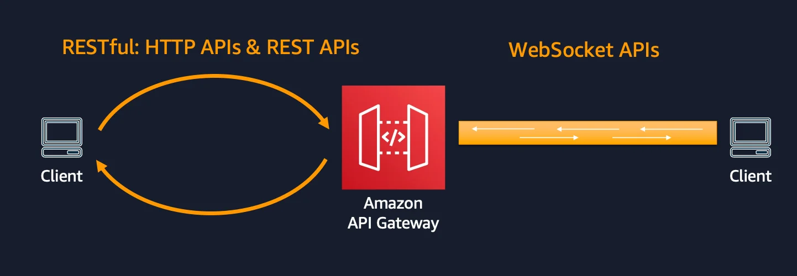

> RESTful

- RESTful은 HTTP APIs, REST APIs 중 하나를 선택해 사용할 수 있다&#46;

- REST API는 HTTP API보다 더 많은 기능을 제공하고 있다&#46; 
    - 예를 들면 클라이언트별 제한, AWS별 와퍼와의 통합, 캐싱과 같은 부가적인 기능을 제공한다&#46; 

- HTTP API는 기능이 적지만 REST APIs 보다 최대 71% 정도 비용을 낮춰 사용 가능하며, 레이턴시를 최대 60%까지 줄일 수 있다&#46; 

> WebSocket

- 채팅, 멀티 플레이어 게임, 금융 거래 플랫폼과 같은 실시간 애플리케이션 선택할 수 있는 유형이다&#46; 

## 4&#46; Amazon DynamoDB

### 특성

> 📌 
> 
> 
> 
> 서버리스 NoSQL 데이터베이스 서비스이다&#46; 

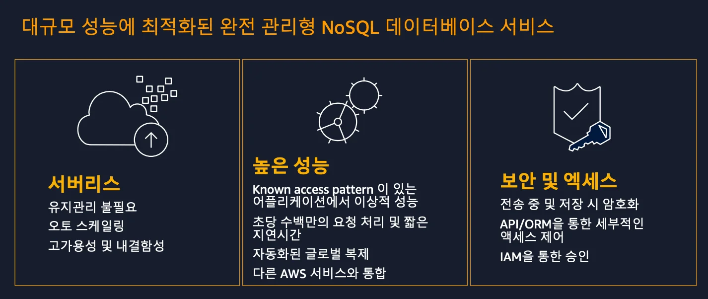

- 서버리스 
    - 서버리스이기 때문에 별도의 서버관리가 필요하지 않다&#46; 

    - 프로비저닝, 패치 등의 적용을 위한 유지보수 관리를 할 필요가 없다&#46;

    - 오토스케일링, 고가용성 및 내결함성을 제공한다&#46; 

- 높은 성능
    - 규모와 관계 없이 1자리수 milisecond 단위의 짧은 레이턴시가 보장된다&#46; 

    - 일관된 고성능이 중요한 대규모 워크로드에 적합하다&#46; 

- 보안 및 액세스
    - 데이터 전송 시, 패킷 암호화

    -  데이터 암호화하여 저장 가능

    - 승인 및 세부적인 엑세스 제어 제공

    

    이를 통해 중요한 데이터를 보호하고 이와 관련된 운용 부담을 줄여준다&#46; 

### 데이터베이스 확장

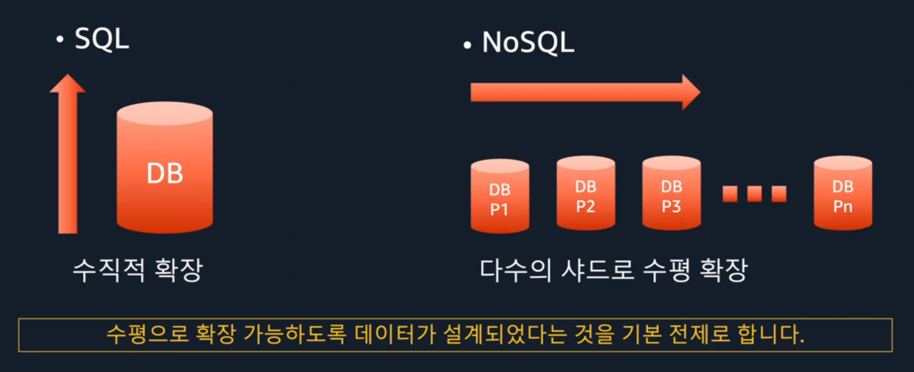

- 앞서 DynamoDB가 1자리 수의 밀리세컨드 단위의 낮은 레이턴시를 보장한다고 설명했다&#46; 
    

    그 이유는 대용량 트래픽을 빠르게 처리할 수 있는 이유는 바로 데이터베이스의 확장과 연관성이 있다&#46; 

    

    
스케일 업 ( 수직적 확장 )

    

    기본적으로 전통적인 SQL DB의 경우, 늘어나는 트래픽을 처리하기 위해 기존 서버의 장비의 CPU, 메모리 등 하드웨어 스펙을 증가시키는 스케일업 방식으로 처리 용량을 키웠다&#46;

    - 그러나 쉽게 DB의 성능을 확장할 수 있지만, 장비를 교체하는 동안 다운타임이 필수적으로 발생된다&#46; 이는 24시간 운영이 필요한 서비스에서는 치명적이다&#46;

    - 물리 장비에는 한계가 있다&#46; 즉, 하나의 컴퓨터에 최대로 올릴 수 있는 CPU, 메모리에는 한계가 있기 때문에 대규모 트래픽을 처리하는데 문제가 발생된다&#46; 

    

    

    
NoSQL DB &#45; 스케일 아웃 ( 수평적 확장 )

    

    스케일 아웃 방식을 취한다&#46;

    

    기존 SQL과 달리 NoSQL은 수평으로 확장 가능하도록 설계되었다&#46; 

    - 데이터를 다수의 샤드로 쪼개 수평 확장이 가능하다&#46; 

    - DynamoDB는 수평 확장을 통해 높은 성능을 보장한다&#46;

    

### Core Concepts &#45; Tables, Items, Attributes, Indexes

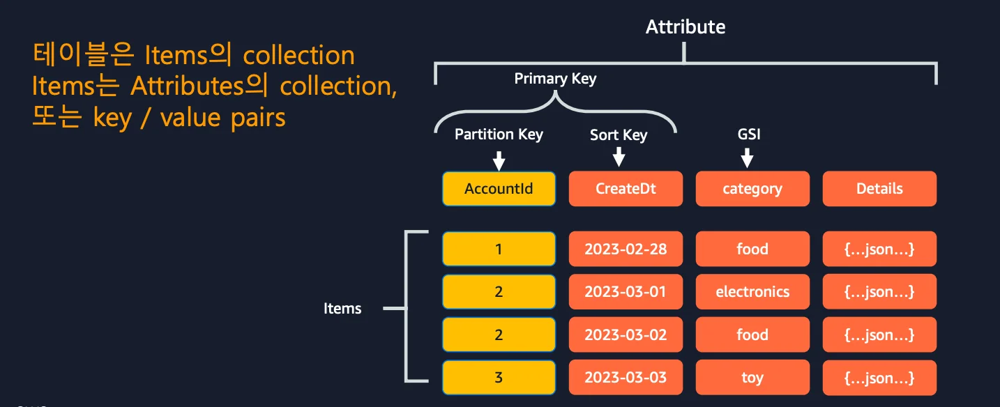

DynamoDB의 핵심 컨셉은 위와 같다&#46; 

- 이해를 돕기위해 RDB와 연관지어 설명한다&#46;

테이블 개념 동일, 각 테이블은 여러 아이템을 가질 수 있다&#46;

이 아이템은 다른 데이터베이스에서는 보통 로우, 레코드, 튜플과 같은 이름으로 불린다&#46; 

하나의 아이템은 여러 어트리뷰트로 구성된다&#46; 

다른 데이터베이스에서는 필드, 컬럼이라는 이름으로 불린다&#46; 

Dynamo DB는 이러한 Attributes를 미리 정의할 필요가 없는 스키마리스 방식을 사용한다&#46; 

대부분의 DB는 PK를 통해 데이터를 고유하게 식별하고 빠르게 접근 가능하도록 한다&#46; 

이와 같이 DynamoDB에서도  2가지 방식으로 Primary Key를 제공한다&#46;  

1. Partition Key을 가지고 PK를 제공한다&#46;
    1. Partition Key는 유니크 해야한다&#46; 

    1. 카디널리티가 높은 값을 사용해 데이터를 고르게 분포 시키면 부하를 분산 처리하여 성능을 끌어올릴 수 있다&#46; 

1. Partition Key에 추가로 Short Key를 사용하여 복합키로 PK를 제공할 수 있다&#46; 
    1. Partition Key가 유니크가 할 필요는 없다&#46; 
        

        Partition Key 와 Short Key를 합친 복합키가 유니크 해야한다&#46;

    1. 이러한 복합키를 사용하면 추가적인 유연성을 가져갈 수 있다&#46;

 

## 5&#46; Amazon S3

### 특성

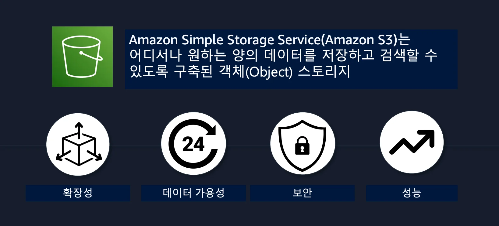

흔히 접하는 파일시스템에서는 저장하는 데이터를 파일이라고 명시한다&#46; 

반면 Object 스토리지인 S3에서는 파일과 메타 데이터가 함께 저장이 되는데, 이를 저장하는 데이터를 Object(객체)라고 명시한다&#46; 

### 정적 웹사이트 호스팅

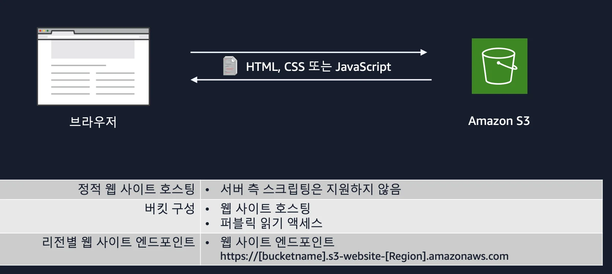

### 퍼블릭 액세스 정책

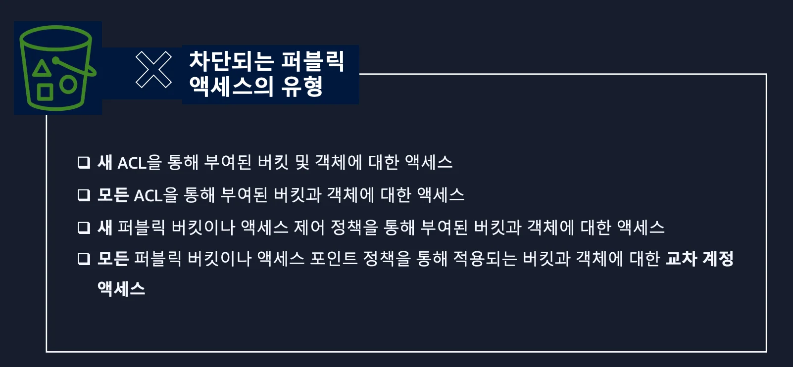

### S3 버킷 정책

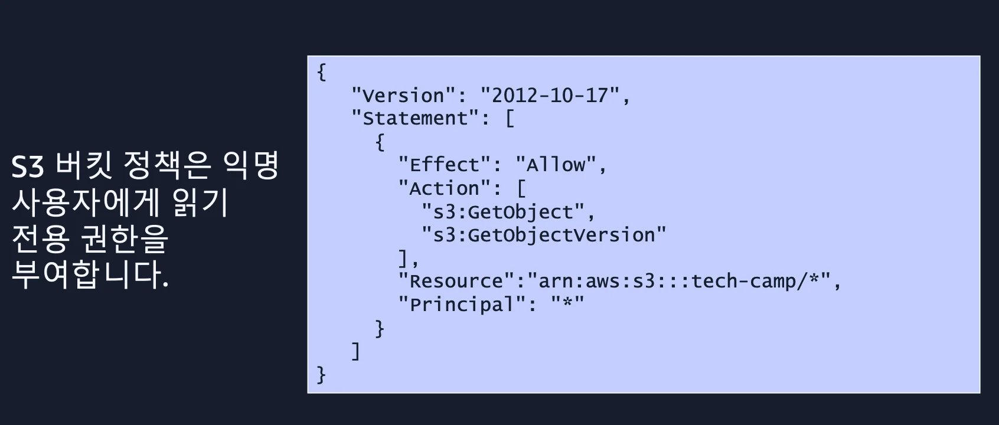

## 6&#46; 실습

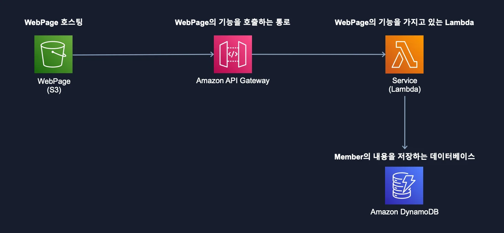
