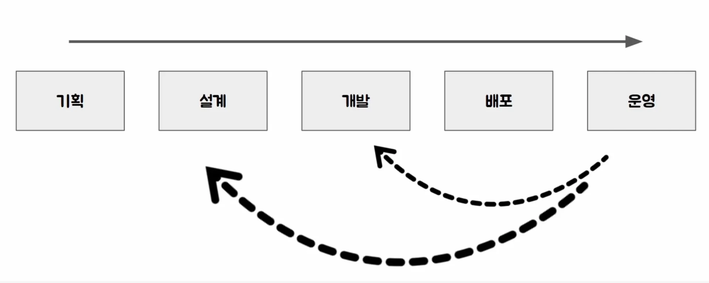
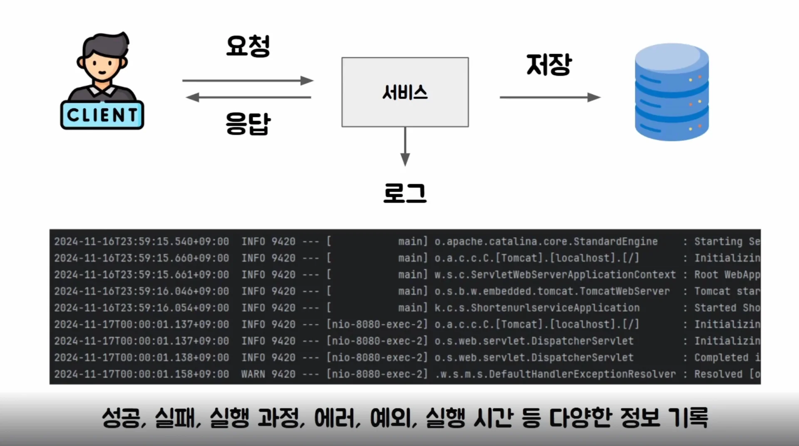

- [왜 로그가 필요한가?](#221eda9b0fe180689e05ed55f21d5ac8)
- [1. 개발 사이클 ( 생명주기 )](#221eda9b0fe180f2b3d3cf9cdb29f652)
- [2. 웹 서비스의 정상 작동 확인](#221eda9b0fe180c3b91ef5c8b0c2dfa6)
- [3. 로그](#221eda9b0fe180d4957df8b63608949e)
- [4. 마무리](#221eda9b0fe18082b02dd7a5c2cf0efc)

## 왜 로그가 필요한가?

---

### 1&#46; 개발 사이클 ( 생명주기 )

일반적으로 개발되는 소프트웨어는 사용자가 있는 서비스로 기획 단계에서부터 시작해서 설계, 개발, 베포, 운영 과정을 거친다&#46; 

이걸 소프트웨어의 생명주기, 개발 사이클 등으로 표현한다&#46;

그리고 그 안에서 운영하면서 버그 수정, 새로운 기능 추가 등으로 인해 도중에 다시 개발, 설계, 기획으로 돌아가기도 한다&#46; 

### 2&#46; 웹 서비스의 정상 작동 확인

> 그렇다면 앱을 운영하다가 문제가 발생되면 해당 문제의 원인을 어디서 찾을 수 있을까? 

일반적인 웹 서비스라면 크게 3가지 데이터를 통해 서비스가 정상 실행되고 있는지 확인할 수 있다&#46; 

1. 요청에 대한 응답

1. 데이터베이스 같은 저장소 데이터

1. <strong>로그</strong>

요청에 대한 응답은 클라이언트를 직접 관리한다면 로그 남기도록 할 수 있지만, 웹브라우저를 일반 사용자가 요청한 것이면 로그를 남길수도 없고, 문제가 발생 됐다는 것을 알수도 없다&#46; 

그리고 DB도 의도적으로 영속성이 필요한 데이터들만 저장한다&#46;  따라서 굉장히 제한적인 데이터 집단군을 가진다&#46; 

반면 로그는 다양한 데이터를 저장할 수 있다&#46; 

- 기능이 정상 실행 되었는지, 실패 되었는지

- 실행 과정에서 처리되는 데이터

- 실행 도중에 발생하는 에러, 예외

- 성능 측정을 위한 실행 시간 

따라서 로그를 통해 서비스의 운영 상태, 문제 상황을 확인하고 그에 대한 원인을 파악할 수 있다&#46; 

### 3&#46; 로그

> ✏️ 
> 
> - 운영에서 장애 발생을 로그를 통해 확인
> 
> - 장애 발생 시 문제 해결을 위한 힌트 제공
> 
> - CS(고객 문의)가 들어와 서비스에서 처리된 데이터 확인
> 
> - 개인정보를 다루는 서비스나 금융 관련 서비스에서 법적으로 로그를 남겨야 하는 경우도 있음

- 주기적으로 로그 자체를 분석하도록 구성하고 특정 로그가 일정 시간동안 여러 번 등장하면 장애 상황으로 간주하여 개발자에게 알림을 주도록 구성할 수 있다&#46;

- 장애 상황을 해결하기 위해서는 개발자가 동일한 데이터로 동일한 상황을 로컬 개발 환경에서 재현하는 것이 중요한데, 이를 로그가 도와줄 수 있다&#46; 

- 서비스를 운영하다보면 발생하는 고객 문의 같은 것들도 서비스에서 어떤 식으로 데이터가 처리 됐는지 확인하는 과정이 필요한데, 이때 마찬가지로 로그가 없다면 해당 문의를 해결하기 어려운 경우가 많다&#46;
    - ex)  은행 계좌에서 계좌이체 내역 없이 오직 잔고만 나오면  고객은 어디에 돈을 썼는지 알 수가 없다&#46; 

- 개인정보를 다루는 서비스나 금융 관련 서비스에서는 법적으로 로그를 남겨야 하는 것도 있다&#46; 
    

    이 경우 발생될지 모르는 개인정보 유출 사고나 금융 관련 사고가 발생 여부를 파악할 수 있고 

    

    만약 사고 발생 되었다면, 발생 경로나 피해 규모를 파악할 때도 활용될 수 있다&#46; 

위와 같이 로그는 서비스에서 발생하는 여러가지 이슈를 처리하기 위해 꼭 필요한 요소이다&#46; 

특히 요즘은 작은 서비스를 운영하고 있는 곳에서도 많은 서버 위에서 다양한 애플리케이션을 운영하고 있기 때문에 로그에 대한 중요성이 더 커졌다&#46;

### 4&#46; 마무리

실무에서 로그를 효율적으로 수집하고 분석하는 것은 애플리케이션의 안정적인 운영과 문제해결을 위해 매우 중요한 부분이다&#46;

애플리케이션의 상태 오류, 성능 관련 이슈를 파악하는데 필수적인 요소이기 때문에 적절한 수준과 형태로 로그를 남기는 것이 중요하다&#46; 

특히 서비스의 중요 이벤트와 예외 상활을 중심으로 로그를 남기면 문제 발생 시 빠르게 인지하고 원인을 추적을 할 수 있다&#46; 

따라서 이후 챕터부터 어떤 정보를 로그로 남기고 운영하는지에 대해 학습한다&#46;
