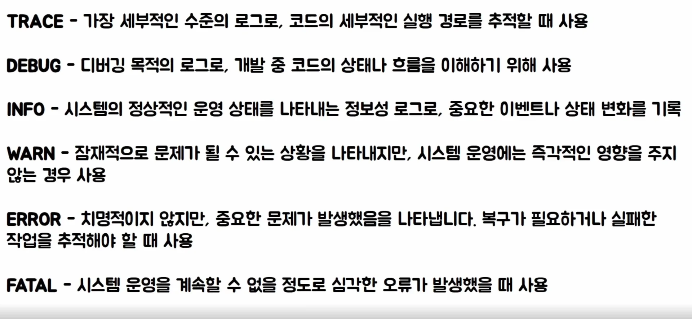

- [로그레벨](#221eda9b0fe180479dc3c3763838dd83)
- [1. subtitle](#221eda9b0fe180ac98e7e888624d4f3d)

<a id="221eda9b0fe180479dc3c3763838dd83"></a>

## 로그레벨

---

<a id="221eda9b0fe180ac98e7e888624d4f3d"></a>

### 1&#46; subtitle

> ✏️ 
> 
> <a id="221eda9b0fe1802382acf7ea3bf00fbc"></a>
> 
> 로그 라이브러리에 따라 달라질 수 있지만 일반적으로 사용되는 로그 레벨은 아래 6가지이다&#46;
> 
> - <code>TRACE</code>
> 
> - <code>DEBUG</code>
> 
> - <code>INFO</code>
> 
> - <code>WARN</code>
> 
> - <code>ERROR</code>
> 
> - <code>FATAL</code>

<details>
<summary>&#91; 코드 &#93;</summary>

<a id="221eda9b0fe1805b8cd2d2cb9b09098d"></a>

```java

```

</details>

> 📌 
> 
> <a id="221eda9b0fe1808b9887f7afb44a085e"></a>
> 
> 디자인패턴 &#45; 바퀴를 재발명 하지말라
> 
> - 이미 라이브러리 차원에서 제공해주고 있는 기능들을 다시 만드는 것은 불필요한 낭비이다&#46;



<a id="221eda9b0fe180a69742f721715c4ac7"></a>

레벨 단위로 로그를 어느 기간 동안 보관할 것인지 전략적으로 설계하는 것이중요하다&#46;

<a id="221eda9b0fe1804598c5df0e063228bc"></a>

엔티티의 상태 변화를 정도를 info 레벨로 로그를 남겨야 실제 운영에 필요한 정도의 로그 양이 나온다&#46;
