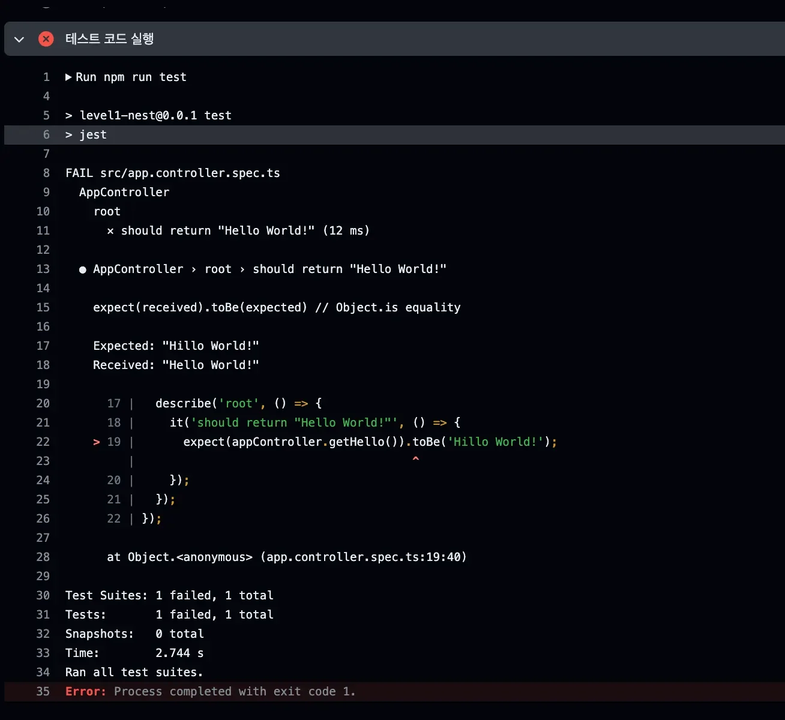

> ✏️ 
> 
> <a id="222eda9b0fe18003960de95704a2c160"></a>
> 
> <code>CI/CD</code>의 <code>CI</code>에는 <strong><u>테스트를 실행시키는 과정</u></strong>이 일반적으로 포함되어 있다&#46; 
> 
> <a id="222eda9b0fe180458414d941b42fed7f"></a>
> 
> 따라서 <code>Github Actions</code>에서 <strong><u>테스트 코드를 실행</u></strong>하여 <strong>업데이트된 코드를 검증</strong> 후  <code>통합(Intergration)</code>하는 방법을 실습한다&#46; 

1. Nest&#46;js 프로젝트에서 내장되어 있는 테스트 코드가 잘 동작하는지 확인하기
    <a id="222eda9b0fe180118981cdbcae7d8f7e"></a>

    ```bash
    npm run test
    ```

1. Github Actions 수정
    <details>
    <summary>🧐 <code>npm i</code> 대신 <code>npm ci</code>를 사용한 이유</summary>

    [npm install vs npm ci &#58;&#58; 마이구미]()

    </details>

    <a id="222eda9b0fe18037b25eca6171b6fcfd"></a>

    ```yaml
    name: Deploy To EC2

    on:
      push:
        branches:
          - main

    jobs:
      deploy:
        runs-on: ubuntu-latest
        steps:
          - name: Github Repository 파일 불러오기
            uses: actions/checkout@v4

          - name: Node 설치
            uses: actions/setup-node@v4
            with:
              node-version: "20"

          - name: 의존성(라이브러리) 설치
            run: npm ci
            
          - name: .env 파일 만들기
            run: |
              touch .env
              echo '${{ secrets.ENV }}' >> .env

          - name: 테스트 코드 실행
            run: npm run test

          - name: SSH로 EC2에 접속하기
            uses: appleboy/ssh-action@v1.0.3
            env:
              ENV: ${{ secrets.ENV }}
            with:
              host: ${{ secrets.EC2_HOST }}
              username: ${{ secrets.EC2_USERNAME }}
              key: ${{ secrets.EC2_PRIVATE_KEY }}
              envs: ENV
              script_stop: true
              script: |
                cd /home/ubuntu/cicd-nest-test
                rm -rf .env
                git pull origin main
                echo "$ENV" > .env
                npm i
                npm run build
                pm2 kill
                pm2 start dist/main.js --name "backend-server"
    ```

1. 테스트 코드 실패 시, Github Actions 실패(베포 중단) 확인
    
