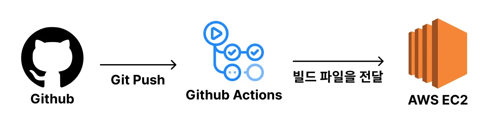
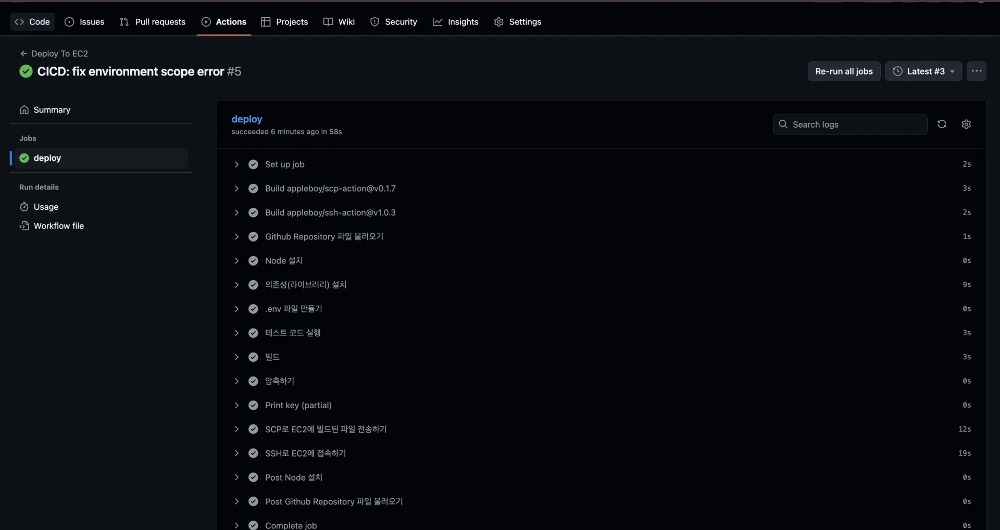
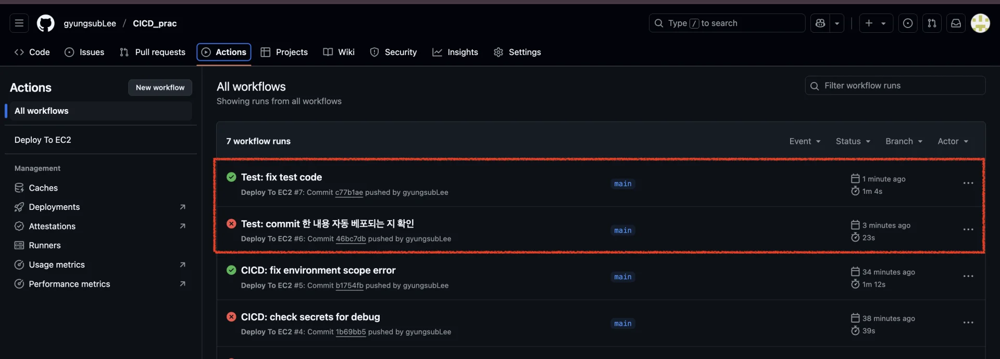
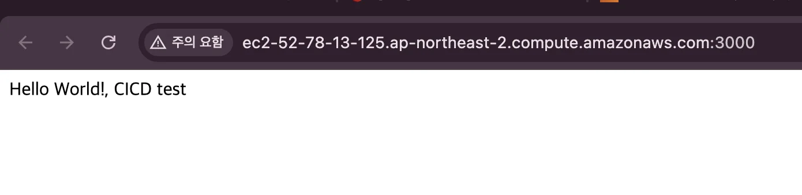

> 
> 
> <a id="227eda9b0fe18026b3c8dcae00d11dc4"></a>
> 
> <strong>목차</strong>
> 
> - [1. 일반 프로젝트(Nest.js)에서  많이 구축하는 방법](#222eda9b0fe180ecb624f85156096cc0)
> - [ 1.1. 장•단점](#222eda9b0fe180a3a452d75cc8699c76)
> - [2. [ 실습 ] CI/CD 구축](#223eda9b0fe180a38634c48928e94432)
> - [2.1.  Github Actions 스크립트 작성](#223eda9b0fe1809cbf5ad4f79fe12b9e)
> - [2.2. 정상 동작 확인](#223eda9b0fe1801196f3d6b960b5ec10)
> - [코드](#224eda9b0fe18076becce2839f0ede16)

<a id="222eda9b0fe180ecb624f85156096cc0"></a>

## 1&#46; 일반 프로젝트(<code>Nest&#46;js</code>)에서  많이 구축하는 방법

---



> ✏️ 
> 
> <a id="224eda9b0fe18016aa7ae876a3a9085c"></a>
> 
> <strong>빌드를 Github Actions에서 진행</strong>하기 때문에 <strong><u>서버의 부하를 줄</u></strong>일 수 있다&#46; 
> 
> - 현업에서 초기 서비스 구축 시에 많이 사용한다&#46;
> 
> - 처음 서비스를 구현할 때는 대규모 서비스에 적합한 구조를 구현하지 않는다&#46; 즉, 오버 엔지니어링을 하지 않는다&#46; 
> 
> - 확장의 필요성이 있다고 느끼는 시점에 인프라를 고도화하기 시작한다&#46; 

> 
> 
> <a id="223eda9b0fe1806da8a6c8ef3323cbec"></a>
> 
> 복잡한 인프라 구조를 갖추고 관리하는 건 생각보다 여러 측면에서 신경쓸게 많다&#46;
> 
> - 인프라 구조를 변경할 때 시간이 많이들어간다&#46; 
> 
> - 에러 발생을 경우, 트러블 슈팅이 더 복잡해진다&#46;
> 
> - 팀원이 인프라 구조에 대한 이해의 어려움이 있다&#46;
> 
> - 기능을 추가하거나 수정 시, 더 많은 비용이 들어간다&#46;
> 
> - 금전적으로 더 많은 비용이 들어간다&#46; 

<a id="222eda9b0fe180a3a452d75cc8699c76"></a>

###  1&#46;1&#46; 장•단점

> ✅ 
> 
> <a id="222eda9b0fe180768f1bfb4140ffd237"></a>
> 
> <strong>장점</strong>
> 
> - 빌드 작업을 github actions에서 하기 때문에 운영하고 있는 서버의 성능에 영향을 거의 주지 않는다&#46; 
> 
> - CI/CD 툴로 Github Actions만 사용하기 때문에 인프라 구조가 복잡하지 않고 간단하다&#46;

> ❗ 
> 
> <a id="222eda9b0fe1804d89fec0820ab223cc"></a>
> 
> <strong>단점</strong>
> 
> - 무중단 베포를 구현하거나 여러 EC2에 베포해야 하는 상황이라면 직접 Github Actions 스크립트를 작성해 구현 해야한다&#46;
> 
> - 직접 구현해보면 알겠지만 생각보다 꽤 복잡하다&#46; 

<a id="223eda9b0fe180a38634c48928e94432"></a>

## 2&#46; &#91; 실습 &#93; CI/CD 구축

---

> ✏️ 
> 
> 1. EC2 인스턴스 생성 및 <code>node</code>, <code>pm2</code> 설치 
>     - <a href="#/post/224eda9b-0fe1-8064-8edd-ed8c04dba979">페이지</a> 참조
> 
> 1. actions workflow 작성

<a id="223eda9b0fe1809cbf5ad4f79fe12b9e"></a>

### 2&#46;1&#46;  Github Actions 스크립트 작성

<a id="223eda9b0fe1808bb67ed2a84df1fb83"></a>

```yaml
name: Deploy To EC2

on:
  push:
    branches:
      - main

jobs:
  deploy:
    runs-on: ubuntu-latest
    steps:
      - name: Github Repository 파일 불러오기
        uses: actions/checkout@v4

      - name: Node 설치
        uses: actions/setup-node@v4
        with:
          node-version: "20"

      - name: 의존성(라이브러리) 설치
        run: npm ci

      - name: .env 파일 만들기
        run: |
					echo '${{ secrets.ENV }}' > .env

      - name: 테스트 코드 실행
        run: npm run test

      - name: 빌드
        run: npm run build

      - name: 압축하기
        run: tar -czvf project.tar.gz dist .env package.json package-lock.json
        
      - name: SCP로 EC2에 빌드된 파일 전송하기
        uses: appleboy/scp-action@v0.1.7
        with:
          host: ${{ secrets.EC2_HOST }}
          username: ${{ secrets.EC2_USERNAME }}
          key: ${{ secrets.EC2_PRIVATE_KEY }}
          source: project.tar.gz
          target: /home/ubuntu/instagram-server/tobe

      - name: SSH로 EC2에 접속하기
        uses: appleboy/ssh-action@v1.0.3
        with:
          host: ${{ secrets.EC2_HOST }}
          username: ${{ secrets.EC2_USERNAME }}
          key: ${{ secrets.EC2_PRIVATE_KEY }}
          script_stop: true
          script: |
            rm -rf /home/ubuntu/instagram-server/current
            mkdir /home/ubuntu/instagram-server/current
            mv /home/ubuntu/instagram-server/tobe/project.tar.gz /home/ubuntu/instagram-server/current/project.tar.gz
            cd /home/ubuntu/instagram-server/current
            tar -xvf project.tar.gz
            npm i
            pm2 kill
            pm2 start dist/main.js --name "backend-server"

```

<a id="223eda9b0fe1801196f3d6b960b5ec10"></a>

### 2&#46;2&#46; 정상 동작 확인

- workflow 정상 동작 확인
    > ‣

    

- EC2
    > ✏️ 
    > 
    > <a id="224eda9b0fe18029b055fd89d2729a85"></a>
    > 
    > 인바운드 규칙 &#45; <code>3000</code> 포트 허용 필요

    - <code>http&#58;//{엔드포인트}&#58;3000</code> 접속
        

- CI/CD 동작확인
    - 새로 commit 한 내용이 EC2 인스턴스에 자동으로 적용되는지 확인하기
        

        

        <a id="224eda9b0fe18076becce2839f0ede16"></a>

        ### 코드

        [Test: fix test code](https://github.com/gyungsubLee/CICD_prac/commit/c77b1ae9d71c0471e200008c6ac946b89384acda)

        [Test: commit 한 내용 자동 베포되는 지 확인](https://github.com/gyungsubLee/CICD_prac/commit/46bc7db38704f6cbf527622251f8451ceecee6d5)
