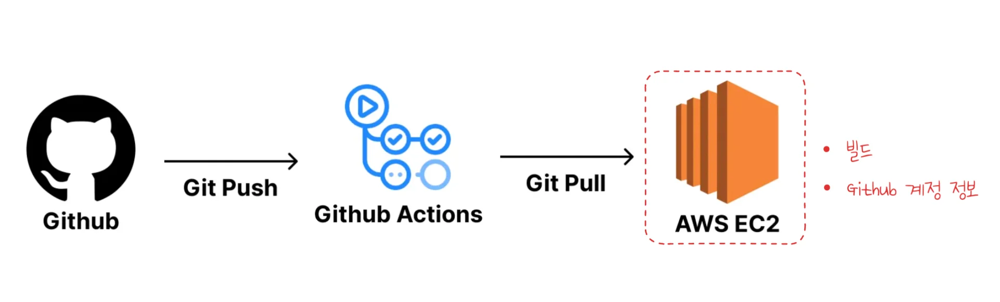
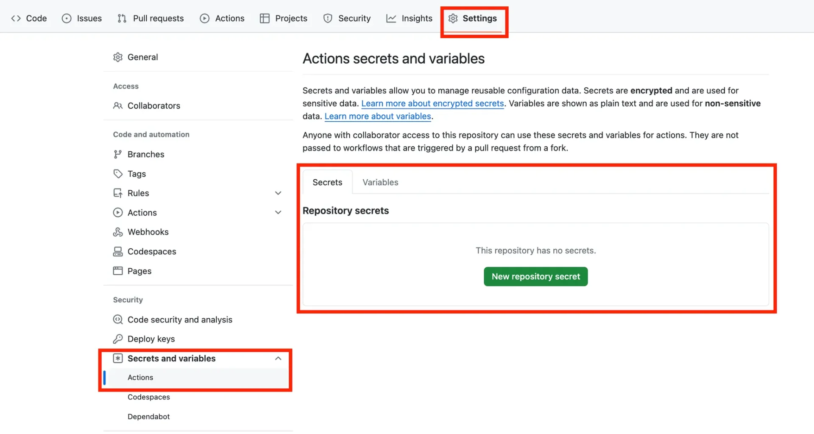
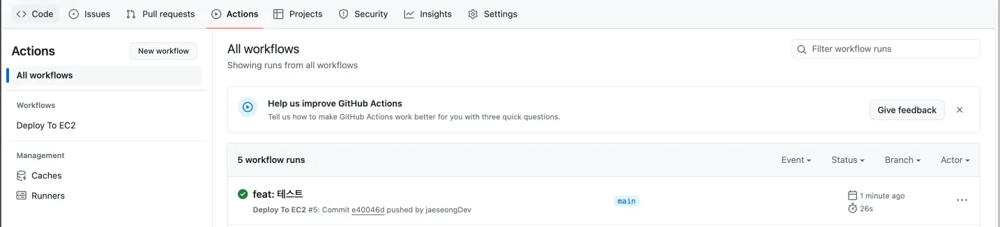

> 
> 
> <a id="227eda9b0fe18037b879d16b3e00dd8f"></a>
> 
> <strong>목차</strong>
> 
> - [1. 개인 프로젝트(Nest.js)에서 Github Actions로 CI/CD 구성](#222eda9b0fe180eca29dccc1a996fa31)
> - [1.1. 장• 단점](#222eda9b0fe180bc90d3c38e4b71f3a5)
> - [2. [ 실습 ] CI/CD 구축](#222eda9b0fe180f797cbcddb65e35e45)
> - [2.1. Github Actions를 통한 베포 자동화](#222eda9b0fe18026a489c61db140f9c3)

<a id="222eda9b0fe180eca29dccc1a996fa31"></a>

## 1&#46; 개인 프로젝트(<code>Nest&#46;js</code>)에서 Github Actions로 CI/CD 구성

---


> ✏️ 
> 
> <a id="222eda9b0fe180f2ae5bc35e0194a534"></a>
> 
> 해당 방법은 <strong><u>개인 프로젝트</u></strong>에서 <strong>간단하고 빠르게 CI/CD를 구축</strong>하고 싶은 경우 사용한다&#46;
> 
> - Github Actions를 통해 간단하게 EC2 인스턴스에서 pull 할수 있도록 구성한다&#46; 

<a id="222eda9b0fe180bc90d3c38e4b71f3a5"></a>

### 1&#46;1&#46; 장• 단점

> ✅ 
> 
> <a id="222eda9b0fe18062a64dc3349d8827dc"></a>
> 
> <strong>장점</strong>
> 
> - <code>git pull</code>을 통해 변경된 프로젝트의 코드만 업데이트 한다&#46; 따라서 CI/CD 속도가 빠르다&#46;
>     - 대부분의 CI/CD는 프로젝트 통째로 갈아끼우는 방식을 사용한다&#46;
> 
> - CI/CD 툴로 Github Actions만 사용하기 때문에 인프라 구조가 간단하다&#46;

> ❗ 
> 
> <a id="222eda9b0fe18003adc4e63ae8335db9"></a>
> 
> <strong>단점</strong>
> 
> 
> 
> - <strong>빌드 작업을 EC2에서 직접 진행</strong>하기 때문에 <strong><u>운영하고 있는 서버의 성능에 영향을 미칠 수 있</u></strong>다&#46; 
> 
> - <strong>Github 계정 정보가 해당하는 EC2 인스턴스에 저장</strong>되기 때문에 <strong><u>개인 프로젝트</u></strong> 또는 <strong><u>믿을 만한 사람들과 같이하는 토이 프로젝트에서만 사용</u></strong>해야 한다&#46;

<a id="222eda9b0fe180f797cbcddb65e35e45"></a>

## 2&#46; &#91; 실습 &#93; CI/CD 구축

---

<a id="222eda9b0fe18026a489c61db140f9c3"></a>

### 2&#46;1&#46; Github Actions를 통한 베포 자동화

<details>
<summary><strong>1&#46; </strong><strong><code>&#46;github/workflows/deploy&#46;yml</code></strong><strong> 작성</strong></summary>

<a id="222eda9b0fe180f3948bf49b066524c3"></a>

```yaml
name: Deploy To EC2

on:
  push:
    branches:
      - main

jobs:
  Deploy:
    runs-on: ubuntu-latest
    steps:
      - name: SSH로 EC2에 원격 접속
        uses: appleboy/ssh-action@v1.0.3
        with:
          host: ${{ secrets.EC2_HOST }} # EC2의 주소
          username: ${{ secrets.EC2_USERNAME }} # EC2 접속 username
          key: ${{ secrets.EC2_PRIVATE_KEY }} # EC2의 Key 파일의 내부 텍스트
          script_stop: true # 아래 script 중 실패하는 명령이 하나라도 있으면 실패로 처리
          script: |
            cd /home/ubuntu/instagram-server # 여기 경로는 자신의 EC2에 맞는 경로로 재작성하기
            git pull origin main
            npm i
            npm run build
            pm2 kill
            pm2 start dist/main.js --name "backend-server"
```

</details>

<details>
<summary>2&#46; Github Actions &#45; Secret key 설정</summary>




</details>

<details>
<summary>3&#46; Actions 정상 동작 확인</summary>



</details>

<details>
<summary>4&#46; 실제 서버 접속하여 정상 동작 확인</summary>


</details>
