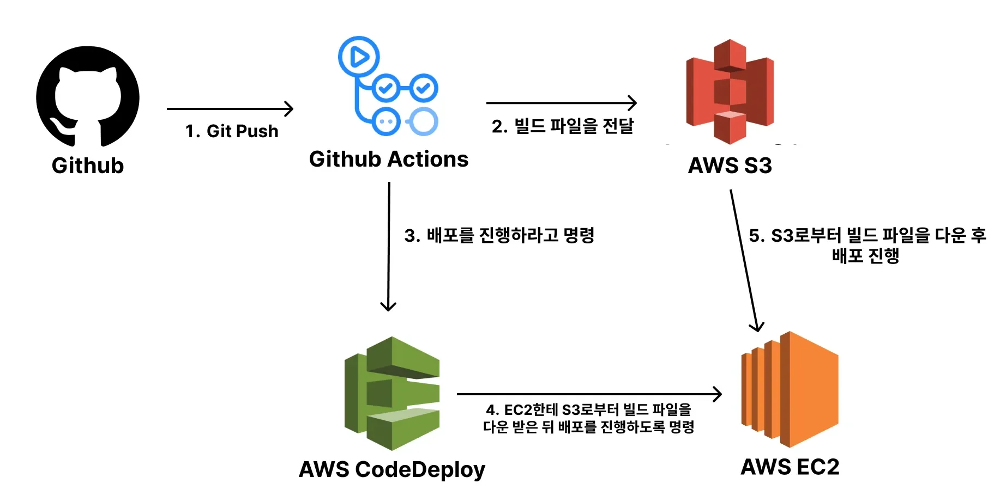

## 확장성을 고려한 프로젝트 구성 ( Code Deploy ) 

---

> ✏️ 
> 
> 
> 
> 서버를 여러 대 이상 구동하거나 무중단 베포가 중요한 서비스일 떄 주로 활용한다&#46; 

### CodeDeploy 사용 이유

[CodeDeploy란 무엇인가요? &#45; AWS CodeDeploy]()

- CodeDeploy는 수많은 AWS EC2에 베포를 쉽게 할 수 있도록 도와준다&#46; 

- CodeDeploy에 무중단 베포 기능이 내재되어 있어 손쉽게 무중단 베포를 진행할 수 있다&#46; 

### 장• 단점

> ✅ 
> 
> 
> 
> <strong>장점</strong>
> 
> - 여러 서버를  구축한 상황에서도 쉽게 자동 베포가 가능하다&#46; 
> 
> - 손쉽게 무중단 베포를 적용할 수 있다&#46;

> ❗ 
> 
> 
> 
> <strong>단점</strong>
> 
> - CodeDeploy를 사용함으로써 인프라 구조가 복잡해졌다&#46; 
> 
> - 구조가 복잡해진만큼 관리 비용, 유지보수 비용, 구현 난이도, 트러블 슈팅 어려움, 복잡도 등이 증가했다&#46;

## &#91; 실습 &#93; CI/CD 구축

---

### CodeDeploy 셋팅 / IAM 설정
