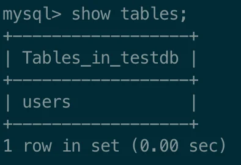
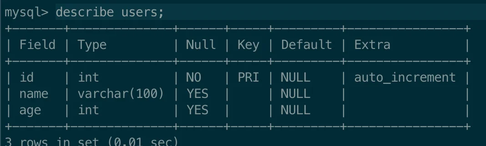
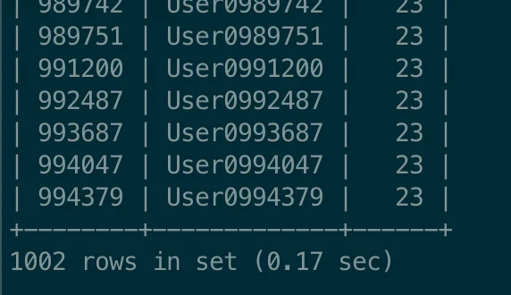
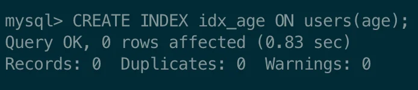
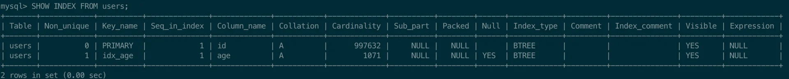
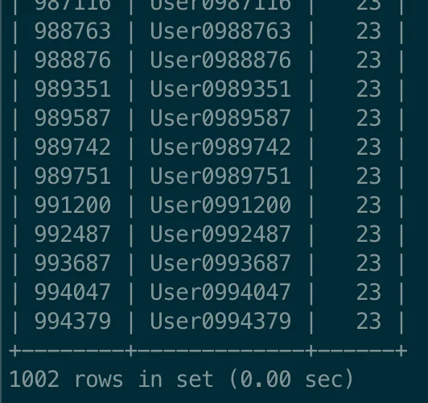
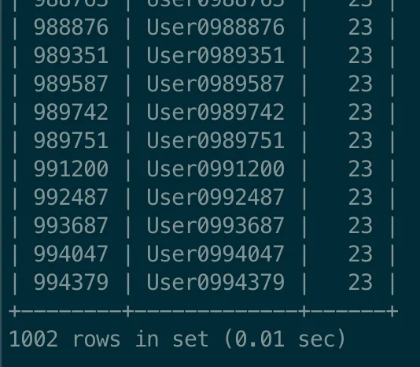

> 
> 
> <a id="226eda9b0fe1802983fbf599533b1ccc"></a>
> 
> <strong>목차</strong>
> 
> - [[ 실습 ] 인덱스 설정 및 성능 측정](#226eda9b0fe18092b330c9e7587d493a)
> - [직관적으로 이해하기](#227eda9b0fe180ed9ff9f966499940a1)

<a id="226eda9b0fe18092b330c9e7587d493a"></a>

## &#91; 실습 &#93; 인덱스 설정 및 성능 측정

---

> 
> 
> <a id="227eda9b0fe180db8805cbe365ea36b6"></a>
> 
> 성능 개선 시에는 <code>‘빨라진 것 같아요’</code> 라는 말은 잘못됐다&#46;
> 
> <a id="227eda9b0fe1803fb3cbd99d5a93b676"></a>
> 
> <strong><u>정확한 수치를 측정</u></strong>하여 <strong>이전보다 얼마나 더 빨라지고 느려졌는 지를 명확한 수치값으로 얘기</strong>할 수 있어야 한다&#46; 

<details>
<summary>1&#46; 테이블 생성</summary>


<a id="227eda9b0fe18090b753dc90597261d8"></a>

```sql
# 기존 테이블 삭제
DROP TABLE IF EXISTS users; # [옵션] 이전 실습 내용이 있을 시 진행

CREATE TABLE users (
		id INT AUTO_INCREMENT PRIMARY KEY,
		name VARCHAR(100),
		age INT
);
```

</details>

<details>
<summary>2&#46; 테이블 생성 확인</summary>

<a id="227eda9b0fe1806fa7cdf9d5d3d4c5f6"></a>

```bash
# 생성 확인
show tables;

# 생성된 테이블 스키마 확인
describe users;
```





</details>

<details>
<summary>3&#46; 100만 건의 랜덤 데이터 삽입</summary>

> ✏️ 
> 
> <a id="227eda9b0fe180c39a8cf63257518664"></a>
> 
> 인덱스 설정 전후, 성능 차이를 비교하기 위한 더미 데이터 생성

<a id="227eda9b0fe1802ea7c4dd5377d4d3e4"></a>

```sql
# 1. 높은 재귀(반복) 횟수를 허용하도록 설정
SET SESSION cte_max_recursion_depth = 1000000; 	# 아래에서 생성할 더미 데이터 개수와 맞춰서 생성

# 2. 더미 데이터 생성
INSERT INTO users(name, age)
WITH RECURSIVE cte(n) AS (
  SELECT 1
  UNION ALL
  SELECT n + 1 FROM cte WHERE n < 1000000 # 생성하려는 더미 데이터 개수	
)
SELECT 
	CONCAT('User', LPAD(n, 7, '0')).        # 'User' 다음에 7자리 숫자로 구성된 이름 생성
	, FLOOR(1 + RAND() * 1000) AS age       # 1부터 1000 사이의 랜덤값으로 나이 생성
FROM cte;
	
# 3. 생성 확인
SELECT COUNT(*) FROM users;
```

</details>

<details>
<summary>4&#46; 데이터 조회 &#45; <strong>성능 측정</strong></summary>

<a id="227eda9b0fe18011b80fe83cc1492105"></a>

```sql
SELECT * FROM users WHERE age = 23;
```



- 조회 시간&#58; <code>0&#46;17 sec</code> ( <code>170ms</code> )

<a id="227eda9b0fe18084a036e402fc3128b9"></a>

조회 시간을 측정 결과 대략 <code>170ms</code>의 시간이 소요된다&#46;

</details>

<details>
<summary>5&#46; <u>인덱스</u> 설정</summary>

> 
> 
> <a id="227eda9b0fe180b3a3f4cf0535b8c937"></a>
> 
> <strong><code>인덱스</code></strong>는 <strong><u>탐색 속도를 향상시키기 위해 중간 필터링 테이블 만</u></strong>드는 것이다&#46;
> 
> <a id="227eda9b0fe18042b2e5d3bccab466f8"></a>
> 
> 따라서 <strong><u>탐색하려는 조건 컬럼을 기준으로 생성</u></strong>해야 탐색 성능이 개선된다&#46; 
> 
> <a id="227eda9b0fe1803aa713d3cedc56b4af"></a>
> 
> 즉, <strong><u>WHERE 절의 컬럼으로 인덱스를 생성</u></strong>해야 한다&#46;
> 
> - <strong>조건 값로 인덱스를 생성하지 않</strong>는다면 <strong><u>오히려 성능이 떨</u></strong>어질 수 있다&#46; 

<a id="227eda9b0fe180c5a6a3f4d02f8607d1"></a>

```sql
# 인덱스 생성 - CREATE INDEX 인덱스명 ON 테이블명(컬럼명);
CREATE INDEX idx_age ON users(age);

# 인덱스 조회
SHOW INDEX FROM users;
```





</details>

<details>
<summary>6&#46;  인덱스 설정 후 조회 &#45;  <strong>성능 측정</strong><strong>&#58; 약 17배의 속도 개선</strong></summary>





<a id="227eda9b0fe18025a83ef4fc75d65590"></a>

약 <code>10ms</code> 이내로 조회가 처리된다&#46;

<a id="227eda9b0fe180f6bc9efe06b56e3246"></a>

즉, 인덱스 적용 전과 비교하여 <strong><u>약 17배의 속도 개선</u></strong>이 이뤄졌다&#46; 

</details>

<a id="227eda9b0fe180ed9ff9f966499940a1"></a>

### 직관적으로 이해하기


<a id="227eda9b0fe180f5b299c29942b16a60"></a>

인덱스를 직접 생성하게 되면 위 그림과 같이 내부에서 인덱스(필터링) 테이블이 생성된다&#46; 

- 인덱스 컬럼으로 설정한 <code>나이(age)</code> 컬럼을 기준으로 정렬된 테이블을 생성한다&#46;

<a id="227eda9b0fe180789efef09ae6713f93"></a>

따라서 해당 테이블을 통해 빠르게 특정 범위로 접근하여 훨씬 빠른 속도로 조회가 가능하다&#46; 

- B&#43; Tree 구조를 가지며, 탐색 시간은 트리의 높이인 <code>logN</code>만큼의 시간복잡도를 가진다&#46;
