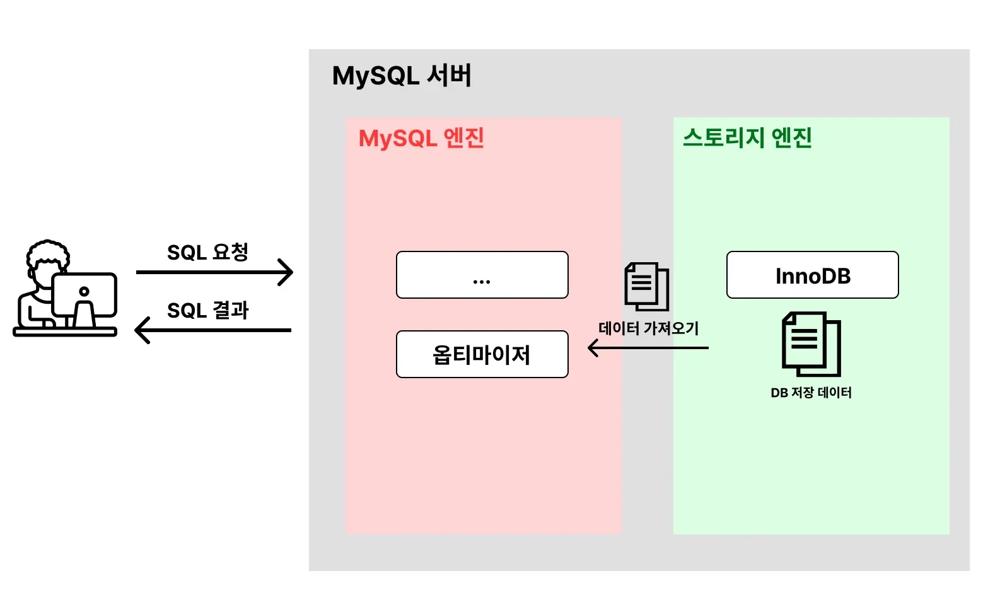

> 
> 
> 
> 
> <strong>목차</strong>
> 
> - [1. MySQL의 아키텍처](#226eda9b0fe1819c8b8dc8c788f1af7b)
> - [2.  SQL 튜닝의 핵심](#226eda9b0fe180c78316ece9f7ef321c)

## 1&#46; MySQL의 아키텍처

---

> ✏️ 
> 
> 
> 
> MySQL의 아키텍처를 간단하게 표현하자면 위와 같다&#46; 
> 
> 
> 
> 해당 아키텍처에서 SQL문이 어떻게 실행되는 지 과정을 알아보자&#46;

1. 클라이언트가 DB에 SQL 요청을 보낸다&#46;

1. MySQL 엔진에서 <code>옵티마이저</code>가 <strong><u>SQL문을 분석</u></strong>한 뒤 빠르고 효율적으로 데이터를 가져올 수 있는 <strong><u>계획을 세운다</u></strong><u>&#46;</u>
    > <code>optimization</code>&#58; 최적화

    - 어떤 순서로 테이블에 접근할 지, 인덱스를 사용할 지, 어떤 인덱스를 사용할 지 등을 결정한다&#46;

    - <strong>옵티마이저가 세운 계획은 완벽하지 않다&#46; 따라서 SQL 튜닝이 필요하다&#46;</strong><strong> </strong>

1. 옵티마이저가 세운 계획을 바탕으로 스토리지 엔진에서 데이터를 가져온다&#46;
    - <strong>DB 성능에 문제가 생기는 대부분의 원인</strong>은 스토리지 엔진으로부터 데이터를 가져올 때 발생한다&#46;

    - 데이터를 찾기가 어려워서 오래 걸리거나, 가져올 데이터가 너무 많아서 오래 걸린다&#46;

    - SQL 튜닝의 핵심은 <strong><u>스토리지 엔진으로부터 되도록이면 데이터를 찾기 쉽게 바꾸고, 적은 데이터를 가져오도록 바꾸는 것을 말</u></strong>한다&#46;

1. MySQL 엔진에서 정렬, 필터링 등의 마지막 처리를 한 뒤 클라이언트에게 SQL 결과를 응답한다&#46;

## 2&#46;  SQL 튜닝의 핵심

---

> ✏️ 
> 
> 
> 
> SQL 튜닝에 있어 핵심은 아래 2가지이다&#46;
> 
> 1. <strong>스토리지 엔진에서 데이터를 찾기 쉽게 바꾸기</strong>
> 
> 1. <strong>스토리지 엔진으로부터 가져오는 데이터양 줄이기</strong>

위 2가지를 적용하기 위해 가장 많이 활용되는 방법이 <strong><u>인덱스 활용</u></strong>이다&#46;

> 단순히 <strong><u>인덱스</u></strong>만 적용한다고 해서 무조건 해결되는 게 아니다&#46;  인덱스를 <strong><u>‘적절하게’</u></strong> 활용해야만 DB 성능이 개선된다&#46; 이 방법에 대해 깊이 있게 다루기 전에 ‘<strong><u>인덱스</u></strong>’라는 개념에 대해 학습이 필요하다&#46;
