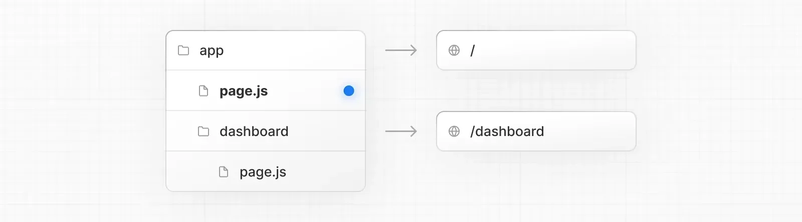
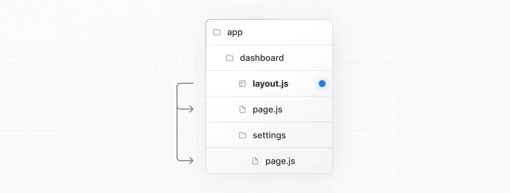

> 
> 
> <a id="226eda9b0fe1805d941ec53ee4cf1b30"></a>
> 
> <strong>목차</strong>
> 
> - [1. Next.js 란?](#226eda9b0fe180b78f4bee6ca583c630)
> - [폴더 구조, 파일 및 라우팅](#226eda9b0fe18002b952ccaedd591afa)
> - [[ 실습 ] Next.js 페이지 라우팅](#226eda9b0fe1802eaa07c6baf824472d)

<a id="226eda9b0fe180b78f4bee6ca583c630"></a>

## 1&#46; <code>Next&#46;js</code> 란?

---

> 📖 
> 
> <a id="226eda9b0fe18000a24ac8ea4488b8a6"></a>
> 
> <strong><u>“소규모 풀스택 개발에 최적화된 가능한 웹 프레임워크”</u></strong> 이다&#46;
> 
> - <code>서버사이드 렌더딩</code>이 큰 특징이다&#46;
> 
> - <code>React</code>와 유사한 문법으로 더 현대적인 웹 서비스 구현 가능
> 
> - 서버에서부터 html을 최적화하여 웹으로 전달 가능하기 때문에<code>SEO(검색엔진)</code> 최적화에 대한 이점을 갖는다&#46; 
> 
> - 소규모 프로젝트의 경우, 별도 서버 구축 없이 Next&#46;js 만으로 API 구현이 가능하다&#46; 

<details>
<summary>프로젝트 생성</summary>

<a id="226eda9b0fe18062a886e601ca56d4e9"></a>

```bash
npx create-next-app@15 {프로젝트명}
```

</details>

<a id="226eda9b0fe18002b952ccaedd591afa"></a>

### 폴더 구조, 파일 및 라우팅

> ✏️ 
> 
> <a id="226eda9b0fe180459a0dc1b314957a90"></a>
> 
> <code>next&#46;js</code>의 폴더는 route 구조와 동일하게 동작한다&#46; 
> 
> - <code>React</code>에서는 폴더명에 대한 제한사항이 없었지만
>     <a id="226eda9b0fe1807f8b28db6861c45333"></a>
> 
>     <code>next&#46;js</code>에서는 <strong>폴더명을 통해 라우팅(URL) 경로 </strong><strong>매핑</strong>을 한다&#46; 따라서 <strong><u>폴더명을 정확히 작성</u></strong>해야 한다&#46; 
> 
> <details>
> <summary><strong>ex) 폴더구조에 따른 라우팅 경로</strong></summary>
> 
> <details>
> <summary>Case1) 일반적인 경로 매핑</summary>
> 
> - <code>app/movies</code>
>     <a id="226eda9b0fe1801c8d11d3779901c350"></a>
> 
>     → <code>“http&#58;//localhost&#58;3000/movies”</code>
> 
> </details>
> 
> <details>
> <summary>Case2) 동적 경로 매핑(Dynamic Route)</summary>
> 
> - <code>app/movies/&#91;id&#93;</code>
>     <a id="226eda9b0fe1804fb867e9b99fded597"></a>
> 
>     <strong>→</strong> <code>“http&#58;//localhost&#58;3000/movies/1”</code>
> 
> </details>
> 
> </details>

<details>
<summary>1&#46; <code>page&#46;tsx(js)</code></summary>

> 
> 
> <a id="226eda9b0fe180349a06ca7a981a4c83"></a>
> 
> Route를 생성하는 파일
> 
> - 각 폴더(Route)의 대표 파일이다&#46;



- <code>app/page&#46;js</code>   →  <code>“/”</code> 페이지

- <code>app/dashboard/page&#46;js</code> →  <code>“/dashboard”</code> 페이지

</details>

<details>
<summary>2&#46; <code>layout&#46;tsx(js)</code></summary>

> 
> 
> <a id="226eda9b0fe180fbaa04e1715f57a8b1"></a>
> 
> 화면 레이아웃을 설정하는 파일



</details>

<details>
<summary>3&#46; <code>route&#46;ts(js)</code></summary>

[File&#45;system conventions&#58; route&#46;js]()

> 
> 
> <a id="226eda9b0fe1808ea5d4ea8aeee9ce89"></a>
> 
> HTTP API를 구현하는데 사용한다&#46; <code>route&#46;ts</code>를 잘 이용하면 서버 구축을 따로 하지 않아도 <code>Next&#46;js</code>를 서버로도 이용 가능하다&#46; 

- route&#46;ts 파일에 있는 코드는 웹에서 접근이 불가능하다&#46;<br>즉, 서버에서 돌아가는 코드이기 때문에 <strong>browser api들은 사용이 불가능</strong>하다&#46; 
    - window, navigation, react 코드 등

- 보안이 중요한 코드들을 해당 파일에 작성 가능
    - DB 접속 등

- RESTfull 방식의 API들을 정의할 수 있다&#46;
    <a id="226eda9b0fe1800eb4ccd2616ad631e7"></a>

    ```bash
    export async function GET(request: Request) {}
     
    export async function HEAD(request: Request) {}
     
    export async function POST(request: Request) {}
     
    export async function PUT(request: Request) {}
     
    export async function DELETE(request: Request) {}
     
    export async function PATCH(request: Request) {}
     
    // If `OPTIONS` is not defined, Next.js will automatically implement `OPTIONS` and  set the appropriate Response `Allow` header depending on the other methods defined in the route handler.
    export async function OPTIONS(request: Request) {}
    ```

</details>

<details>
<summary>4&#46; <code>Link</code></summary>

> 
> 
> <a id="226eda9b0fe18048ab06d40a091be361"></a>
> 
> Nest&#46;js에서 <code>a 태그</code> 대신 사용된다&#46; 
> 
> <a id="226eda9b0fe180dfb9c1d0a4bde75181"></a>
> 
> 일반적인 <code>a 태그</code>보다 클라이언트 사이드 라우팅을 더 최적화 되어 있다&#46; 
> 
> <a id="226eda9b0fe180838715ed058c6d3b99"></a>
> 
> 또란 Next&#46;js에게 URL 정보도 알려줄 수 있어 최대한 <code>Link</code> 사용을 권장한다&#46; 

<a id="226eda9b0fe1805bb590c751257aabe4"></a>

```typescript
import Link from 'next/link'

export default function Page() {
	return <Link href="/dashboard">Dashboard</Link>
}
```

</details>

<a id="226eda9b0fe1802eaa07c6baf824472d"></a>

### &#91; 실습 &#93; <code>Next&#46;js</code> 페이지 라우팅

[video](https://www.youtube.com/watch?v=Ujjdn2wMIew&t=736s)
