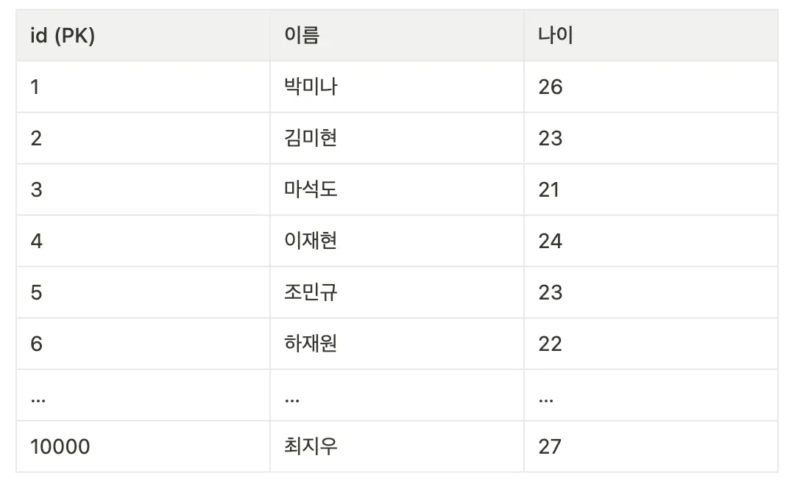
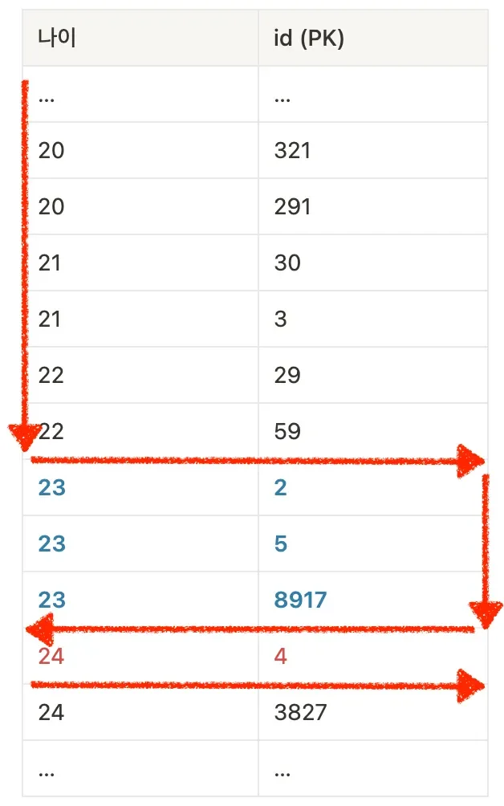
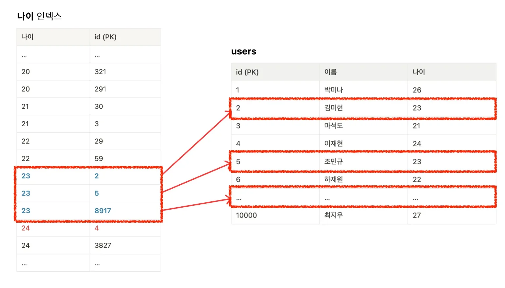

> 
> 
> 
> 
> <strong>목차</strong>
> 
> - [1. 인덱스(Index)](#226eda9b0fe180ee9a3efe8b6e7b428a)
> - [ex) 인덱스 이해](#226eda9b0fe1805b8bd9e55a7f09e34e)

## 1&#46; 인덱스(Index)

---

> 📖 
> 
> 
> 
> <code>인덱스(Index)</code>는 DB 테이블에 대한 <strong><u>검색 성능 속도를 높</u></strong>여주는 자료 구조를 뜻한다&#46; 
> 
> - <code>B&#43; Tree</code>구조를 가지며 트리의 높이만큼 즉, <code>O(logn)</code> 시간복잡도 만큼의 탐색 속도를 가진다
> 
> - ‣

> ✏️ 
> 
> 
> 
> <code>인덱스(Index)</code>&#58; <strong><u>데이터를 빨리 찾</u></strong><strong>기 위해 </strong><strong>특정 컬럼을 기준으로 미리 정렬해놓은 표</strong>

### ex) 인덱스 이해

만약 USER 테이블 내부에 1만개의 데이터가 존재하고, 그중 23살인 사용자를 전부 직접 찾으려고 한다면? 

나이에 대한 정렬을 하지 않았기 때문에 모든 행을 일일이 검사해 23살인 사용자를 탐색해야 한다&#46;

- 1만 개의 데이터를 일일이 다 확인해야 하므로 시간이 오래 걸릴 수 밖에 없다&#46; → <code>O(n)</code>의 시간 복잡도

하지만 왼쪽과 같이 나이 순으로 정렬된 표가 있다면 

아래와 같이 빠르게 탐색할 수 있다

- 나이가 23살인 사용자를 뽑아내려면 위의 표에서 <strong><u>23살로 시작하는 지점</u></strong>과 <strong><u>24살로 시작되는 지점</u></strong>만 찾은 뒤 그 사이에 있는 모든 값을 가져오면 된다

- 모든 데이터를 일일이 다 확인할 필요가 없이 훨씬 더 빠르게 데이터 조회가 가능하다&#46;

> 
> 
> 
> 
> 위의 예시에서 <strong><u>나이 순으로 정렬된 표</u></strong>가 <strong>인덱스</strong>이다&#46; 정확히 말하자면 <strong>나이 컬럼을 기준으로 인덱스를 생성한 것</strong>이다&#46; 
> 
> 
> 
> 이러한 특징 때문에 <strong><u>데이터를 찾는 속도를 빠르게 만들기 위해서 인덱스를 많이 활용</u></strong>한다&#46; 

- 참고로 실제 DB에서는 인덱스를 생성한다고 해서 정렬된 표를 직접 눈으로 확인할 수는 없다&#46;  시스템 내부적으로 생성될 뿐이다&#46;
