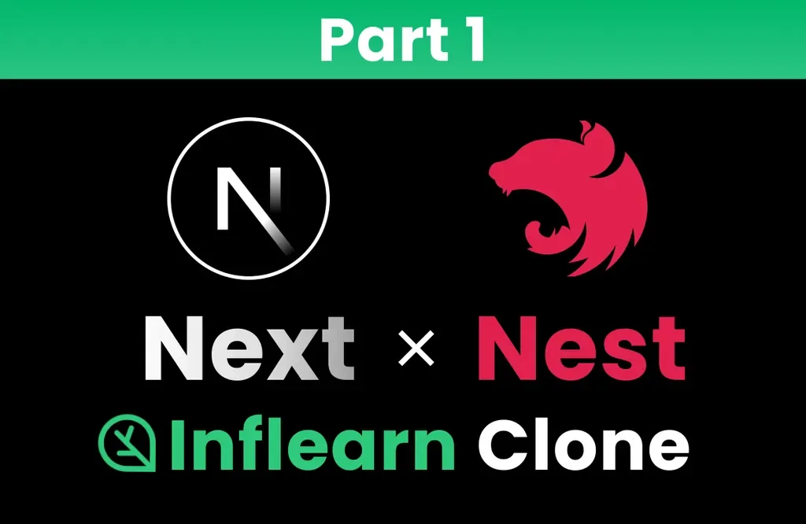

> 
> 
> 
> 
> <strong>&#91; 인프런 &#93; </strong><strong><code>인프런 클론코딩 Part 1&#58; Next&#46;js와 NestJS로 시작하는 실전 프로젝트</code></strong><strong> 정리본</strong>
> 
> - 기간&#58; 25&#46;07&#46;04(금) &#126; 
> 
> 

> 
reference

> 
> - ‣
> 
> - <a href="https://beautiful-college-c84.notion.site/196a346f20fa80e2a6ede30cf9d360fd">페이지</a> 
> 
> 

Template

> 

> ✏️ 

> 📖 

[제목 없음](#/post/226eda9b-0fe1-80c9-90de-d4bcbc2507d0)

[제목 없음](#/post/226eda9b-0fe1-8040-98b3-dc42c63e9602)

### 1&#46; 초기 설정

[초기 설정 - Cursor, Git, fnm, Typescript](#/post/226eda9b-0fe1-80a2-87b2-f8b10d7c896f)

 

### 2&#46; &#91; FE &#93; 기본 개념

Docs

[Next&#46;js Docs]()

[Next.js - 개념 1. 폴더, 파일 구조 및 라우팅](#/post/226eda9b-0fe1-8069-b2ec-ec417825623b)

[Next.js  - 개념 2. Metadata, Server Action](#/post/226eda9b-0fe1-8033-8da8-d95646ad1c16)

[TailwindCSS 설치 및 기본 문법](#/post/226eda9b-0fe1-8067-90e2-e36651f178bf)

[Jotai 설치 및 기본 문법](#/post/226eda9b-0fe1-80f3-82bb-ed7879388203)

[React Query 기본 문법](#/post/226eda9b-0fe1-8046-9e49-c5a6e16b189e)

[AI를 사용한 UI 스타일링](#/post/226eda9b-0fe1-80b0-b48b-fc99b595ec1b)

### 3&#46; &#91;BE&#93; 기본 개념

[1. NestJS](#/post/226eda9b-0fe1-8015-b72d-c42ed8f49026)

[제목 없음](#/post/226eda9b-0fe1-80d4-b623-ec26a22f7499)

### 4&#46; &#91;
