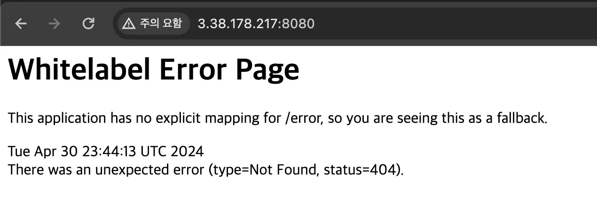

> 
> 
> <a id="227eda9b0fe1801aa5f5eab416e2e541"></a>
> 
> <strong>목차</strong>
> 
> - [수동 베포](#227eda9b0fe180e1b1dec3084ccaf878)
> - [1. Spring 프로젝트 수동 베포](#227eda9b0fe18077b8b7cdc2dc20c93c)
> - [2. 코드 업데이트 내역, 수동 통합 및 베포](#227eda9b0fe180a7bb67d683cc5908c6)

<a id="227eda9b0fe180e1b1dec3084ccaf878"></a>

## 수동 베포

---

> 📖 
> 
> <a id="227eda9b0fe180f8831fd14d6ff91d22"></a>
> 
> Github Actions를 통한 CI/CD 자동화 실습 전, 수동 베포 환경이 어떻게 이뤄지고 어떤 문제점이 있는지 학습한다&#46;

<a id="227eda9b0fe18077b8b7cdc2dc20c93c"></a>

### 1&#46; Spring 프로젝트 <strong><u>수동 베포</u></strong>

<details>
<summary>1&#46; 간단한 Spring 프로젝트 생성</summary>

[start&#46;spring&#46;io]()


- Java&#58; <code>JDK 17</code> 

- Dependencies
    - <code>Spring Web</code>

    - <code>Spring Boot DevTools</code>

</details>

<details>
<summary>2&#46; 실습용 Controller 생성</summary>

<a id="227eda9b0fe1804ead43c1f1af949a94"></a>

AppController

<a id="227eda9b0fe1801cb0ceecc5888ee7f0"></a>

```java
@RestController
public class AppController {
		@GetMapping("/")
		public String home() {
				return "Hello, World!";
		}
}
```

</details>

<details>
<summary>3&#46; Github push</summary>

<a id="227eda9b0fe1805fb6e8eb44786c0b56"></a>

```java
cd prac_spring1
git init
git add .
git commit -m "first commit"
git branch -M main
git remote add origin {github repo URI}
git push -u origin main
```

</details>

<details>
<summary>4&#46; EC2 기본 환경 구성</summary>

- EC2 생성
    - <code>t2&#46;micro</code>

- 인바운드 규칙&#58; <code>80</code>(http), <code>8080</code>(spring) 포트 열기

</details>

<details>
<summary>5&#46; EC2 JDK 설치</summary>

<a id="227eda9b0fe180d18ba2c32bb024640c"></a>

```bash
sudo apt update && /
sudo apt install openjdk-17-jdk -y

java -version # java 설치 확인
```

</details>

<details>
<summary>6&#46; Git clone을 활용해 프로젝트 다운</summary>

<a id="227eda9b0fe180278326e5652a43041f"></a>

```bash
git clone {git repository 주소}
```

> ☝🏻 
> 
> <a id="227eda9b0fe18027a15dc869ada18545"></a>
> 
> <code>Private Repository</code>를 clone할 경우 Github의 계정과 비밀번호를 입력해야 한다&#46;  
> 
> <a id="227eda9b0fe180dc991ffb64f503fc0c"></a>
> 
> 이 때, 비밀번호는 실제 Github 계정의 비번이 아닌 Github 토큰을 입력해야 한다&#46; 
> 
> - 참고&#58; ‣

</details>

<details>
<summary>7&#46; EC2에서 clone 받은 서버가 잘 동작하는 지 확인하기</summary>

<a id="227eda9b0fe180ec80cffc33fbca755b"></a>

```bash
cd {프로젝트 경로}
./gradlew clean build
cd build/libs
nohup java -jar ________.jar &

sudo lsof -i:8080 # 8080번 포트에 Spring Boot가 실행되고 있는 지 확인
```



</details>

<a id="227eda9b0fe180a7bb67d683cc5908c6"></a>

### 2&#46; 코드 업데이트 내역, <strong><u>수동 통합 및 베포</u></strong>

<details>
<summary>1&#46; 새로 코드 베포 후, EC2에서 Git Pull 받기</summary>

1. 새로 코드 commit 후 github에 push

1. EC2에 들어가서 git pull 받기
    <a id="227eda9b0fe180c7b651dadf9e44e9d4"></a>

    ```bash
    cd {프로젝트 경로}
    git pull origin main
    ```

</details>

<details>
<summary>2&#46; 빌드 후 재배포</summary>

<a id="227eda9b0fe18001a2bbe4ca780f746b"></a>

```bash
sudo lsof -i:8080 # 8080 포트에 Spring Boot가 실행되고 있는지 확인
sudo fuser -k -n tcp 8080 # 8080번 포트에 실행되고 있는 프로세스 종료
./gradlew clean build
cd build/libs
nohup java -jar {jar 파일명}.jar &
```

</details>

> 🗒️ 
> 
> <a id="227eda9b0fe18010be07fd820752a126"></a>
> 
> <strong>정리</strong>
> 
> ---
> 
> <a id="227eda9b0fe18032926cfc901f9dc269"></a>
> 
> 수동 배포 시 위 과정이 매번 반복적으로 발생한다&#46;<br>이러한 반복적인 패턴을 자동화하기 위한 방법이 CI/CD 개발 방식이다&#46; 이를 통해 <strong><u>즉각적인 배포 및 수정</u></strong>이 이루어지며, <strong>사용자 피드백을 보다 신속하게 반영</strong>할 수 있다&#46;
