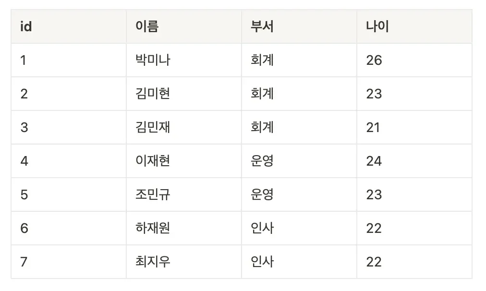
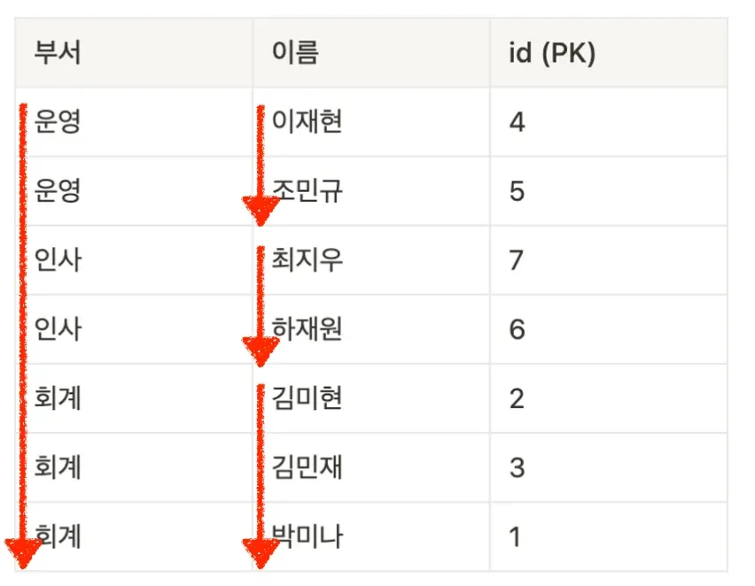

> 
> 
> 
> 
> <strong>목차</strong>
> 
> - [멀티 컬럼 인덱스 (Mulitple-Column Index)](#227eda9b0fe1817aa2c8fae450fe5b3a)
> - [ 예시를 통한 멀티 컬럼 인덱스 이해](#227eda9b0fe180d28b37ebd6425f69e6)

## 멀티 컬럼 인덱스 (Mulitple&#45;Column Index)

---

> 📖 
> 
> 
> 
> <strong><code>멀티 컬럼 인덱스</code></strong><strong> (</strong><strong><code>Mulitple&#45;Column Index</code></strong><strong>)</strong>
> 
> ---
> 
> - <strong>2개 이상의 컬럼을 묶어서 설정하는 인덱스</strong>
> 
> - <em><strong>데이터를 빨리 찾</strong></em><em><strong>기</strong></em><strong> 위해 </strong><strong><u>2개 이상의 컬럼을 기준</u></strong><strong>으로 미리 </strong><strong><u>정렬해놓은 표</u></strong>이다

###  예시를 통한 멀티 컬럼 인덱스 이해

위와 같이 <code>users</code> 테이블이 있다고 가정한다면

이때, <code>부서</code>, <code>이름</code> 컬럼들을 활용해 멀티 컬럼 인덱스를 생성하면 위와 같은 표가 시스템 내부에 생성된다&#46; 

1. <code>부서</code>를 기준으로 먼저 오름차순 정렬

1. 같은 <code>부서</code>의 값을 가진 데이터들 사이에서 <code>이름</code>을 기준으로 오름차순 정렬

  

> ✏️ 
> 
> 
> 
> 위 예시는 2개의 컬럼을 가지고 인덱스를 생성했지만,
> 
> 
> 
> 2개 이상의 컬럼들을 가지고도 생성 가능하다&#46;
