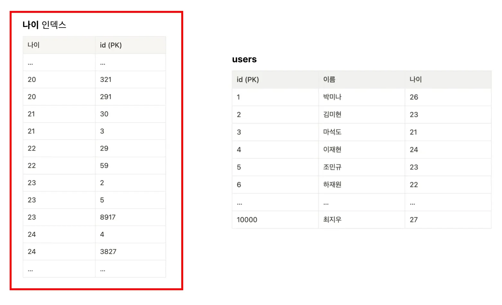
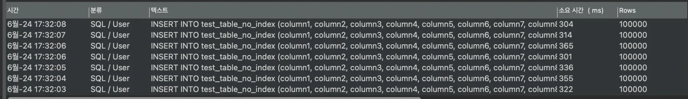
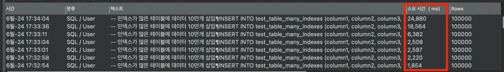

> 
> 
> <a id="227eda9b0fe18194af0ee0a42eeb6f0b"></a>
> 
> <strong>목차</strong>
> 
> - [[ 의문점 ] 인덱스를 무식하게 많이 걸면 어떻게 되는가?](#227eda9b0fe181aeaf4fe1ac283b5aeb)
> - [[ 실습 ] 다중 인덱스 유무에 따른 성능 측정](#227eda9b0fe1800a8f2afa0b7666a094)

<a id="227eda9b0fe181aeaf4fe1ac283b5aeb"></a>

## &#91; 의문점 &#93; 인덱스를 무식하게 많이 걸면 어떻게 되는가?

---

> 📖 
> 
> <a id="227eda9b0fe180f08b33c8d9d99dc40e"></a>
> 
> 인덱스를 사용하면 데이터를 조회 시, 성능이 향상된다&#46; 
> 
> - 단, 필터링 조건에 해당하는 컬럼으로 인덱스를 생성해야 한다&#46;
> 
> > 🧐 그러면 인덱스를 엄청 많이 추가하면 어떻게 될까?
> 
> <a id="227eda9b0fe1803bb683fe1a4404da48"></a>
> 
> 인덱스 추가 시, 조회(탐색)에 대한 성능을 올릴 수 있지만 <strong><u>쓰기 작업(삽입, 수정, 삭제)의 성능은 떨</u></strong>어진다&#46;  그리고 이는 인덱스가 많아질수록 더 그렇다&#46; 
> 
> - 인덱스 테이블에 대한 작업(삽입, 수정, 삭제) 비용이 추가로 든다&#46; 



<a id="227eda9b0fe18092b07ef1c439af9920"></a>

덱스를 추가한다는 건 인덱스용 테이블이 추가적으로 생성된다는 뜻이다&#46; 

<a id="227eda9b0fe18083940af4195c7b7b47"></a>

그렇다면 인덱스를 추가하지 않은 상태에서 원래 테이블에만 데이터를 넣는 것보다, 인덱스를 추가한 상태에서 원래 테이블과 인덱스용 테이블 둘 다에 데이터를 넣어야 하는 게 더 느릴 수 밖에 없다&#46; 

<a id="227eda9b0fe180d8888bfe4c7135bdce"></a>

따라서 인덱스의 개수가 많아지면 많아질수록 성능은 느려질 수 밖에 없다&#46;

<a id="227eda9b0fe180aea605eaab3994c1e0"></a>

 데이터를 삽입하는 것 이외에도 수정, 삭제 작업에서도 같은 이유로 성능이 느려진다&#46; 

<a id="227eda9b0fe1800a8f2afa0b7666a094"></a>

## &#91; 실습 &#93; 다중 인덱스 유무에 따른 성능 측정

---

<details>
<summary>1&#46; 테이블 생성</summary>

<a id="227eda9b0fe180adbbd1c141c6981628"></a>

```sql
-- 테이블 A: 인덱스가 없는 테이블
CREATE TABLE test_table_no_index (
    id INT AUTO_INCREMENT PRIMARY KEY,
    column1 INT,
    column2 INT,
    column3 INT,
    column4 INT,
    column5 INT,
    column6 INT,
    column7 INT,
    column8 INT,
    column9 INT,
    column10 INT
);

-- 테이블 B: 인덱스가 많은 테이블
CREATE TABLE test_table_many_indexes (
    id INT AUTO_INCREMENT PRIMARY KEY,
    column1 INT,
    column2 INT,
    column3 INT,
    column4 INT,
    column5 INT,
    column6 INT,
    column7 INT,
    column8 INT,
    column9 INT,
    column10 INT
);
```

</details>

<details>
<summary>2&#46; 인덱스 추가</summary>

<a id="227eda9b0fe18083b105db27f63f3854"></a>

```sql
-- 각 컬럼에 인덱스를 추가
CREATE INDEX idx_column1 ON test_table_many_indexes (column1);
CREATE INDEX idx_column2 ON test_table_many_indexes (column2);
CREATE INDEX idx_column3 ON test_table_many_indexes (column3);
CREATE INDEX idx_column4 ON test_table_many_indexes (column4);
CREATE INDEX idx_column5 ON test_table_many_indexes (column5);
CREATE INDEX idx_column6 ON test_table_many_indexes (column6);
CREATE INDEX idx_column7 ON test_table_many_indexes (column7);
CREATE INDEX idx_column8 ON test_table_many_indexes (column8);
CREATE INDEX idx_column9 ON test_table_many_indexes (column9);
CREATE INDEX idx_column10 ON test_table_many_indexes (column10);
```

</details>

<details>
<summary>3&#46; 데이터 삽입</summary>

<a id="227eda9b0fe18031909eeac802ce8b52"></a>

```sql
# 0. 높은 재귀(반복) 횟수를 허용하도록 설정
  -- 아래에서 생성할 더미 데이터의 개수와 맞춰 생성
SET SESSION cte_max_recursion_depth = 100000; 
```

<a id="227eda9b0fe180ed8640c3f944da8260"></a>

```sql
# 1. 인덱스가 없는 테이블에 데이터 10만개 삽입
INSERT INTO test_table_no_index (column1, column2, column3, column4, column5, column6, column7, column8, column9, column10)
WITH RECURSIVE cte AS (
    SELECT 1 AS n
    UNION ALL
    SELECT n + 1 FROM cte WHERE n < 100000
)
SELECT
    FLOOR(RAND() * 1000),
    FLOOR(RAND() * 1000),
    FLOOR(RAND() * 1000),
    FLOOR(RAND() * 1000),
    FLOOR(RAND() * 1000),
    FLOOR(RAND() * 1000),
    FLOOR(RAND() * 1000),
    FLOOR(RAND() * 1000),
    FLOOR(RAND() * 1000),
    FLOOR(RAND() * 1000)
FROM cte;
```

<a id="227eda9b0fe18009963eecf7d4789c32"></a>

```sql
# 2. 인덱스가 많은 테이블에 데이터 10만개 삽입
INSERT INTO test_table_many_indexes (column1, column2, column3, column4, column5, column6, column7, column8, column9, column10)
WITH RECURSIVE cte AS (
    SELECT 1 AS n
    UNION ALL
    SELECT n + 1 FROM cte WHERE n < 100000
)
SELECT
    FLOOR(RAND() * 1000),
    FLOOR(RAND() * 1000),
    FLOOR(RAND() * 1000),
    FLOOR(RAND() * 1000),
    FLOOR(RAND() * 1000),
    FLOOR(RAND() * 1000),
    FLOOR(RAND() * 1000),
    FLOOR(RAND() * 1000),
    FLOOR(RAND() * 1000),
    FLOOR(RAND() * 1000)
FROM cte;
```

</details>

<details>
<summary>4&#46; <strong>성능 테스트</strong></summary>

- <strong> 인덱스를 생성하지 않은 테이블에 10만개 데이터 삽입 시 걸리는 속도</strong>
    

    - 약 300ms 정도의 시간이 소요된다&#46;

- <strong>인덱스를 많이 생성한 테이블에 10만개 데이터 삽입 시 걸리는 속도</strong>
    

    - 약 2000ms로 시작해서 25,000ms까지 걸리는 걸 확인할 수 있다&#46; 

    - 데이터가 많아지면 많아질수록 점점 삽입 속도가 느려지는 걸 확인할 수 있다&#46; 

</details>

> 
> 
> <a id="227eda9b0fe180288466e24873522771"></a>
> 
> <strong>정리</strong>
> 
> - <strong>최소한의 인덱스</strong>만 사용
> 
> - <strong><u>인덱스를 추가하면 조회 속도는 빨</u></strong>라지나, <strong>쓰기(삽입, 수정, 삭제) 속도는 느려진</strong>다&#46;
