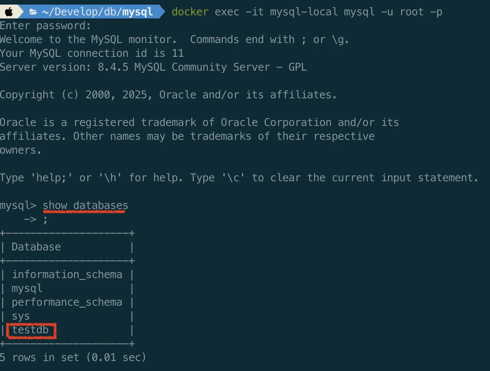

> 
> 
> <a id="227eda9b0fe1809bb4c0e133b9167b27"></a>
> 
> <strong>목차</strong>
> 
> - [1. GUI - DBeaver 사용](#227eda9b0fe18173bf05e8981764725d)
> - [2. Docker Compose로 구축](#227eda9b0fe180eaa67ef5c73c369e5f)

> ⚙ 
> 
> <a id="227eda9b0fe18094af7eea765ebb7bff"></a>
> 
> 강의와 다르게 Docker로 구축 후 터미널로 실습 진행

<a id="227eda9b0fe18173bf05e8981764725d"></a>

## 1&#46; GUI &#45; DBeaver 사용

- 강의 버전 &#45; 우선 패스

<a id="227eda9b0fe180eaa67ef5c73c369e5f"></a>

## 2&#46; Docker Compose로 구축

<details>
<summary>Docker file 기반으로 실행</summary>

<a id="227eda9b0fe180d6b231efa90a0a1cb5"></a>

‣

[Dockerfile.oracle](https://github.com/docker-library/mysql/blob/8ade9b2c9a32a79fbaa44b564d09a40744f1d105/8.4/Dockerfile.oracle)

</details>

- docker compose 파일
    <a id="227eda9b0fe1806b8b90ec01269bf474"></a>

    ```yaml
    services:
      mysql:
        image: mysql:8.4
        container_name: mysql-local
        restart: always
        environment:
          MYSQL_ROOT_PASSWORD: root123         # root 비밀번호
          MYSQL_DATABASE: testdb               # 자동 생성될 DB 이름
          MYSQL_USER: test                     # 사용자 계정
          MYSQL_PASSWORD: test123              # 사용자 비밀번호
        ports:
          - "3306:3306"                        # 호스트 → 컨테이너 포트 바인딩
        volumes:
          - mysql-data:/var/lib/mysql          # 데이터 저장 볼륨
        healthcheck:
          test: ["CMD", "mysqladmin", "ping", "-h", "localhost"]
          interval: 10s
          timeout: 5s
          retries: 5

    volumes:
      mysql-data:
    ```

- compose 실행 및 컨테이너 접속
    <a id="227eda9b0fe18091952bd3289441f238"></a>

    ```bash
    # compose 파일 실행
    docker compose up -d

    # 실행 확인
    docker compose ps

    # 컨테이너 mysql 접속
    docker exec -it mysql-local mysql -u root -p  # root 계정이 아닌 일반 계정을 사용하는 경우, 해당 유저명으로 수정 필요
    	# compose에 정의한 비밀번호 입력

    # compose 종료
    docker compose down

    # 볼륨까지 삭제
    docker compose down -v
    ```

- db checkout
    <a id="227eda9b0fe1807a97e6fee61108ac35"></a>

    ```bash
    # DB 리스트 확인
    show databases;

    # DB checkout
    use testdb;  # compose 파일에서 정의한 테스트용 DB로 변경
    ```

    

    - compose 파일로 정의한 DB가 정상적으로 생성된 것을 확인할 수 있다&#46;
