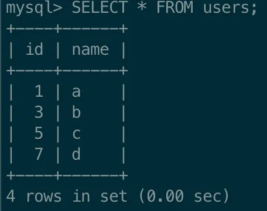
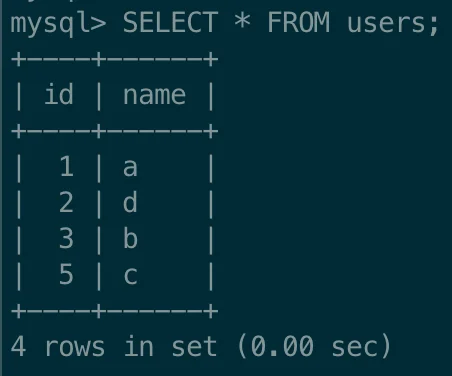
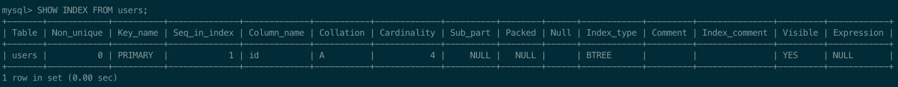

> 
> 
> <a id="227eda9b0fe18136a5aeeb40cf755ea5"></a>
> 
> <strong>목차</strong>
> 
> - [기본으로 설정되는 인덱스: 기본키 ( Primary Key, PK )](#227eda9b0fe18139af78ea8f332ee13f)

<a id="227eda9b0fe18139af78ea8f332ee13f"></a>

## 기본으로 설정되는 인덱스&#58; <code>기본키</code> ( <code>Primary Key</code>, <code>PK</code> )

---

> 📖 
> 
> <a id="227eda9b0fe1807894c6f52510534fa8"></a>
> 
> 테이블에서 <strong><u>특정 데이터를 고유하게 식별</u></strong>하기 위한 값을 <code>기본키(Primary Key, PK)</code>라 한다&#46; 
> 
> -  대부분의 경우에 테이블을 생성 시, PK를 설정한다&#46;
> 
> - <strong>PK를 기준으로 정렬을 해서 데이터를 보관한다&#46; </strong>
>     <a id="227eda9b0fe1806f85eff0baaaf82278"></a>
> 
>     <strong>즉, </strong><strong><u>PK를 기준으로 기본 인덱스가 형성</u></strong><strong>된다&#46; </strong>

<details>
<summary>1&#46; PK가 포함된 users 테이블 생성</summary>

<a id="227eda9b0fe18083a52eea88303bc836"></a>

```sql
# 기존 테이블 삭제
DROP TABLE IF EXISTS users;   # [옵션] 이전에 실습한 테이블 삭제

#  users 테이블 생성
CREATE TABLE users(
		id INT PRIMARY KEY,
		name VARCHAR(100)
);
```

</details>

<details>
<summary>2&#46; 데이터 삽입</summary>

<a id="227eda9b0fe1802691d1d57268cf9379"></a>

```sql
# 4개의 더미 데이터 삽입
INSERT INTO users(id, name) VALUES
(1, 'a'),
(3, 'b'),
(5, 'c'),
(7, 'd');

# 테이블 조회
SELECT * FROM users;
```



</details>

<details>
<summary>3&#46; id 값 변경 후 다시 조회</summary>

<a id="227eda9b0fe1806d91ffef5d2931271f"></a>

```sql
# id 값 변경
UPDATE users
SET id = 2
WHERE id = 7;

SELECT * FROM users;
```



- 데이터가 변경되어도 정렬되어 보여진다&#46;

> 
> 
> <a id="227eda9b0fe180c19de7fbc4e5a77e25"></a>
> 
> <code>id</code> 컬럼을 기준으로 정렬되어 있는 채로 데이터가 조회된다&#46;
> 
> <a id="227eda9b0fe1801db7baf8751e755e62"></a>
> 
> 왜냐하면 <code>PK</code>가 <strong><u>인덱스의 일종</u></strong>이기 때문이다&#46; 
> 
> <a id="227eda9b0fe180679ba3c2172c311621"></a>
> 
> 이렇게 <strong><u>원본 데이터 자체가 정렬되는 인덱스</u></strong>를 보고 <code>클러스터링 인덱스</code>라고 부른다&#46;
> 
> - <code>클러스터링 인덱스</code>는 <code>PK(Primary Key)</code> 밖에 없다&#46;
> 
> - <code>PK(Primary Key) = 클러스터링 인덱스</code>
> 
> <a id="227eda9b0fe18087aa6ef3c5eeff858d"></a>
> 
> <del>클러스터링 인덱스라는 용어가 엄청나게 중요한 건 아니기 때문에 기억하기 어렵다면 일단 무시</del>

</details>

<details>
<summary>4&#46; PK에 실제 인덕스가 적용 되었는지 확인</summary>

<a id="227eda9b0fe1800dab0ecac6fdd0f392"></a>

```sql
# 특정 테이블 인덱스 조회      - [문법] SHOW INDEX FROM 테이블명;
SHOW INDEX FROM users;
```



- Primary Key가 기본 인덱스로 적용되어 있는 것을 확인할 수 있다&#46;

</details>

> 
> 
> <a id="227eda9b0fe1800798cac24ea76f58a6"></a>
> 
> <strong>정리</strong>
> 
> - <strong>PK에는 인덱스가 기본적으로 적용</strong><strong>된다&#46;</strong>
> 
> - PK에는 인덱스가 적용되어 있으므로 <strong>PK를 기준으로 데이터가 정렬</strong>된다&#46;
