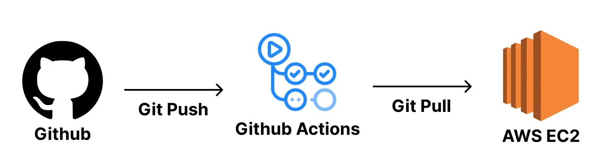
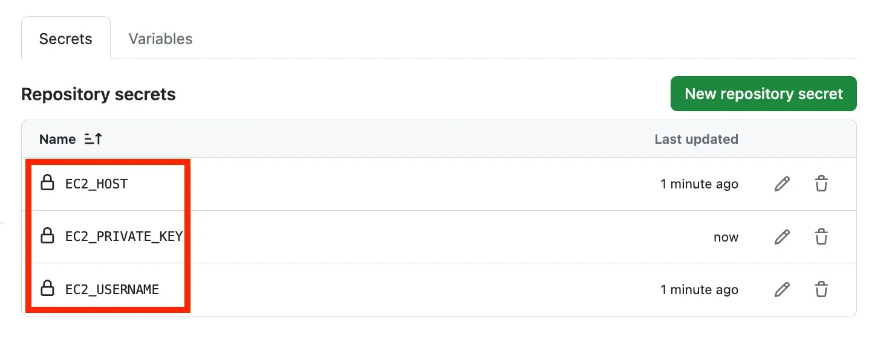
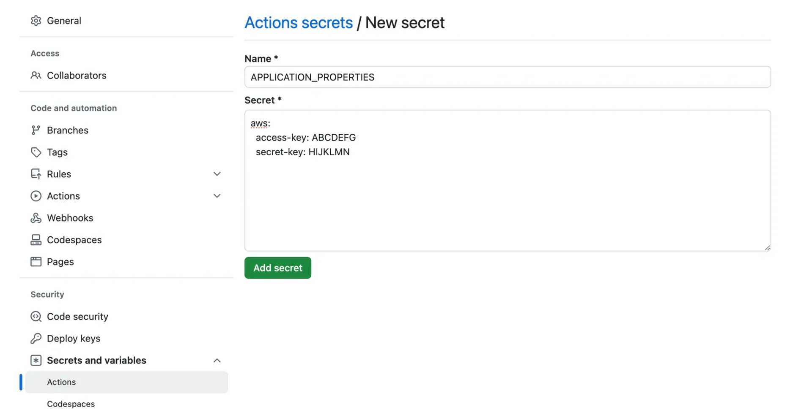

> 
> 
> <a id="227eda9b0fe180cc89fcd3f9488660dd"></a>
> 
> <strong>목차</strong>
> 
> - [1.  개인 프로젝트 ( Github Actions )](#227eda9b0fe180d5bcdcf9dd391fc89d)
> - [1.1. 장•단점](#227eda9b0fe1805a8ba0effd4da9e727)
> - [2. [ 실습 ] ](#227eda9b0fe180e789b2c3d89355c5a2)
> - [2.1.  CI/CD  ( 베포 자동화 )](#227eda9b0fe180f9bfcfdbd1e77cba43)
> - [2.2.  application.yml 파일 넣는 과정 자동화](#227eda9b0fe180859021fb4d30032747)
> - [2.3. 테스트 코드 실패에 따른 CI/CD 과정 실패 확인](#227eda9b0fe180f7a28cf87ea9da5234)

<a id="227eda9b0fe180d5bcdcf9dd391fc89d"></a>

## 1&#46;  개인 프로젝트 ( Github Actions )

---



> ✏️ 
> 
> <a id="227eda9b0fe180c39789ffb54504d4d5"></a>
> 
> 주로 개인, 토이 프로젝트에서 CI/CD를 빠르게 적용 시키는 경우 사용한다&#46;

<a id="227eda9b0fe1805a8ba0effd4da9e727"></a>

### <strong>1&#46;1&#46; 장•단점</strong>

> ✅ 
> 
> <a id="227eda9b0fe1809fa730ebe383c72b2d"></a>
> 
> <strong>장점</strong>
> 
> - <code>git pull</code>을 할용해 변경된 부분의 프로젝트 코드에 대해서만 업데이트를 진행하여 <code>CI/CD</code> 속도가 빠르다&#46; 
>     - 대부분의 CI/CD 방식들은 전체 프로젝트를 통째로 갈아끼우는 방식을 사용한다&#46; 
> 
> - CI/CD 툴로 Github Actions만 사용하기 때문에 인프라 구조가 복잡하지 않고 간단하다&#46; 

> ❗ 
> 
> <a id="227eda9b0fe1804194ecf59aad93f37f"></a>
> 
> <strong>단점</strong>
> 
> - 빌드 작업을 EC2에서 직접 진행하기 때문에 운영하고 있는 서버의 성능에 영향을 미칠 수 있다&#46; 
> 
> - Github 계정 정보가 해당 EC2에 저장되기 때문에 개인 프로젝트 또는 신뢰 가능한 팀원들과 같이 진행하는 토이 프로젝트에서만 사용이 적합하다&#46; 

<a id="227eda9b0fe180e789b2c3d89355c5a2"></a>

## 2&#46; &#91; 실습 &#93; 

---

<a id="227eda9b0fe180f9bfcfdbd1e77cba43"></a>

### 2&#46;1&#46;  <code>CI/CD</code>  ( 베포 자동화 )

<details>
<summary>1&#46; <code>&#46;github/workflows/deploy&#46;yml</code> 작성</summary>

> ✏️ 
> 
> <a id="227eda9b0fe180f5a770cf4e31c3c34e"></a>
> 
> SSH란 다른 컴퓨터로 원격 접속하는 방식을 의미한다&#46; 
> 
> <details>
> <summary><code>appleboy/ssh&#45;action</code> 공식 문서</summary>
> 
> [SSH Remote Commands &#45; GitHub Marketplace]()
> 
> </details>
> 
> <details>
> <summary><code>nohup … &#38;</code> 부분의 코드를 수동으로 배포할 때와 조금 다르게 작성한 이유</summary>
> 
> <a id="227eda9b0fe180c9a26dd9a67a29e368"></a>
> 
> ‣
> 
> </details>

<a id="227eda9b0fe1805b9fd1e730a5bdabcd"></a>

```yaml
name: Deploy To EC2

on:
  push:
    branches:
      - main

jobs:
  deploy:
    runs-on: ubuntu-latest
    steps:
      - name: SSH로 EC2 접속
        uses: appleboy/ssh-action@v1.0.3
        with:
          host: ${{ secrets.EC2_HOST }}            # EC2의 주소
          username: ${{ secrets.EC2_USERNAME }}    # EC2 접속 username
          key: ${{ secrets.EC2_PRIVATE_KEY }}      # EC2의 Key 파일의 내부 텍스트
          script_stop: true                        # 아래 script 중 실패하는 명령이 하나라도 있으면 실패로 처리
          script: |
            cd /home/ubuntu/actions_prac1 # 여기 경로는 자신의 EC2에 맞는 경로로 재작성하기
            git pull origin main
            ./gradlew clean build
            sudo fuser -k -n tcp 8080 || true # || true를 붙인 이유는 8080에 종료시킬 프로세스가 없더라도 실패로 처리하지 않기 위해서이다. 
            # jar 파일을 실해이키는 명령어이다. 그리고 발생하는 로그들을 ./output.log 파일에 남기는 명령어이다. 
            nohup java -jar build/libs/*SNAPSHOT.jar > ./output.log 2>&1 &
```

</details>

<details>
<summary>2&#46; Github에 Secret값 설정</summary>

> ⚠️ 
> 
> <a id="227eda9b0fe180c49c03d0559d2fb327"></a>
> 
> environment를 설정하는 경우, workflows 내에서 해당하는 scope 설정을 추가 해야한다&#46;




</details>

<details>
<summary>3&#46; Github에 Push 해서 Github Actions 잘 동작하는 지 확인</summary>


</details>

<details>
<summary>4&#46; 실제 서버 접속하여 잘 작동하는지 확인</summary>


</details>

<a id="227eda9b0fe180859021fb4d30032747"></a>

### 2&#46;2&#46;  <code>application&#46;yml</code> 파일 넣는 과정 자동화

> ✏️ 
> 
> <a id="227eda9b0fe18029abc7fe5f497fa71f"></a>
> 
> 실무에서는 민감한 값을 따로 <code>application&#46;yml</code>로 분리하는 경우가 많다&#46;
> 
> <a id="227eda9b0fe1808eb37ff6ccc5838a4a"></a>
> 
> 민감한 값이기 때문에 <code>&#46;gitignore</code>에 추가해서 <code>application&#46;yml</code>가 버전관리 되지 않게 설정한다&#46;
> 
> <a id="227eda9b0fe18064849fdad9bd9ddb3d"></a>
> 
> 이 때문에 배포를 할 때 <code>application&#46;yml</code>를 따로 넣어주어야 하는 귀찮은 과정이 포함된다&#46;
> 
> <a id="227eda9b0fe1800894fef0e3b4475f8b"></a>
> 
> <strong><u>이러한 과정을 자동화</u></strong> 시킬 수 있다&#46; 

<details>
<summary>1&#46; <code>&#46;gitignore</code>에 <code>application&#46;yml</code> 추가</summary>

<a id="227eda9b0fe18089a46ffa93bb116fd1"></a>

<strong>&#46;gitignore</strong>

<a id="227eda9b0fe1808dbbb8ea5f3ad21dca"></a>

```plaintext
...

application.yml
```

</details>

<details>
<summary>2&#46; <code>application&#46;yml</code> 파일 생성</summary>

<a id="227eda9b0fe18093823dc88358b4fee3"></a>

<strong>src/main/resoureces/application&#46;yml</strong>

<a id="227eda9b0fe1806e9b3ad009d44dd1ee"></a>

```plaintext
aws:
	access-key: ABCDEFG
	secret-key: HIJKLMN
```

</details>

<details>
<summary>3&#46; Github에 resources 폴더가 push 되도록 임의의 파일 하나 만들어주기</summary>

> ☝🏻 
> 
> <a id="227eda9b0fe18087b846c03c445a7468"></a>
> 
> 폴더 내 파일이 존재해야 <code>git</code>으로 버전 관리된다&#46; 

<a id="227eda9b0fe18079be93cb45bc6c77b1"></a>

<strong>src/main/resources/empty&#46;txt</strong>

<a id="227eda9b0fe1807ba72fc30a15f31861"></a>

```plaintext

```

</details>

<details>
<summary>4&#46; Github Actions 코드 수정</summary>

<a id="227eda9b0fe180ef821dcb42688bc7ef"></a>

<strong>&#46;github/workflows/deploy&#46;yml</strong>

<a id="227eda9b0fe18064b3e2f583f3aeb468"></a>

```yaml
name: Deploy To EC2

on:
	push:
		branches:
			- main

jobs:
	deploy:
		runs-on: ubuntu-latest
		steps:
			- name: SSH로 EC2에 접속하기
				uses: appleboy/ssh-action@v1.0.3
				env:
					APPLICATION_PROPERTIES: ${{ secrets.APPLICATION_PROPERTIES }}
				with:
					host: ${{ secrets.EC2_HOST }}.         # EC2의 주소 
					username: ${{ secrets.EC2_USERNAME }}  # EC2 접속 username 
					key: ${{ secrets.EC2_PRIVATE_KEY }}    # EC2의 Key의 파일 내부 텍스트
					envs: APPLICATION_PROPERTIES
					script_stop: true                      # 아래 script 중 실패하는 명령어 하나라도 있으면 실패로 처리
					script: |
						cd /home/ubuntu/instagram-server     # 아래 script 중 실패하는 명령이 하나라도 있으면 실패로 처리
						rm -rf src/main/resources/application.yml
						git pull origin main
						echo "$APPLICATION_PROPERTIES" > src/main/resources/application.yml
						./gradlew clean build
						sudo fuser -k -n tcp 8080 || true 
						nohup java -jar build/libs/*SNAPSHOT.jar > ./output.log 2>&1 &
```

</details>

<details>
<summary>5&#46; Github에 Secret 값 추기</summary>



</details>

<details>
<summary>6&#46; EC2 application&#46;yml 베포 확인</summary>


</details>

<a id="227eda9b0fe180f7a28cf87ea9da5234"></a>

### 2&#46;3&#46; 테스트 코드 실패에 따른 CI/CD 과정 실패 확인

> ✏️ 
> 
> <a id="227eda9b0fe180a3847ce94cd00723fa"></a>
> 
> <code>&#46;/gradlew clean build</code>에서 테스트 코드를 실행시키는 과정이 포함된다&#46; 만약 이 과정에서 테스트 실패가 발생되면 <code>action</code>이 실패하여 베포가 진행되지 않는다&#46; 

<details>
<summary>1&#46; Spring Boot 프로젝트의 테스트 코드 확인</summary>

<a id="227eda9b0fe1808ba8b2c38c7bbf21bf"></a>

```shell
./gradlew test
```

</details>

<details>
<summary>2&#46; 테스트 실패하도록 수정</summary>

<a id="227eda9b0fe18026b460e57214c20235"></a>

<strong>test/…/&#95;&#95;&#95;ApplicationTests&#46;java</strong>

<a id="227eda9b0fe180cda4a1caa7e45d6f5e"></a>

```java
package com.example.demo;

import org.junit.jupiter.api.Test;
import org.springframework.boot.test.context.SpringBootTest;

@SpringBootTest
class DemoApplicationTests {

		@Test
		void contextLoads() {
			throw new RuntimeException("Fail!");
		}
}
```

</details>

<details>
<summary><strong>3&#46; 테스트 코드 실패하면 배포가 안 되는 지 확인</strong></summary>


</details>
