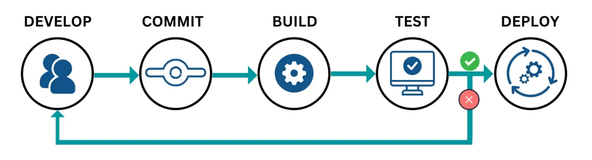

> 
> 
> 
> 
> <strong>목차</strong>
> 
> - [1. CI/CD](#227eda9b0fe180faa7f6c0efd5d6fccb)
> - [왜 CI/CD를 적용하는가?](#227eda9b0fe18068b399c6395662b3a8)
> - [CI/CD 구축 -  Github Actions](#227eda9b0fe180e4b639db61c92d63cc)
> - [🧐 비교 - Jenkins, Github Actions](#227eda9b0fe180d6950ddbeef16f9567)
> - [🧐 엔터프라이즈( Enterprise )](#227eda9b0fe18029a5bece6aa9619c08)

## 1&#46; CI/CD

---

> 📖 
> 
> 
> 
> <code>CI/CD</code> 란 <code>Continuous Integration</code>, <code>Continuous Deployment</code>의 줄임말이다&#46;
> 
> 

> 
<code>CI</code>&#58; <code>Continuous Integration</code>, <code>지속적인 통합</code>

> 
> - 각 개발자들이개발한 코드를 공용 저장소(github)에 푸시하고, 통합 관리되는 브랜치(<code>main</code>, <code>develop</code>) pull request를 통해 팀단위로 동의가 이뤄지면 해당 코드가 통합된다&#46; 
> 
> - 이렇게 코드 통합이 이뤄지면 <strong><u>빌드(build)</u></strong> 및 <strong><u>테스트(test)</u></strong>를 진행해야 하는데, 이러한 프로세스가 매번 반복적으로 이뤄진다&#46; 
> 
> 
> 
> 이를 <strong>자동화 처리</strong>하여 개발하는 방법론을 <code>CI, 지속적인 통합</code> 이라 한다&#46; 
> 
> 

> 
> 

> 
<code>CD</code>&#58; <code>Continuous Deployment</code>, <code>지속적인 베포</code>

> 
> - CI 과정을 통과한 코드를 자동으로 운영 서버(Production)에 베포까지 하는 프로세스이다&#46;
> 
> - 이를 통해, 개발자 개입이 없어 실수없이  안정적으로 베포가 가능하며, 피드백 루프를 단축시켜 사용자에게 빠르게 기능을 제공한다&#46;
> 
> 
> 
>  
> 
> 

> 
> 

> 
ex)

> 
> 1. CI 통과
> 
> 1. Docker build → 이미지 생성
> 
> 1. kubectl apply 또는 aws ecs update&#45;service 등을 통해 서버에 자동 반영
> 
> 

### 왜 <code>CI/CD</code>를 적용하는가?

서비스를 운영하면서 새로운 기능을 추가하거나, 기존의 기능이 변화되거나 등으로 서비스가 지속적으로 변화되며 이에 따른 지속인 개발이 이뤄진다&#46;  

즉, 계속 프로덕션의 코드가 계속 변화된다&#46; 

이러한 변화 따른 개발 즉, 코드가 작성되고 통합 되며 테스트 및 빌드 과정을 거쳐 베포가 이뤄진다&#46; 

이러한 과정이 매번 코드가 통합(merge)가 이뤄질 때 반복적으로 이뤄진다&#46;  

이러한 동일한 프로세스를 자동화 처리하여 개발 생산성을 증진 시키며 사용자 즉각적인 피드백을 반영하여 애자일 개발 방식에 부합하는 빠르게 변화 가능한 서비스를 구축 가능토록 한다&#46;

### <code>CI/CD</code> 구축 &#45;  <code>Github Actions</code>

> 🛠 
> 
> 
> 
> <strong>CI/CD 툴</strong>
> 
> - <code>Github Actions</code>
> 
> - <code>Jenkins</code>
> 
> - Circle CI
> 
> - Travis Ci
> 
> - …

해당 학습은 이 중에서 무료이면서, 빌드용 서버가 따로 필요없는 <code>Github Actions</code>를 활용해서 CI/CD를 구축한다&#46; 

- 실무에서는 규모가 큰 회사, 팀의 경우 <code>Jenkins</code>을  많이 활용한다&#46;  

- <code>Jenkins</code>는 <u>별도의 서버를 구축</u>해야 하는 단점이 있어, 서버 구축 및 운영 비용이 발생된다&#46;

- 따라서 엔터프라이즈 급 대규모 시스템을 갖춘 회사가 아닌 경우, <code>Github Actions</code>를 사용하는 것이 더 적절하다&#46;

### 🧐 비교 &#45; <code>Jenkins</code>, <code>Github Actions</code>

현업에서 Github Actions 뿐만 아니라 Jenkins도 많이 활용한다&#46; 

- Github Actions와 Jenkins 둘 중 하나만 쓰더라도 CI/CD 구축이 가능하다&#46; 

그렇다면 두 기술 사이에 어떠한 차이점이 있는가?  이에 대한 비교 내용은 아래와 같다&#46; 

| <strong>항목</strong> | <strong>Jenkins</strong> | <strong>GitHub Actions</strong> |
| --- | --- | --- |
| <strong>배포 모델</strong> | 자가 호스팅 (On&#45;Premise 또는 EC2 등 직접 운영) | 클라우드 기반 (GitHub에서 자동 제공) |
| <strong>설정 방식</strong> | Jenkins UI &#43; Groovy Script (Jenkinsfile) | YAML 파일 (&#46;github/workflows/) |
| <strong>플러그인 생태계</strong> | 매우 풍부함 (1,800&#43; 개) | 점점 증가 중이지만 제한적 |
| <strong>비용</strong> | 서버 직접 운영 필요 (EC2 등)  Jenkins 자체는 오픈소스 | GitHub Free 요금제에서 2,000분/월 무료 제공 |
| <strong>속도</strong> | 에이전트 성능에 따라 달라짐  (병렬 설정 가능) | GitHub 호스팅 환경에서 동작  (Runner 제한 존재) |
| <strong>보안 관리</strong> | 직접 구성 필요 (접근 권한, 비밀번호, 인증 등) | GitHub 자체 보안 정책 적용 (기본 안전) |
| <strong>Cloud 연동성</strong> | AWS, GCP, Azure 플러그인 다양 | GitHub Actions &#43; GitHub Packages &#43; GitHub Codespaces 등 자연스럽게 연동 |
| <strong>러닝 커브</strong> | 초기 진입 장벽 높음  (설치, 플러그인 관리 등) | GitHub UI에서 바로 사용 가능  초심자 친화적 |
| <strong>재사용성</strong> | Jenkins 공유 라이브러리 필요 | GitHub Action 재사용 가능 (uses&#58; 구문) |
| <strong>로깅/모니터링</strong> | 직접 설정 (예&#58; Prometheus, ELK 등) | GitHub UI에서 간단히 확인 가능 |
| <strong>확장성</strong> | 기업 수준 확장에 강함 (엔터프라이즈 운영 적합) | 소규모/중소기업에 적합 (Github 기반 프로젝트에 최적화) |

> 🗒️ 
> 
> 
> 
> <strong>정리</strong>
> 
> ---
> 
> - <code>Jenkins</code>&#58; 사내 통합 대시보드, 커스텀 플러그인 연동, 시스템 계정 연계에 적합하다&#46;
> 
> - <code>Github Actions</code>&#58; 개인 개발자, 스타트업, Github 기반 조직에서 빠르게 적용 가능해서 생산성이 뛰어나다&#46; 
> 
> 
> 
> 따라서 팀(회사) 규모가 크지 않고 복잡한 요구사항이 없다면<code>Github Actions</code>
> 
> 
> 
> 모니터링, 보안, 운영 자동화까지 하는 시나리오 즉, <code>Prometheus</code>, <code>Slack 연동</code>까지 적용이 필요한 상황은 <code>Jebkins</code>사용이 적절하다&#46;

 

### 🧐 엔터프라이즈( <strong>Enterprise</strong> )

> ✏️ 
> 
> 
> 
>  엔터프라이즈( <strong>Enterprise</strong> )는 “대규모 기업”  또는 “조직적이고 복잡한 운영 구조를 가진 회사” 즉, 수백&#45;수천 명의 인원, 엄격한 보안 정책, 다단계 승인, 고가용성 시스템 등이 필요한 회사를 말한다&#46; 

개발자나 시스템 관점에서 “엔터프라이즈급”이라고 하면 아래과 같은 특징을 가진다&#46; 

- 엔터프라이즈급 기업의 특징
    | <strong>항목</strong> | <strong>설명</strong> |
    | --- | --- |
    | <strong>보안(Security)</strong> | 내부망, 접근 제어, LDAP/SAML 연동, 감사 로그 등 |
    | <strong>확장성(Scalability)</strong> | 수천&#126;수만 유저, 고부하 대응 가능 |
    | <strong>통합성(Integration)</strong> | SAP, Oracle, CRM 등 다양한 시스템과 연동 |
    | <strong>운영 자동화</strong> | CI/CD, 모니터링, 로깅, 장애 대응 체계 |
    | <strong>이중화/백업/DR</strong> | 무중단 서비스, 장애 복구 계획 필수 |
    | <strong>역할 분리 및 승인</strong> | Dev/QA/운영팀 분리, 코드 리뷰 및 승인 필수 |

- 소규모 스타트업과 엔터프라이즈 기업 비교
    | <strong>항목</strong> | <strong>스타트업</strong> | <strong>엔터프라이즈</strong> |
    | --- | --- | --- |
    | 배포 | <code>수동 배포</code>,<code>GitHub Actions</code> | <code>Jenkins</code> &#43; 승인 프로세스 &#43; 이중화 배포 |
    | 보안 | 최소한의 인증 | SSO, MFA, VPN, 내부망, 인증 시스템 연동 |
    | 모니터링 | 간단한 콘솔 확인 | Prometheus &#43; Grafana &#43; AlertManager 연동 |
    | 코드 관리 | GitHub 브랜치 전략 단순 | GitHub Enterprise / GitLab &#43; Code Review 강제 |
    | 업무 방식 | 빠른 시도와 실패 허용 | 절차 기반, 변경 요청 문서화 필수 |
