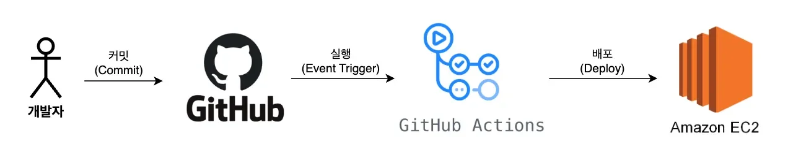
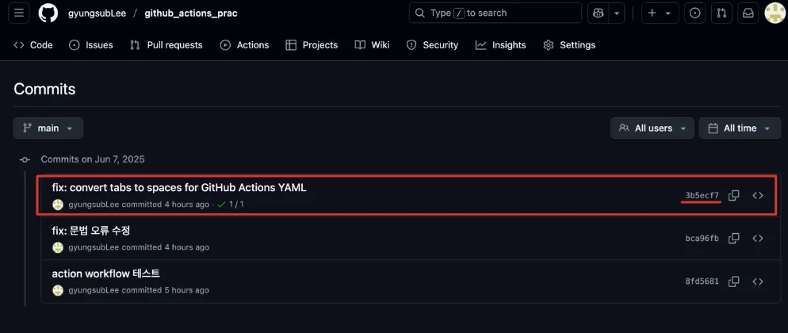
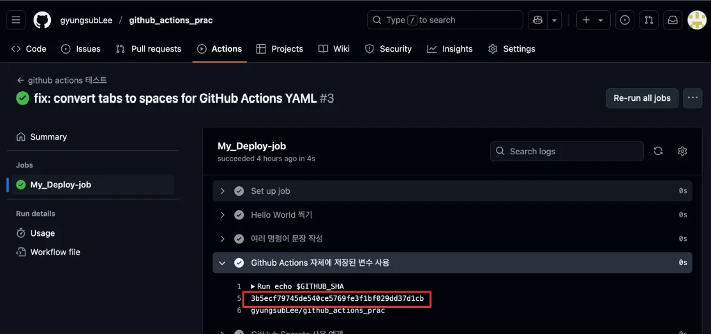
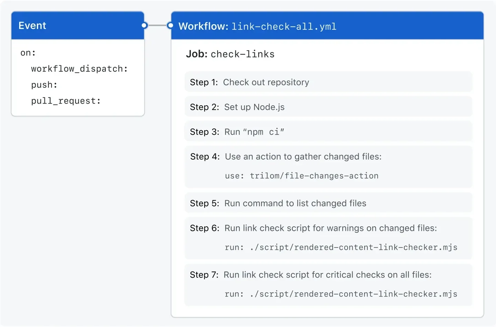
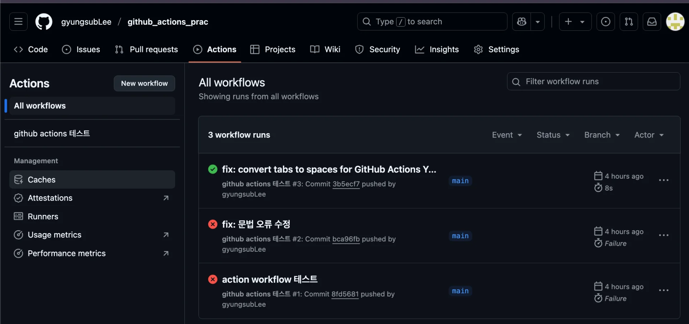

> 
> 
> <a id="227eda9b0fe181e9bb38c3d0e06a0708"></a>
> 
> <strong>목차</strong>
> 
> - [1. GIthub Actions](#227eda9b0fe18167b2f3c58789c50fbd)
> - [1.1.  Github Actions을 활용한 CI/CD 프로세스](#227eda9b0fe180a697b3ca25fe5b2edd)
> - [1.2. Github Actions - Workflow 정의](#227eda9b0fe1801ca578cfd636ee69cb)
> - [2. [실습]  workflow 정의 및 actions 실행](#227eda9b0fe1802cbceecd78e97d795e)
> - [2.1. 구조 ](#227eda9b0fe18006b0c6cfa7d6e20ede)
> - [2.2. 실습](#227eda9b0fe180958447c63301ef2df0)

<a id="227eda9b0fe18167b2f3c58789c50fbd"></a>

## 1&#46; GIthub Actions

---

> 📖 
> 
> <a id="227eda9b0fe180f396cfc83f206a2653"></a>
> 
> Github Actions는 로직 실행이 가능한 일종의 컴퓨터라고 생각하면 된다&#46; 
> 
> - CI/CD 과정에서 Github Actions는  “빌드, 테스트, 베포”에 대한 로직을 실행시키는 역할을 한다&#46;

<a id="227eda9b0fe180a697b3ca25fe5b2edd"></a>

### 1&#46;1&#46;  Github Actions을 활용한 CI/CD 프로세스



1. 코드 작성 후 Commit

1. Github에 Push

1. Push를 감지해 Github Actions 로직 실행
    1. 빌드(Build)

    1. 테스트(Test)

    1. 서버로 베포(Deploy)

1. 서버에서 베포된 최신 코드로 서버를 재실행

<a id="227eda9b0fe1801ca578cfd636ee69cb"></a>

### 1&#46;2&#46; Github Actions &#45; Workflow 정의

<details>
<summary>Docs</summary>

[GitHub Actions 설명서 &#45; GitHub Docs]()

</details>

> 
> 
> <a id="227eda9b0fe180d396c6e7f077b2b375"></a>
> 
> Gihub Actions를 실행시키기 위해서는 반드시 <code>&#46;github/workflows</code>에 YAML 형식(<code>&#46;yml</code>, <code>&#46;yaml</code>)으로 파일을 생성해 Workflow를  정의해야 한다&#46; 
> 
> - <code>&#46;github/workflows</code>는 <strong><u>프로젝트 폴더 루트 경로(최상단)</u></strong>에 만들어야 한다&#46;

> ✏️ 
> 
> <a id="227eda9b0fe180bfa62ec36ea2115cdb"></a>
> 
> <strong>Github Actions &#45; Workflow 정의</strong>
> 
> ---
> 
> > 작업 단위&#58; <code>Workflow</code> → <code>Jobs</code> → <code>Steps</code>
> 
> 1. Workflow 이름 설정
> 
> 1. 이벤트 트리거 설정 ( 브랜치 간에 merge 발생 시 )
> 
> 1. workflow 내 job 설정
>     - 1개의 workflow 내 여러개의 job 구성가능
> 
> 1. job 내 step 설정
>     - 1개의 job 안에 여러개의 step 구성 가능
> 
> 1. step으로 실행 동작 정의
>     - <code>step</code>으로 설정한 이벤트 발생 시, 실행될 구체적인 동작을 정의한다&#46; 
> 
>     - 기본 변수, 시크릿 변수 등을 가져와 사용 가능

<details>
<summary>🧐 <code>&#36;GITHUB&#95;SHA</code></summary>

<a id="227eda9b0fe18088bf57c754d0669a10"></a>

```yaml
# commit hash를 복사한 값
3b5ecf79745de540ce5769fe3f1bf029dd37d1cb

# action 실행으로 출력된 '$GITHUB_SHA' 변수값
3b5ecf79745de540ce5769fe3f1bf029dd37d1cb

```

<details>
<summary>액션이 실행된 Commit의 Hash 값을 나타낸다&#46; </summary>





- 동일한 값인 것을 확인 가능

</details>

</details>

<a id="227eda9b0fe18045865ac618300403e1"></a>

```yaml
# 1. Workflow의 이름
# Workflow: 하나의 yml 파일을 하나의 Workflow 라고 부른다.
name: Github Actions 실행

# 2. Event: 실행 트리거 설정
	# main이라는 브랜치에 push 될 때 해당 아래 Workflow를 실행
on:
	push:
		branches:
			- main

# 3. workflow 내 job 설정
# 하나의 Workflow는 1개 이상의 Job으로 구성된다.
# 여러 Job은 기본적으로 병렬적으로 수행된다. 
jobs:
	# Job 식별 id
	My-Deploy-job:
		# Github Actions를 실행시킬 서버 종류 선택
		runs-on: ubuntu-latest
		
		# 4. job 내 step 설정
		# Step: 특정 작업을 수행하는 가장 작은 단위
		# Job은 여러 Step들로 구성되어 있다.
		steps: 
			# 5. 각 step에 실행 동작 정의
			- name: Hello World 찍기 # Step에 이름 명시 가능
				run: echo "Hello World" # 실행시킬 명령어 작성
			
			- name: 여러 명령어 문장 작성
				run: |
					echo "Good"
					echo "Morning"
			
			# 참고: https://docs.github.com/en/actions/learn-github-actions/variables	
			- name: Github Actions 자체에 저장되어 있는 변수 사용
				run: |
					echo $GITHUB_SHA
					echo $GITHUB_REPOSITORY
					
			- name: Github Actions Secret 변수 사용
				run: |
					echo ${{ secrets.MY_NAME }}
					echo ${{ secrets.MY_HOBBY }}
```

<a id="227eda9b0fe1802cbceecd78e97d795e"></a>

## 2&#46; &#91;실습&#93;  workflow 정의 및 actions 실행

---

<a id="227eda9b0fe18006b0c6cfa7d6e20ede"></a>

### 2&#46;1&#46; 구조 



<a id="227eda9b0fe180958447c63301ef2df0"></a>

### 2&#46;2&#46; 실습



[GitHub &#45; gyungsubLee/github&#95;actions&#95;prac]()

1. 프로젝트 루트 경로에 <code>&#46;github/workflows</code> 생성

1. yaml 파일 정의
    > ⚠️ 
    > 
    > <a id="227eda9b0fe1801d8898fa515e29b7ee"></a>
    > 
    > yaml 형식의 <strong><u>들여쓰기 구분</u></strong>은 <code>space 2번</code>이다&#46; 
    > 
    > - <code>tab</code>은 <code>space 4번</code>으로 <strong><u>사용 시 오류가 발생</u></strong>된다&#46; 

    <a id="227eda9b0fe1806ebdd3e92ed82f71b6"></a>

    ```yaml
    name: github actions 테스트

    on:
      push:
        branches:
          - main

    jobs:
      My_Deploy-job:
        runs-on: ubuntu-latest

        steps:
          - name: Hello World 찍기
            run: echo "Hello World"

          - name: 여러 명령어 문장 작성
            run: |
              echo "Good"
              echo "Morning"

          - name: Github Actions 자체에 저장된 변수 사용
            run: |
              echo $GITHUB_SHA
              echo $GITHUB_REPOSITORY

          - name: GitHub Secrets 사용 예제
            run: |
              echo "${{ secrets.MY_NAME }}"
              echo "${{ secrets.MY_HOBBY }}"
    ```
