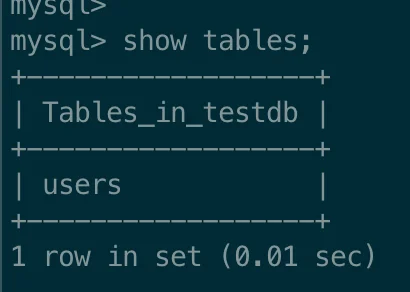
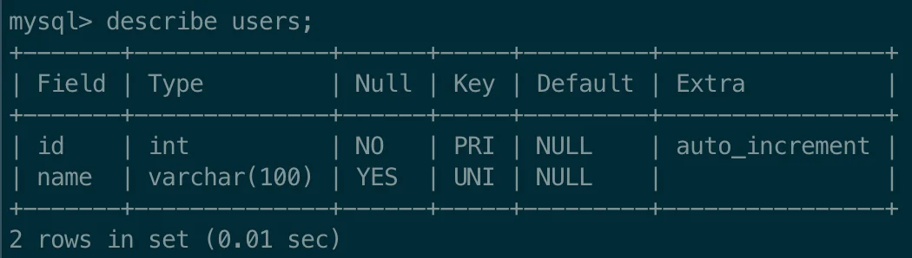
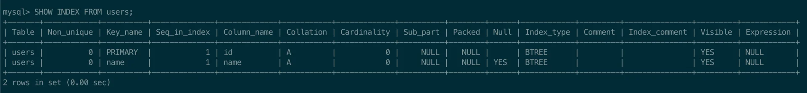

> 
> 
> <a id="227eda9b0fe1810b9596fb32c0f73356"></a>
> 
> <strong>목차</strong>
> 
> - [1.  UNIQUE 제약 조건 추가,  자동 인덱스 생성](#227eda9b0fe1815c92cdcb261c3540e2)

<a id="227eda9b0fe1815c92cdcb261c3540e2"></a>

## 1&#46;  <code>UNIQUE</code> 제약 조건 추가,  자동 인덱스 생성

---

> 📖 
> 
> <a id="227eda9b0fe180a5b99eea3f7cf18bce"></a>
> 
> MySQL은 <code>UNIQUE</code> 제약 조건을 추가하면 자동으로 인덱스가 생성된다&#46;

<details>
<summary>1&#46; 테이블 생성</summary>

<a id="227eda9b0fe180369260ea6ded40b640"></a>

```sql
# 기존 테이블 삭제
DROP TABLE IF EXISTS users; # [옵션] 이전 실습 시, 진행

# USERS 테이블 생성
CREATE TABLE users (
    id INT AUTO_INCREMENT PRIMARY KEY,
    name VARCHAR(100) UNIQUE
);

# 테이블 생성 확인
show tables;
describe users;
```

<a id="227eda9b0fe1808682c9ebbeaaa4c84f"></a>

<strong>테이블 생성 확인</strong>





</details>

<details>
<summary>2&#46; 인덱스 확인</summary>

> 
> 
> <a id="227eda9b0fe180e299c6eed0ee66f401"></a>
> 
> <code>UNIQUE</code> 제약조건으로 인해 <strong><u>자동 생성되는 인덱스</u></strong>를 <strong>고유 인덱스(Unique Index)</strong>라 부른다&#46; 

<a id="227eda9b0fe1805d97d2dedf7dc15952"></a>

```sql
# 인덱스 조회
SHOW INDEX FROM users;
```



- <code>unique</code> 제약조건을 부여한 <code>name</code> 컬럼에 <strong><u>인덱스가 적용</u></strong>된 것을 확인할 수 있다&#46; 

</details>

> 
> 
> <a id="227eda9b0fe1806fb023c9c3c60c4a29"></a>
> 
> <strong>정리</strong>
> 
> - <code>UNIQUE</code> 제약조건 사용 시, <strong><u>해당 컬럼에 자동으로 인덱스가 생성</u></strong>된다&#46; 
>     - 이렇게 자동 생성되는 인덱스를 <strong>고유 인덱스(Unique Index)</strong>라 부른다&#46;
> 
> - <code>UNIQUE</code> 옵션을 사용하면 인덱스가 같이 생성되기 때문에 <strong><u>조회 성능이 향상</u></strong>된다&#46;
