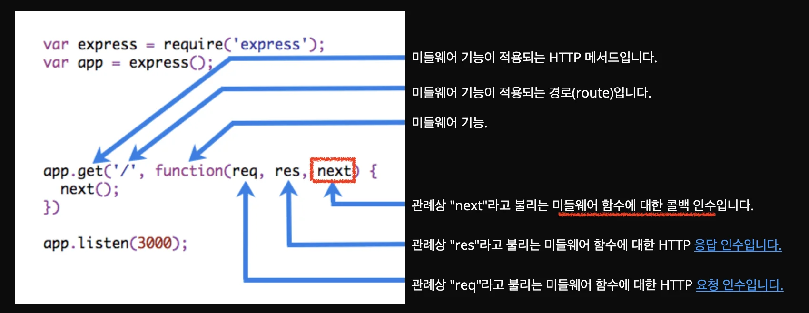
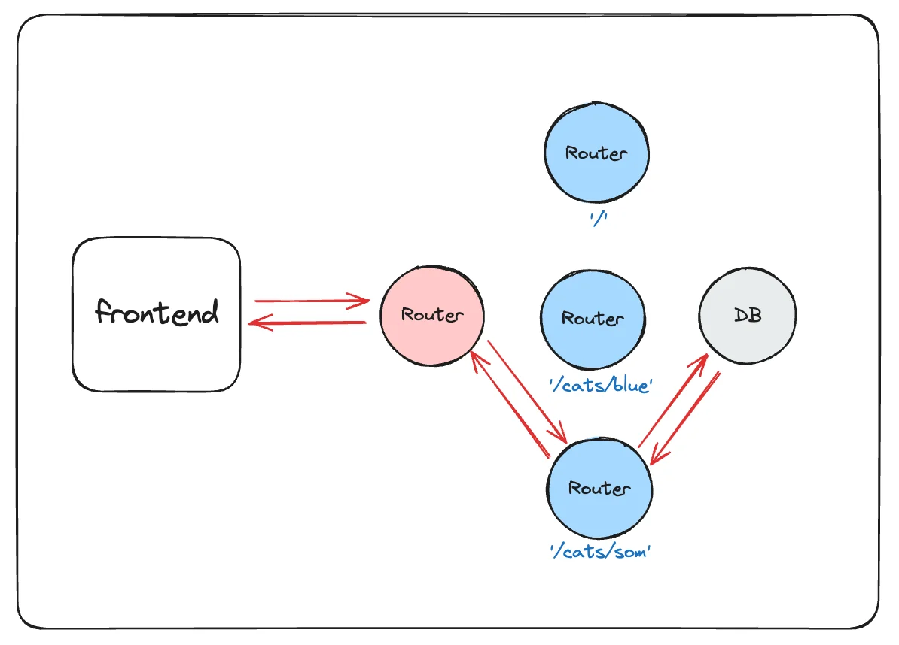
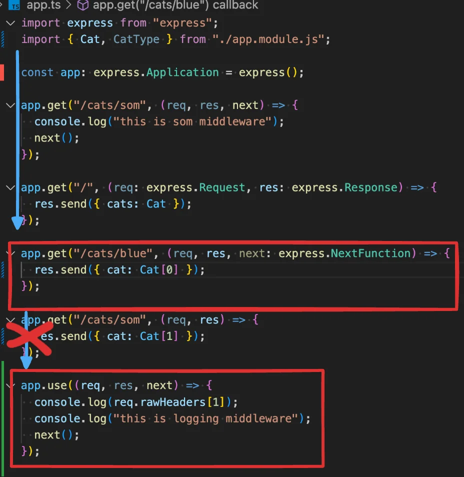

> 
> 
> <a id="228eda9b0fe18164baf8e69bd6eb6c47"></a>
> 
> <strong>목차</strong>
> 
> - [express 미들웨어 함수](#228eda9b0fe181e6a5ecc293ddee1a44)
> - [이전 챕터에서의 로그 전처리 ](#228eda9b0fe180a794cef4b58649ce89)
> - [미들웨어 함수 사용 시 주의점](#228eda9b0fe18061a107e3c72193373a)

[Writing middleware for use in Express apps]()

<a id="228eda9b0fe181e6a5ecc293ddee1a44"></a>

## express 미들웨어 함수

---



> 📖 
> 
> <a id="228eda9b0fe180e183d6d166f4b35875"></a>
> 
> <strong><code>미들웨어 함수</code></strong>는<em><strong> </strong></em><a href="https://expressjs.com/en/4x/api.html#req">요청 객체</a> ( <code>req</code>), <a href="https://expressjs.com/en/4x/api.html#res">응답 객체</a> ( <code>res</code>), 그리고 <code>next</code>애플리케이션의 요청&#45;응답 주기에 있는 함수 에 접근할 수 있는 함수이다&#46;
> 
> - 해당 <code>next</code>함수는 Express 라우터에 있는 함수로, 호출 시 현재 미들웨어의 다음 미들웨어를 실행한다&#46;
> 
> <details>
> <summary>가능한 작업</summary>
> 
> - 모든 코드 실행
> 
> - 요청 및 응답 객체 변경
> 
> - 요청&#45;응답 주기 종료
> 
> - 스택의 다음 미들웨어 호출
> 
> </details>

> ❗ 
> 
> <a id="228eda9b0fe180dea7f8eea4c1420f8b"></a>
> 
> <strong>미들웨어 함수 &#45; 로딩 순서 중요</strong><br>먼저 로드된 미들웨어 함수가 먼저 실행된다&#46;

<details>
<summary>ex)</summary>

<a id="228eda9b0fe18088a72bd46c07a5459f"></a>

```typescript
const express = require('express')
const app = express()

const myLogger = function (req, res, next) {
  console.log('LOGGED')
  next()
}

app.use(myLogger)

app.get('/', (req, res) => {
  res.send('Hello World!')
})

app.listen(3000)

```

</details>

<a id="228eda9b0fe180a794cef4b58649ce89"></a>

### 이전 챕터에서의 로그 전처리 

> 
> 
> <a id="228eda9b0fe180ef858ec3b5111da6d1"></a>
> 
> 이전 챕터에서의 <strong>전처리 로그 출력</strong>을 <code>미들웨어 함수</code>를 통해 처리했다&#46;

> <a href="#/post/228eda9b-0fe1-80bd-b152-de936956e696">페이지</a> 



<a id="228eda9b0fe18081909bccbbffba6675"></a>

```typescript
// 미들웨어 함수 - 라우터 도착 전, 전처리 가능
app.use((req, res, next) => {
  console.log(req.rawHeaders[1]);
  console.log("this is logging middleware");
  next();
});

// 특정 라우트에만 전처리 가능
app.get("/cats/som", (req, res, next) => {
  console.log("this is som middleware");
  next();
});

...

// 예외처리
app.use((req, res, next) => {
  console.log("this is error middleware");
  res.send({ error: "404 not found error" });
});
```

<details>
<summary>&#91; 코드 &#93; app&#46;ts</summary>

[teaching&#45;nestjs&#45;a&#45;to&#45;z/02 NestJS를 위한 express /03, 04/src/app&#46;ts at main · amamov/teaching&#45;nestjs&#45;a&#45;to&#45;z]()

<a id="228eda9b0fe18028b16dd55b25fddcc4"></a>

```typescript
import express from "express";
import { Cat, CatType } from "./app.module.js";

const app: express.Application = express();

// 미들웨어 함수 - 라우터 도착 전, 전처리 가능
app.use((req, res, next) => {
  console.log(req.rawHeaders[1]);
  console.log("this is logging middleware");
  next();
});

// 특정 라우트에만 전처리 가능
app.get("/cats/som", (req, res, next) => {
  console.log("this is som middleware");
  next();
});

// 라우트
app.get("/", (req: express.Request, res: express.Response) => {
  res.send({ cats: Cat });
});
 
app.get("/cats/blue", (req, res, next: express.NextFunction) => {
  res.send({ cat: Cat[0] });
});

app.get("/cats/som", (req, res) => {
  res.send({ cat: Cat[1] });
});

// 예외처리
app.use((req, res, next) => {
  console.log("this is error middleware");
  res.send({ error: "404 not found error" });
});

// 서버 실행
app.listen(8000, () => {
  console.log("server is on...");
});

```

</details>

<a id="228eda9b0fe18061a107e3c72193373a"></a>

### 미들웨어 함수 사용 시 주의점

> ☝🏻 
> 
> <a id="228eda9b0fe18037ad9eebf91955fe89"></a>
> 
> 자바스크립트는 위에서부터 아래로 코드를 읽으면서 실행한다&#46; 
> 
> - <a href="#/post/228eda9b-0fe1-80b1-aa01-cd6659e84a8b">페이지</a> 
> 
> <a id="228eda9b0fe180f59373fc137a7bc03c"></a>
> 
> 따라서 만약 미들웨어 함수(<code>app&#46;user(&#46;&#46;&#46;)</code>)가<strong><u> 맨 끝에 위치</u></strong>하고 중간에 라우터가 호출된다면
> 
> <a id="228eda9b0fe18089a289e0ab1f322823"></a>
> 
> 라우터에서 응답값을 반환하고 종료되기때문에 미들웨어 함수가 실행되지 않는 오류가 발생된다&#46;


