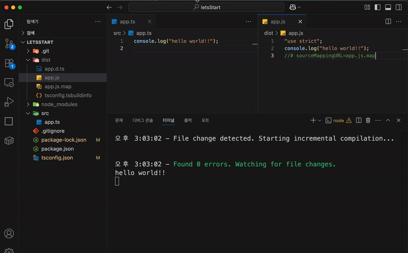
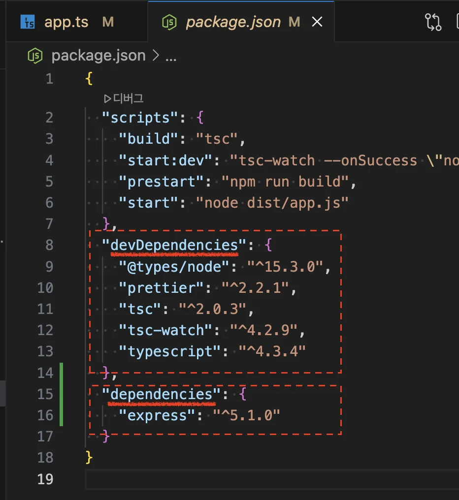
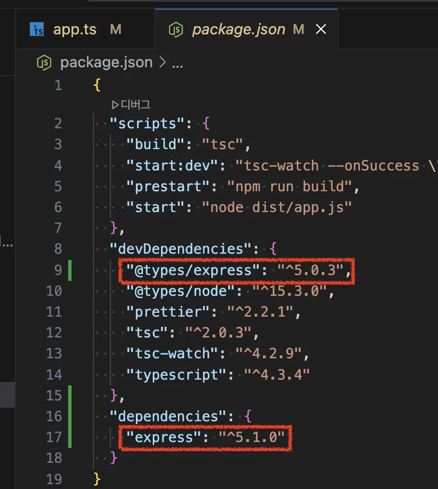
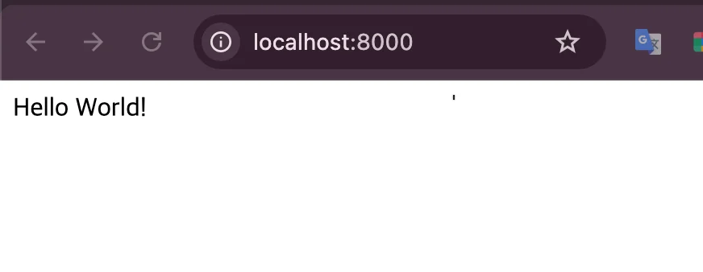
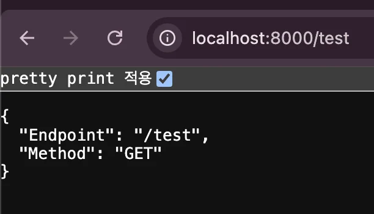

> 
> 
> <a id="228eda9b0fe1800390cbde362f725a10"></a>
> 
> <strong>목차</strong>
> 
> - [1. 프로젝트 세팅](#228eda9b0fe1804bbe91d57d42093dc1)
> - [2. gh를 통한 CLI로 리포 생성하기](#228eda9b0fe18040853ec48162fd38cf)
> - [3. 커스텀 CLI  - Typescript 컴파일 설정](#228eda9b0fe1809080bef515fa60ae70)
> - [커스텀 CLI 정의](#228eda9b0fe180d3a48be6cb42f57a25)
> - [컴파일러 옵션 설명](#228eda9b0fe18018b82cc4e1357b2079)
> - [Typescript 컴파일 확인](#228eda9b0fe180c09001f4f01af45b45)
> - [4. 추가 패키지 설치 - express, @types/express](#228eda9b0fe180a6baf3f0efc6b89eac)
> - [5. express 실행](#228eda9b0fe1807fbf72f80f08c08185)

<a id="228eda9b0fe1804bbe91d57d42093dc1"></a>

### 1&#46; 프로젝트 세팅

[Express &#45; Node&#46;js web application framework]()

<a id="228eda9b0fe180138b9dd1b82235dbd2"></a>

```bash
# 강의 자료 다운
npm i

# 오래된 버전의 패키지 수정
npm audit 
npm audit fix
```

<a id="228eda9b0fe18040853ec48162fd38cf"></a>

### 2&#46; gh를 통한 CLI로 리포 생성하기

<a id="228eda9b0fe180dfac15d4ad0c423538"></a>

<a href="#/post/228eda9b-0fe1-80a3-960c-ed854500cb15">페이지</a> 

<a id="228eda9b0fe1809080bef515fa60ae70"></a>

### 3&#46; 커스텀 CLI  &#45; Typescript 컴파일 설정

<a id="228eda9b0fe180d3a48be6cb42f57a25"></a>

### 커스텀 CLI 정의

<details>
<summary><code>package&#46;json</code></summary>

<a id="228eda9b0fe180d4a8dee8485e7edab6"></a>

```json
{
  "scripts": {
    "build": "tsc",
    /**
     [ 커스텀 CLI ] 
	     - tsc 컴파일 성공한 경우, dist 파일이 생성되고 app.js를 통해 앱을 실행한다.
		   - tsc-watch: tsconfig.json에서 정의한 옵션값으로 컴파일을 실행한다. 
    **/
    "start:dev": "tsc-watch --onSuccess \"node dist/app.js\"",
    "prestart": "npm run build",
    "start": "node dist/app.js"
  },
  "devDependencies": {
    "@types/node": "^15.3.0",
    "prettier": "^2.2.1",
    "tsc": "^2.0.3",
    "tsc-watch": "^4.2.9",
    "typescript": "^4.3.4"
  }
}
```

</details>

<details>
<summary><code>tsconfig&#46;json</code></summary>

<details>
<summary>레거시 </summary>

<a id="228eda9b0fe180c88afde4f23ece9f2f"></a>

```json
//* https://www.staging-typescript.org/tsconfig

// 컴파일 옵션 커스텀
{
    "compilerOptions": {
      "strict": true,
      "module": "commonjs",
      "declaration": true,
      "removeComments": true,
      "emitDecoratorMetadata": true,
      "experimentalDecorators": true,
      "allowSyntheticDefaultImports": true,
      "target": "ES5",
      "sourceMap": true,
      "outDir": "./dist",
      "baseUrl": "./src",
      "incremental": true
    },
    "include": ["src/**/*"]
}
  
```

</details>

<a id="228eda9b0fe180489240f001a17260ac"></a>

```json
// TypeScript 5.x 기준

{
  "compilerOptions": {
    "target": "ES2020",
    "module": "ESNext",
    "moduleResolution": "Node",
    "lib": ["ES2020", "DOM"],
    "strict": true,
    "esModuleInterop": true,
    "allowSyntheticDefaultImports": true,
    "forceConsistentCasingInFileNames": true,
    "skipLibCheck": true,
    "resolveJsonModule": true,
    "declaration": true,
    "removeComments": true,
    "emitDecoratorMetadata": true,
    "experimentalDecorators": true,
    "sourceMap": true,
    "outDir": "./dist",
    "baseUrl": "./src",
    "incremental": true
  },
  "include": ["src/**/*"]
}
```

<a id="228eda9b0fe18018b82cc4e1357b2079"></a>

### 컴파일러 옵션 설명

| 옵션 | 값 | 설명 |
| --- | --- | --- |
| <code>target</code> | ES2020 | ES2020 문법으로 트랜스파일&#46; <br>최신 JS 기능 사용 가능&#46; |
| <code>module</code> | ESNext | ESNext 모듈 시스템(동적 import 등)&#46;<br>최신 번들러와 호환&#46; |
| <code>moduleResolution</code> | Node | Node&#46;js 방식의 모듈 해석&#46; |
| <code>lib</code> | &#91;&#34;ES2020&#34;, &#34;DOM&#34;&#93; | ES2020 및 DOM API 타입 포함&#46; <br>브라우저 &#38; Node 환경 모두 대응 가능&#46; |
| <code>strict</code> | true | &#91;권장&#93; 모든 엄격한 타입 검사 활성화 |
| <code>esModuleInterop</code> | true | CommonJS, ES모듈 간 호환성 개선&#46; |
| <code>allowSyntheticDefaultImports</code> | true | default import를 더 유연하게 허용&#46; |
| <code>forceConsistentCasingInFileNames</code> | true | 파일명 대소문자 일관성 강제&#46; <br>크로스플랫폼 개발 시 필수&#46; |
| <code>skipLibCheck</code> | true | 라이브러리 타입 검사 생략&#46; <br>컴파일 속도 향상&#46; |
| <code>resolveJsonModule</code> | true | &#46;json 파일 import 허용&#46; |
| <code>declaration</code> | true | &#46;d&#46;ts 타입 선언 파일 생성&#46;<br>라이브러리 배포 시 필수&#46; |
| <code>removeComments</code> | true | 컴파일 결과에서 주석 제거&#46; |
| <code>emitDecoratorMetadata</code> | true | 데코레이터 메타데이터 생성&#46;<br> NestJS 등에서 필요&#46; |
| <code>experimentalDecorators</code> | true | 데코레이터 문법 활성화&#46; |
| <code>sourceMap</code> | true | 소스맵 생성&#46; 디버깅에 필요&#46; |
| <code>outDir</code> | &#46;/dist | 컴파일 결과물 출력 디렉토리&#46; |
| <code>baseUrl</code> | &#46;/src | 모듈 경로의 기준 디렉토리&#46; |
| <code>incremental</code> | true | 증분 빌드 활성화&#46; 빌드 속도 향상&#46; |

<details>
<summary><code>emitDecoratorMetadata</code> &#38; <code>experimentalDecorators</code></summary>

- <strong>데코레이터를 사용</strong>하는 <strong><u>프레임워크(NestJS, TypeORM 등)</u></strong>에서 필요

- 사용하지 않는다면 false로 변경하여 빌드 속도를 높일 수 있다&#46;

</details>

<details>
<summary><code>declaration&#58; true</code></summary>

- 라이브러리 또는 패키지로 배포할 목적이 아니라면 false로 변경해도 무방

</details>

<details>
<summary><code>skipLibCheck&#58; true</code></summary>

- 외부 라이브러리 타입 검사 생략으로 컴파일 속도는 빨라지지만, 타입 오류를 놓칠 수 있다&#46;

- 개발 초기에는 <code>false</code>로 두고, 빌드 파이프라인에서는 <code>true</code> 설정하는 전략도 있다&#46;

</details>

<details>
<summary><code>baseUrl</code></summary>

- 절대경로 import를 사용할 때 유용

- 필요에 따라 paths 옵션 추가 가능

</details>

<details>
<summary><code>include</code></summary>

<a id="228eda9b0fe18039b092e0739cbad09b"></a>

```json
"include": "src/**/*"
```

- src 폴더 내 모든 파일을 컴파일 대상으로 지정

- 일반적이고 안전한 설정

</details>

</details>

<a id="228eda9b0fe180c09001f4f01af45b45"></a>

### Typescript 컴파일 확인

<a id="228eda9b0fe180868d56e22eed74e4fb"></a>

```bash
# 서버 실행
npm run start:dev
```



> 
> 
> <a id="228eda9b0fe1801fa1f8ff3504e85fab"></a>
> 
> <code>app&#46;ts</code>에서 수정된 내용이 바로 컴파일 되어 추가되는 것을 확인할 수 있다&#46;

<a id="228eda9b0fe180a6baf3f0efc6b89eac"></a>

### 4&#46; 추가 패키지 설치 &#45; <code>express</code>, <code>&#64;types/express</code>

<details>
<summary>🧐 <code>DevDependency</code> vs <code>Denpendency</code></summary>



> 
> 
> <a id="228eda9b0fe1801999d4c9ae7fe7588c"></a>
> 
> <code>DevDependency</code>는 개발 시 필요한 라이브러리를 설정한다&#46; 
> 
> - 실제 프로덕션 서버에는 설치되지 않음

<a id="228eda9b0fe18085935bd5c6fbc4a5fd"></a>

실제 프로덕션 베포 시에는 필요없는 라이브러리들을 <code>&#45;D</code>(Dev&#45;Dependency) 옵션을 적용하여 설치 

- 개발 시에만 필요한 의존성을 scope를 분리 설치

<a id="228eda9b0fe1808c8fb0f0d1d60e12b3"></a>

```bash
npm i {패키지명} -D
```

</details>

<a id="228eda9b0fe180519006c3d8be882026"></a>

```bash
# npm install express --save
npm i express  # install -> i 축약 가능, --save 생략 가능

npm i @types/express -D # dev-dependency
```



<a id="228eda9b0fe1807fbf72f80f08c08185"></a>

### 5&#46; express 실행

[Express]()

> 
> 
> <details>
> <summary>&#91; 라우터&#93; <code>app&#46;get({엔드포인트}, {매핑함수}</code></summary>
> 
> - 엔드포인트에 매핑되는 요청(req), 응답(res)을 처리
> 
> </details>
> 
> <details>
> <summary><code>app&#46;listen(port, …)</code></summary>
> 
> - 해당되는 포트번호로 서버 실행
> 
> </details>

<details>
<summary>&#91; 코드 &#93; app&#46;js</summary>

<a id="228eda9b0fe180bb9af3cc5c7587f6cc"></a>

```typescript
import express from "express";

const app: express.Express = express();

const port: number = 8000;

app.get("/", (req: express.Request, res: express.Response) => {
  res.send("Hello World!");
});

app.listen(port, () => {
  console.log(`Example app listening on port ${port}`);
});
```

</details>

- <strong>서버 실행</strong>
    <a id="228eda9b0fe180e5aabdfd7f56fb1268"></a>

    ```typescript
    npm run start:dev
    ```

- <strong>엔드포인트 접속&#58; </strong><strong><a href="http://localhost:8000/">http&#58;//localhost&#58;8000/</a></strong>
    

- <strong>라우터 추가&#58; </strong><strong><code>/test</code></strong>
    <a id="228eda9b0fe180589c99cd5799c1569b"></a>

    ```typescript
    app.get("/test", (req: express.Request, res: express.Response) => {
      res.send({ Endpoint: "/test", Method: "GET" });
    });
    ```

    
