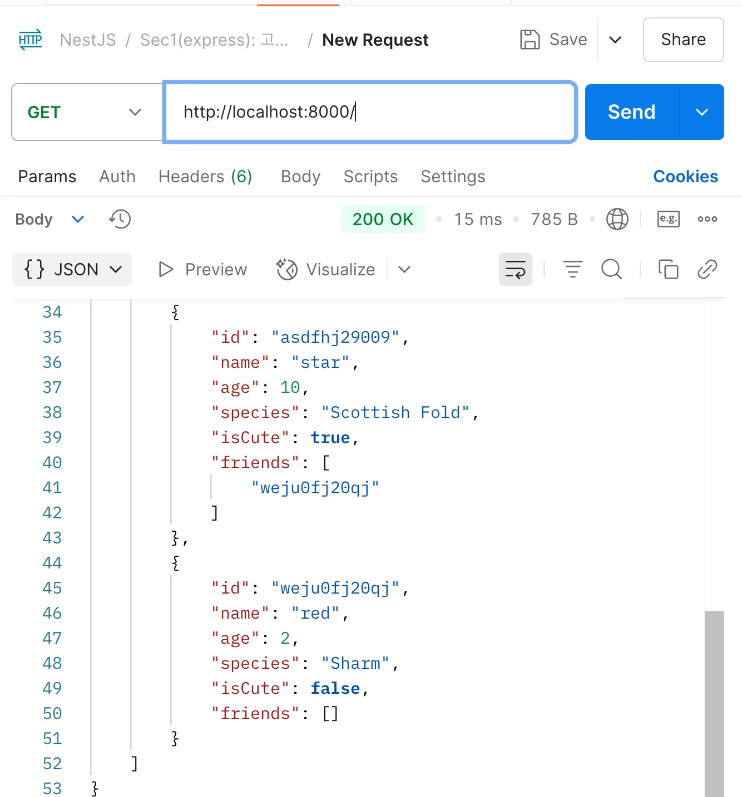
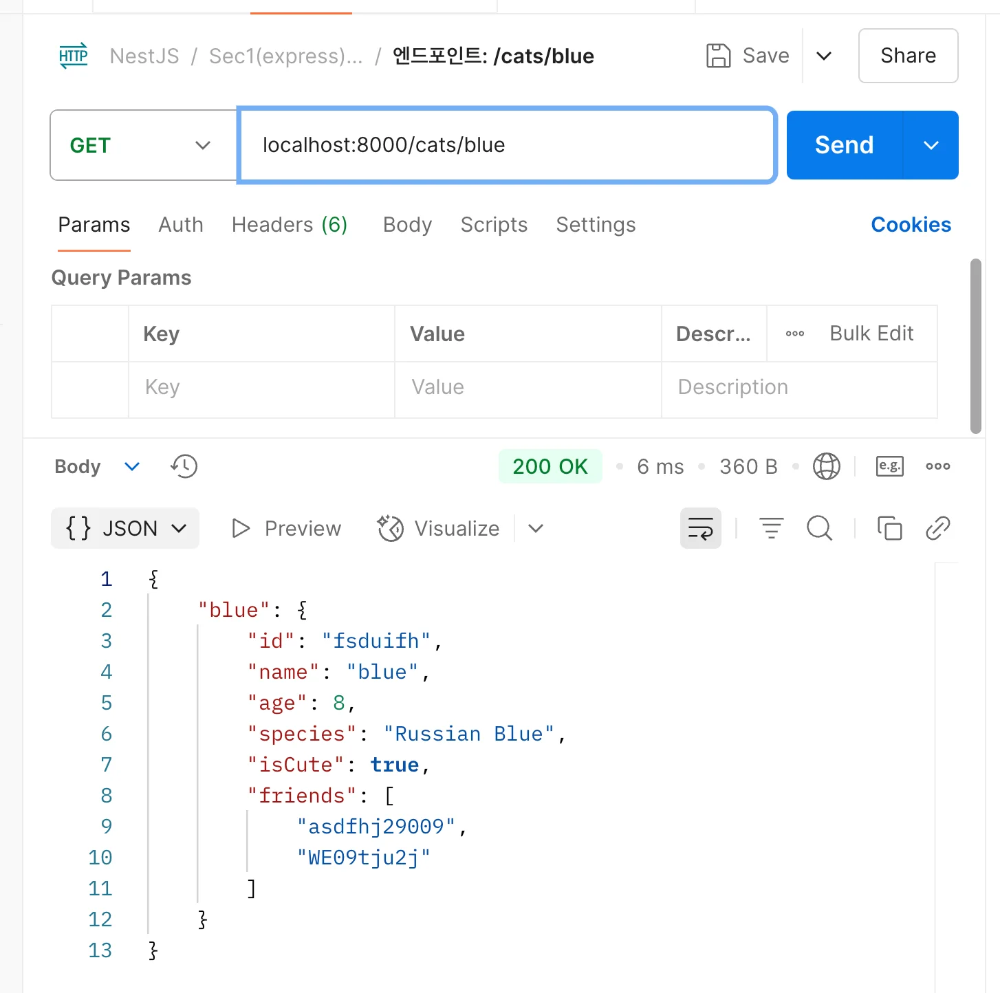
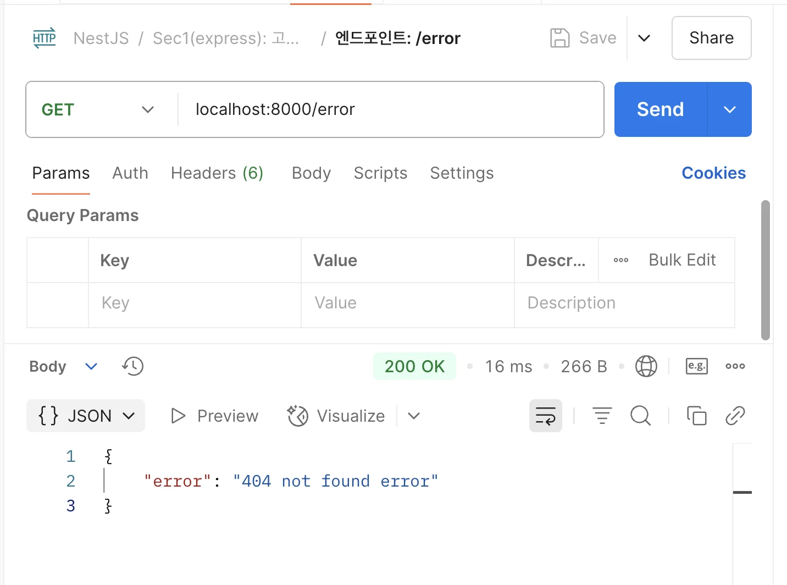
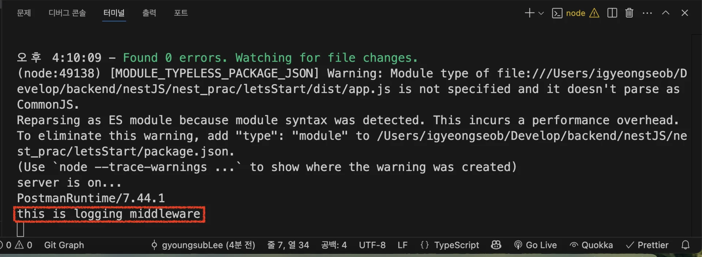

> 
> 
> <a id="228eda9b0fe1817098e4fcb97b4b6bc4"></a>
> 
> <strong>목차</strong>
> 
> - [[ 실습 ] 데이터 모킹 및 포스트맨 호출](#228eda9b0fe1814c9a85fb60000b544b)
> - [1. mock data](#228eda9b0fe1800db58acd2ce1e5a214)
> - [2. server](#228eda9b0fe1806287e0e151f05dba99)
> - [3. postman 테스트](#228eda9b0fe1806a89bfedcf0e2f5673)
> - [4. 로그 확인](#228eda9b0fe180969f90d3b3a038e249)

<a id="228eda9b0fe1814c9a85fb60000b544b"></a>

## &#91; 실습 &#93; 데이터 모킹 및 포스트맨 호출

---

> 📖 
> 
> <a id="228eda9b0fe180909e2ad11d356f0b00"></a>
> 
> <strong>데이터 모킹 ( Data Mocking )</strong>
> 
> ---
> 
> <a id="228eda9b0fe1806288e3f59f4f0c857f"></a>
> 
> 테스트를 위해 실제 데이터가 아닌 개발자가 필요에의해 만든 가짜 데이터를 말한다&#46; 
> 
> - <code>Mock</code>&#58; 가짜, 모조품

> ✏️ 
> 
> <a id="228eda9b0fe18168a63fd8c30c036cb5"></a>
> 
> 익스프레스 디자인 패턴 학습을 위한 테스트를 위한 예제이다&#46; 따라서 간단하게 메모리에서만 데이터를 생성하여 테스트를 진행한다&#46; 

<a id="228eda9b0fe1800db58acd2ce1e5a214"></a>

### <strong>1&#46; mock data</strong>

<details>
<summary>&#91; 코드 &#93; app&#46;module&#46;ts</summary>

<a id="228eda9b0fe1806f97e3c1d510be60bb"></a>

```typescript
export type CatType = {
  id: string;
  name: string;
  age: number;
  species: string;
  isCute: boolean;
  friends: string[];
};

export const Cat: CatType[] = [
  {
    id: "fsduifh",
    name: "blue",
    age: 8,
    species: "Russian Blue",
    isCute: true,
    friends: ["asdfhj29009", "WE09tju2j"],
  },
  {
    id: "iohf2309q4hr",
    name: "som",
    age: 4,
    species: "Sphynx cat",
    isCute: true,
    friends: ["weju0fj20qj", "asdfhj29009", "weju0fj20qj"],
  },
  {
    id: "WE09tju2j",
    name: "lean",
    age: 6,
    species: "Munchkin",
    isCute: false,
    friends: [],
  },
  {
    id: "asdfhj29009",
    name: "star",
    age: 10,
    species: "Scottish Fold",
    isCute: true,
    friends: ["weju0fj20qj"],
  },
  {
    id: "weju0fj20qj",
    name: "red",
    age: 2,
    species: "Sharm",
    isCute: false,
    friends: [],
  },
];

```

</details>

<a id="228eda9b0fe1806287e0e151f05dba99"></a>

### <strong>2&#46; server</strong>

<details>
<summary>&#91; 코드 &#93; app&#46;ts</summary>

[teaching&#45;nestjs&#45;a&#45;to&#45;z/02 NestJS를 위한 express /03, 04/src/app&#46;ts at main · amamov/teaching&#45;nestjs&#45;a&#45;to&#45;z]()

<a id="228eda9b0fe1802fa300e6b645c7b4ba"></a>

```typescript
import express from "express";
import { Cat, CatType } from "./app.module.js";

const app: express.Application = express();

// 전처리 - 로그 출력
app.use((req, res, next) => {
  console.log(req.rawHeaders[1]);
  console.log("this is logging middleware");
  next();
});

app.get("/cats/som", (req, res, next) => {
  console.log("this is som middleware");
  next();
});

// 라우트
app.get("/", (req: express.Request, res: express.Response) => {
  res.send({ cats: Cat });
});

app.get("/cats/blue", (req, res, next: express.NextFunction) => {
  res.send({ cat: Cat[0] });
});

app.get("/cats/som", (req, res) => {
  res.send({ cat: Cat[1] });
});

// 예외처리
app.use((req, res, next) => {
  console.log("this is error middleware");
  res.send({ error: "404 not found error" });
});

// 서버 실행
app.listen(8000, () => {
  console.log("server is on...");
});

```

</details>

<a id="228eda9b0fe1806a89bfedcf0e2f5673"></a>

### <strong>3&#46; postman 테스트</strong>

<details>
<summary>1&#46; 엔드포인트&#58; <code>/</code></summary>



</details>

<details>
<summary>2&#46; 엔드포인트&#58; <code>/cats/blue</code></summary>



</details>

<details>
<summary>3&#46; 엔드포인트&#58; <code>/cats/som</code></summary>


</details>

<details>
<summary>4&#46; 엔드포인트&#58; <code>/error</code></summary>



</details>

<a id="228eda9b0fe180969f90d3b3a038e249"></a>

### <strong>4&#46; 로그 확인</strong>

> 
> 
> <a id="228eda9b0fe1801c8695ddad6f949e10"></a>
> 
> <code>next</code> 인자를 통해 전처리 가능

<a id="228eda9b0fe1804ea5b9e4af5236eb0a"></a>

```typescript
app.use((req, res, next) => {
  console.log(req.rawHeaders[1]);
  console.log("this is logging middleware");
  next();
});

app.get("/cats/som", (req, res, next) => {
  console.log("this is som middleware");
  next();
});
```


