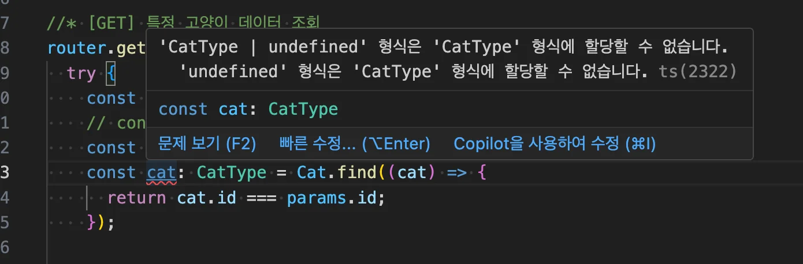
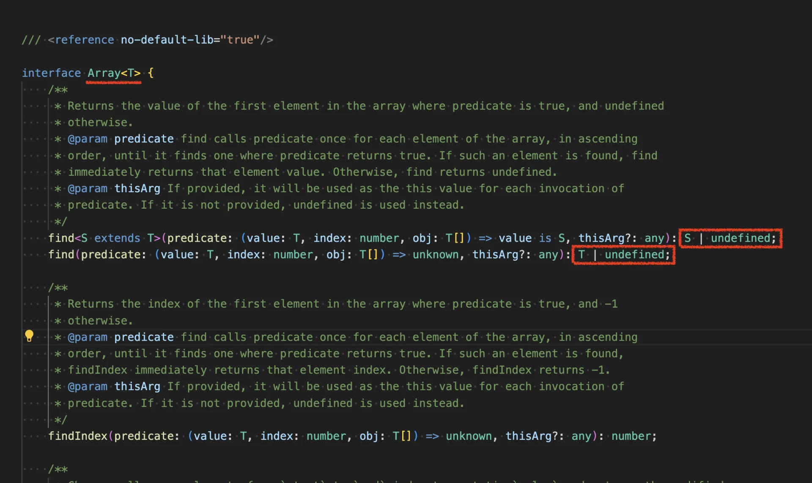

> 
> 
> <a id="229eda9b0fe1806d9742fcb757b252a4"></a>
> 
> 목차
> 
> - [[의문점] 왜 undefinded를 할당하는가?](#229eda9b0fe18044b07edcb01ce341b0)
> - [[ 해결 ] Array.prototype.find() 반환값](#229eda9b0fe1800abd4ace1281325438)

[Array&#46;prototype&#46;find() &#45; JavaScript &#124; MDN]()

<a id="229eda9b0fe18044b07edcb01ce341b0"></a>

### &#91;의문점&#93; <strong>왜 </strong><strong><code>undefinded</code></strong><strong>를 할당하는가?</strong>

---

> 🧐 
> 
> <a id="229eda9b0fe180deb79ee8e10e999f8d"></a>
> 
> 실습 중 해당하는 객체 타입(<code>CatType</code>)만을 할당 했더니 오류가 발생되었다&#46; 
> 
> <a id="229eda9b0fe1802c88c2f8c51579d31c"></a>
> 
> 이를 해결하기위해 <code>undefinded</code>를 할당 했어야 했는데, <strong><u>왜 </u></strong><strong><u><code>undefinded</code></u></strong><strong><u>를 할당</u></strong>하는지 의문점이 들어 정리한다&#46; 

<a id="229eda9b0fe180319003cfa9a4a78f62"></a>

<strong>문제 코드</strong>

<a id="229eda9b0fe180f78341cd139695dd2e"></a>

```javascript
const cat: CatType = Cat.find((cat) => {
  return cat.id === params.id;
});
```



<a id="229eda9b0fe180099858e523ef748618"></a>

<strong>해결 코드</strong>

<a id="229eda9b0fe181c9a854f3c3d55cbf19"></a>

```javascript
const cat: CatType | undefined = Cat.find((cat) => {
  return cat.id === params.id;
});
```

<a id="229eda9b0fe1800abd4ace1281325438"></a>

### <strong>&#91; 해결 &#93; </strong><code>Array&#46;prototype&#46;find()</code> 반환값

---

<a id="229eda9b0fe180ad981ec961bd38c378"></a>

위 코드에서 사용하는 <code>find()</code> 함수는 <code>Array&#46;prototype&#46;find()</code>이다&#46;



> 
> 
> <a id="229eda9b0fe180bca97ff59ae49663ec"></a>
> 
> <code>Array&#46;prototype&#46;find</code> 메서드는 TypeScript에서 아래와 같이 정의되어 있다&#46; 
> 
> <a id="229eda9b0fe18007a595f48ec9010562"></a>
> 
> 해당 정의에 따라 <code>find</code> 메서드는 주어진 조건에 부합하는 요소를 찾으면 해당 요소를 반환하고, 조건에 맞는 요소가 없을 경우에는 <code>undefined</code>를 반환한다&#46;
> 
> <a id="229eda9b0fe18072ad98cf3352446720"></a>
> 
> 즉, 반환 타입은 항상 <code>T &#124; undefined</code> 이다&#46;

<a id="229eda9b0fe18041aceedac2f0890575"></a>

```typescript
find<S extends T>(
  predicate: (value: T, index: number, obj: T[]) => value is S,
  thisArg?: any
): S | undefined;
```

<a id="229eda9b0fe180e0b8b9d3eefbc99f19"></a>

TypeScript는 <strong><u>엄격한 타입 체커(strictNullChecks) </u></strong>하에서

<a id="229eda9b0fe1803fb7adcfcecef48228"></a>

<code>Array&#46;prototype&#46;find</code>의 반환값을 반드시 <code>T &#124; undefined</code>로 추론하며, 이를 받는 변수에도 <code>undefined</code>를 포함한 <u>유니언 타입을 명시</u>해야한다&#46;

<a id="229eda9b0fe180a0bc53cff0d7945663"></a>

이는 Typescript의 <strong><u>표준 라이브러리(표준 타입 정의</u></strong>)와의 <strong><u>정합성(type compatibility)을 유지</u></strong>하고,

<a id="229eda9b0fe1801f85d7da0971bb4f5b"></a>

<strong><u>런타임에서 발생할 수 있</u></strong><strong>는 </strong><strong><u>잠재적인 undefined 접근 오류를 사전에 방지</u></strong>하기 위한 조치이다&#46;
