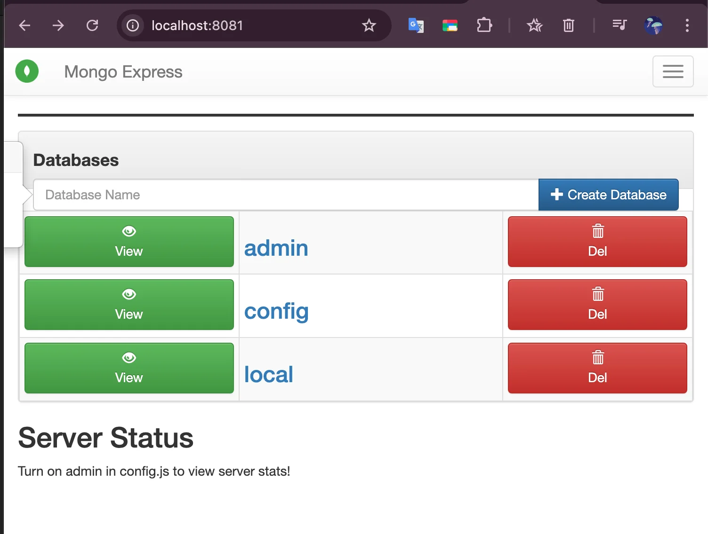

> 
> 
> <a id="229eda9b0fe181a98223dd0904a80984"></a>
> 
> <strong>목차</strong>
> 
> - [MongoDB 로컬 구축 및 CLI 연습](#229eda9b0fe181978af2df82c3e483bc)
> - [1. Docker compose를 통한 구축](#229eda9b0fe1807b955ae16d136e6d25)
> - [2. mongo-express ( 레거시 )](#229eda9b0fe1804ab82cd54d1012fca4)
> - [3. [실습] mongoDB CRUD CLI ](#229eda9b0fe180f6b429c5116171f49f)

<a id="229eda9b0fe181978af2df82c3e483bc"></a>

## MongoDB 로컬 구축 및 CLI 연습

---

<a id="229eda9b0fe1807b955ae16d136e6d25"></a>

### 1&#46; Docker compose를 통한 구축

<a id="229eda9b0fe180b18b14f5ef01ccf54b"></a>

```yaml
📁 my-mongo-project/
├── docker-compose.yml
└── .env
```

<details>
<summary><code>compose&#46;yml</code></summary>

<a id="229eda9b0fe1803b8950ffd2dc117db0"></a>

```yaml
services:
  mongo:
    image: mongo:7
    container_name: mongo
    restart: unless-stopped
    ports:
      - "27017:27017"
    environment:
      MONGO_INITDB_ROOT_USERNAME: ${MONGO_INITDB_ROOT_USERNAME}
      MONGO_INITDB_ROOT_PASSWORD: ${MONGO_INITDB_ROOT_PASSWORD}
    command: ["mongod", "--auth"] 
    volumes:
      - mongo_data:/data/db
    networks:
      - mongo-network

  mongo-express:   # 옵션
    image: mongo-express:1.0.0-alpha.4
    container_name: mongo-express
    restart: unless-stopped
    ports:
      - "8081:8081"
    environment:
      ME_CONFIG_MONGODB_ADMINUSERNAME: ${MONGO_INITDB_ROOT_USERNAME}
      ME_CONFIG_MONGODB_ADMINPASSWORD: ${MONGO_INITDB_ROOT_PASSWORD}
      ME_CONFIG_MONGODB_SERVER: mongo
    depends_on:
      - mongo
    networks:
      - mongo-network

volumes:
  mongo_data:

networks:
  mongo-network:
    driver: bridge
```

</details>

<details>
<summary><code>&#46;env</code></summary>

<a id="229eda9b0fe180bc9291f7ca2c843af7"></a>

```bash
# .env
MONGO_INITDB_ROOT_USERNAME=admin
MONGO_INITDB_ROOT_PASSWORD=admin123
MONGO_DB_NAME=test
```

</details>

<a id="229eda9b0fe1804ab82cd54d1012fca4"></a>

### 2&#46; <code>mongo&#45;express</code> ( 레거시 )

> ✏️ 
> 
> <a id="229eda9b0fe18098ba6dc04e2842f5de"></a>
> 
> <code>mongo&#45;express</code>를 사용하면 GUI로 mongoDB 조작이 가능하다&#46;



<a id="229eda9b0fe180f6b429c5116171f49f"></a>

### 3&#46; &#91;실습&#93; mongoDB CRUD CLI 

[[실습] CLI를 통한 조작](#/post/229eda9b-0fe1-80d0-8317-e56538dbb82e)
