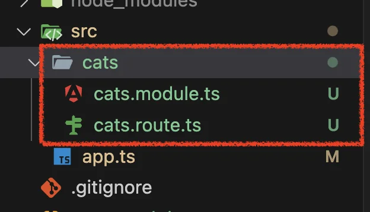
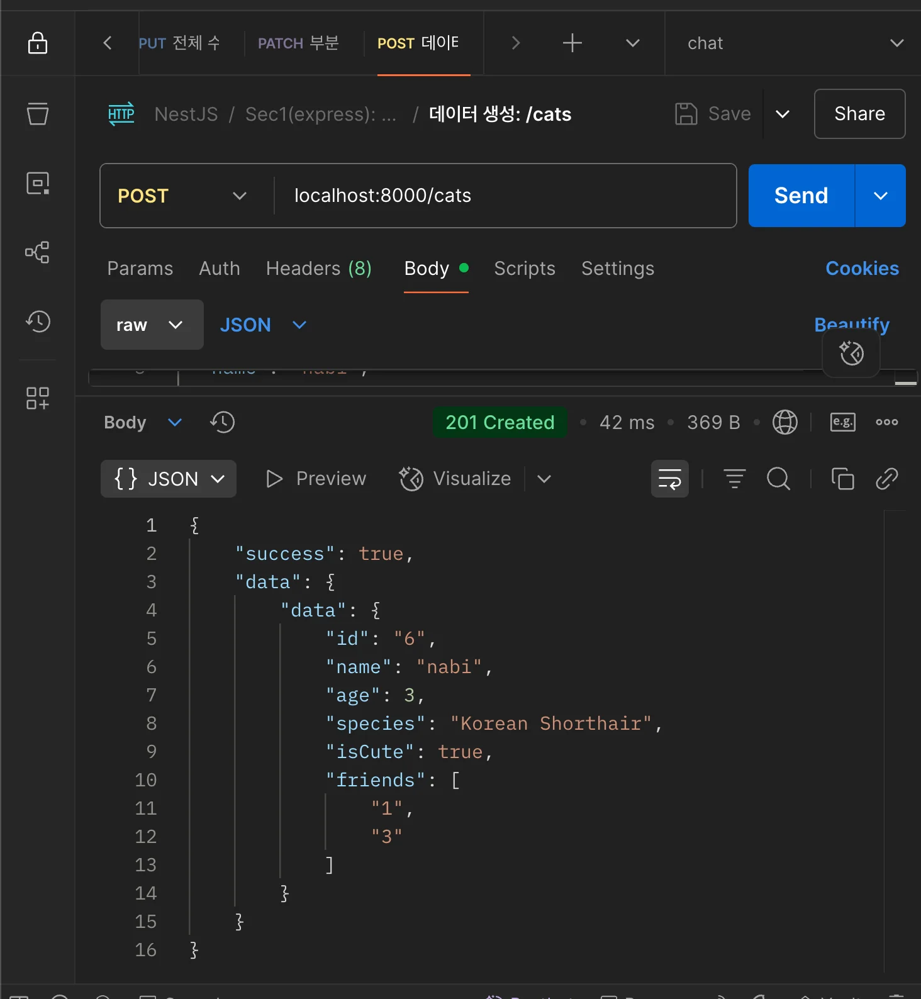
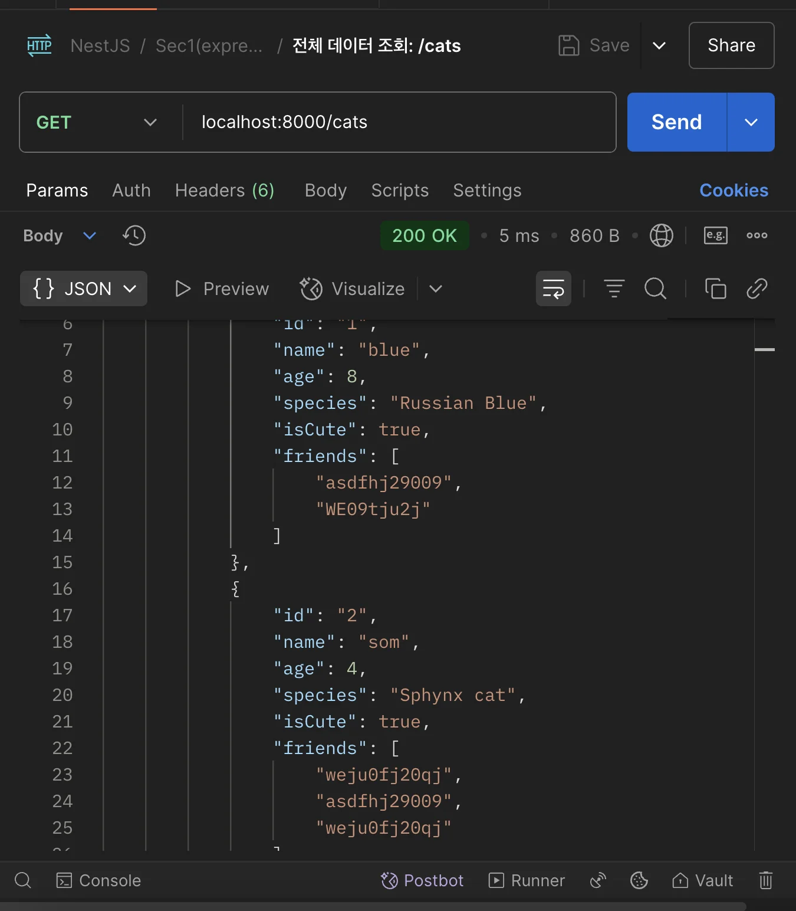
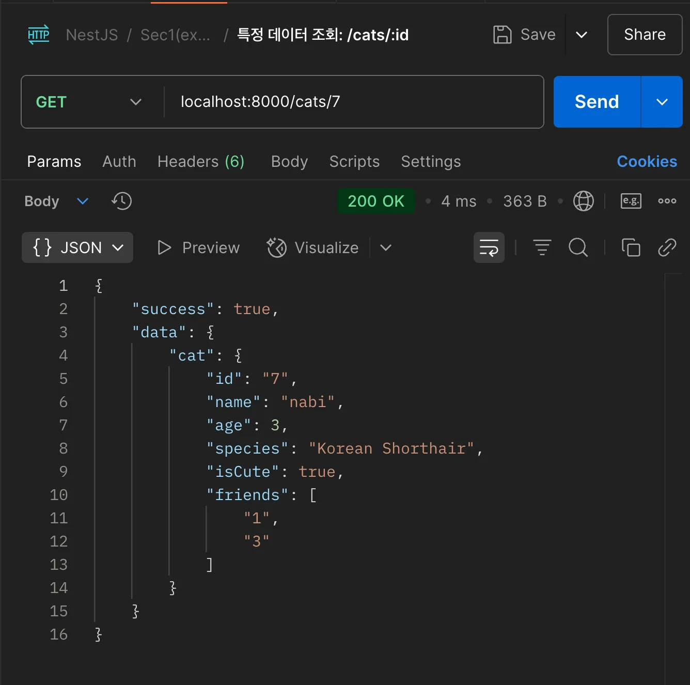
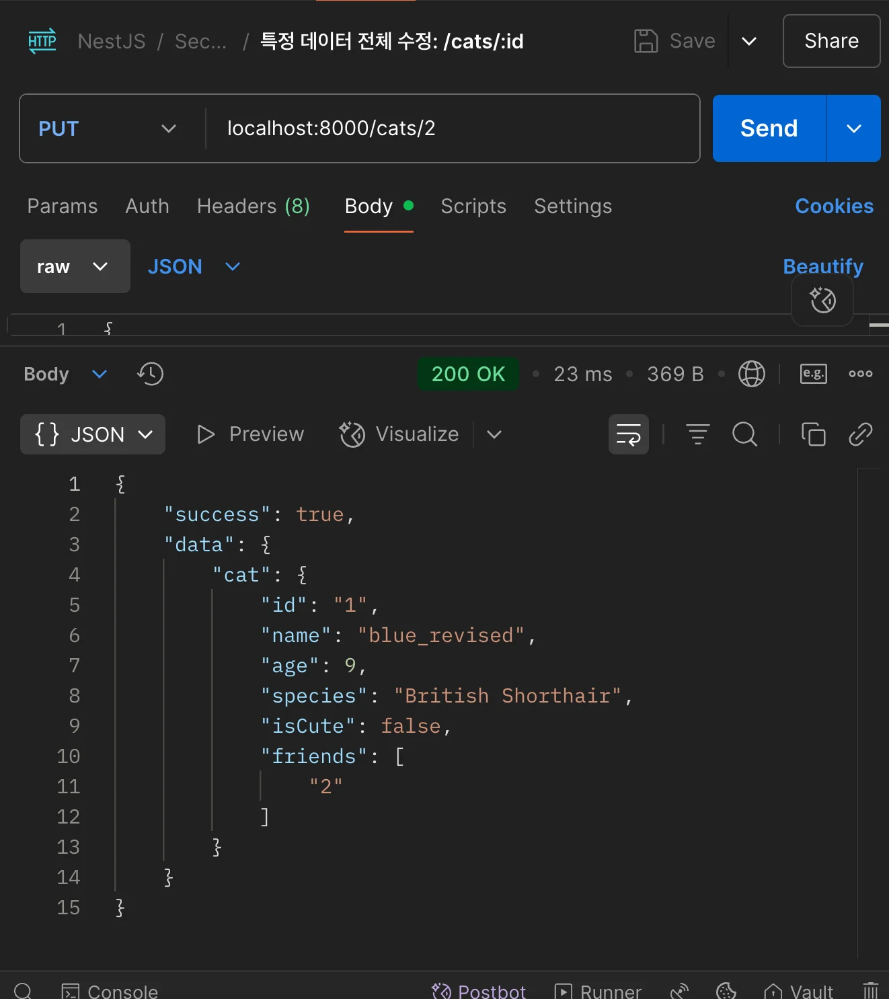
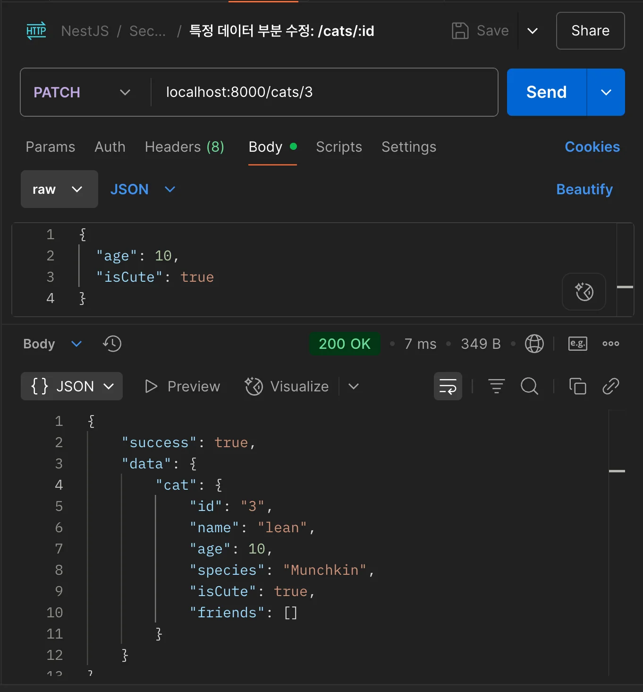
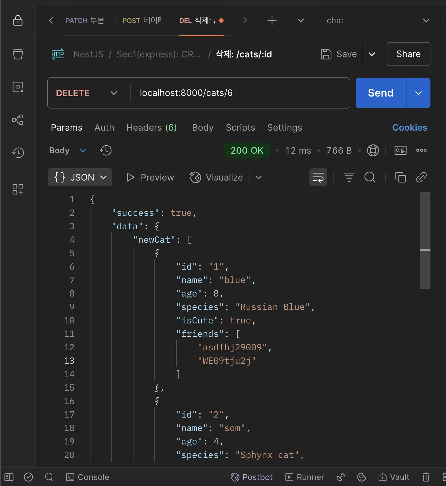

> 
> 
> <a id="229eda9b0fe18033ae8de0965feb7b15"></a>
> 
> <strong>목차</strong>
> 
> - [모듈 분리 및 CRUD API 구현](#229eda9b0fe18050b44dea88161a844f)
> - [1. 모듈 분리 및 CRUD API 구현](#229eda9b0fe180b0816fd653e7bb3abb)
> - [코드](#229eda9b0fe180acb682ca18552f5b66)
> - [2. 포스트맨 테스트](#229eda9b0fe180308bd6fa719a556c82)
> - [요청](#229eda9b0fe18044bc22ea3b62958f58)
> - [응답](#229eda9b0fe18050ab4ff643e32523d4)
> - [요청](#229eda9b0fe1807db893e0c674e2e20e)
> - [응답](#229eda9b0fe180318a06d7d1c4286878)
> - [요청](#229eda9b0fe18022b226ce8decd8ff28)
> - [응답](#229eda9b0fe180e4b312ebbc760a17ce)
> - [요청](#229eda9b0fe180578947ed9f3341fdd4)
> - [응답](#229eda9b0fe180249975f252c641cdf0)
> - [요청](#229eda9b0fe1807f9abcf4cd39f81d92)
> - [응답](#229eda9b0fe1801388f3cd4c1f330258)
> - [요청](#229eda9b0fe180738c94d60f1fcaa0a5)
> - [응답](#229eda9b0fe1809dbfc0e3540e48009c)

<a id="229eda9b0fe18050b44dea88161a844f"></a>

## 모듈 분리 및 CRUD API 구현

---

<a id="229eda9b0fe180b0816fd653e7bb3abb"></a>

### 1&#46; 모듈 분리 및 CRUD API 구현



<a id="229eda9b0fe180acb682ca18552f5b66"></a>

### 코드

<details>
<summary>🧐 undefined 타입 할당</summary>

<a id="229eda9b0fe180cf8780d6ccb548cb24"></a>

<a href="#/post/229eda9b-0fe1-803a-90fb-e2e6696953a8">페이지</a> 

</details>

<details>
<summary>&#91; 코드 &#93; app&#46;ts &#45; 모듈 import</summary>

<a id="229eda9b0fe18013ae38db58f66ee0f6"></a>

```typescript
import express from "express";
import catRouter from "./cats/cats.route.js";

const app: express.Application = express();

app.use((req, res, next) => {
  console.log(req.rawHeaders[1]);
  console.log("this is middleware");
  next();
});

/**  
 * json 미들웨어 설정
    해당 설정은 클라이언트가 보낸 JSON 형식의 요청 본문을
    자동으로 파싱하여 req.body에 저장한다.
*/
app.use(express.json());

// 라우터 등록
app.use(catRouter);

// 404 에러 핸들링
app.use((req, res, next) => {
  console.log("this is error middleware");
  res.send({ error: "404 not found error" });
});

app.listen(8000, () => {
  console.log("server is on...");
});
```

</details>

<details>
<summary>&#91; 코드 &#93; cats&#46;route&#46;ts &#45; CRUD API 구현</summary>

<a id="229eda9b0fe180e08405d8c71a0d7cdb"></a>

```typescript
import { Cat, CatType } from "./cats.module.js";
import { Router } from "express";

const router = Router();

//* [POST] 고양이 데이터 생성
router.post("/cats", (req, res) => {
  try {
    const data = req.body;
    Cat.push(data); // create
    res.status(201).send({
      success: true,
      data: { data },
    });
  } catch (error: any) {
    res.status(400).send({
      success: false,
      error: error.message,
    });
  }
});

//* [GET] 고양이 전체 데이터 조회
router.get("/cats", (req, res) => {
  try {
    const cats: CatType[] = Cat;
    // throw new Error('db connect error');

    res.status(200).send({
      success: true,
      data: {
        cats,
      },
    });
  } catch (error: any) {
    res.status(400).send({
      success: false,
      error: error.message,
    });
  }
});

//* [GET] 특정 고양이 데이터 조회
router.get("/cats/:id", (req, res) => {
  try {
    const params = req.params;
    // console.log( params);
    const cat: CatType | undefined = Cat.find((cat) => {
      return cat.id === params.id;
    });

    res.status(200).send({
      success: true,
      data: {
        cat,
      },
    });
  } catch (error: any) {
    res.status(400).send({
      success: false,
      error: error.message,
    });
  }
});

//* [PUT] 특정 고양이 데이터 수정
router.put("/cats/:id", (req, res) => {
  try {
    const params = req.params;
    const body = req.body;
    let result;

    const index = Cat.findIndex((cat) => cat.id === params.id);
    if (index !== -1) {
      Cat[index] = body;
      result = Cat[index]; // update
    }

    res.status(200).send({
      success: true,
      data: { cat: result },
    });
  } catch (error: any) {
    res.status(400).send({
      success: false,
      error: error.message,
    });
  }
});

//* [PATCH] 특정 고양이 데이터 부분 수정
router.patch("/cats/:id", (req, res) => {
  try {
    const params = req.params;
    const body = req.body;
    let result;

    Cat.forEach((cat) => {
      if (cat.id === params.id) {
        cat = { ...cat, ...body }; // update
        result = cat;
      }
    });

    res.status(200).send({
      success: true,
      data: { cat: result },
    });
  } catch (error: any) {
    res.status(400).send({
      success: false,
      error: error.message,
    });
  }
});

//* [DELETE] 특정 고양이 데이터 삭제
router.delete("/cats/:id", (req, res) => {
  try {
    const params = req.params;
    const newCat = Cat.filter((cat) => cat.id !== params.id); // delete
    res.status(200).send({
      success: true,
      data: {
        newCat,
      },
    });
  } catch (error: any) {
    res.status(400).send({
      success: false,
      error: error.message,
    });
  }
});

export default router;

```

</details>

<details>
<summary>&#91; 코드 &#93; cats&#46;module&#46;ts</summary>

<a id="229eda9b0fe180d09b19f72908302d1c"></a>

```typescript
export type CatType = {
  id: string;
  name: string;
  age: number;
  species: string;
  isCute: boolean;
  friends: string[];
};

export const Cat: CatType[] = [
  {
    id: "1",
    name: "blue",
    age: 8,
    species: "Russian Blue",
    isCute: true,
    friends: ["asdfhj29009", "WE09tju2j"],
  },
  {
    id: "2",
    name: "som",
    age: 4,
    species: "Sphynx cat",
    isCute: true,
    friends: ["weju0fj20qj", "asdfhj29009", "weju0fj20qj"],
  },
  {
    id: "3",
    name: "lean",
    age: 6,
    species: "Munchkin",
    isCute: false,
    friends: [],
  },
  {
    id: "4",
    name: "star",
    age: 10,
    species: "Scottish Fold",
    isCute: true,
    friends: ["weju0fj20qj"],
  },
  {
    id: "5",
    name: "red",
    age: 2,
    species: "Sharm",
    isCute: false,
    friends: [],
  },
];

```

</details>

<a id="229eda9b0fe18082a7d0e4f79e3766bd"></a>

<br>

<a id="229eda9b0fe180308bd6fa719a556c82"></a>

### 2&#46; 포스트맨 테스트

<details>
<summary>1&#46; 데이터 생성 &#91; POST &#93;</summary>

<a id="229eda9b0fe18044bc22ea3b62958f58"></a>

### 요청

- HTTP METHOD&#58; <code>POST</code>

- 엔드포인트&#58; <code>localhost&#58;8000/cats</code>

<details>
<summary>요청 body</summary>

<a id="229eda9b0fe180b1b627f55aea7e37f5"></a>

```json
{
  "id": "6",
  "name": "nabi",
  "age": 3,
  "species": "Korean Shorthair",
  "isCute": true,
  "friends": ["1", "3"]
}
```

</details>

<a id="229eda9b0fe18050ab4ff643e32523d4"></a>

### 응답

- 포스트맨
    

    <details>
    <summary>응답 body</summary>

    <a id="229eda9b0fe18083a2d1f43318d2fff6"></a>

    ```json
    {
        "success": true,
        "data": {
            "data": {
                "id": "6",
                "name": "nabi",
                "age": 3,
                "species": "Korean Shorthair",
                "isCute": true,
                "friends": [
                    "1",
                    "3"
                ]
            }
        }
    }
    ```

    </details>

</details>

<details>
<summary>2&#46; 전체 데이터 조회 &#91; GET &#93;</summary>

<a id="229eda9b0fe1807db893e0c674e2e20e"></a>

### 요청

- HTTP METHOD&#58; <code>GET</code>

- 엔드포인트&#58; <code>localhost&#58;8000/cats</code>

- 요청 body&#58; ❌

<a id="229eda9b0fe180318a06d7d1c4286878"></a>

### 응답

- 포스트맨 호출 
    

    <details>
    <summary>응답 body</summary>

    <a id="229eda9b0fe1804abe91eae118ade638"></a>

    ```json
    {
        "success": true,
        "data": {
            "cats": [
                {
                    "id": "1",
                    "name": "blue",
                    "age": 8,
                    "species": "Russian Blue",
                    "isCute": true,
                    "friends": [
                        "asdfhj29009",
                        "WE09tju2j"
                    ]
                },
                {
                    "id": "2",
                    "name": "som",
                    "age": 4,
                    "species": "Sphynx cat",
                    "isCute": true,
                    "friends": [
                        "weju0fj20qj",
                        "asdfhj29009",
                        "weju0fj20qj"
                    ]
                },
                {
                    "id": "3",
                    "name": "lean",
                    "age": 6,
                    "species": "Munchkin",
                    "isCute": false,
                    "friends": []
                },
                {
                    "id": "4",
                    "name": "star",
                    "age": 10,
                    "species": "Scottish Fold",
                    "isCute": true,
                    "friends": [
                        "weju0fj20qj"
                    ]
                },
                {
                    "id": "5",
                    "name": "red",
                    "age": 2,
                    "species": "Sharm",
                    "isCute": false,
                    "friends": []
                },
                {
                    "id": "7",
                    "name": "nabi",
                    "age": 3,
                    "species": "Korean Shorthair",
                    "isCute": true,
                    "friends": [
                        "1",
                        "3"
                    ]
                }
            ]
        }
    }
    ```

    </details>

</details>

<details>
<summary>3&#46; 특정 데이터 조회 &#91; GET &#93;</summary>

<a id="229eda9b0fe18022b226ce8decd8ff28"></a>

### 요청

- HTTP METHOD&#58; <code>GET</code>

- 엔드포인트&#58; <code>localhost&#58;8000/cats/&#58;id</code>

- 요청 body&#58; ❌

<a id="229eda9b0fe180e4b312ebbc760a17ce"></a>

### 응답

- 포스트맨 호출 
    

    <details>
    <summary>응답 body</summary>

    <a id="229eda9b0fe1807a9870cf287db5c388"></a>

    ```json
    {
        "success": true,
        "data": {
            "cats": [
                {
                    "id": "1",
                    "name": "blue",
                    "age": 8,
                    "species": "Russian Blue",
                    "isCute": true,
                    "friends": [
                        "asdfhj29009",
                        "WE09tju2j"
                    ]
                },
                {
                    "id": "2",
                    "name": "som",
                    "age": 4,
                    "species": "Sphynx cat",
                    "isCute": true,
                    "friends": [
                        "weju0fj20qj",
                        "asdfhj29009",
                        "weju0fj20qj"
                    ]
                },
                {
                    "id": "3",
                    "name": "lean",
                    "age": 6,
                    "species": "Munchkin",
                    "isCute": false,
                    "friends": []
                },
                {
                    "id": "4",
                    "name": "star",
                    "age": 10,
                    "species": "Scottish Fold",
                    "isCute": true,
                    "friends": [
                        "weju0fj20qj"
                    ]
                },
                {
                    "id": "5",
                    "name": "red",
                    "age": 2,
                    "species": "Sharm",
                    "isCute": false,
                    "friends": []
                },
                {
                    "id": "7",
                    "name": "nabi",
                    "age": 3,
                    "species": "Korean Shorthair",
                    "isCute": true,
                    "friends": [
                        "1",
                        "3"
                    ]
                }
            ]
        }
    }
    ```

    </details>

</details>

<details>
<summary>4&#46; 특정 데이터 전체 수정 &#91; PUT &#93;</summary>

<a id="229eda9b0fe180578947ed9f3341fdd4"></a>

### 요청

- HTTP METHOD&#58; <code>PUT</code>

- 엔드포인트&#58; <code>localhost&#58;8000/cats/&#58;id</code>

<details>
<summary>요청 body</summary>

<a id="229eda9b0fe180b18c58f10ac1f0cd30"></a>

```json
{
  "id": "1",
  "name": "blue_revised",
  "age": 9,
  "species": "British Shorthair",
  "isCute": false,
  "friends": ["2"]
}
```

</details>

<a id="229eda9b0fe180249975f252c641cdf0"></a>

### 응답

- 포스트맨 호출 
    

    <details>
    <summary>응답 body</summary>

    <a id="229eda9b0fe180a1a99fc1fc5023882f"></a>

    ```json
    {
        "success": true,
        "data": {
            "cat": {
                "id": "1",
                "name": "blue_revised",
                "age": 9,
                "species": "British Shorthair",
                "isCute": false,
                "friends": [
                    "2"
                ]
            }
        }
    }
    ```

    </details>

</details>

<details>
<summary>5&#46; 특정 데이터 부분 수정 &#91; PATCH &#93;</summary>

<a id="229eda9b0fe1807f9abcf4cd39f81d92"></a>

### 요청

- HTTP METHOD&#58; <code>PATCH</code>

- 엔드포인트&#58; <code>localhost&#58;8000/cats/&#58;id</code>

<details>
<summary>요청 body</summary>

<a id="229eda9b0fe180639799f073dc2ea120"></a>

```json
{
  "age": 10,
  "isCute": true
}
```

</details>

<a id="229eda9b0fe1801388f3cd4c1f330258"></a>

### 응답

- 포스트맨 호출 
    

    <details>
    <summary>응답 body</summary>

    <a id="229eda9b0fe18023ac83fc0a85557996"></a>

    ```json
    {
        "success": true,
        "data": {
            "cat": {
                "id": "3",
                "name": "lean",
                "age": 10,
                "species": "Munchkin",
                "isCute": true,
                "friends": []
            }
        }
    }
    ```

    </details>

</details>

<details>
<summary>6&#46; 데이터 삭제 &#91; DELETE &#93;</summary>

<a id="229eda9b0fe180738c94d60f1fcaa0a5"></a>

### 요청

- HTTP METHOD&#58; <code>DELETE</code>

- 엔드포인트&#58; <code>localhost&#58;8000/cats/&#58;id</code>

- 요청 body&#58; ❌

<a id="229eda9b0fe1809dbfc0e3540e48009c"></a>

### 응답



<details>
<summary>응답 body</summary>

<a id="229eda9b0fe18041aad3f5bf69599bc8"></a>

```json
{
    "success": true,
    "data": {
        "newCat": [
            {
                "id": "1",
                "name": "blue",
                "age": 8,
                "species": "Russian Blue",
                "isCute": true,
                "friends": [
                    "asdfhj29009",
                    "WE09tju2j"
                ]
            },
            {
                "id": "2",
                "name": "som",
                "age": 4,
                "species": "Sphynx cat",
                "isCute": true,
                "friends": [
                    "weju0fj20qj",
                    "asdfhj29009",
                    "weju0fj20qj"
                ]
            },
            {
                "id": "3",
                "name": "lean",
                "age": 6,
                "species": "Munchkin",
                "isCute": false,
                "friends": []
            },
            {
                "id": "4",
                "name": "star",
                "age": 10,
                "species": "Scottish Fold",
                "isCute": true,
                "friends": [
                    "weju0fj20qj"
                ]
            },
            {
                "id": "5",
                "name": "red",
                "age": 2,
                "species": "Sharm",
                "isCute": false,
                "friends": []
            }
        ]
    }
}
```

</details>

</details>
