> 
> 
> <a id="229eda9b0fe18094a0f6c0d607bbe033"></a>
> 
> <strong>목차</strong>
> 
> - [1. Clusters 생성](#229eda9b0fe180bc91dfd21e04dca606)
> - [2. Network Access 허용](#229eda9b0fe180b3958bdb570dd39ac3)
> - [3. Database Access 허용](#229eda9b0fe180918e4cc85b025b6d8e)
> - [4. DB 연결](#229eda9b0fe180688d32dabdd5cd4588)

[MongoDB Atlas&#58; Cloud Document Database]()

<a id="229eda9b0fe180bc91dfd21e04dca606"></a>

### 1&#46; Clusters 생성

> ✏️ 
> 
> <a id="229eda9b0fe180aea3f4ed5386beaf8d"></a>
> 
> 처음 회원가입 시, Free 요금제 사용 가능하다&#46; ( 이후 안됨 )

- 옵션 선택 후 클러스터 생성 &#45; AWS로 진행
    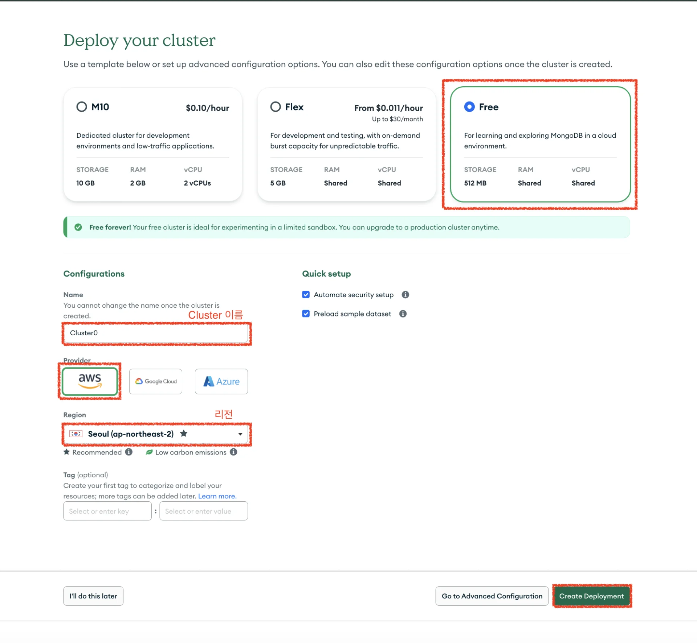

- 생성 확인
    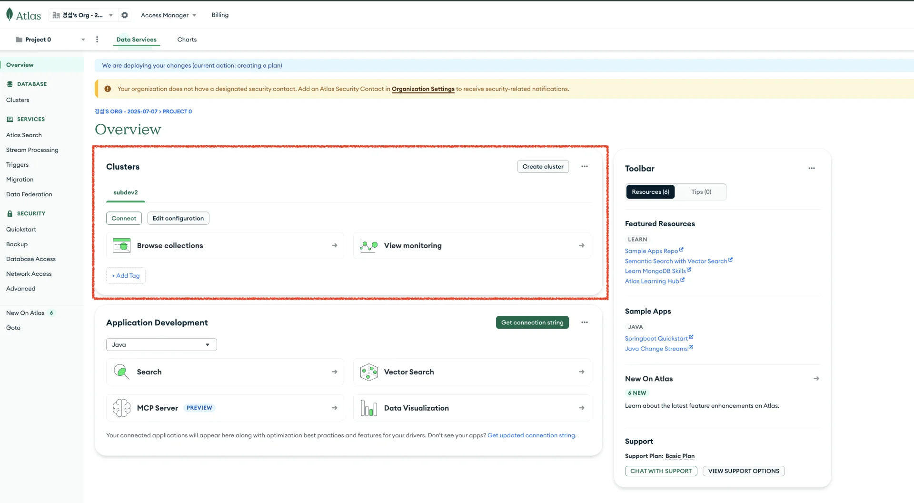

<a id="229eda9b0fe180b3958bdb570dd39ac3"></a>

### 2&#46; Network Access 허용

> 
> 
> <a id="229eda9b0fe1802fac60e284928b1767"></a>
> 
> mongoDB에 접근 가능하도록 인바운드 규칙(<code>IP 주소</code>)을 추가한다&#46; 
> 
> - 실습&#58; 로컬 컴퓨터 IP 주소
> 
> - 베포&#58; 베포 서버 IP 주소

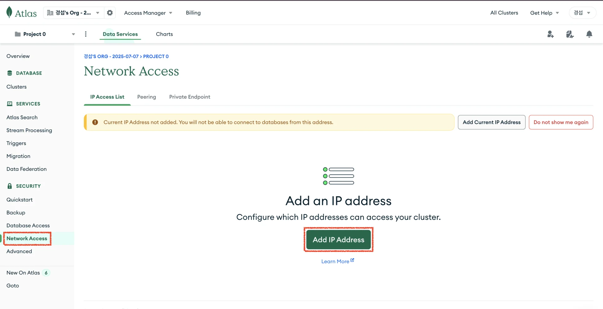

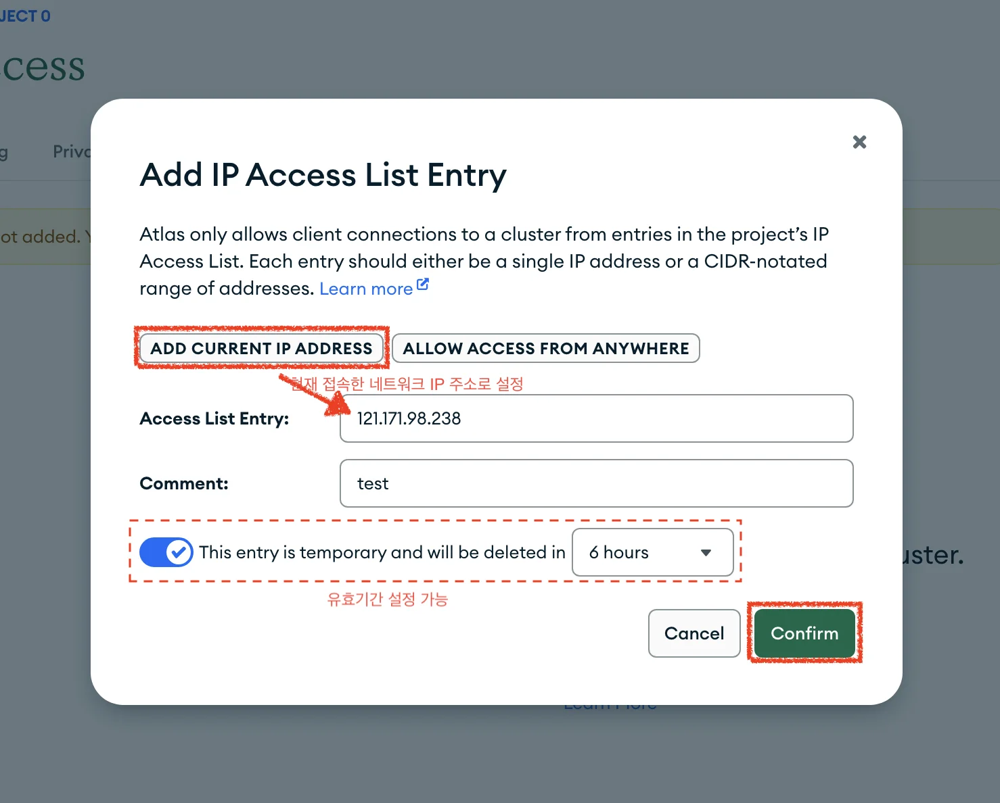

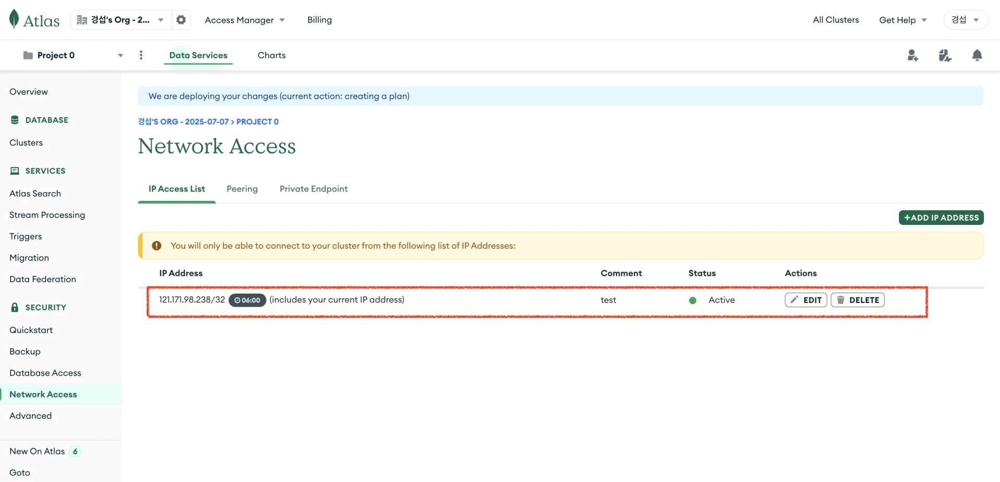

<a id="229eda9b0fe180918e4cc85b025b6d8e"></a>

### 3&#46; Database Access 허용

- 왼쪽 메뉴 &#45; Database Access &#45; Add new Database User
    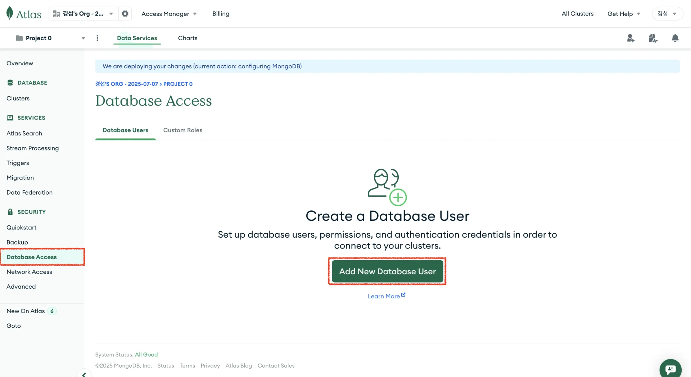

- Database 유저 생성
    > 
    > 
    > - Authentication Method&#58;  <code>Password</code>
    > 
    > - username&#58; 입력 필요
    > 
    > - password&#58; 자동 생성
    >     - 처음 생성 시에만 확인 가능, 따라서 보관 필요
    > 
    > - Built&#45;in Role&#58; <code>Read and Write to any database</code>
    >     - 상황에 따라 보안 scope 설정
    > 
    > - Temporary User&#58; 인증 정보 유효기간 설정

    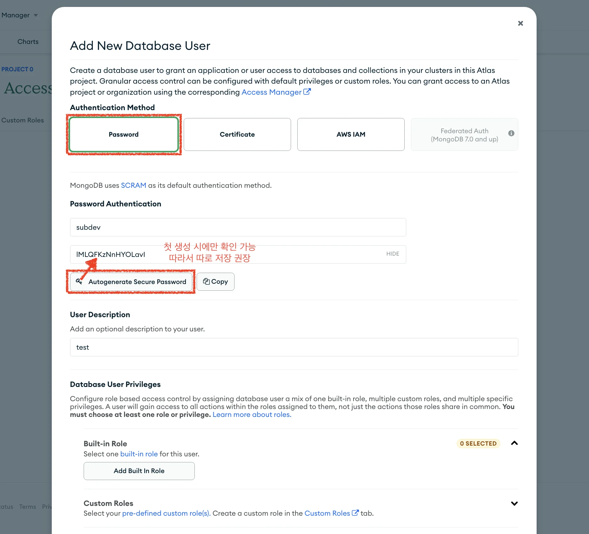

    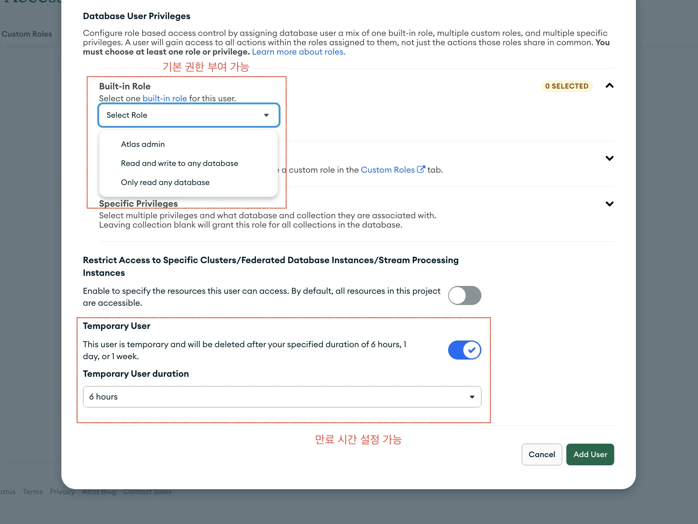

- Access 유저 생성 확인
    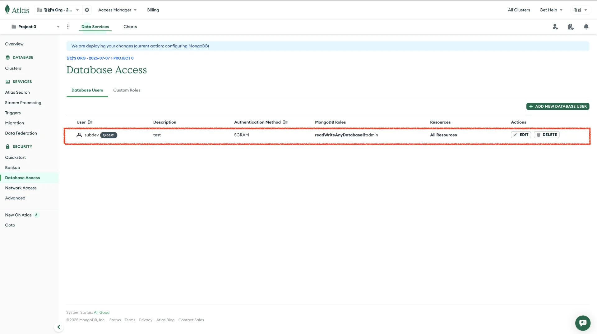

<a id="229eda9b0fe180688d32dabdd5cd4588"></a>

### 4&#46; DB 연결

- 왼쪽 메뉴 &#45; Cluster &#45; Connect 클릭
    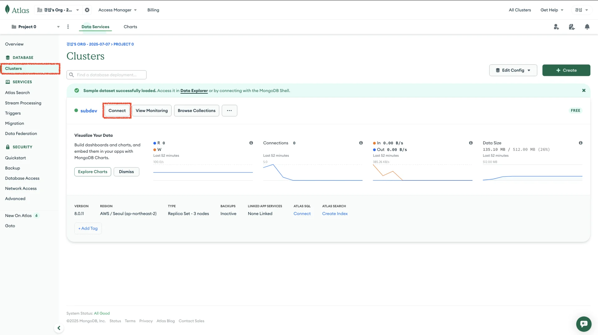

- 연결 유형 선택
    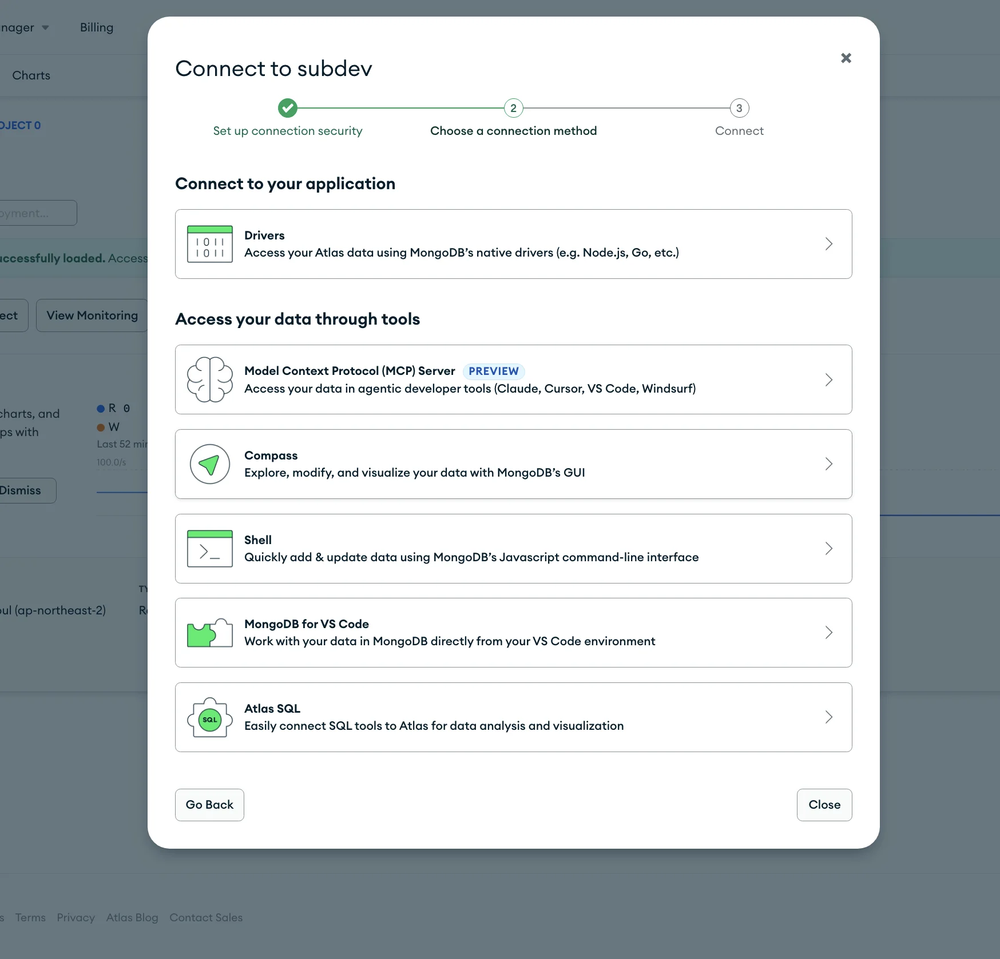

    - Shell 로 진행

- mongsh 로 DB 연결
    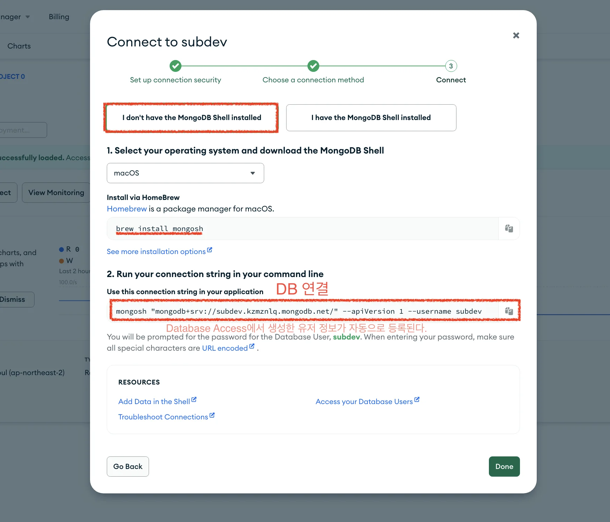

    <a id="229eda9b0fe180e48664ff011090e658"></a>

    ```bash
    # mongosh 설치
    brew install mongosh

    # mongosh 연결
    mongosh "mongodb+srv://subdev.kzmznlq.mongodb.net/" --apiVersion 1 --username subdev
     # 비밀번호 입력: 09uVKqfRQBenQPry
    ```

    <details>
    <summary>비밀번호 새로 발급</summary>

    > ✏️ 비밀번호가 기억나지 않는 경우, 새로 발급 가능하다&#46; 

    - Database Access &#45; 유저 대시보드 &#45; Edit 클릭
        

    - 비밀번호 새로 설정
        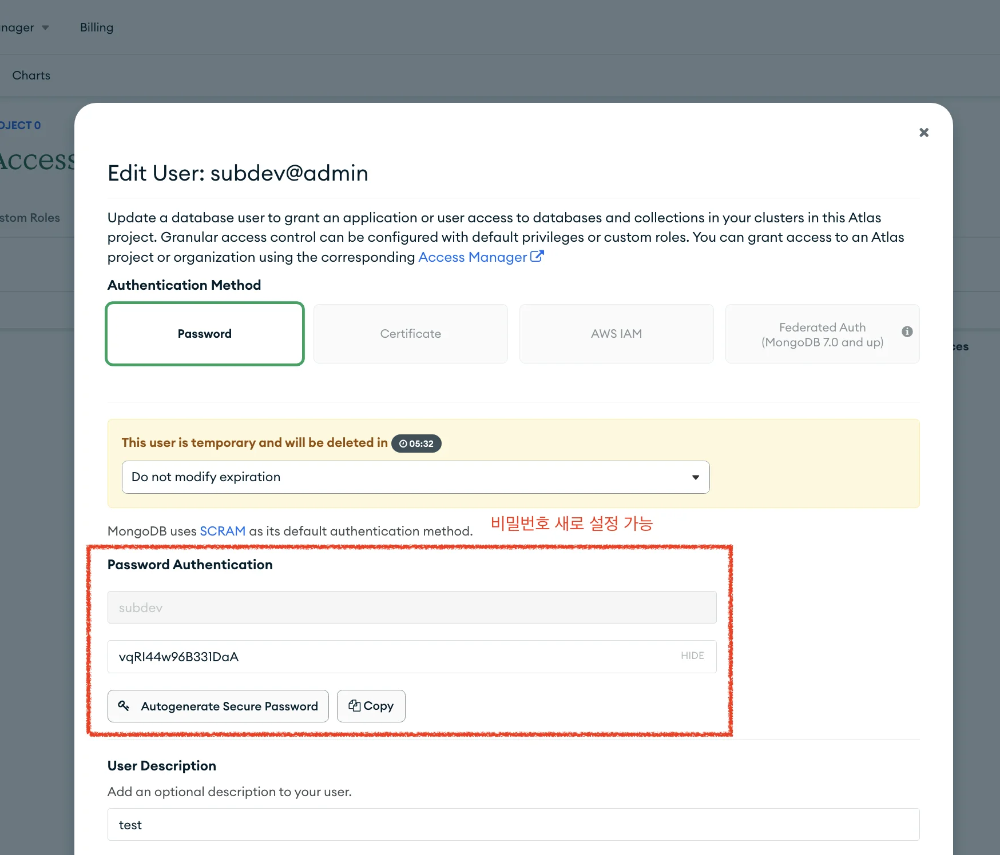

        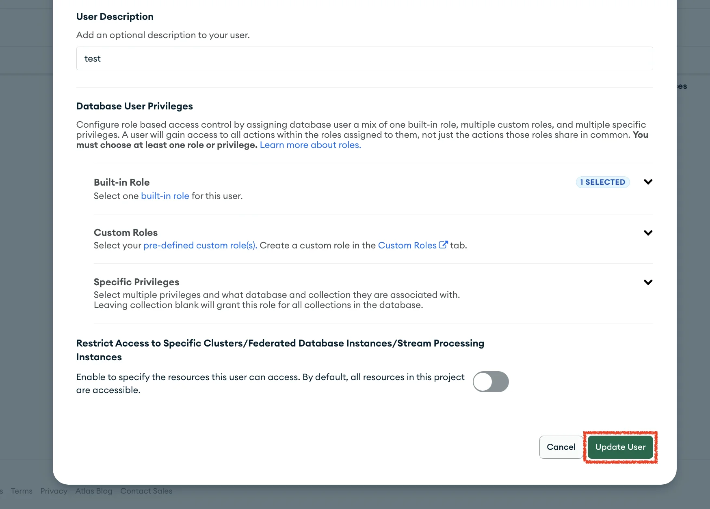

        - <code>update User</code>를 통해 수정해야 적용된다&#46;

    </details>

- 정상 연결 확인
    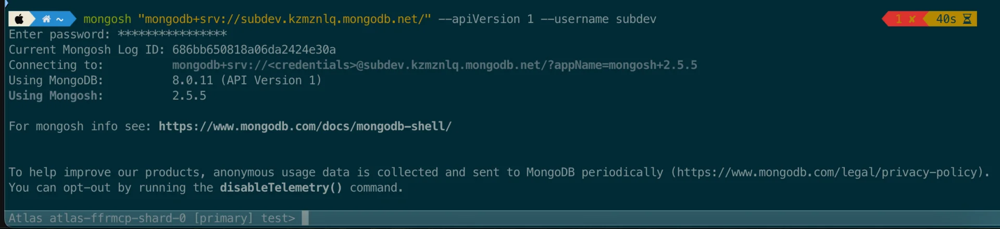
