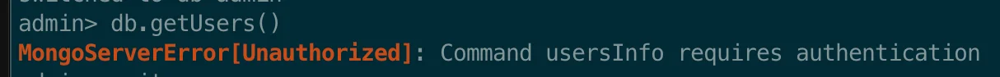
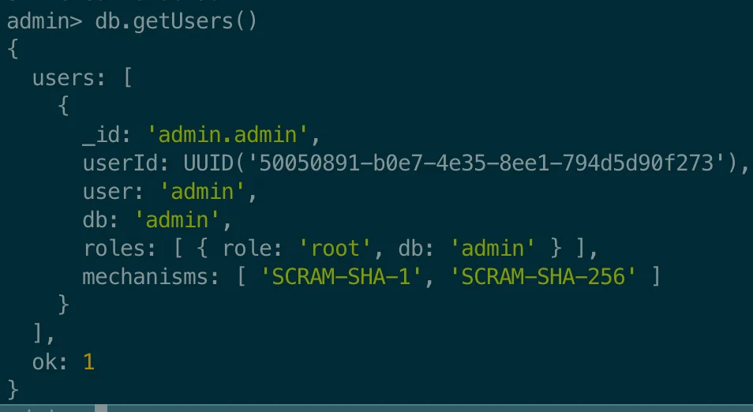

<details>
<summary>admin으로 접속하여 유저 조회</summary>

<details>
<summary>🤬 일반 접속 후, 유저 조회 시 인증 권한 필요</summary>

<a id="229eda9b0fe180ea9898f599739d9b17"></a>

```bash
docker exec -it mongo mongosh
```



</details>

<a id="229eda9b0fe180fca1fcd744b61aa14a"></a>

```bash
# admin 권한으로 접속
docker exec -it mongo mongosh -u admin -p admin123 --authenticationDatabase admin

# db checkout
use admin

# user 조회
db.getUsers()
```



</details>

<details>
<summary><code>help</code></summary>

<a id="229eda9b0fe18022b93ceeb04c87991f"></a>

```bash
help
```

-  사용 가능한 명령어 및 도움말 옵션 목록을 제공

</details>

<a id="229eda9b0fe1807bb93fcfbe89372220"></a>

### 1&#46; 데이터베이스

<details>
<summary>&#91;C&#93; 데이터베이스 생성 또는 전환</summary>

<a id="229eda9b0fe180cc8c62fed6cd5a4d58"></a>

```bash
use {myNewDatabase}
```

- 새 데이터베이스를 만들거나 기존 데이터베이스로 전환

</details>

<details>
<summary>&#91;R&#93; 전체 데이터베이스 조회</summary>

<a id="229eda9b0fe1804f83fbe37da24f7de4"></a>

```bash
show dbs
```

-  서버의 모든 데이터베이스 목록 조회

</details>

<details>
<summary>&#91;R&#93;현재 선택된 DB 조회</summary>

<a id="229eda9b0fe1806a82d9ecd50b662dc3"></a>

```bash
db
```

- 현재 선택된 DB 조회

</details>

<details>
<summary>&#91;D&#93;데이터베이스 삭제</summary>

<a id="229eda9b0fe180eeb0dbd569651ac463"></a>

```bash
db.dropDatabase()
```

- 현재 선택된 DB를 삭제한다&#46;

</details>

<a id="229eda9b0fe1803ea2a7f6f446857e1f"></a>

### 2&#46; 컬렉션

<details>
<summary>&#91;C&#93; 컬렉션 생성</summary>


</details>

<details>
<summary>&#91;D&#93; 컬렉션 삭제</summary>

<a id="229eda9b0fe18001977ee3df5a09b9f4"></a>

```bash
db.myCollection.drop()
```

- <code>drop()</code> 메서드를 사용하여 특정 컬렉션을 제거할 수 있따&#46;

</details>

<a id="229eda9b0fe18036a995c1e35615c1ed"></a>

### 2&#46; 문서

> <strong>생성 ( Create )</strong>

> ✏️ 
> 
> <a id="229eda9b0fe1805fb54aec4782168e25"></a>
> 
> 컬렉션에 문서를 삽입하려면 <code>insertOne()</code> 또는 <code>insertMany()</code> 메서드를 사용한다&#46;

<details>
<summary>2&#46;1&#46; 단일 문서 삽입(생성)</summary>

<a id="229eda9b0fe180c883a3fee784c4e312"></a>

```bash
db.myCollection.insertOne({ 
	  name: "John Doe", 
	  age: 30, 
	  email:"john.doe@example.com" 
})
```

</details>

<details>
<summary>2&#46;2&#46; 여러 문서 삽입</summary>

<a id="229eda9b0fe18090a5cfd40429f9d1cc"></a>

```bash
db.myCollection.insertMany([
		{ name: "Jane Doe", age: 28 },
		{ name: "Peter Jones", age: 35 }
])
```

</details>

> <strong>읽기 ( Read ) </strong>

> ✏️ 
> 
> <a id="229eda9b0fe1804faab4da23185db5e7"></a>
> 
> <code>find()</code> 메서드는 컬렉션에서 문서를 검색하는데 사용된다&#46;

<details>
<summary>2&#46;3&#46; 컬렉션의 모든 문서 조회</summary>

<a id="229eda9b0fe180ce9359c8527260fb28"></a>

```bash
db.{myCollection}.find()
```

</details>

<details>
<summary>2&#46;4&#46; 특정 필터와 일치하는 문서 조회</summary>

<a id="229eda9b0fe180b7af2ef0d0f216cd39"></a>

```bash
db.{myCollection}.find({ name: "John Doe" })
```

</details>

> <strong>수정 ( Update )</strong>

> ✏️ 
> 
> <a id="229eda9b0fe18098b547f409a1b669fc"></a>
> 
> 기존 문서를 수정하려면 <code>updateOne()</code> 또는 <code>updateMany()</code> 메서드를 사용한다&#46;

<details>
<summary>2&#46;5&#46; 단일 문서 수정</summary>

<a id="229eda9b0fe180b1845ddd662b6e4560"></a>

```bash
db.myCollection.updateOne(
		{ name: "John Doe" },
		{ $set: { age: 31 } }
)
```

</details>

<details>
<summary>2&#46;6&#46; 여러 문서 수정</summary>

<a id="229eda9b0fe1803fa930cec50c10d45c"></a>

```bash
db.myCollection.updateMany(
		{ age: { $lt: 30 } },
		{ $set: { status: "active" } }
)
```

</details>

> <strong>삭제 ( Delete )</strong>

> ✏️ 
> 
> <a id="229eda9b0fe180779991c849c4a6ba37"></a>
> 
> 컬렉션에서 문서를 제거하려면 <code>deleteOne()</code> 또는 <code>deleteMany()</code> 메서드

<details>
<summary>2&#46;7&#46; 단일 문서 삭제</summary>

<a id="229eda9b0fe1802bb0ccf4bcfc0596e6"></a>

```bash
db.myCollection.deleteOne({ name: "John Doe" })
```

</details>

<details>
<summary>2&#46;8&#46; 단일 문서 삭제</summary>

<a id="229eda9b0fe1803f9e4ef6cca0268023"></a>

```bash
db.myCollection.deleteMany({});
```

</details>
