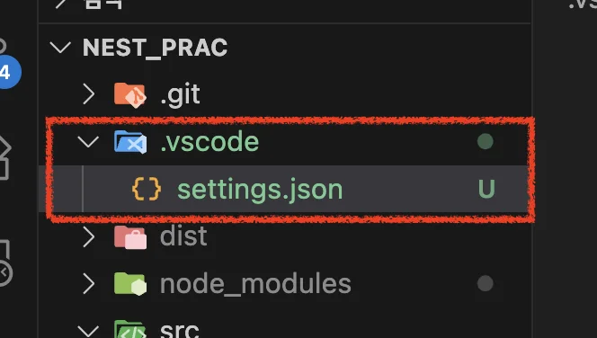
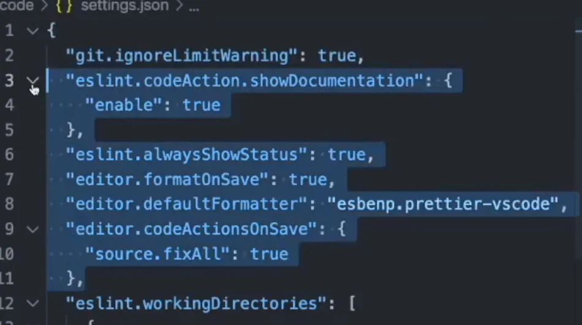

> 
> 
> <a id="22aeda9b0fe181b68807e1af3f3fe861"></a>
> 
> <strong>목차</strong>
> 
> - [1. Server Action](#22aeda9b0fe18144b7e8e859d5bae8ef)

[Rules Reference &#45; ESLint &#45; Pluggable JavaScript Linter]()

<a id="22aeda9b0fe18144b7e8e859d5bae8ef"></a>

## 1&#46; Server Action

---

> 📖 
> 
> <a id="22aeda9b0fe180ffbb06f3bb9d87b523"></a>
> 
> VS

> ✏️ 
> 
> <a id="22aeda9b0fe18076b87dc248bcae936e"></a>
> 
> ESLint 플러그인을 설치한 후에도 정상 동작하지 않는다면 <br>아래와 같이 <code>&#46;vscode/settings&#46;json</code> 생성 후, 설정 정의가 필요하다&#46;





<details>
<summary>설정 정보</summary>

<a id="22aeda9b0fe180ecab32d561c7f91eee"></a>

```javascript
{
	"git.ignoreLimitWarning": true,
	"eslint.codeAction.showDocumentation": {
		"enable": true
	},
	"eslint.alwaysShowStatus": true,
	"editor.formatOnSave": true,
	"editor.defaultFormatter": "esbenp.prettier-vscode",
	"editor.codeActionsOnSave": {
		"source.fixAll": true
	},
	
...
```

</details>

<a id="22aeda9b0fe180fe911eedf87c59966c"></a>

실무에서 ESLint 사용이 필수이다&#46;

<a id="22aeda9b0fe18084add0fd7451c23200"></a>

어떤 코드 컨벤션을 따라야 될지 정의를 하는 것이기 때문에 

> ✏️ 
> 
> <a id="22aeda9b0fe18071b8ecf6db3f4bb9bc"></a>
> 
> 기업마다 코드 컨벤션이 있다&#46; 그에 맞게 prettier 설정을 해
